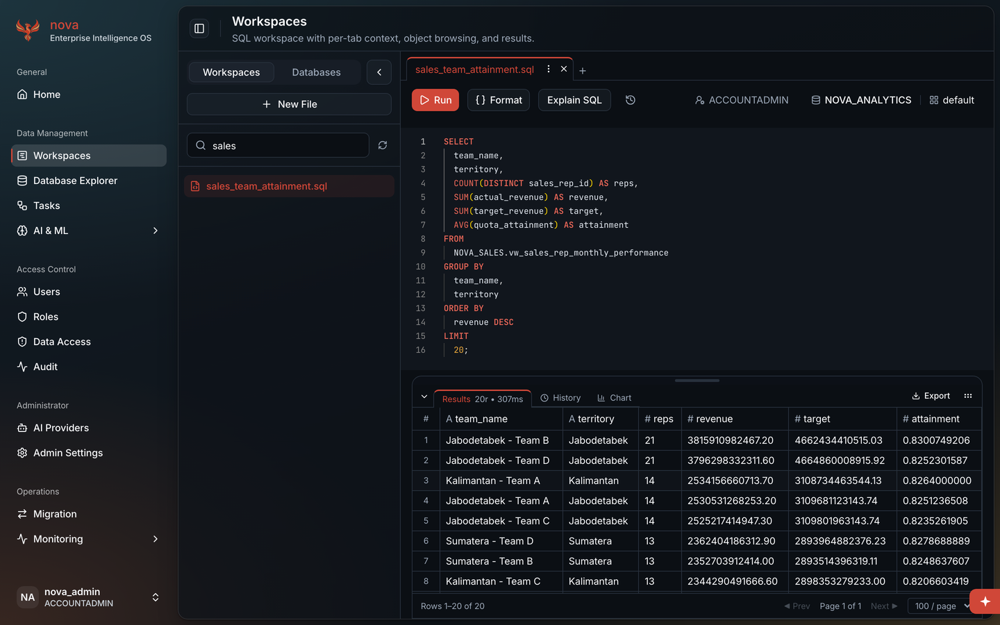
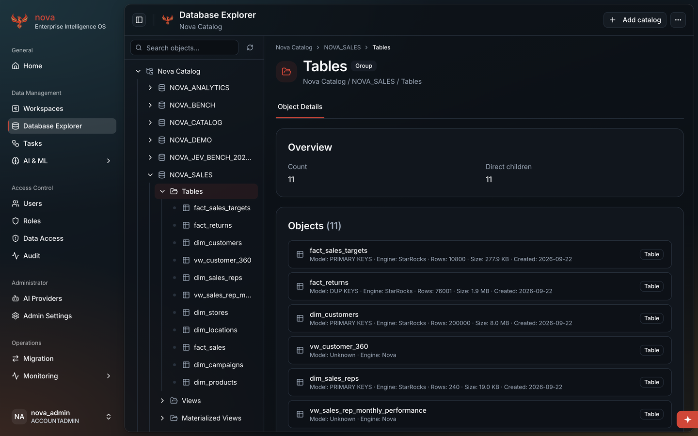
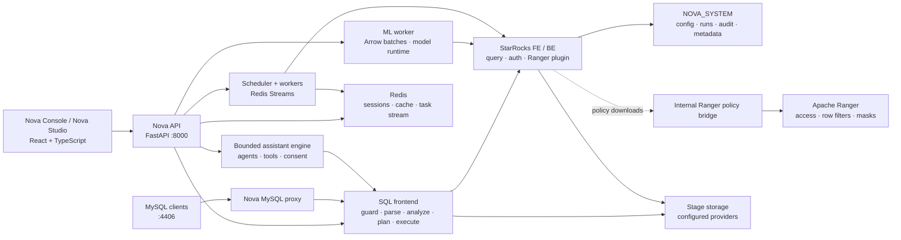
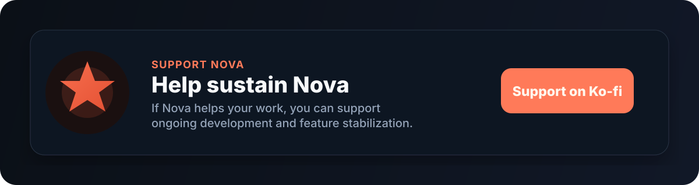

<div align="center">
  

# Nova

**Enterprise Intelligence OS**

Turn governed enterprise data into trusted answers and shared business meaning.

Nova unifies governed data, Semantic Views, a governed business ontology, AI agents,
and BI in one platform, under one identity and one authorization path.

[Supernova Ontology](#supernova-business-ontology) · [See the app](#the-nova-app) · [Architecture](#architecture) · [Run locally](#run-locally) · [Documentation](#documentation) · [Brand assets](frontend/public/images/BRAND.md)
</div>

## What Nova is

Nova is an Enterprise Intelligence OS where people and agents ask business
questions of governed data and get answers they can check. Every answer runs
through the same path: the caller's StarRocks identity and one active role,
Apache Ranger policies, published Semantic Views, and the business meaning the
Supernova Business Ontology records.

The warehouse, SQL, stages, and ML form its data foundation. StarRocks provides
Nova's analytical query and storage engine and authenticates users. Nova owns
SQL semantics and execution routing, business meaning, and the agent runtime.
Apache Ranger policies always govern user-data access through the patched
StarRocks frontend.

## How the pieces fit

```text
Governed data (StarRocks + Ranger)
      ↓
Semantic Views: metrics, dimensions, relationships, verified queries
      ↓
Supernova Business Ontology: concepts, names, bindings, releases
      ↓
Nova Studio agents · Superset BI · SQL clients
      ↓
Measured learning → steward proposals → new release
```

Semantic Views define how a metric is computed. The ontology records what the
business calls it and which view computes it. Studio grounds every metric
question on the published ontology before it plans a query. Learning never
edits meaning directly: it files proposals that a domain steward reviews.

## Nova Console and Nova Studio

| Surface | Role |
| --- | --- |
| **Nova Console** | The data and control foundation: SQL Workspace, catalog and Database Explorer, stages, ingestion/export, ML, tasks, security, Semantic Views, the Business Ontology page, and monitoring. |
| **Nova Studio** | The intelligence workspace: chat with one selected agent, inline tables and charts, artifacts and Superset dashboards, News with reviewed investigations, skills, and connectors. |

Both surfaces operate on the same governed enterprise foundation and authenticated
StarRocks identity with one active role. In Studio, each turn runs one selected
agent through the shared bounded assistant engine. Process traces, tables,
charts, and citations make every answer reviewable.
SQL clients also use Nova's SQL path through the MySQL protocol proxy on port `4406`.

## Core capabilities

### Data foundation

SQL development, catalog exploration, stages, data loading/export, scheduled
tasks, monitoring, and native ML remain core platform capabilities. ML supports
classification, regression, forecasting, anomaly detection, and clustering,
with versioned models and run metadata in `NOVA_SYSTEM`. SQL AI functions such
as `AI_COMPLETE` and `AI_SENTIMENT` require a configured provider and the
corresponding StarRocks functions.

The SQL Workspace uses Monaco and runs Nova SQL through a shared pipeline.
Stage references keep physical file locations and storage credentials out of
user queries:

```sql
SELECT order_id, total_amount
FROM @sales_stage.orders.2026.parquet
WHERE total_amount > 100;
```

Nova authorizes stage access, resolves `@stage` to StarRocks `FILES(...)`, detects
the format, resolves storage credentials for execution, and records a redacted
audit entry. The same pipeline guards, translates, and redacts user SQL across
the supported API, proxy, and ML paths. Nova-specific SQL belongs in the
Workspace, Query API, or Nova proxy; the native StarRocks port does not parse it.

### Semantic layer

Entity identities, versioned Semantic Views, metrics, relationships, and verified
queries define governed business meaning. Semantic validation compares candidate
definitions through the caller's StarRocks session before publication. AI Search
rechecks source rows under the caller's role; Feature Views provide versioned
features for ML.

### Studio and agents

Each Studio turn runs one selected agent through the shared bounded assistant
engine. Tools, personal skills, scoped memory, artifacts, and explicitly
selected MCP connectors support its work. Data tools keep the signed-in user's
active role; external tool calls keep per-call consent. `semantic_query`
answers metric questions from published Semantic Views, grounded on the
ontology (below). An agent's harness adds rules, in-loop guards, evaluation
cases, and measured refinement proposals.

### BI and charts

Answers render inline tables and charts. Saved charts and dashboards live in
Superset, embedded at `/bi` with the caller's identity, so BI queries follow the
same Ranger policies as everything else
([Superset architecture](docs/arch-17-superset.md)).

### News and investigations

Newsroom stories and monitor alerts on governed metrics become business signals,
bound to ontology concepts and grouped into incidents. A story can open a
Studio investigation that records evidence and findings for review.

### The Nova platform stack

This is a conceptual product view. These layers share existing runtime owners;
they do not represent separate physical services.

| Layer | Capabilities |
| --- | --- |
| Nova Studio and BI | Agent chat, artifacts, Superset dashboards, News investigations |
| Intelligence runtime | Agents, skills, tools, memory, harness |
| Business meaning | Supernova Business Ontology: concepts, names, bindings, releases, learning |
| Semantic layer | Semantic Views, metrics, relationships, verified queries |
| Data foundation | SQL, warehouse, catalog, stages, ML, StarRocks |
| Control plane across the stack | Security, Ranger, audit, `NOVA_SYSTEM`, Redis runtime coordination |

Nova Console exposes the data and control foundation across these layers.

## Supernova Business Ontology

The Supernova Business Ontology is Nova's shared, governed business meaning:
which business concepts exist, what people call them, how they relate, and
which published Semantic View metric computes each one. It never runs SQL and
never grants data access; Semantic Views, StarRocks, and Ranger stay the only
computation and authorization path. Code: `backend/app/modules/ontology/`.
Design: [architecture 18](docs/arch-18-business-ontology.md).

### What it holds

| Record | Meaning |
| --- | --- |
| Domain | An area of meaning (`Penjualan`, `Finance.Treasury`) with steward roles |
| Concept | One business concept: label, definition, aliases, unit, grain, time semantics |
| Relation | A typed link between concepts (`IS_A`, `HAS_PART`, `DERIVES`, `MEASURES`, ...); none asserts causation |
| Binding | A concept bound to one public metric of a published Semantic View version, pinned by fingerprint |
| Proposal | A set of changes and its steward reviews |
| Release | An immutable manifest of exact revisions; readers use the published one |

### How it works

1. **Nova derives a first draft from the views.** The compiler turns what each
   published Semantic View already proves into entities, dimensions, metrics,
   role relationships, and which metric is built from which, with a confidence
   for each item. Nobody types it in.
2. **Stewards govern meaning.** Every change to a concept, name, or binding is
   a proposal that a steward of its domain approves. An administrator publishes
   a release; readers always use exactly one published release.
3. **Studio grounds every metric question.** Before planning, `semantic_query`
   resolves the business words in the question against the release's names.
   - A grounded concept selects the view that computes it.
   - A word that names several concepts makes Studio ask which one is meant.
   - A period with no data is refused with the dates the data covers.
   - A filter value is checked against governed values first.
4. **Joins are learned from data.** Join discovery profiles columns as the
   caller, filters candidates with KMV sketches, and verifies them exactly.
   Calibrated evidence classes accept a join alone only at ≥ 0.97 measured
   precision, reject at ≤ 0.01, and leave the rest for review.
5. **It learns from measured failures and from Studio.** Four detectors file
   steward proposals; none edits meaning directly.
   - Names a claim audit found misleading.
   - Words a failed gold question used for its metric.
   - Metrics a refused question needed: a formula is proven by compiling and
     running it before it is proposed.
   - Phrases at least two people used for a metric in answers they liked, on
     threads where they allowed learning.
6. **It exchanges releases as Open Semantic Interchange.** Export and import
   round-trip the release with a recomputed manifest hash.

### Benchmark

Measured on the local governed stack with pre-registered protocols, Wilson 95%
intervals, and paired McNemar tests.
Full method and raw numbers: [benchmark](docs/testing/supernova/benchmark.md).

| What | Result |
| --- | --- |
| Answer accuracy, view vocabulary (123 cases) | 120/123 with the ontology, 122/123 without (p = 0.5, no difference) |
| Answer accuracy, business vocabulary (134 cases) | 133/134 with the ontology, 132/134 without |
| **Learning from Studio conversations** | New words two people used became 24 aliases, all correct. Held-out questions using them went from 46/58 to **58/58** (p = 0.0005); unlearned metrics did not change ([report](docs/testing/supernova/conversation-learning.md)) |
| Gold-set judge agreement | κ = 0.986 (0.965–1.000) on 288 balanced items; 129/129 wrong meanings caught ([report](docs/testing/supernova/judge-agreement.md)) |
| Claim audit | 90.6% (85.0–96.2%) of ontology claims correct by consensus |
| Automatic join accepts, 14 unseen databases | 114/115 = 99.1% (95.2–99.8%) ([report](docs/testing/supernova/join-precision.md)) |
| Automatic join accepts, 183 Spider databases | 322/327 = 98.5% (96.5–99.3%) ([report](docs/testing/supernova/join-precision-2.md)) |

Not yet proven:
- **Join accept precision ≥ 97%.** The lower bound is still just under 97%.
- **Rejection of joins named by role.** Automatic rejection misses 8.1% of
  real joins whose columns are named by role (`Shipment.Planet`).
- **Judge agreement on naturally hard cases.** Those need human labels.

## The Nova app

These images are captures of a local development instance running demo sales
data.

### SQL Workspace



### Database Explorer



## Architecture

StarRocks owns physical planning and distributed analytical execution. Nova
composes that engine with its SQL frontend, shared assistant runtime, and
governed control plane:



| Layer              | Responsibility                                                                                                                                                                                                                      |
| ------------------ | ----------------------------------------------------------------------------------------------------------------------------------------------------------------------------------------------------------------------------------- |
| **Web**            | React 19, Vite, TanStack Router, Monaco, and shadcn/ui provide the Console and standalone Studio.                                                                                                                                   |
| **API and proxy**  | FastAPI serves the application and HTTP API. The MySQL proxy carries Nova-aware SQL and session behavior to existing clients.                                                                                                       |
| **SQL dialect**    | The central ANTLR frontend builds typed statements and plans, then routes execution to StarRocks or Nova services. Parser generation uses Java at build time; the request path runs in Python.                                             |
| **StarRocks**      | Version 4.1.4 is the query engine and authentication source. The patched FE passes Nova's single active role into Ranger checks.                                                                                                    |
| **Ranger**         | Ranger 2.9.0 owns object permissions, row filters, and masks in the full security profile. Nova manages policies; the StarRocks Ranger plugin enforces them. An internal, authenticated bridge supplies policy downloads to the FE. |
| **State and jobs** | `NOVA_SYSTEM` is a StarRocks database with prefixed tables for configuration, metadata, runs, and audit records. Redis carries sessions, caches, and task work; scheduled execution uses separate scheduler and worker processes.   |
| **Storage and ML** | Stages abstract configured object storage. ML workers read governed StarRocks data in bounded batches and store versioned artifacts through the configured storage connection.                                                      |

### Authorization path

```text
User signs in to StarRocks
  -> Nova validates one assigned active role
  -> user-data execution reasserts SET ROLE and verifies CURRENT_ROLE()
  -> patched StarRocks FE passes userRoles={active_role} to its Ranger plugin
  -> plugin evaluates Ranger access policies, row filters, and masks
  -> Nova returns the governed result and writes its audit record
```

The active role comes from the authenticated session, including in Studio,
semantic queries, ML, and scheduled work. Native StarRocks object grants are
not an authorization fallback in full Ranger mode. The native SQL port stays
inside the Docker network in the standard stack; the development override binds
it to loopback only. `ACCOUNTADMIN` is protected from drop and revoke operations.
For the trust boundaries, role switching, policy propagation, and migration
procedure, see [Ranger authorization](docs/arch-08-ranger-authorization.md) and
[Ranger access control](docs/29-ranger-access-control.md).

## Run locally

You need Docker Compose, Node.js, [pnpm](https://pnpm.io/), Python 3.11, and
[uv](https://docs.astral.sh/uv/).

1. Create `docker/.env` from `docker/.env.example`. Set `NOVA_SECRET_KEY` and
   `NOVA_FERNET_KEY` to generated, persistent values before starting the app.

   ```bash
   cp docker/.env.example docker/.env
   openssl rand -hex 32
   cd backend && uv sync
   uv run python -c "from cryptography.fernet import Fernet; print(Fernet.generate_key().decode())"
   ```

   Put the first generated value in `NOVA_SECRET_KEY` and the Fernet value in
   `NOVA_FERNET_KEY` in `docker/.env`. Return to the repository root.

2. Start StarRocks, Ranger, storage, Redis, and the Nova API/proxy.

   ```bash
   docker compose --env-file docker/.env \
     -f docker/docker-compose-engine.yml --profile app up --build -d
   docker compose --env-file docker/.env \
     -f docker/docker-compose-engine.yml ps
   ```

3. Start the web app.

   ```bash
   cd frontend
   pnpm install
   pnpm dev
   ```

Open [Nova at localhost:5173](http://localhost:5173). The API runs at
`localhost:8000`, the Nova MySQL proxy at `localhost:4406`, and Ranger Admin
at `localhost:6080` for local operations. The initial `nova_admin` password is
`nova`; the first login requires a change.

For host-side backend development and task scheduler/worker setup, use
[HOW_TO_RUN.md](HOW_TO_RUN.md) and the [Ranger runbook](docs/29-ranger-access-control.md).
The latter documents the loopback-only StarRocks development override and the
live security acceptance script.

## Repository

```text
nova/
├── backend/                 FastAPI, SQL pipeline, Studio engine, ML, scheduler
│   ├── app/modules/          Domain services and API routes
│   ├── app/proxy/            MySQL protocol proxy
│   ├── app/sql_dialect/      StarRocks grammar and generated Python parser
│   └── tests/                Unit, integration, eval, and benchmark suites
├── frontend/                React Console and Nova Studio
├── docker/                  StarRocks, Ranger, Redis, storage, and bootstrap
├── patches/starrocks/       Verified FE patches for Ranger role context
├── docs/                    Product, architecture, operations, and research
└── workspace/               Example agent workspaces
```

## Documentation

| Topic | Read |
| --- | --- |
| Platform overview | [Product model, principles, and terminology](docs/01-overview.md) |
| Data and SQL | [Frontend and planner](docs/arch-13-sql-frontend.md), [dialect architecture](docs/arch-01-sql-dialect-engine.md), [stage manager](docs/04-stage-manager.md), [storage layer](docs/arch-02-storage-provider-layer.md) |
| Semantic layer | [Intelligence foundation](docs/28-intelligence-foundation.md) |
| Business ontology | [Supernova Business Ontology](docs/arch-18-business-ontology.md), [benchmark](docs/testing/supernova/benchmark.md) |
| Studio and agents | [Governed Studio](docs/arch-15-governed-studio.md), [operations and acceptance](docs/governed-studio-operations.md) |
| BI and charts | [Superset](docs/arch-17-superset.md), [viz core](docs/arch-16-viz-core.md) |
| Security and governance | [Ranger authorization architecture](docs/arch-08-ranger-authorization.md), [access control runbook](docs/29-ranger-access-control.md) |
| ML | [Native ML runtime](docs/28-native-ml-runtime.md) |
| Operations | [Run guide](HOW_TO_RUN.md), [task manager](docs/08-task-manager.md), [NOVA_SYSTEM architecture](docs/arch-06-nova-system-database.md) |

Nova is under active development. The linked module documents describe
capabilities, configuration, and known limitations in more detail. In the local
Ranger stack, policy propagation is asynchronous; Nova's own audit log remains
enabled, while the pinned StarRocks FE image does not include the audit
destination modules needed to send FE authorization decisions to Solr.

## Development checks

```bash
cd backend
uv run pytest tests/unit
uv run python -m tests.eval.report
uv run ruff check .
```

```bash
cd frontend
pnpm lint
pnpm test
pnpm build
```

## Support

[](https://ko-fi.com/dwickyferi)

## License

Internal project; not yet licensed for distribution.
