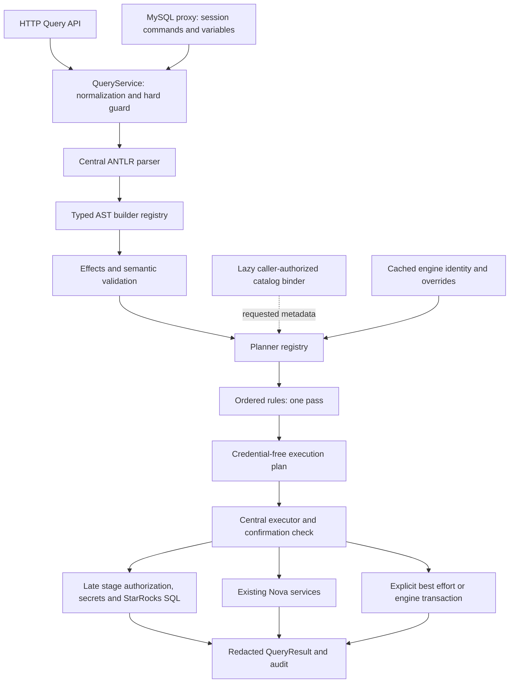

# Architecture 13: SQL Frontend and Planner

> Nova owns SQL syntax, meaning, policy and execution routing; StarRocks owns physical planning and distributed execution.

## Architecture



`backend/app/sql_frontend/` contains the request pipeline. `QueryService` retains
normalization, lifecycle, metrics, script sequencing, history and response duties.
It delegates SQL classification, validation, planning and execution.

The service interfaces are synchronous `parse_statement(sql, original_sql=...)`,
asynchronous `SQLPlanner.plan(statement, context)`, and asynchronous
`SQLExecutor.execute(plan, context)`. Execution returns the existing `QueryResult`.

## Implementation

| Package | Responsibility |
| --- | --- |
| `parser.py`, `source.py`, `errors.py` | Case-insensitive ANTLR input, hidden tokens, source spans and sanitized diagnostics |
| `ast/` | Native, stage, task, model, prediction, forecast, security and password-policy nodes |
| `analysis/` | Logical effects and pure validation of supported Nova clauses |
| `binding/` | Injectable catalog protocol and request-local lazy caches |
| `capabilities/` | Conservative engine profiles and optional detection by target |
| `planning/` | Logical intent, exact-type planner registry and execution plan types |
| `rules/` | Explicit registration order; stage lowering descriptors |
| `execution/` | Engine execution, service adapters, stage resolution and composite sequencing |
| `preparation.py` | Guarded preparation for ML training and streaming inputs |
| `security.py` | Grammar-context decoding of managed Ranger operations |

### Source and parsing

Original editor source and normalized source are separate fields. Token offsets
and spans refer to normalized source. Starts are inclusive, ends exclusive;
lines are one-based and columns zero-based. SQL fragments come from source
slices. `getText()` is used only for metadata such as identifiers, never to
reconstruct executable SQL.

The parser first tries SLL prediction with a bail-out error strategy and
reparses with full LL prediction only when SLL cannot decide. SLL accepts a
subset of what LL accepts and builds the same tree when it succeeds, so the
fallback changes speed, not results; diagnostics always come from the LL pass.

Both lexer and parser default error listeners are removed. Errors report a
position and a generic message; rejected tokens and literals are omitted.
Direct execution accepts exactly one complete statement. Script execution keeps
the existing splitter and checks security, syntax, semantic effects, safe action
validation and rule effect bounds for the entire script before the first execution.
Confirmation refusal runs no statements. Confirmed scripts plan and execute each
statement sequentially so CREATE followed by INSERT can observe the new table.
The hard guard still checks the complete input of direct execution before parsing.

The MySQL proxy classifies all stage spans in one tree while substituting
session variables. `parsing_scope()` caches successful trees for that request.
An unchanged statement reuses its tree in query execution. A substituted or
normalized statement gets a new tree for its changed source. The cache is
discarded at request exit and has no process-wide source retention.

AST builders and planners reject duplicate registration. Native context fallback
is restricted to engine statement contexts. Unregistered Nova contexts and
statement types fail closed. An engine statement whose grammar context has no
explicit effect mapping is treated as writing metadata, so an unclassified
administrative form is never reported as read-only. Classification checks task creation before native
task submission, and prediction/forecast forms before ordinary queries.
`EXPLAIN` remains an engine request. Engine statements whose grammar rule
uses labelled alternatives produce the alternative's context
(`ShowAllAuthenticationContext`, `ShowAuthenticationForUserContext`), not a
`...StatementContext`; such forms are registered explicitly as native
statements with read-only effects.

Nova accepts the standard `TIMESTAMP '...'` literal alongside the engine's
`DATE '...'` and `DATETIME '...'` (a marked region of `dateLiteral`).
`NativePlanner` replaces only that keyword's source span with `DATETIME`
(`app/sql_frontend/literals.py`), the same span mechanism stage and private
bindings use, so string contents and identifiers named `timestamp` stay as
written.

### Effects and plans

`PlanEffects` includes `reads_data`, `writes_data`, `deletes_rows`,
`changes_schema`, `changes_security`, `external_io`, `writes_metadata`,
`updates_rows`, `replaces_data` and `drops_objects`. Destructive confirmation
is a separate `requires_confirmation` property. An INSERT can write data without
acquiring UPDATE/DELETE confirmation behavior. INSERT OVERWRITE replaces data
without requiring additional confirmation. CREATE TASK writes Nova metadata;
its deferred body does not contribute execution effects.

`StatementSemanticsRegistry` owns exact-type analyzer, validator, effects resolver
and confirmation-policy registrations. Native effects dispatch on grammar context
and structural children. Comments and literals never supply statement effects.
Planners return complete plans even when confirmation has not been granted.
Lifecycle and executor checks raise `ConfirmationRequiredError` with typed effects.
The HTTP response keeps legacy fields and adds `error_code`, `statement_kind`,
`effects` and optional `execution_failure`. `destructive` describes statement
policy; `needs_confirmation` describes the current wait for approval. The worksheet
uses the server response and resubmits the immutable SQL/tab/namespace snapshot.
MySQL clients have no confirmation exchange, so the proxy submits the statement as
confirmed: the statement the client sent is the explicit request, as with any MySQL
server. The guard, engine authorization and audit still apply.

`LogicalPlan` carries the statement and analysis. Lowering produces one of:

- `EngineSqlPlan`: a safe SQL template, effects and unresolved stage descriptors.
- `NovaActionPlan`: a typed operation payload, effects and a private source key.
- `CompositePlan`: ordered steps whose effects and confirmation requirements
  are the union of their children.

Planning can read explicitly requested catalog metadata and populate request-local
validation caches. It does not persist metadata, fetch storage secrets, submit
engine mutations or call action services. The executor enforces confirmation
again after planning. Rules run once in registration order and may preserve or
expand effects and confirmation requirements; they cannot remove either. A rule
adding effects declares `effect_bound` and, if needed, `requires_confirmation_bound`.
Preflight unions the bounds; execution rejects an undeclared effect increase.

Every `CompositePlan` requires an explicit `Atomicity`. `BEST_EFFORT` stops on
the first error result or exception and reports completed indices, failed index,
outcome and possible partial effects. It never claims rollback.

`SINGLE_ENGINE_TRANSACTION` admits proven internal-engine DML in one database.
It rejects DDL, Nova actions, INSERT OVERWRITE, unknown dependencies, reads of
previously modified tables and unsupported partial-column writes. UPDATE/DELETE
require primary-key tables and a known shared-data release supporting them;
repeated INSERT also requires shared-data support. Version overrides cannot
remove these structural restrictions. Metadata is requested only for this validation.

The runner opens a dedicated user connection, selects role/database before BEGIN,
executes all steps on that connection and commits after the last success.
Statement failure or cancellation rolls back on the same connection. A lost COMMIT
response or failed rollback produces `unknown` and discards the connection.
Statements inside a transaction are audited as EXECUTED, with a separate committed,
rolled_back or unknown transaction event. Proxy sessions are never borrowed for a
composite transaction; missing credentials for a dedicated connection cause refusal.

### Worksheet session

The worksheet (`QueryService.execute_statements` without a held or delegated
connection) normally runs each statement on its own connection. A script that
contains a session statement, classified from grammar contexts by
`app/sql_frontend/session.py` (session-scope `SET`, `SET @var`, `SET NAMES`,
`SET TRANSACTION`, `BEGIN`/`START TRANSACTION`, `COMMIT`, `ROLLBACK`), or a run
of a worksheet with remembered state, runs on one held connection instead
(`app/modules/query/worksheet_session.py`, `HeldRun`):

- The whole script is checked first (guard, syntax, semantics, confirmation),
  as before. The connection is then opened as the caller with the session's
  encrypted password; every statement still goes through `QueryService.execute`
  with `connection=` set, so `SET ROLE <active role>`, the security-context
  check, Ranger authorization and audit are those of the normal path. Without
  caller credentials the old refusals remain.
- After `BEGIN` succeeds, statements run with `client_transaction` (no
  re-selection of role and database, audited as EXECUTED), as on the proxy.
  A run that ends, or fails, with the transaction open is rolled back on the
  same connection (5 s bound; otherwise the connection is closed), an
  `transaction_rolled_back`/`transaction_unknown` audit event is written and
  the run reports it.
- Successful `SET` items are remembered per worksheet: session system variables
  as their `name = value` source slice (re-checked as one session assignment,
  including the `sql_dialect` rule, before reuse; `= DEFAULT` removes one), and
  user variables as literals of the value read back with `SELECT @v, typeof(@v)`
  at the end of the run (never the assignment expression). ARRAY, MAP and
  STRUCT values, `SET NAMES` and `SET TRANSACTION` last for the run only.
- State is stored in Redis (`nova:worksheet_session:<session id>`, one field per
  worksheet file id), Fernet-encrypted, with the sign-in session TTL, and carries
  principal, active role and security-context version. A mismatch deletes it;
  a role switch and sign-out delete the whole hash. It is applied, after
  `SET ROLE`, at the start of the next held run of that worksheet only.
- Audit and history record user-variable values as `?` (`SET @v = ?`). Profile
  capture does not toggle `enable_profile` around a `SET`, so a user's own
  setting is not undone. The held connection returns JSON values, not wire
  values (`is_worksheet_connection`).
- One `SET` that mixes `GLOBAL` and session items is refused. Pure `SET GLOBAL`,
  `SET sql_dialect` and role statements keep their existing handling.

A trailing `\G` (the MySQL client's vertical terminator) is removed after
script splitting by `app/sql_frontend/vertical.py`, outside literals, quoted
identifiers, comments and `$$` bodies; the result carries `vertical=true` and
the worksheet shows one record per block.

A MySQL client's own `BEGIN`/`COMMIT`/`ROLLBACK` is a different path: the proxy
forwards them to that client's engine session and, while the transaction is
open, runs each statement on that session without re-selecting role and database
(`client_transaction`). StarRocks refuses `SET ROLE` inside a transaction, and
so does the proxy.
Cross-system coordination and compensation are outside this contract.

### Credentials and stage execution

Plans contain no passwords, resolved storage keys or authenticated connections.
Typed task/model/prediction/security payloads contain their validated definitions.
Security payloads include the decoded operation and identifiers. Source
fragments remain in private request execution state for audit and execution material.
Only plans are suitable for serialization; execution contexts are internal.
Debug representations omit source, encrypted passwords, connections and private
validation caches. Engine plan construction rejects credential-bearing SQL.

Native sensitive tokens also use unique slots, with source spans pointing into
private runtime state. Their material is restored only after stage authorization
and lowering, so length-changing rewrites and mixed native FILES/stage queries
retain both the rewrite and execution material without serializing secrets.
Missing or duplicated private slots fail closed. After parsing, stage references
become unique slot identifiers in the SQL template with path, scope and access
direction descriptors. Rewrite rules
operate on the template; runtime locates each slot exactly once and rejects missing
or duplicate slots. It never rescans the AST or restores the original stage SQL.
`StageRuntime` resolves scoped
references and checks access for every selected stage before resolving any
storage secret. Credentials and CSV settings remain keyed by reference offset,
so repeated stage names, joins and different scoped connections stay independent.

The existing translator and injector handle FILES(), LIST, COPY and stage
exports. Secret resolution occurs at execution, immediately before preparation
and engine submission. Responses and audit SQL use the redacted form.
Native FILES() reads are preserved.

Unload (`app/sql_frontend/unload.py`): `INSERT INTO FILES(...)`,
`SELECT ... INTO OUTFILE` and `EXPORT TABLE` write only to a stage path written
as a string (`'@stage/folder/'` or `'@stage/folder/prefix_'`). AST building
refuses any other target (storage URLs, local paths, `@stage` without a
folder, `..`), any option outside the form's documented allowlist (so
credentials, endpoints and broker settings never pass), duplicates, and
`WITH BROKER` with a name or properties. The planner replaces the whole target
clause with one stage slot whose access is `write` and whose `UnloadClause`
holds only the stage path and the user's allowed option literals. The stage
runtime authorizes `write` (Ranger `INSERT`/`ALL` on the stage's
database.schema) for the active role before any secret is resolved; the
translator renders the clause with the physical path (`s3a://` for EXPORT) and
credentials at execution. Every unload form, and `COPY INTO @stage` /
`INSERT INTO @stage`, has the `exports_data` effect, which requires
confirmation. The lexical guard still refuses all of them (and `EXPORT TABLE`)
unless the caller passes `allow_stage_export`: the worksheet API and the agent
custom SQL tool do; assistant read-only tools, the MySQL proxy, task bodies and
DDL routers do not, and the executor refuses a write slot in a context without
it. Responses, errors and audit rows map stage roots back to `@stage`;
`SHOW EXPORT` paths map to stages the caller may read and other storage URLs
show as `<external location>`.

Broker Load (`app/sql_frontend/broker_load.py`): every `DATA INFILE` path of
`LOAD LABEL` must be a stage path (`"@stage/folder/file.csv"`, globs allowed;
no `..`, empty or `.` folders). AST building refuses storage URLs, `WITH
BROKER <name>` and broker properties, job properties outside the documented
allowlist (credential-like keys are refused without echoing them),
`WITH RESOURCE` (Spark Load) and `DATA FROM TABLE`. The planner makes each path
a `read` slot and adds one more `read` slot on the first path's stage for the
`WITH BROKER` clause (or an empty-span slot where the clause belongs). The
stage runtime authorizes `read` on every stage before any secret is resolved;
the translator renders `s3://` paths and `WITH BROKER (<credentials>)` and
refuses a statement whose stages need different credentials. A load is a
one-off engine job submitted on the caller's connection (principal and active
role), so it is allowed like `INSERT`; it needs no confirmation, except
`NEGATIVE`, which changes existing rows (`updates_rows`). `SHOW LOAD`,
`SHOW LOAD WARNINGS` and queries of `information_schema.loads` /
`load_tracking_logs` map physical paths to `@stage` paths the caller may read
(also for streamed proxy rows); `CANCEL LOAD` and `ALTER LOAD` stay native.

Backup repositories (`app/sql_frontend/backup_restore.py`): `CREATE [READ ONLY]
REPOSITORY <name> WITH BROKER ON LOCATION "@stage/folder/"` is the only
repository form; a storage URL, broker name or any `PROPERTIES` is refused. The
location becomes one slot (`write`, `read` for READ ONLY) rendered at execution
as `'s3a://bucket/<stage root>/<folder>' PROPERTIES(<credentials>)`. Unlike a
load or export, the engine keeps a repository's location and credential in its
own metadata until `DROP REPOSITORY`. Decision (W5, 2026-11-16): every
repository, backup and restore statement (`CREATE/DROP/SHOW REPOSITORIES`,
`BACKUP`, `RESTORE`, `SHOW/CANCEL BACKUP|RESTORE`, `SHOW SNAPSHOT`) requires
`ACCOUNTADMIN` as the active role, checked in the executor before any stage
resolution, and the user docs state that the engine stores the stage's storage
connection credential. This matches the existing engine-side retention of
load and export job credentials, which are also kept in FE metadata for the
job's lifetime. A dedicated stage-scoped storage identity per repository would
limit the stored credential to the repository folder; it needs a storage
administration integration Nova does not have and is recorded as open. `BACKUP`
has the `exports_data` effect (confirmation), `DROP REPOSITORY` drops objects
(confirmation), and `RESTORE` replaces data like `INSERT OVERWRITE`.
`SHOW REPOSITORIES` locations are shown as `@stage` paths.

Task creation and password-policy actions never become raw engine statements.
Task bodies containing stage references or explicit populated credentials are
rejected before metadata persistence. Task timezone lookup, owner role,
dependency checks and audit actions remain in the existing services/adapters.
`SUBMIT TASK [name] [SCHEDULE EVERY(...)] [PROPERTIES("session.<var>" = ...)]
AS <CTAS|INSERT|CACHE SELECT>` builds the same `CreateTaskStatement` as
`CREATE TASK`: owner role = the caller's active role, a generated name
(`submit_task_<time>_<hex>`) when none is given, `db.task` read as database and
task, session properties (and a `SUBMIT /*+ SET_VAR(...) */ TASK` hint) written
as a `SET_VAR` hint into the body. Without a schedule it runs once
(`run_once`): the executor checks the caller's Nova session first, persists the
task, then queues one manual run as `EXECUTE TASK` does, and returns the task
and run identity; follow-up is `DESCRIBE TASK`/`SHOW TASKS`. The engine never
stores the task, so it never runs without the caller's role.

### Binding and capabilities

`CatalogProvider` exposes `resolve_table`, `get_columns` and `get_details`.
`Binder` caches each operation separately for one request. Asking for a table
does not fetch columns or details. Missing or inaccessible tables and missing
columns produce semantic errors. Metadata queries use the caller's identity,
active role, authenticated connection and database/catalog context.

Columns use documented `COLUMN_TYPE`, `ORDINAL_POSITION`, `IS_NULLABLE`,
`COLUMN_DEFAULT` and `GENERATION_EXPRESSION` fields. Results retain ordinal
order. Details use the source of `SHOW CREATE TABLE` to retain key type, primary
keys and the full partition clause where available. The binder preserves the
resolved table/view type. See [StarRocks columns metadata](https://docs.starrocks.io/docs/sql-reference/information_schema/columns/).

`RelationBinder.bind_relation()` derives ordered output columns from table/view
metadata, aliases, computed expressions with aliases, wildcard, qualified wildcard,
subquery and CTE (including column alias lists). Duplicate names are retained.
Complex expressions have `UnknownType`; undetermined output forms such as recursive
CTE, set operations or USING join wildcard shape are refused conservatively.
Stage schemas use an authorized DESC FILES execution helper; credentials remain
inside that helper and only typed columns reach the planner.

`SqlType` preserves raw engine type and normalized parameters for numeric/string
types, ARRAY, MAP and STRUCT. Unknown future types remain unknown. Query assignment
permits explicit compatibility categories; safe schema widening is a separate
conservative comparison. Name mapping uses case-insensitive column identifiers,
rejects missing/extra/duplicate names and follows target order rather than source
ordinal. `SchemaDelta` describes additive candidates and unsafe reasons; it never
executes ALTER. Generated/key/partition/auto-increment/hidden constraints and missing
metadata prevent a safe mutation decision. No synthetic schema version is invented.

Production resolves `EngineIdentity` using CURRENT_VERSION(), splitting release,
prerelease and build (including StarRocks's hexadecimal build suffix). VERSION()
continues to be a user compatibility function. Deployment mode comes from explicit
configuration or the FE `run_mode` Value column using a system connection.
Unknown mode never enables shared-data transaction features.

Capabilities resolve in order: conservative defaults, detected release profile,
operator overrides. Unknown override names and non-boolean values are rejected.
Native MERGE remains disabled in upstream 4.1.4 (`native_merge`); Nova's own
`MERGE INTO` does not depend on it. Cache keys contain host/port, deployment
configuration identity, deployment mode and overrides, never credentials. A
single-flight lock per target/configuration prevents concurrent duplicate probes;
successful identity lasts 15 minutes and
failure retries after 30 seconds. The combined probe budget is two seconds.
Startup warms the cache. `reload_nova_app_config()` clears config/capability caches;
`capability_provider.invalidate(target)` supports an engine switch. Detection
failure returns conservative capabilities so ordinary SQL can proceed.
Native queries, including SELECT 1, perform zero binding and no capability network
calls once the cache is warm.

## Integration Points

The HTTP query routes and MySQL proxy preserve response shapes, identity, active
role, tenant context, row limits and audit behavior. EXPLAIN uses the same
frontend, stage preparation and engine adapter. ML SQL preparation uses the
shared frontend without routing through QueryService. Assistant SQL validation
uses parsing and pure validation without a catalog or engine connection.

The worksheet opens confirmation only from server `needs_confirmation` and
resubmits the captured SQL, tab and namespace. Cancel submits nothing. On narrow
viewports a pending confirmation closes the assistant sheet so it cannot cover
the dialog or trap its keyboard controls; the desktop assistant stays open.

Planning decodes role creation/deletion, membership, hierarchy,
supported table grants, role listings and access listings from grammar contexts.
Unsupported managed governance forms are rejected; they are never forwarded as
native grants. Native user-account operations retain their prior routing.
The ACCOUNTADMIN/root/UDF/egress guard runs before parsing and Ranger actions.
Native `SET sql_dialect` to anything other than StarRocks is refused with
`capability_unsupported`: the engine would parse later statements with another
grammar while Nova classified them with the pinned StarRocks grammar.
A block comment glued to the end of an `@stage` path (`@stage/*.csv /* ... */`)
is refused: the comment would swallow the glob and the reference would name the
whole stage.

Engine results can stream: `ExecutionContext.row_sink` receives column names and
row batches as the engine produces them, and the MySQL proxy writes them to the
client without holding the whole result. Stage listings and storage errors are
rewritten so physical bucket roots appear as `@stage` and endpoints as
`<storage endpoint>`.

Compatibility APIs remain in `modules/query/dialect/parser.py` and the compact ML
and task parsers for existing callers.
They are not production feature detectors. The stage parser's legacy short
circuits do not apply to central SQL parsing. The semantic-expression parser
retains its separate expression entrypoint and compatibility listener.

## Configuration

The frontend requires no database migration or new runtime dependency. It uses
the committed Python parser generated by ANTLR 4.13.2 from the pinned StarRocks
4.1.4 grammar. Java is used only for regeneration.

QueryService accepts injected AST builders, planner, catalog-provider factory and
capability resolver. Production defaults select the registries and caller-authorized
StarRocks catalog. The executor's payload-type handler registry accepts extensions
without changes to adapter routing. Generic debug logging reports planner/rule names,
effects, binding request counts, capability source and atomicity; it omits SQL and
credentials and introduces no unbounded metric labels.

```yaml
sql_frontend:
  engine:
    deployment_mode: shared_data # optional; omit to introspect
    feature_overrides:
      native_merge: false
```

## Developer Extension Workflow

1. Add syntax inside a marked Nova grammar region, then run
   `bash backend/scripts/generate_grammar.sh`. Add parser corpus cases for
   comments, literals, spans and rejected forms.
2. Add a typed Statement subclass and register an AST builder for its context.
   Slice SQL fragments from normalized source. Do not add a feature detector
   to QueryService.
3. Register `StatementSemantics` with an analyzer, validator, effects resolver and
   confirmation policy. Mark a validator preflight-safe only when it needs no
   table binding or execution; request-local validation avoids decoding it twice.
4. Implement a planner and register its exact statement type. Request only the
   catalog metadata needed through `context.binder`; choose lowering from
   `context.capabilities`. Keep action execution and secrets out of planning.
5. Return safe engine templates, a typed action payload or an explicit composite. Declare
   all effects and any separate confirmation requirement. Register an action
   handler only when an existing service must execute the operation.
6. Add a rule only if lowering requires one; register it in explicit order and
   declare any effect bounds. Preserve stage slots and do not reuse transaction
   intent after changing SQL unless the new dependencies are proven.
7. Test native preservation, planner purity, binding caches, capabilities,
   composite ordering/failure, redaction and the real consumer path.

`test_sql_frontend_planning.py` demonstrates capability-dependent composite
lowering with a dummy statement and explicit binding. The consumer test
`test_extension_runs_through_unmodified_query_service_with_injected_catalog`
runs that extension through QueryService without adding a branch to its SQL flow.
`test_sql_frontend_readiness.py` registers a test mutation's analyzer, validator,
effects, planner, relation binding, rule and payload handler, proves confirmation
for a SELECT-prefixed mutation, and executes through the production adapters.

`MERGE INTO` (`novaMergeStatement`, `app/sql_frontend/merge.py`) is a Nova
statement on these interfaces: a typed `MergeStatement`, a metadata-free
validator, effects that follow its clauses, and a planner that binds the target's
key, columns and defaults and lowers to a partial-update Primary Key
`INSERT ... SELECT` (one
`EngineSqlPlan`) or, with `WHEN MATCHED ... THEN DELETE`, a best-effort
`CompositePlan` of a key check, a `DELETE`, and the upsert. See
[MERGE INTO](02-sql-worksheet.md#merge-into). ALL BY NAME and schema evolution
have no syntax or implementation here; their future planners can use the same
registration, binding, capability and composite interfaces. Physical optimization remains StarRocks's responsibility.

Pipe statements (`CREATE`/`ALTER`/`DROP PIPE`, `SHOW PIPES`, `DESC PIPE`) use
the pinned engine grammar with no Nova region: typed `PipeStatement` builders, a
metadata-free validator and a `PipePlanner` lower them to a Nova action executed
by `app/modules/pipes`; queries over `information_schema.pipes`/`pipe_files`
are answered from Nova rows. A pipe statement never reaches the engine. Pipes
are the one background path that reads `@stage` without the caller: each run of
the task worker checks the owner role's table and stage access first and
resolves the stage secret only for that run. See
[Pipes over stages](architecture/starrocks-compat/PIPES.md).

Query Autopilot uses the central frontend for canonical fingerprints, typed snapshot mappings, and governed maintenance. See [Query Autopilot architecture](arch-14-query-autopilot.md).
