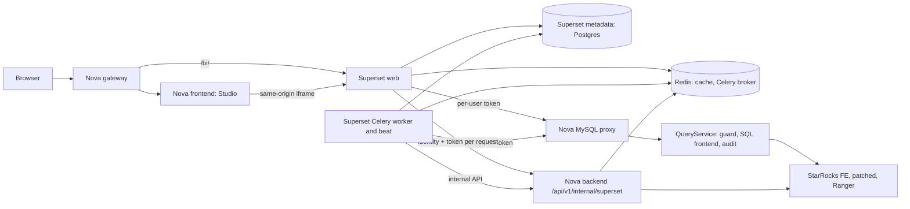

# Architecture 17: Superset as Studio's BI surface

> Status: **accepted design; all phases (1 to 6) implemented.** This document
> is the delivery plan for replacing Studio's viz-core chart and dashboard
> artifacts with Apache Superset. Its open decisions were settled on 2026-10-29
> (see [Decisions](#decisions)). Studio artifacts are Superset charts and
> dashboards, Superset's background work runs under Nova's identity, and
> artifacts saved before BI are converted in place or stay read-only with a
> report. Semantic Views sync into locked datasets, Superset's metrics reach
> Prometheus and Grafana, and its metadata travels with `NOVA_SYSTEM` backups.

Nova ships Apache Superset as a built-in component and shows it inside Studio
as the surface for saved charts and dashboards. Superset brings its full feature
set; Nova keeps ownership of identity, the active role, data authorization,
SQL routing, and audit. Superset is never a second place where a user, a
password, or a data policy lives.

## Goals

- Every Superset feature that can run under Nova's security contract is
  available to Nova users, inside Studio, with one sign-in.
- Every Superset query runs as the signed-in Nova principal with exactly one
  named active role, through Nova's SQL path, governed by Ranger row filters
  and masks, and audited by Nova.
- Studio agents create and edit Superset charts and dashboards on the user's
  behalf, replacing `data_to_chart` and `dashboard_build` persistence.
- Upgrading Superset is a version bump plus patch rebase, not a port.

## Non-goals

- Porting, vendoring, or re-implementing Superset source inside Nova.
- A Superset user/password store, Superset row-level security, or any other
  data policy outside Ranger.
- Letting users register additional databases in Superset.
- Replacing inline chat visualizations. Ephemeral charts in a Studio answer
  (`frontend/src/features/studio/intelligent-ui/`) stay native; only saved
  artifacts move to Superset.
- A switch that turns Superset on or off. Per the root
  [AGENTS.md](../AGENTS.md), it ships active and is gated only on real
  prerequisites (authentication, the Nova database connection, Ranger).

## Decision: run pinned upstream Superset, never port it

| Option | Outcome | Verdict |
| --- | --- | --- |
| Port Superset code into Nova (FastAPI backend, Nova frontend) | Hundreds of thousands of lines coupled to Flask, Flask-AppBuilder, SQLAlchemy, Celery and a transactional metadata database. Nova would maintain a divergent fork, re-port every upstream release and security fix, and still end with fewer features | Rejected |
| Fork Superset | Same upgrade burden for every change, even ones a hook covers | Rejected |
| Use only `@superset-ui` chart packages in Nova's frontend | Chart rendering only: no SQL Lab, Explore, alerts, reports, saved queries | Rejected for the goal of all features |
| **Run upstream Superset at a pinned release, wrapped in a Nova image, connected through official hooks plus a small verified patch set** | All features, upstream upgrades stay mechanical, Nova code lives in Nova-owned files | **Chosen** |

This is the same model Nova uses for StarRocks: a pinned engine, small patches
under `patches/starrocks/` with a `verify.sh`, an image built from the official
release, and no vendored source tree ([patch baseline](../patches/starrocks/README.md)).

**Pin:** Superset `6.1.0` (released 2026-05-13). Every hook named below was
checked against that tag. Features only on Superset `master` (for example the
`SEMANTIC_LAYERS` flag) are not planned until a pinned release carries them.

## Architecture

### Component ownership

| Concern | Owner | Notes |
| --- | --- | --- |
| Authentication | StarRocks via [AuthService](../backend/app/modules/auth/service.py) | Superset never sees a password |
| Session, active role, context version | Nova session store in Redis | Superset holds only a reference |
| Data authorization, row filters, masks | Ranger through the patched FE | Superset dataset permissions are not a policy layer |
| SQL syntax, guard, `@stage`, audit | [QueryService](../backend/app/modules/query/service.py) behind the [MySQL proxy](../backend/app/proxy/README.md) | Superset never connects to StarRocks directly |
| Chart, dashboard, dataset definitions, saved queries, tags | Superset metadata database | Product-owned store, see [Storage](#storage) |
| Studio artifact index, provenance, thread link | `NOVA_SYSTEM.CONFIG_STUDIO_ARTIFACTS` | Pointer to the Superset object |
| Business meaning | Nova Semantic Views | Synced into Superset datasets, never authored there first |
| Agent loop | [assistant engine](../backend/app/modules/assistant/) | New tools call Superset's REST API as the user |

### Repository layout

| Path | Contents |
| --- | --- |
| `superset/Dockerfile` | `FROM apache/superset:6.1.0`, applies `patches/superset/`, installs `nova_superset` |
| `superset/superset_config.py` | Feature flags, hooks, theme, executors, cache and Celery wiring. Secrets come from environment placeholders only |
| `superset/nova_superset/` | Python package: security manager, connection mutator, event logger, Jinja addons, Nova API client |
| `superset/extensions/` | Superset extensions for Nova-specific UI inside Superset, when `ENABLE_EXTENSIONS` covers the need |
| `patches/superset/` | `6.1.0-*.patch`, `README.md`, `verify.sh`, mirroring `patches/starrocks/` |
| `backend/app/modules/superset/` | BI session and author-role API; internal identity and data-token API (Phase 1); artifacts, charts and conversion (Phases 3, 4, 6); delegation (Phase 2); Semantic View sync (`semantic.py`, Phase 5) |
| `backend/app/proxy/connection.py` | Token login next to the existing scramble relay, and per-command re-checks of the bound session |
| `frontend/src/features/studio/` | Superset host panel and postMessage bridge |
| `frontend/src/routes/_authenticated/analytics.tsx` | The BI page inside Nova's console frame: opens a BI session, frames `/bi/`, and keeps the framed view in `?path=` |
| `frontend/src/routes/bi-launch.tsx` | Opens a BI session and hands the browser to `/bi/`; Superset's sign-in redirect and "Open in new tab" use it |
| `docker/` | Superset web, init and metadata services in the existing compose project (worker and beat join in Phase 2); gateway route `/bi/` |

## Security contract

Each rule below is a release blocker. A phase that touches a rule must show the
listed check passing on the governed (patched FE + Ranger) stack.

**S1. One identity source.** Superset runs a custom security manager
(`CUSTOM_SECURITY_MANAGER`) with remote-user authentication. Nova's
`/bi-launch` route calls `POST /api/v1/superset/session`, which sets an
HttpOnly, `SameSite=Strict` cookie `nova_bi` scoped to `/bi`. Its value is an
opaque BI handle bound to the Nova session (stored hashed in Redis), not the
Nova JWT. On every request Superset trades the handle for the identity at
`/api/v1/internal/superset/identity` and creates or updates a mirror user with
no password and exactly one Nova role. Superset's own sign-in does not exist:
`/login/` redirects to Nova, and the password login API, registration, password
reset and the FAB user/role views answer 404 or are absent from every Nova
role. A Nova user that cannot authenticate cannot reach Superset.

This replaces the gateway `auth_request` of the first draft: the check lives in
Superset's request hook, so it holds in every topology (Vite in development,
the gateway when split, a direct port) and never trusts a forwarded header.

**S2. Session binding.** The request hook keeps the handle and identity in
context variables cleared at the start and end of every request, so they
survive Superset's nested request contexts (synchronous SQL Lab) without
leaking across requests on a worker thread. Superset does not cache identity
beyond the request; every request re-validates with Nova, and a Nova outage
answers 503 rather than reusing an old identity.

**S3. Per-user data token.** `DB_CONNECTION_MUTATOR` asks Nova's internal API
for a short-lived token bound to `{principal, session_id, active_role,
security_context_version}` and places it in the connection URL as the
password for the Superset database "Nova". Rules:
- TTL is minutes, not hours; a token is useless once its session is gone.
- The proxy rejects the token if the session no longer exists, the active role
  changed, or `security_context_version` advanced (role switch, revocation).
- Tokens are opaque, stored encrypted in Redis (S4 explains why not hashed),
  never logged, never returned in an API response other than to the mutator
  over the internal network.
- `/api/v1/internal/superset/*` is unreachable through the gateway, as all
  `/api/v1/internal/` routes already are ([routes.conf](../docker/gateway/routes.conf)).

**S4. Proxy token login.** The proxy keeps the StarRocks scramble relay for
ordinary MySQL clients and adds a token mode for Superset. The token is
verified by the proxy itself; on success the proxy opens the engine session
from the bound Nova session and activates its role, exactly as the HTTP query
path does. Verification uses `mysql_native_password` against the scramble the
proxy itself presents: the proxy relays StarRocks' fresh 20-byte scramble, so
it knows it, looks up the principal's live tokens, and checks the client's
response against each stored token; the token never crosses the wire. On a
match the proxy completes the engine login on the same socket with the bound
session's own credential, activates the bound role through the role activation
service (assignment and Ranger projection), locks the role for the connection,
and re-checks the binding before every command. Any other client takes the
unchanged relay path. Because the
response must be checked against the token value, Redis keeps the token in a
form the proxy can verify with, encrypted under the same scheme as session
passwords, not as a one-way hash. A principal has at most a small, bounded
number of live tokens. `mysql_clear_password` is not supported. The token mode
is limited to the Superset service network identity and fails closed on any
mismatch. Unknown principals and `root` stay refused
(`_INTERNAL_ONLY_USERS`).

**S5. Background work uses explicit delegation.** Alerts, reports, thumbnails,
and cache warmup run in Celery with no live session. Their executors resolve to
a Superset user (`ALERT_REPORTS_EXECUTORS`, `THUMBNAIL_EXECUTORS`,
`CACHE_WARMUP_EXECUTORS`). The mutator then requests a *delegated* token from
Nova with the Superset service credential (a supported secret reference, not a
raw secret in config). Nova grants it only for an existing, enabled principal,
activates that principal's current **default role**, revalidates assignment at
every run, and executes through the existing impersonation contract used by
scheduled tasks ([execution.py](../backend/app/modules/task_orchestration/execution.py)):
a dedicated account with `IMPERSONATE` granted per owner, never on all users,
never `root` or `nova_admin`. A principal without a default role fails closed.

Implemented in `backend/app/modules/superset/delegation.py` and
`/api/v1/internal/superset/delegate`. Delegation is authorized by impersonating
the owner through `DelegateExecutor.owner_connection` and reading the default
role from that session, so the engine decides; the worker account and the
per-owner Ranger grant are the ones `scripts/provision_task_worker_access.py`
manages for scheduled tasks. A delegated session lives in Redis for
`SUPERSET_DELEGATION_TTL_SECONDS` and has no password: the proxy opens the
owner's engine session through the same impersonation and activates exactly
the default role. Grants and refusals are audited.

Work a signed-in request starts on someone's behalf is not delegated: Superset
thumbnails (requested by the viewer) and async SQL Lab carry the requesting
session into Celery (S10), so they run under that session's active role. Only
scheduled work (alerts and reports) is delegated. This narrows D4: thumbnails
follow the viewer, not the owner, because a thumbnail drawn under the owner's
default role would show the viewer rows they may not see.

**S6. Superset roles gate features, not data.** Nova roles are StarRocks role
names (`ACCOUNTADMIN`, `SECURITYADMIN`, and customer roles such as `finance`).
At every login and role switch the security manager assigns exactly one of
three Superset roles from the *active* Nova role:

| Superset role | Based on | Can | Assigned when the active role is |
| --- | --- | --- | --- |
| `NovaViewer` | Gamma | View dashboards and charts shared with them | Any role not mapped below (default) |
| `NovaAuthor` | Alpha, minus database admin | Explore; create and edit charts, dashboards, datasets; SQL Lab | A role listed in Nova's BI author mapping |
| `NovaAdmin` | Admin, minus security and database admin | Manage Superset objects across owners | `ACCOUNTADMIN` |

The author mapping is Nova control-plane metadata in `NOVA_SYSTEM`
(`CONFIG_BI_AUTHOR_ROLES`), edited by `ACCOUNTADMIN` through
`PUT /api/v1/superset/author-roles`, never inside Superset. Superset builds
datasets by reflecting tables as the principal, so the same request writes the
managed Ranger policy `nova-managed/bi/metadata/default_catalog`: `select` on
the `information_schema` reflection views (`tables`, `tables_config`,
`columns`, `views`, `materialized_views`) for exactly the author roles plus
`ACCOUNTADMIN`. The policy is written first; if Ranger refuses it, the author
list is left unchanged. Rows in those views remain limited to objects the
principal can already see. An unmapped or missing role
gets `NovaViewer`; an ambiguous security context gets no Superset session.
Dataset-level access is granted broadly to authors (`all_datasource_access` on
the single Nova database) because Ranger decides what rows and columns each
principal sees.

**S7. Ranger is the only data policy.** Superset row-level security views and
APIs are removed from every Nova role. Dataset SQL, Jinja, and filters cannot
widen access because every statement runs as the principal through Ranger.

**S8. One database connection.** Bootstrap provisions exactly one Superset
database, "Nova", pointing at the proxy. No Nova role can create, edit, test,
or delete databases, or change "Nova"'s URI, impersonation, or extras.
Superset's database admin APIs are removed from all roles, including
`NovaAdmin`. Upload-to-database is disabled until a stage-backed path exists.

**S9. Cache isolation.** Superset data cache keys include principal, active
role, and `security_context_version`. No patch is needed: Superset folds
`security_manager.get_rls_cache_key()` into every chart-data cache key, and
`NovaSecurityManager` appends the Nova session's partition there
(`nova:<session|delegated>:<principal>:<role>:<version>`). Thumbnail digests use
the same partition through `THUMBNAIL_CHART_DIGEST_FUNC` and
`THUMBNAIL_DASHBOARD_DIGEST_FUNC`; without a Nova session there is no
thumbnail. Cache warmup is not scheduled: its entries would belong to a
delegated identity and could never be served to a signed-in session.

**S10. Async execution needs session binding.** Superset's async SQL Lab runs
in Celery, where the interactive session is not on the request context.
Treating it as background work would replace the user's active role with the
default role, which violates S3. `nova_superset/celery_hooks.py` carries the
submitting session's BI handle and its `principal:role:version` in task
headers (Celery's `before_task_publish`), and the worker adopts the session
only if it still has that role and version; otherwise the query fails rather
than run under another role or be delegated. The handle crosses Superset's
Redis broker on the internal network only. `GLOBAL_ASYNC_QUERIES` stays off:
chart loads run synchronously in the viewer's own request.

Revocation reaches data first: a revoked role assignment or dropped user fails
the next query (role activation or engine login refuses it), while the Superset
pages themselves stay reachable until the Nova session ends, as Nova's own pages
do.

**S11. ACCOUNTADMIN.** Statements from Superset pass the same guard as every
proxy statement. Superset bootstrap never creates, alters, or grants on
`ACCOUNTADMIN`.

**S12. Audit.** Data statements are audited by `QueryService` with the real
principal and role. Superset UI actions (create, edit, delete, export, share,
schedule) go through a custom `EVENT_LOGGER` to Nova's internal audit intake
and land in `NOVA_SYSTEM.AUDIT_LOG` with redacted fields. Refusals (denied
token, denied delegation, revoked session) are audited by Nova.

**S13. Secrets.** `SECRET_KEY`, the metadata database password, the Superset
service credential, and the impersonation account password come from
deployment secret references. They never appear in Superset UI, Superset
metadata, logs, Nova responses, frontend state, or agent context. Superset's
"Nova" database URI holds no credential at rest; the mutator supplies the token
per connection.

**S14. Browser boundary.** Superset is served same-origin under `/bi/`.
`TALISMAN_CONFIG` allows framing only by Nova's own origin
(`frame-ancestors 'self'`). The Embedded SDK and guest tokens are not used for
Nova users. If external sharing is added later, Nova alone mints guest tokens
and they follow S3's binding rules.

**S15. User-facing names.** Superset UI shows "Nova" as the data source and
`@stage` names for files. Storage vendors, endpoints, and credential-bearing
paths stay out of Superset objects, as for every Nova surface.

## Feature matrix

Status column: **Ships** (available when its phase lands), **Patch** (ships
after the named patch passes), **Blocked** (off, with the reason).

| Superset feature | How it runs in Nova | Hook or change | Phase | Status |
| --- | --- | --- | --- | --- |
| Dashboards, native filters, cross-filters, drill | Same-origin iframe in Studio and full page at `/bi/` | Security manager, gateway route | 1, 3 | Ships |
| Explore and chart editing | As the real user, through the proxy | Security manager, mutator | 1 | Ships |
| All chart types shipped in 6.1.0 | Unchanged | None | 1 | Ships |
| SQL Lab, synchronous | Through the proxy; `@stage` and the guard apply | Mutator | 1 | Ships |
| SQL Lab, async | Celery, as the submitting session; refused if it changed (S10) | Celery signals in `nova_superset` | 2 | Ships |
| `GLOBAL_ASYNC_QUERIES` | Chart loads stay synchronous in the viewer's request | — | — | Off |
| Datasets: physical and virtual, metrics, calculated columns | Virtual datasets for agent artifacts; Semantic Views synced as datasets | Semantic sync job | 1, 5 | Ships |
| Jinja templating | Plus `nova_active_role()` | `JINJA_CONTEXT_ADDONS` | 1 | Ships |
| Saved queries, query history, tags, annotations | Superset metadata | None | 1 | Ships |
| Data cache | Partitioned by principal, role, context version | `get_rls_cache_key` (S9) | 2 | Ships |
| Alerts and reports (email, Slack) | Owner, default role, delegated token | `ALERT_REPORTS_EXECUTORS`, mutator, delegation (S5) | 2 | Ships |
| Thumbnails and screenshots | Drawn for the requesting session, partitioned digests | Digest functions, machine auth (S9) | 2 | Ships |
| Cache warmup | Not scheduled: delegated entries could not be served to signed-in sessions | — | — | Off |
| Export: CSV, Excel, PNG, PDF, dashboard bundles | Superset exporters, audited by S12 | `EVENT_LOGGER` | 4 | Ships |
| Import of bundles | Superset 6.1.0 gates `/import/` on `write`, so authors could import database definitions. Every import endpoint answers 404 (S8) | `nova_superset` request hook | 4 | Blocked |
| Theme, dark mode | Tokens derived from [DESIGN.md](../DESIGN.md) | `THEME_DEFAULT`, `THEME_DARK`, `THEME_DEFAULT_MODE` | 3 | Ships |
| Languages | Superset's default (English), as Nova's console | `LANGUAGES` | 3 | Ships |
| Nova UI inside Superset (for example "Ask Nova") | Not built; Studio's edit chat sits beside the framed chart instead | `ENABLE_EXTENSIONS` | — | Not planned yet |
| Dashboard RBAC, ownership, sharing | Superset objects, gated by S6 roles | Role mapping | 1 | Ships |
| Row-level security | Removed; Ranger owns it (S7) | Role definitions | — | Blocked |
| Database management, upload to database | Removed (S8) | Role definitions | — | Blocked |
| Embedded SDK, guest tokens | Not used for Nova users (S14) | — | — | Blocked |
| Semantic Layers | Only on Superset `master` | Re-evaluate at the next pin | — | Blocked |

## Storage

- **Superset metadata database: PostgreSQL**, owned by the Superset component.
  Superset requires PostgreSQL or MySQL for its metadata and does not support
  StarRocks. This is an accepted exception (D1) of the same kind as Ranger's
  policy database: it stores Superset objects only. Users, roles, passwords, policies,
  and Nova control-plane metadata never go there. It joins the existing compose
  project and the [backup module](../backend/app/modules/backup/)'s scope.
- **Redis:** Superset data cache, thumbnail cache, Celery broker and results,
  each on its own logical database. Runtime only, consistent with Redis's role.
- **`NOVA_SYSTEM.CONFIG_STUDIO_ARTIFACTS`:** gains a Superset object reference
  (kind and UUID). `owner_name`, `thread_id`, `agent_id`, `title`, and the
  read-only provenance SQL remain. `viz_spec` and `chart_spec` are legacy: no
  code writes them, conversion clears them, and the repository drops both
  columns once no legacy artifact remains (Phase 6). Schema changes follow the owning initialization in
  [artifact_repository.py](../backend/app/modules/agents/artifact_repository.py).
- **Report and screenshot payloads** that must persist go through Nova's
  managed storage abstraction, not a new bucket configured inside Superset.

## Studio integration

### Artifact model

A Studio artifact becomes a Nova record pointing at a Superset chart or
dashboard. Studio's sidebar, artifact list, provenance, and chat buttons stay
Nova components and read the Nova record; the body renders Superset.

### Host panel

`frontend/src/features/bi/bi-frame.tsx` frames a Superset view in the
artifact panel: `/bi/explore/?slice_id=<id>&standalone=1` for a chart and
`/bi/superset/dashboard/<id>/?standalone=2` for a dashboard. **Edit in BI**
switches the frame to Explore or the dashboard's edit mode. The frame opens the
BI session first and sets Superset's theme mode from Nova's before it loads.

Because Superset is same-origin, Nova reads the framed location directly (to
keep `/analytics?path=` in step) and sets the theme through shared storage; no
postMessage bridge is needed. The panel owns the frame's size. Filter hand-off
from a Studio answer into dashboard native filters is not implemented.

### Agent tools

New tools in the shared assistant engine replace persistence in `data_to_chart`
and `dashboard_build` ([tool catalog](../backend/app/modules/agents/tool_catalog.py)):

1. Take the turn's verified result and its producing read-only statement.
2. Create or reuse a virtual dataset on "Nova" as the user.
3. Translate the chart intent into Superset `form_data` for the chosen viz type.
4. Create the chart, then the dashboard layout for multi-view requests.
5. Write the Nova artifact record with provenance and return it to the thread.

Calls go to Superset's REST API with the user's Nova JWT, accepted by the
security manager's request loader. Consent rules of the existing tools carry
over unchanged. The one-shot editor in
[artifact_editor.py](../backend/app/modules/agents/artifact_editor.py) is
rewritten to propose `form_data` and dataset SQL changes instead of `viz_spec`.

The `form_data` translator is the largest custom component. It is a typed,
tested mapping per supported viz type, not free-form model output: the model
picks a chart type and fields, the translator builds `form_data`, and
Superset's chart data API validates it before the artifact is saved.

## Patch policy

`patches/superset/` follows the StarRocks patch rules: each patch is minimal,
names its upstream file and reason, applies cleanly to the pinned tag, and is
checked by `verify.sh` in CI. A hook that covers the need always wins over a
patch. Every need so far was met by a hook, so no patch exists yet:

| Need | Hook used instead of a patch | Rule |
| --- | --- | --- |
| Cache key partition | `NovaSecurityManager.get_rls_cache_key`, thumbnail digest functions | S9 |
| Async session carry | Celery `before_task_publish` / `task_prerun` / `task_postrun` signals | S10 |
| Headless-browser sign-in | `MACHINE_AUTH_PROVIDER_CLASS` | S5 |
| Host bridge | Not needed: Superset is same-origin | Studio host |

Two 6.1.0 behaviors are handled in `nova_superset` without a patch, and are
re-checked at every pin: Superset reads MySQL result types from the `MySQLdb`
module, which `superset_config.py` provides through PyMySQL's
`install_as_MySQLdb()`; and the theme logo is prefixed with the app root by
both server and browser, which the app hook undoes on the server side.

## Delivery phases

Every phase is production quality: it lands complete with tests, docs, and its
acceptance criteria passing on the governed stack. No phase leaves a parallel
authoring path active.

### Phase 1: identity and governed data

Deliver: Superset web, init, and metadata services in the existing compose
project; `/bi-launch` and the `/bi/` route (Vite in development, gateway when
split); security manager, request hook and role mapping; BI session, identity
and data-token API; proxy token mode; mutator; bootstrap of the single "Nova"
database; role definitions removing RLS and database admin; synchronous SQL
Lab; `nova_active_role()` Jinja addon. Celery worker and beat serve only
background work and join in Phase 2.

The sidebar's **BI** entry opens `/analytics`, which keeps Nova's sidebar and
header around a same-origin Superset frame (S14 allows only Nova's origin to
frame it). Superset's own navigation stays inside the frame; a full-page
Superset remains one click away.

Status: **delivered.** The acceptance below is automated in
`backend/tests/integration/test_superset_governed.py` and runs against the
governed stack; see [HOW_TO_RUN.md](../HOW_TO_RUN.md) for the command.

Acceptance:
- A Nova user opens `/bi/` and lands signed in; an unauthenticated request is
  redirected to Nova sign-in; Superset's own login, registration, and password
  reset are unreachable.
- Two principals with different active roles see different rows and masked
  columns for the same chart and the same SQL Lab statement.
- After a role switch, the next Superset query uses the new role; a query on a
  token minted before the switch is refused.
- After revoking a role assignment or dropping a user, the next query is
  refused; signing out of Nova ends the BI session for every request.
- An assigned-but-inactive role grants nothing.
- No Nova role can create or edit a database, open RLS, or change "Nova".
- `DROP ROLE ACCOUNTADMIN` from SQL Lab is refused (SQL Lab DML is off for
  "Nova"), and on a Superset proxy connection the guard refuses it too.
- Every Superset query appears in `AUDIT_LOG` with the real principal and role.
- No secret appears in Superset metadata, Superset logs, Nova logs, or API
  responses (grep-based check over a full test run).

### Phase 2: background work and caches

Deliver: delegation API and executor wiring for alerts, reports, thumbnails,
and cache warmup; cache key patch; async session-carry patch; Celery and
headless browser services.

Status: **delivered**, with hooks instead of patches (see
[Patch policy](#patch-policy)): delegated sessions and proxy impersonation
(S5), cache and thumbnail partitions (S9), session carry for async SQL Lab and
thumbnails (S10), `superset-worker` (Celery, Chromium through Playwright) and
`superset-beat`. Cache warmup is deliberately not scheduled and
`GLOBAL_ASYNC_QUERIES` stays off (S9, S10). Reports and alerts are sent only
when `SUPERSET_SMTP_HOST` is configured; otherwise they run and are logged.
Acceptance is automated in
`backend/tests/integration/test_superset_governed.py::test_superset_phase_2_acceptance`.

Acceptance:
- A scheduled report runs as its owner with the owner's default role and shows
  that role's rows; it fails closed when the owner is disabled or has no
  default role.
- Delegation is refused for `root`, `nova_admin`, unknown principals, and any
  principal without a per-owner `IMPERSONATE` grant.
- The same chart viewed by two principals, or by one principal under two roles,
  never returns the other's cached data or thumbnail.
- An async SQL Lab query runs with the submitting session's active role and is
  refused if that session ends or changes role before execution.

### Phase 3: Studio host

Deliver: artifact pointer columns; Superset host panel; theme tokens from
`DESIGN.md`.

Status: **delivered** (`bi_kind`, `bi_object_id`, `bi_dataset_id` on
`CONFIG_STUDIO_ARTIFACTS`; `BiFrame` in the artifact panel; Nova primary,
font, radius and dark surface in `superset_config.py`). The postMessage bridge
was not needed (see [Host panel](#host-panel)); languages stay Superset's
default; no Superset extension was built.

Acceptance:
- A Superset dashboard and chart open in Studio's artifact panel without a
  second sign-in, sized to content, in light and dark mode.
- Framing `/bi/` from any other origin is refused by CSP.
- Frontend checks pass: `pnpm lint`, `pnpm build`, `pnpm test:coverage`, and
  the CI browser layout checks for the artifact panel at desktop and phone
  widths.

### Phase 4: agents and editing

Deliver: new dataset, chart, and dashboard tools; typed `form_data` translator;
rewritten artifact editor; Superset exports with audit; import guard.

Status: **delivered.** `backend/app/modules/superset/charts.py` reduces a
worksheet, a Vega-Lite chart or a bare result to a `ChartPlan` and builds
`form_data` and a `query_context`; `artifacts.py` publishes the dataset, chart
and dashboard as the user, runs the chart's query through Superset's chart data
API before saving, and audits each step. Saving a result (the Intelligent UI
and chat save buttons), `dashboard_build`, the artifact editor's apply step and
artifact deletion all use it. A role that is not a BI author is refused before
Superset is called. Imports are blocked rather than guarded (see the feature
matrix). Acceptance is automated in
`backend/tests/integration/test_superset_governed.py::test_superset_phases_3_and_4_acceptance`.

Acceptance:
- Studio trajectories in `tests/eval/` that previously produced chart and
  dashboard artifacts now produce Superset artifacts and pass.
- A created artifact re-opened by another principal shows that principal's
  governed rows, never the creator's.
- Every create, edit, export, and import is in `AUDIT_LOG`; an import that
  carries a database definition is rejected.
- The agent eval scorecard does not regress.

### Phase 5: semantics, observability, backup

Deliver: Semantic View to dataset sync; Superset metrics in the existing
Prometheus and Grafana; Superset metadata database in backup and restore.

Status: **delivered.**

- **Semantic Views.** Publishing a version runs
  `backend/app/modules/superset/semantic.py` as the publisher: each fact
  dataset (the base of at least one metric) becomes one virtual dataset that
  selects the fact's fields and the fields of datasets it reaches through
  many-to-one relationships, under their semantic names, with the fact's
  metrics rewritten over those columns, time fields as temporal columns and a
  default time dimension as the main time column. A new version updates the
  same dataset; a private, deprecated or dropped view has none. Derived,
  filtered and semi-additive metrics, and metrics reaching an unjoined dataset,
  are left out and named in the sync record (`CONFIG_SEMANTIC_BI_DATASETS`,
  `GET /semantic-views/{id}/bi-datasets`, retry with `POST .../bi-sync`).
  `nova_superset/semantic_guard.py` refuses edits and deletes of a marked
  dataset, and any dataset claiming the marker, unless the request carries the
  `X-Nova-Semantic-Sync` service token that only Nova's backend holds. Its
  queries run as the viewer like every Nova dataset.
- **Metrics.** `nova_superset/metrics.py` is Superset's `STATS_LOGGER` and adds
  request (method, status class, area), query-on-Nova (outcome) and Celery task
  (task, state) timings with no user, role, SQL or object names. They go over
  UDP to the observability stack's `statsd-exporter`
  (`docker/observability/statsd/mapping.yml`), scraped as job `bi-metrics`, and
  the Grafana dashboard **Nova | BI (Superset)** (`nova-bi`) shows them. Without
  the exporter, packets are dropped; Superset never waits on it.
- **Backup.** A snapshot of `NOVA_SYSTEM` also stores a `pg_dump` of Superset's
  metadata in managed object storage under the same repository and label
  (`backend/app/modules/backup/bi_metadata.py`); restoring that whole snapshot
  restores the dump in one transaction. The backend image carries the
  PostgreSQL 16 client; the password reaches it through the environment only.
  Restart the Superset services after a restore.

Acceptance is automated in `test_superset_phase_5_semantics_and_backup_acceptance`
and `test_superset_phase_5_metrics_acceptance` in
`backend/tests/integration/test_superset_governed.py`. The backup check restores
into a scratch database so a shared stack's Superset is never replaced.

Acceptance:
- A Semantic View change appears in its Superset dataset after sync; a dataset
  derived from a Semantic View cannot be edited into a divergent definition.
- Superset request, query, and Celery metrics are visible in Grafana.
- Backup and restore round-trip Superset objects alongside Nova metadata.

### Phase 6: migration and retirement

Deliver: converter from `viz_spec` charts and dashboards to Superset objects
with a per-artifact report; retirement of the viz core authoring path, legacy
renderer, `data_to_chart` persistence, and `dashboard_build`; updates to
[Architecture 16](arch-16-viz-core.md), `AGENTS.md` task routing, and user docs.

Status: **delivered.** `backend/app/modules/superset/conversion.py` converts
an owner's artifacts as that owner: charts first (a worksheet through
`worksheet_conversion`, a Vega-Lite chart through `plan_from_vega`, a bare
query as a table), then dashboards saved as zone layouts or as tiles from
before the viz core. Each artifact keeps its id. *Blockers* are features BI
computes differently: calculated and level-of-detail fields, table
calculations, aggregations Superset has no equivalent for, context, aggregate
and relative-date filters, and, for a dashboard, the blockers of the charts it
places. An artifact with blockers stays read-only unless its owner converts it
anyway. *Notes* change only presentation (sort, size or label encodings,
dashboard filter zones and actions, zone sizes). Every outcome is returned and
audited as `CONVERT_ARTIFACT`.

- Studio: `POST /studio/artifacts/convert` (all of the caller's legacy
  artifacts, or a list; `force` converts kept ones). A legacy artifact's view
  carries `legacy_blockers` and `legacy_notes`; editing it returns 409. Explore
  shows a notice with **Convert all** and a per-artifact report; a legacy view
  shows a banner with **Convert to BI** or, with blockers, **Convert anyway**
  after confirmation. Converting a dashboard brings the legacy charts it places.
- Operators: `backend/scripts/convert_studio_artifacts.py --all-owners` (or
  `--owner`) converts through a delegated session (S5) for owners the task
  worker may impersonate and prints the report. `root` and `nova_admin` are
  never delegated; they convert their own artifacts in Studio.
- Retired: the worksheet editor, formula editor, filter dialog and dashboard
  layout editor; the viz authoring endpoints and `PATCH
  /studio/artifacts/{id}/spec`; the repository's spec writes and the viz
  service's save paths. `data_to_chart` and `dashboard_build` already publish
  to BI (Phase 4). The viz core keeps the inline chat chart and read-only
  legacy views ([Architecture 16](arch-16-viz-core.md)).

Acceptance is automated in
`backend/tests/integration/test_superset_governed.py::test_superset_phase_6_acceptance`.

Acceptance:
- Every existing artifact is converted or listed with the exact feature that
  could not be carried (for example a level-of-detail expression or table
  calculation) and stays viewable read-only until re-saved.
- No code path writes `viz_spec` or `chart_spec`; the legacy columns are
  removed after conversion.
- Backend, frontend, eval, and governed integration suites pass on the final
  integrated result.

## Validation per phase

Phases follow the root [validation routing](../AGENTS.md#validation-routing):

| Change | Checks |
| --- | --- |
| `nova_superset`, internal API, proxy token mode | Backend unit suite with coverage, blocking Ruff on changed Python, mypy, seeded real-engine integration |
| Security contract S1–S15 | Patched-FE Ranger role and policy acceptance on the governed stack |
| `patches/superset/` | `patches/superset/verify.sh` against a clean 6.1.0 checkout plus Superset's own tests for the patched modules |
| Studio host and bridge | Frontend lint, build, coverage, CI browser layout checks |
| Agent tools | Affected `tests/eval/` trajectories and the agent eval scorecard |

## Risks

| Risk | Mitigation |
| --- | --- |
| Proxy token mode is a new login path | Phase 1 security review; fail closed on every mismatch; network-scoped to the Superset services; refusal audit |
| Patch drift on upgrade | Small patch set, `verify.sh` in CI, upstream contributions, hooks preferred |
| Viz-core features without a Superset equivalent | Per-artifact conversion report; read-only fallback until re-saved |
| `form_data` differs per viz type | Typed translator and validation through Superset's chart data API before saving |
| Superset UI is not Nova's design system | Theme tokens and extensions narrow the gap; accepted for Superset-owned screens |
| Extra services | Same compose project, health checks, metrics, backup scope |

## Decisions

Accepted on 2026-10-29. Changing one reopens the affected rules and phases.

| # | Decision | Applies to |
| --- | --- | --- |
| D1 | Superset keeps its own PostgreSQL metadata database as a product-owned exception to the `NOVA_SYSTEM`-only rule, like Ranger's policy database. It holds Superset objects only | [Storage](#storage) |
| D2 | The viz core is retired in Phase 6. Superset does not run alongside it as a second authoring path | [Phase 6](#phase-6-migration-and-retirement) |
| D3 | The proxy verifies Superset tokens with its own `mysql_native_password` scramble. Cleartext token login is not supported | S3, S4 |
| D4 | Background work (alerts, reports, thumbnails, cache warmup) runs as the owner under the owner's current default role, revalidated every run. Refined in Phase 2: thumbnails follow the requesting session and cache warmup is not scheduled (see S5, S9) | S5 |

## References

- [Superset 6.1.0 `config.py`](https://github.com/apache/superset/blob/6.1.0/superset/config.py):
  `CUSTOM_SECURITY_MANAGER`, `DB_CONNECTION_MUTATOR`, executors,
  `THEME_DEFAULT`, feature flags.
- [Superset 6.1.0 StarRocks engine spec](https://github.com/apache/superset/blob/6.1.0/superset/db_engine_specs/starrocks.py)
- [Superset configuration docs](https://superset.apache.org/admin-docs/configuration/configuring-superset):
  supported metadata databases.
- [Architecture 7: MySQL proxy](arch-07-mysql-proxy.md),
  [Architecture 8: Ranger authorization](arch-08-ranger-authorization.md),
  [Architecture 15: Governed Studio](arch-15-governed-studio.md),
  [Architecture 16: Viz core](arch-16-viz-core.md).
