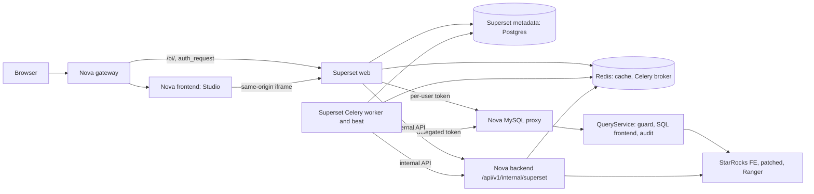

# Architecture 17: Superset as Studio's BI surface

> Status: **proposed, not implemented.** This document is the delivery plan for
> replacing Studio's viz-core chart and dashboard artifacts with Apache Superset.
> Until a phase below lands with its acceptance checks,
> [Architecture 16](arch-16-viz-core.md) describes the running system.

Nova ships Apache Superset as a built-in component and shows it inside Studio
as the surface for saved charts and dashboards. Superset brings its full feature
set; Nova keeps ownership of identity, the active role, data authorization,
SQL routing, and audit. Superset is never a second place where a user, a
password, or a data policy lives.

## Goals

- Every Superset feature that can run under Nova's security contract is
  available to Nova users, inside Studio, with one sign-in.
- Every Superset query runs as the signed-in Nova principal with exactly one
  named active role, through Nova's SQL path, governed by Ranger row filters
  and masks, and audited by Nova.
- Studio agents create and edit Superset charts and dashboards on the user's
  behalf, replacing `data_to_chart` and `dashboard_build` persistence.
- Upgrading Superset is a version bump plus patch rebase, not a port.

## Non-goals

- Porting, vendoring, or re-implementing Superset source inside Nova.
- A Superset user/password store, Superset row-level security, or any other
  data policy outside Ranger.
- Letting users register additional databases in Superset.
- Replacing inline chat visualizations. Ephemeral charts in a Studio answer
  (`frontend/src/features/studio/intelligent-ui/`) stay native; only saved
  artifacts move to Superset.
- A switch that turns Superset on or off. Per the root
  [AGENTS.md](../AGENTS.md), it ships active and is gated only on real
  prerequisites (authentication, the Nova database connection, Ranger).

## Decision: run pinned upstream Superset, never port it

| Option | Outcome | Verdict |
| --- | --- | --- |
| Port Superset code into Nova (FastAPI backend, Nova frontend) | Hundreds of thousands of lines coupled to Flask, Flask-AppBuilder, SQLAlchemy, Celery and a transactional metadata database. Nova would maintain a divergent fork, re-port every upstream release and security fix, and still end with fewer features | Rejected |
| Fork Superset | Same upgrade burden for every change, even ones a hook covers | Rejected |
| Use only `@superset-ui` chart packages in Nova's frontend | Chart rendering only: no SQL Lab, Explore, alerts, reports, saved queries | Rejected for the goal of all features |
| **Run upstream Superset at a pinned release, wrapped in a Nova image, connected through official hooks plus a small verified patch set** | All features, upstream upgrades stay mechanical, Nova code lives in Nova-owned files | **Chosen** |

This is the same model Nova uses for StarRocks: a pinned engine, small patches
under `patches/starrocks/` with a `verify.sh`, an image built from the official
release, and no vendored source tree ([patch baseline](../patches/starrocks/README.md)).

**Pin:** Superset `6.1.0` (released 2026-05-13). Every hook named below was
checked against that tag. Features only on Superset `master` (for example the
`SEMANTIC_LAYERS` flag) are not planned until a pinned release carries them.

## Architecture

### Component ownership

| Concern | Owner | Notes |
| --- | --- | --- |
| Authentication | StarRocks via [AuthService](../backend/app/modules/auth/service.py) | Superset never sees a password |
| Session, active role, context version | Nova session store in Redis | Superset holds only a reference |
| Data authorization, row filters, masks | Ranger through the patched FE | Superset dataset permissions are not a policy layer |
| SQL syntax, guard, `@stage`, audit | [QueryService](../backend/app/modules/query/service.py) behind the [MySQL proxy](../backend/app/proxy/README.md) | Superset never connects to StarRocks directly |
| Chart, dashboard, dataset definitions, saved queries, tags | Superset metadata database | Product-owned store, see [Storage](#storage) |
| Studio artifact index, provenance, thread link | `NOVA_SYSTEM.CONFIG_STUDIO_ARTIFACTS` | Pointer to the Superset object |
| Business meaning | Nova Semantic Views | Synced into Superset datasets, never authored there first |
| Agent loop | [assistant engine](../backend/app/modules/assistant/) | New tools call Superset's REST API as the user |

### Repository layout

| Path | Contents |
| --- | --- |
| `superset/Dockerfile` | `FROM apache/superset:6.1.0`, applies `patches/superset/`, installs `nova_superset` |
| `superset/superset_config.py` | Feature flags, hooks, theme, executors, cache and Celery wiring. Secrets come from environment placeholders only |
| `superset/nova_superset/` | Python package: security manager, connection mutator, event logger, Jinja addons, Nova API client |
| `superset/extensions/` | Superset extensions for Nova-specific UI inside Superset, when `ENABLE_EXTENSIONS` covers the need |
| `patches/superset/` | `6.1.0-*.patch`, `README.md`, `verify.sh`, mirroring `patches/starrocks/` |
| `backend/app/modules/superset/` | Internal API: token minting, delegation, provisioning, audit intake, semantic sync |
| `backend/app/proxy/auth.py` | Token login mode next to the existing scramble relay |
| `frontend/src/features/studio/` | Superset host panel and postMessage bridge |
| `docker/` | Superset web, worker, beat and metadata services in the existing compose project; gateway route `/bi/` |

## Security contract

Each rule below is a release blocker. A phase that touches a rule must show the
listed check passing on the governed (patched FE + Ranger) stack.

**S1. One identity source.** Superset runs a custom security manager
(`CUSTOM_SECURITY_MANAGER`) with remote-user authentication. The gateway
validates the Nova JWT with an `auth_request` to Nova and forwards the
principal; Superset creates or updates a shadow user with no usable password.
`AUTH_DB` login, self-registration, password reset, and the FAB user/role
editing views are disabled. A Nova user that cannot authenticate cannot reach
Superset.

**S2. Session binding.** The security manager stores the Nova session id on
the Flask request context. Superset does not cache identity beyond the
request; every request re-validates through the gateway.

**S3. Per-user data token.** `DB_CONNECTION_MUTATOR` asks Nova's internal API
for a short-lived token bound to `{principal, session_id, active_role,
security_context_version}` and places it in the connection URL as the
password for the Superset database "Nova". Rules:
- TTL is minutes, not hours; a token is useless once its session is gone.
- The proxy rejects the token if the session no longer exists, the active role
  changed, or `security_context_version` advanced (role switch, revocation).
- Tokens are opaque, stored hashed in Redis, never logged, never returned in an
  API response other than to the mutator over the internal network.
- `/api/v1/internal/superset/*` is unreachable through the gateway, as all
  `/api/v1/internal/` routes already are ([routes.conf](../docker/gateway/routes.conf)).

**S4. Proxy token login.** The proxy keeps the StarRocks scramble relay for
ordinary MySQL clients and adds a token mode for Superset. The token is
verified by the proxy itself; on success the proxy opens the engine session
from the bound Nova session and activates its role, exactly as the HTTP query
path does. Two verification designs are acceptable and Phase 1 picks one:
- *Preferred:* the proxy advertises `mysql_native_password` with its own
  scramble and verifies the client's response against the stored token, so no
  secret crosses the wire.
- *Fallback:* `mysql_clear_password` only on the internal network with TLS.
Either way the token mode is limited to the Superset service network identity
and fails closed on any mismatch. Unknown principals and `root` stay refused
(`_INTERNAL_ONLY_USERS`).

**S5. Background work uses explicit delegation.** Alerts, reports, thumbnails,
and cache warmup run in Celery with no live session. Their executors resolve to
a Superset user (`ALERT_REPORTS_EXECUTORS`, `THUMBNAIL_EXECUTORS`,
`CACHE_WARMUP_EXECUTORS`). The mutator then requests a *delegated* token from
Nova with the Superset service credential (a supported secret reference, not a
raw secret in config). Nova grants it only for an existing, enabled principal,
activates that principal's current **default role**, revalidates assignment at
every run, and executes through the existing impersonation contract used by
scheduled tasks ([execution.py](../backend/app/modules/task_orchestration/execution.py)):
a dedicated account with `IMPERSONATE` granted per owner, never on all users,
never `root` or `nova_admin`. A principal without a default role fails closed.

**S6. Superset roles gate features, not data.** Nova roles are StarRocks role
names (`ACCOUNTADMIN`, `SECURITYADMIN`, and customer roles such as `finance`).
At every login and role switch the security manager assigns exactly one of
three Superset roles from the *active* Nova role:

| Superset role | Based on | Can | Assigned when the active role is |
| --- | --- | --- | --- |
| `NovaViewer` | Gamma | View dashboards and charts shared with them | Any role not mapped below (default) |
| `NovaAuthor` | Alpha, minus database admin | Explore; create and edit charts, dashboards, datasets; SQL Lab | A role listed in Nova's BI author mapping |
| `NovaAdmin` | Admin, minus security and database admin | Manage Superset objects across owners | `ACCOUNTADMIN` |

The author mapping is Nova control-plane metadata in `NOVA_SYSTEM`, edited by
`ACCOUNTADMIN` through Nova, never inside Superset. An unmapped or missing role
gets `NovaViewer`; an ambiguous security context gets no Superset session.
Dataset-level access is granted broadly to authors (`all_datasource_access` on
the single Nova database) because Ranger decides what rows and columns each
principal sees.

**S7. Ranger is the only data policy.** Superset row-level security views and
APIs are removed from every Nova role. Dataset SQL, Jinja, and filters cannot
widen access because every statement runs as the principal through Ranger.

**S8. One database connection.** Bootstrap provisions exactly one Superset
database, "Nova", pointing at the proxy. No Nova role can create, edit, test,
or delete databases, or change "Nova"'s URI, impersonation, or extras.
Superset's database admin APIs are removed from all roles, including
`NovaAdmin`. Upload-to-database is disabled until a stage-backed path exists.

**S9. Cache isolation.** Superset data cache keys include principal, active
role, and `security_context_version`. `CACHE_IMPERSONATION` adds only the
username in 6.1.0, so `patches/superset/` extends
`add_impersonation_cache_key_if_needed` with the role and version. Thumbnail
cache keys get the same partition. Until the patch passes its tests, the "Nova"
database cache timeout is `0` and thumbnails stay off.

**S10. Async execution needs session binding.** Superset's async SQL Lab and
`GLOBAL_ASYNC_QUERIES` run in Celery, where the interactive session is not on
the request context. Treating them as background work would replace the
user's active role with the default role, which violates S3. They stay off
until a patch carries the Nova session reference from submission into the
Celery task and the proxy validates it like S3. Long-running interactive SQL
stays in Nova's Console.

**S11. ACCOUNTADMIN.** Statements from Superset pass the same guard as every
proxy statement. Superset bootstrap never creates, alters, or grants on
`ACCOUNTADMIN`.

**S12. Audit.** Data statements are audited by `QueryService` with the real
principal and role. Superset UI actions (create, edit, delete, export, share,
schedule) go through a custom `EVENT_LOGGER` to Nova's internal audit intake
and land in `NOVA_SYSTEM.AUDIT_LOG` with redacted fields. Refusals (denied
token, denied delegation, revoked session) are audited by Nova.

**S13. Secrets.** `SECRET_KEY`, the metadata database password, the Superset
service credential, and the impersonation account password come from
deployment secret references. They never appear in Superset UI, Superset
metadata, logs, Nova responses, frontend state, or agent context. Superset's
"Nova" database URI holds no credential at rest; the mutator supplies the token
per connection.

**S14. Browser boundary.** Superset is served same-origin under `/bi/`.
`TALISMAN_CONFIG` allows framing only by Nova's own origin
(`frame-ancestors 'self'`). The Embedded SDK and guest tokens are not used for
Nova users. If external sharing is added later, Nova alone mints guest tokens
and they follow S3's binding rules.

**S15. User-facing names.** Superset UI shows "Nova" as the data source and
`@stage` names for files. Storage vendors, endpoints, and credential-bearing
paths stay out of Superset objects, as for every Nova surface.

## Feature matrix

Status column: **Ships** (available when its phase lands), **Patch** (ships
after the named patch passes), **Blocked** (off, with the reason).

| Superset feature | How it runs in Nova | Hook or change | Phase | Status |
| --- | --- | --- | --- | --- |
| Dashboards, native filters, cross-filters, drill | Same-origin iframe in Studio and full page at `/bi/` | Security manager, gateway route | 1, 3 | Ships |
| Explore and chart editing | As the real user, through the proxy | Security manager, mutator | 1 | Ships |
| All chart types shipped in 6.1.0 | Unchanged | None | 1 | Ships |
| SQL Lab, synchronous | Through the proxy; `@stage` and the guard apply | Mutator | 1 | Ships |
| SQL Lab, async; `GLOBAL_ASYNC_QUERIES` | Session-bound Celery execution | `patches/superset/` session carry (S10) | 2 | Patch |
| Datasets: physical and virtual, metrics, calculated columns | Virtual datasets for agent artifacts; Semantic Views synced as datasets | Semantic sync job | 1, 5 | Ships |
| Jinja templating | Plus `nova_active_role()` | `JINJA_CONTEXT_ADDONS` | 1 | Ships |
| Saved queries, query history, tags, annotations | Superset metadata | None | 1 | Ships |
| Data cache | Partitioned by principal, role, context version | `CACHE_IMPERSONATION` + patch (S9) | 2 | Patch |
| Alerts and reports (email, Slack) | Owner, default role, delegated token | `ALERT_REPORTS_EXECUTORS`, mutator, delegation (S5) | 2 | Ships |
| Thumbnails and screenshots | Viewer, default role, partitioned cache | `THUMBNAIL_EXECUTORS`, patch (S9) | 2 | Patch |
| Cache warmup | Editor, default role | `CACHE_WARMUP_EXECUTORS`, delegation | 2 | Ships |
| Export: CSV, Excel, PNG, PDF, dashboard bundles | Superset exporters, audited by S12 | `EVENT_LOGGER` | 4 | Ships |
| Import of dashboard bundles | Allowed for authors; imported databases are rejected so S8 holds | Import guard in `nova_superset` | 4 | Ships |
| Theme, dark mode | Tokens derived from [DESIGN.md](../DESIGN.md) | `THEME_DEFAULT`, `THEME_DARK`, `THEME_DEFAULT_MODE` | 3 | Ships |
| Languages | Nova's supported languages | `LANGUAGES` | 3 | Ships |
| Nova UI inside Superset (for example "Ask Nova") | Superset extension | `ENABLE_EXTENSIONS`, verify in Phase 3 | 3 | Ships if the extension API covers it, else Patch |
| Dashboard RBAC, ownership, sharing | Superset objects, gated by S6 roles | Role mapping | 1 | Ships |
| Row-level security | Removed; Ranger owns it (S7) | Role definitions | — | Blocked |
| Database management, upload to database | Removed (S8) | Role definitions | — | Blocked |
| Embedded SDK, guest tokens | Not used for Nova users (S14) | — | — | Blocked |
| Semantic Layers | Only on Superset `master` | Re-evaluate at the next pin | — | Blocked |

## Storage

- **Superset metadata database: PostgreSQL**, owned by the Superset component.
  Superset requires PostgreSQL or MySQL for its metadata and does not support
  StarRocks. This is an explicit exception of the same kind as Ranger's policy
  database: it stores Superset objects only. Users, roles, passwords, policies,
  and Nova control-plane metadata never go there. It joins the existing compose
  project and the [backup module](../backend/app/modules/backup/)'s scope.
- **Redis:** Superset data cache, thumbnail cache, Celery broker and results,
  each on its own logical database. Runtime only, consistent with Redis's role.
- **`NOVA_SYSTEM.CONFIG_STUDIO_ARTIFACTS`:** gains a Superset object reference
  (kind and UUID). `owner_name`, `thread_id`, `agent_id`, `title`, and the
  read-only provenance SQL remain; `viz_spec` and `chart_spec` become legacy and
  are dropped in Phase 6. Schema changes follow the owning initialization in
  [artifact_repository.py](../backend/app/modules/agents/artifact_repository.py).
- **Report and screenshot payloads** that must persist go through Nova's
  managed storage abstraction, not a new bucket configured inside Superset.

## Studio integration

### Artifact model

A Studio artifact becomes a Nova record pointing at a Superset chart or
dashboard. Studio's sidebar, artifact list, provenance, and chat buttons stay
Nova components and read the Nova record; the body renders Superset.

### Host panel

`frontend/src/features/studio/` gains a Superset host that frames
`/bi/superset/dashboard/<uuid>/?standalone=…` or the Explore URL for a chart.
A postMessage bridge, origin-checked on both sides, carries:
- size changes so the panel fits its content;
- navigation requests (open in full page, open the source thread);
- theme mode changes from Nova;
- filter hand-off from a Studio answer into dashboard native filters.

Phase 3 confirms which of these 6.1.0 supports in standalone mode; gaps go
through an extension or a patch, not a fork.

### Agent tools

New tools in the shared assistant engine replace persistence in `data_to_chart`
and `dashboard_build` ([tool catalog](../backend/app/modules/agents/tool_catalog.py)):

1. Take the turn's verified result and its producing read-only statement.
2. Create or reuse a virtual dataset on "Nova" as the user.
3. Translate the chart intent into Superset `form_data` for the chosen viz type.
4. Create the chart, then the dashboard layout for multi-view requests.
5. Write the Nova artifact record with provenance and return it to the thread.

Calls go to Superset's REST API with the user's Nova JWT, accepted by the
security manager's request loader. Consent rules of the existing tools carry
over unchanged. The one-shot editor in
[artifact_editor.py](../backend/app/modules/agents/artifact_editor.py) is
rewritten to propose `form_data` and dataset SQL changes instead of `viz_spec`.

The `form_data` translator is the largest custom component. It is a typed,
tested mapping per supported viz type, not free-form model output: the model
picks a chart type and fields, the translator builds `form_data`, and
Superset's chart data API validates it before the artifact is saved.

## Patch policy

`patches/superset/` follows the StarRocks patch rules: each patch is minimal,
names its upstream file and reason, applies cleanly to the pinned tag, and is
checked by `verify.sh` in CI. A hook that covers the need always wins over a
patch. Planned patches:

| Patch | Reason | Rule |
| --- | --- | --- |
| Cache key partition | Add active role and context version to impersonated cache keys | S9 |
| Async session carry | Carry the Nova session reference into Celery query execution | S10 |
| Host bridge, if needed | Standalone-mode messages the bridge needs and 6.1.0 lacks | Studio host |

Each patch is offered upstream where it is generally useful, and dropped at the
first pin that makes it unnecessary.

## Delivery phases

Every phase is production quality: it lands complete with tests, docs, and its
acceptance criteria passing on the governed stack. No phase leaves a parallel
authoring path active.

### Phase 1: identity and governed data

Deliver: Superset web, worker, beat, and metadata services in the existing
compose project; `/bi/` gateway route with `auth_request`; security manager and
role mapping; internal token API; proxy token mode; mutator; bootstrap of the
single "Nova" database; role definitions removing RLS and database admin;
synchronous SQL Lab; `nova_active_role()` Jinja addon.

Acceptance:
- A Nova user opens `/bi/` and lands signed in; an unauthenticated request is
  redirected to Nova sign-in; Superset's own login, registration, and password
  reset are unreachable.
- Two principals with different active roles see different rows and masked
  columns for the same chart and the same SQL Lab statement.
- After a role switch, the next Superset query uses the new role; a query on a
  token minted before the switch is refused.
- After revoking a role assignment or disabling a user, the next Superset
  request and the next query are refused.
- An assigned-but-inactive role grants nothing.
- No Nova role can create or edit a database, open RLS, or change "Nova".
- `DROP ROLE ACCOUNTADMIN` from SQL Lab is refused by the guard.
- Every Superset query appears in `AUDIT_LOG` with the real principal and role.
- No secret appears in Superset metadata, Superset logs, Nova logs, or API
  responses (grep-based check over a full test run).

### Phase 2: background work and caches

Deliver: delegation API and executor wiring for alerts, reports, thumbnails,
and cache warmup; cache key patch; async session-carry patch; Celery and
headless browser services.

Acceptance:
- A scheduled report runs as its owner with the owner's default role and shows
  that role's rows; it fails closed when the owner is disabled or has no
  default role.
- Delegation is refused for `root`, `nova_admin`, unknown principals, and any
  principal without a per-owner `IMPERSONATE` grant.
- The same chart viewed by two principals, or by one principal under two roles,
  never returns the other's cached data or thumbnail.
- An async SQL Lab query runs with the submitting session's active role and is
  refused if that session ends or changes role before execution.

### Phase 3: Studio host

Deliver: artifact pointer columns; Superset host panel; postMessage bridge;
theme tokens from `DESIGN.md`; languages; extension for Nova UI inside Superset
where the extension API allows.

Acceptance:
- A Superset dashboard and chart open in Studio's artifact panel without a
  second sign-in, sized to content, in light and dark mode.
- Framing `/bi/` from any other origin is refused by CSP.
- Frontend checks pass: `pnpm lint`, `pnpm build`, `pnpm test:coverage`, and
  the CI browser layout checks for the artifact panel at desktop and phone
  widths.

### Phase 4: agents and editing

Deliver: new dataset, chart, and dashboard tools; typed `form_data` translator;
rewritten artifact editor; Superset exports with audit; import guard.

Acceptance:
- Studio trajectories in `tests/eval/` that previously produced chart and
  dashboard artifacts now produce Superset artifacts and pass.
- A created artifact re-opened by another principal shows that principal's
  governed rows, never the creator's.
- Every create, edit, export, and import is in `AUDIT_LOG`; an import that
  carries a database definition is rejected.
- The agent eval scorecard does not regress.

### Phase 5: semantics, observability, backup

Deliver: Semantic View to dataset sync; Superset metrics in the existing
Prometheus and Grafana; Superset metadata database in backup and restore.

Acceptance:
- A Semantic View change appears in its Superset dataset after sync; a dataset
  derived from a Semantic View cannot be edited into a divergent definition.
- Superset request, query, and Celery metrics are visible in Grafana.
- Backup and restore round-trip Superset objects alongside Nova metadata.

### Phase 6: migration and retirement

Deliver: converter from `viz_spec` charts and dashboards to Superset objects
with a per-artifact report; retirement of the viz core authoring path, legacy
renderer, `data_to_chart` persistence, and `dashboard_build`; updates to
[Architecture 16](arch-16-viz-core.md), `AGENTS.md` task routing, and user docs.

Acceptance:
- Every existing artifact is converted or listed with the exact feature that
  could not be carried (for example a level-of-detail expression or table
  calculation) and stays viewable read-only until re-saved.
- No code path writes `viz_spec` or `chart_spec`; the legacy columns are
  removed after conversion.
- Backend, frontend, eval, and governed integration suites pass on the final
  integrated result.

## Validation per phase

Phases follow the root [validation routing](../AGENTS.md#validation-routing):

| Change | Checks |
| --- | --- |
| `nova_superset`, internal API, proxy token mode | Backend unit suite with coverage, blocking Ruff on changed Python, mypy, seeded real-engine integration |
| Security contract S1–S15 | Patched-FE Ranger role and policy acceptance on the governed stack |
| `patches/superset/` | `patches/superset/verify.sh` against a clean 6.1.0 checkout plus Superset's own tests for the patched modules |
| Studio host and bridge | Frontend lint, build, coverage, CI browser layout checks |
| Agent tools | Affected `tests/eval/` trajectories and the agent eval scorecard |

## Risks

| Risk | Mitigation |
| --- | --- |
| Proxy token mode is a new login path | Phase 1 security review; fail closed on every mismatch; network-scoped to the Superset services; refusal audit |
| Patch drift on upgrade | Small patch set, `verify.sh` in CI, upstream contributions, hooks preferred |
| Viz-core features without a Superset equivalent | Per-artifact conversion report; read-only fallback until re-saved |
| `form_data` differs per viz type | Typed translator and validation through Superset's chart data API before saving |
| Superset UI is not Nova's design system | Theme tokens and extensions narrow the gap; accepted for Superset-owned screens |
| Extra services | Same compose project, health checks, metrics, backup scope |

## Decisions required before Phase 1

1. Accept a Superset-owned PostgreSQL metadata database as an exception to the
   `NOVA_SYSTEM`-only rule, scoped as in [Storage](#storage).
2. Confirm the viz core is retired in Phase 6 rather than kept alongside
   Superset.
3. Choose the proxy token verification design in S4.
4. Confirm background work runs under the owner's default role (S5).

## References

- [Superset 6.1.0 `config.py`](https://github.com/apache/superset/blob/6.1.0/superset/config.py):
  `CUSTOM_SECURITY_MANAGER`, `DB_CONNECTION_MUTATOR`, executors,
  `THEME_DEFAULT`, feature flags.
- [Superset 6.1.0 StarRocks engine spec](https://github.com/apache/superset/blob/6.1.0/superset/db_engine_specs/starrocks.py)
- [Superset configuration docs](https://superset.apache.org/admin-docs/configuration/configuring-superset):
  supported metadata databases.
- [Architecture 7: MySQL proxy](arch-07-mysql-proxy.md),
  [Architecture 8: Ranger authorization](arch-08-ranger-authorization.md),
  [Architecture 15: Governed Studio](arch-15-governed-studio.md),
  [Architecture 16: Viz core](arch-16-viz-core.md).
