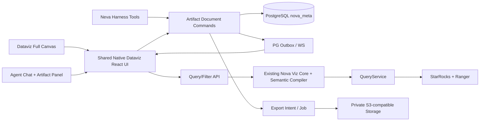

# NOVA NATIVE DATAVIZ — INTEGRATION MAP (V4 CURRENT → TARGET)
**Use with master spec.** This document maps *owners*, not independent replacement systems. `CURRENT` means confirmed static source presence; `TARGET` means not implemented until Codex verification.

## 1. Technical integration at a glance

## 2. Frontend ownership and modifications

| Existing area/file | Current responsibility | Native integration target |
|---|---|---|
| `frontend/src/features/studio/index.tsx` | Agent/Dataviz tabs and currently mounted iframe path | Native `DatavizWorkspace`, Agent right editor panel; old route mapping preserved |
| `studio-sidebar.tsx` | `Artifacts` old BI-only list | Unified five-type Artifact Library and old dashboards link redirect |
| `studio-tabs.tsx` | Top-level Agent / Dataviz | Preserve unchanged tab semantics; Canvas/Data live inside editor |
| `studio/dataviz/dataviz-workspace.tsx` | Embedded Superset + assistant panel | Replace with `NativeDatavizWorkspace`, sharing editor with Agent; no iframe |
| `studio/dataviz/dashboard-bridge.ts` | Superset frame/native filter context | Retire frame bridge; native `DashboardContextStore` with ID/revision/page/filters |
| `studio/artifact-explorer.tsx` | BI chart/dashboard list + Superset thumbnails | Unified library, stable native IDs, server metadata, five artifact filters |
| `studio/studio-artifacts.tsx` | BI editor/detail + legacy Viz Canvas | Shared artifact editor host, per-kind adapter; Chart/Dashboard native |
| `frontend/src/features/viz/dashboard-canvas.tsx` | Read-only 24-col CSS legacy renderer | v1 adapter for migration only; `NativeDashboardCanvas` GridStack 12-col main renderer |
| `frontend/src/features/viz/viz-view.tsx` | Existing presentation model | Reuse sanitization/formatting; ECharts registry + query response versioning |
| `frontend/src/features/agents/api.ts` | Studio API helper and Superset-related DTOs | Add typed Viz API client under existing `api-client.ts`; no parallel networking stack |
| `frontend/src/styles/theme.css`, `DESIGN.md` | Unified Nova palette, type and component rules | Only token aliases if justified; preserve current Nova design language |
| New shared feature package | N/A | `features/native-dataviz/{workspace,canvas,gridstack,chart,dataset,filter,inspector,share,events,...}` |

## 3. Backend ownership and modifications

| Existing owner | Current role | Native integration target |
|---|---|---|
| `backend/app/modules/viz/spec.py` | `WorksheetSpec` + DashboardSpec v1 24-col | Versioned models v2, compatibility converters and strict schemas |
| `modules/viz/compiler.py` | Safe SQL-ish compiler of shelf-based views | Extend typed semantic metric/filter/parameter compilation; reuse central SQL frontend and QueryService |
| `modules/viz/service.py` | Probe+compute, sequential dashboard zones, 500-row cap | Dataset service, bounded query orchestrator, separate table pagination, per-widget errors, policy-safe cache |
| `modules/viz/calc/*` | Formula parser/analyzer/lowering | Metric grain, joins, advanced/time intelligence and window calculation correctness |
| `modules/viz/presmodel.py`, `showme.py` | Presentation model and chart choice | Versioned chart result; valid field/type/chart registry; Neva suggestions |
| `modules/agents/studio_router.py` | Studio artifact API, direct Superset publish | Route to Native Viz Document Service for new writes; migrate legacy endpoints or redirect |
| `modules/agents/artifact_repository.py` | PG records with `bi_object_id` / owner | Read-only migration compatibility + new normalized native resources |
| `modules/agents/tools/{dashboard_build,data_to_chart,dataviz}.py` | Superset BI interactions | Typed native operations using same service as UI; consent, evidence receipts |
| `modules/agents/tool_catalog.py`, assistant run journal | Agent tool registration and persistence | Register native Viz tools; no duplicate LLM runtime |
| `backend/app/core/metadata_db.py` | PG17 actor-bound transactions | Reuse for `viz_*` tables, grants, revisions, outbox, jobs |
| `backend/metadata_migrations` | Existing schema 0045 dev epoch | Add versioned migration(s) + RLS, test migration/init compatibility |
| `modules/access_control`, Ranger integration | User + active role + policies | Used for data execution, ACL and action authorization; no new policy engine |
| `modules/query/service.py` | Caller SQL execution | Compiled dataset queries, cancel, limits, resource group and role-scoped context |
| Existing storage/stage and worker modules | S3-like adapters and durable jobs | Snapshot/export thumbnail and download receipts, scheduled outputs |
| `modules/superset` | Legacy Superset APIs/BI tokens/publication | Import/convert-only until cutover; retire entirely at final release |

## 4. End-to-end write flow

1. User or Neva calls the same typed `artifact.operations` API with artifact ID and expected revision. Server derives actor, active role and workspace from its authenticated context; checks `edit` and specific operation privilege.
2. PG transaction validates current definition, all referenced chart/dataset grants, revision and idempotency key. Inserts immutable new definition revision + operation receipt + outbox; commits atomically.
3. HTTP returns commit receipt. Outbox publisher wakes authorized WebSocket subscribers. Dataviz and Agent render the same revision. Duplicate retries return the prior operation receipt.
4. Client repositions ECharts/GridStack and shows `Saved` only from server acknowledgment. Neva animation is a visual overlay of the committed or pending semantic operation.
5. If a client has stale revision, return 409. It fetches current definition; non-overlapping patches may be rebased; overlapping changes need review. No auto-overwrite.

## 5. End-to-end live query flow

1. Viewer opens published dashboard or authorized draft. Server resolves pinned dataset/chart definitions and viewer's active role and ACL.
2. Viewer applies filter; client sends typed field/parameter bindings and target widget IDs (no raw SQL) to query batch endpoint.
3. Backend validates scope and field mappings, compiles under canonical Viz/Semantic engine, checks read-only safety and executes through `QueryService` as viewer; Ranger FE enforces table/column/row rights.
4. Bounded responses include query ID, typed columns, values, freshness, truncation and per-widget errors; cache key is security-context partitioned.
5. ECharts/TanStack render results; no caller-supplied executable options, no S3 blob full result required for ordinary live view.

## 6. Export and S3-compatible object flow

1. Authorized viewer explicitly requests export. Server checks `export` plus current underlying data access and creates a durable job.
2. Export worker executes current governed queries or captures approved publication snapshot, produces PDF/PNG/CSV/HTML in restricted renderer with no arbitrary outbound network.
3. Worker writes private immutable object with checksum, verifies HEAD/hash/size, publishes PG export receipt, then offers expiring authorized download.
4. On worker/storage crash, durable job/reconciler uses receipts. New exports don't mutate previous snapshots. User UI sees `Export ready` only after verified receipt.
5. **HTML Report** can reference Chart/Dashboard as live data bindings while open in Nova; static HTML export freezes current authorized values and embeds local safe assets, no API credentials.

## 7. Fresh/new chat cross-session flow

1. Artifact library and `@artifact` search query PG with actor/role scope; matches return ID, display title, kind, version and source permissions if safe.
2. User opens document in Agent panel; backend creates an authorized conversation-artifact binding only.
3. Neva obtains current revision/schema/query context from service, not from stale previous chat transcript.
4. If source/role changed, Neva explains access or schema problem rather than regenerating a second dashboard or running as an admin.
5. Action commits to stable artifact ID. Subsequent Dataviz visits and other authorized sessions see same version.

## 8. Cutover/runbook gate

- **Inventory** Superset charts/datasets/dashboards, filters, shares, schedules and original URLs. Keep backups and source IDs.
- **Convert** into native resources; check SQL/metric/filter semantics and screenshot/layout; unsupported saved in explicit exceptions list.
- **Freeze** writes, reconcile counts, ACL and deep links, publish new native routing. No prod dual-write.
- **Soak and validate** native Dataviz + Agent parity, Ranger, S3 exports, PG/WS recovery, scale and user roles.
- **Decommission** `/bi` iframe client, Superset APIs/container/Celery/etc only when all critical migration gates pass.
- Rollback after new native edits uses PG revision recovery, not stale Superset restoration.

## 9. Target stack (no required paid functionality)

| Function | Selected | Licensing/runtime |
|---|---|---|
| Grid editor | GridStack.js v14 pinned after compatibility POC | MIT, frontend |
| Visualization | Existing Apache ECharts 6.x | Apache-2.0, frontend |
| Tables/pivot presentation | Existing TanStack Table; optional TanStack Virtual | MIT, frontend; aggregation in StarRocks |
| SQL/math | Existing Viz Core + StarRocks | Current governed data plane |
| Metadata/security | PG17 nova_meta + existing Nova/Ranger | Existing control/data planes |
| Neva | Existing Python Agent Harness | Existing runtime |
| Long jobs | Existing Nova Task/worker/outbox | No new Celery/Superset dependency |
| File bytes | Configured private S3-compatible object storage | Existing vendor-neutral adapter |

**Audit status:** static source audit and research done. Implementation, migration, test execution and production HA verification not yet done.
