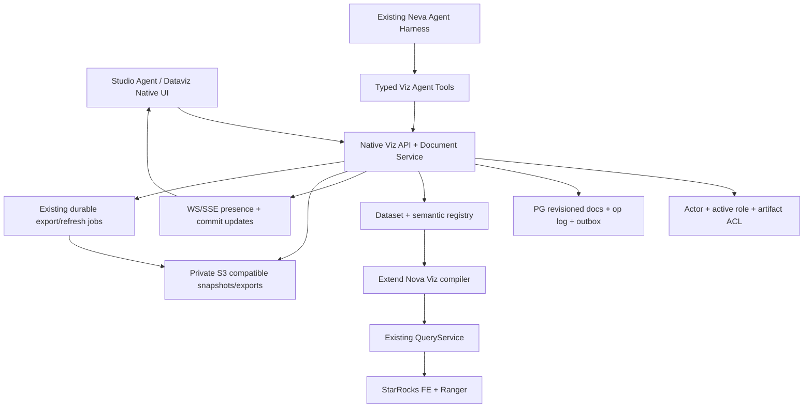

# NOVA NATIVE DATAVIZ — PRODUCTION IMPLEMENTATION SPEC
## Native Chart + Dashboard, GridStack Designer, Semantic BI, Neva Collaboration, and Superset Decommission

**Spec version:** 1.0 | **Prepared:** 2026-11-13 (Asia/Jakarta) | **Repository audited:** `nova-main (4).zip` | **Status:** TARGET/IMPLEMENTATION CONTRACT — **NOT implemented, benchmarked, or production certified**.

**Authoritative inputs:** this specification; the *current* repository's `AGENTS.md` and scoped engineering guides; `DESIGN.md`; `docs/architecture/production-refactor/*`; the supplied Databricks dashboard screenshots; previous Nova Dataviz and Artifact Panel decisions **only where not superseded below**. Read the repo afresh before making code edits. The design reference PNGs in this handoff are composition/concept references; use *actual Nova design tokens*, not their generic blue sample palette.

**Product goal:** Retire Apache Superset and replace it with an entirely self-hosted, genuinely open-source, AI-native Dataviz capability, preserving the necessary BI semantics. **Dataviz and Agent Artifact Panel are two responsive presentations of the SAME chart/dashboard document model, dataset definitions, query engine, revision history, permissions and event log.** Manual editing and Neva tool operations must converge, never fork into independent products.

**Hard prerequisites:** The repository's PostgreSQL metadata migration is active on its *documented dev epoch*, **not** proof of production HA readiness; do not add another PG metadata store or fall back to StarRocks for new metadata. StarRocks remains the authorized analytical/query plane. Only the user's principal + exactly one active role + Ranger controls user-data access. New UI, agent, viewer, export, and scheduled paths must share that enforcement.

---

## 0. Binding decisions, precedence and non-negotiable rules

| ID | Binding decision | Why / acceptance rule |
|---|---|---|
| ADR-01 | **Remove Superset as a runtime dependency after proven migration.** No `/bi` iframe or Superset API calls in the final product. | Build native views and convert existing assets; delete code/services only after reconciliation and approved exceptions. |
| ADR-02 | Keep exactly two top-level Studio perspectives: **Agent** and **Dataviz**. | `Dataviz` = full-width native dashboard library/viewer/designer; `Agent` = Neva chat + responsive Artifact Panel with the same editor components. |
| ADR-03 | Artifact catalog supports exactly five top-level editor document types: `spreadsheet`, `whiteboard`, `html_report`, `chart`, `dashboard`. | Dataset and semantic metric definitions are first-class **data-model resources** under Data tab, not an accidental sixth artifact card. |
| ADR-04 | Native chart is independently addressable/savable/versioned; dashboards reference chart IDs + pinned revision policies. | A saved chart is reused across multiple dashboards and conversations. |
| ADR-05 | **Canvas** and **Data** are sub-tabs inside a dashboard editor, not new Nova Studio top-level tabs. | Data tab creates SQL/table/view/approved semantic datasets; Canvas adds widgets, filters and interactions. |
| ADR-06 | **GridStack.js** is the layout engine with a canonical **12-column desktop grid**, backed by typed JSON only. | Never persist/render raw `grid.save()` HTML or accept arbitrary widget HTML. |
| ADR-07 | **Apache ECharts** is the primary visualization renderer. **TanStack Table + Virtual** is the native table renderer; server-side pivot/aggregation happens in StarRocks. | No AG Grid, no Enterprise add-ons, no commercial-license-dependent functionality. |
| ADR-08 | All indispensable dependencies must be genuine OSS (preferred MIT, Apache-2.0, BSD, ISC, PostgreSQL license). | No paid runtime keys, trials, evaluation/source-available restrictions, or open-core gated required features. Validate transitive SBOM. |
| ADR-09 | Preserve/extend Nova's `modules/viz` spec, compiler, calc language, and `QueryService`; no shadow SQL compiler or new agent loop. | Single typed calculation path; maintain legacy v1 reader/converter. |
| ADR-10 | New definitions and transaction state use **existing PostgreSQL 17 `nova_meta` actor-bound metadata facilities** with schema migrations, RLS, CAS and outbox. | No StarRocks `NOVA_SYSTEM` writes for new Dataviz metadata; no second DB/pool framework. |
| ADR-11 | **Viewer-permission execution only** in release 1: viewers execute data queries using their own active role; sharing a dashboard never grants source data rights. | Do NOT silently use publisher credentials to reveal rows. Published definition is frozen; query results remain current and caller-scoped. |
| ADR-12 | Dataset/metric/filter definitions are typed and versioned; dashboard input values are bound parameters/validated predicates, never string-interpolated SQL. | Reject destructive, multi-statement, unbounded, ungoverned or unsupported SQL. |
| ADR-13 | Server-side authorization precedes every read, write, publish, share, export, websocket join, and Neva operation. | UI hiding controls is not security; Ranger RBAC/RLS/masks remain effective. |
| ADR-14 | Drafts autosave safely; **Publish** creates an immutable definition revision; the published version cannot drift by following arbitrary chart edits. | Edits remain visible to editors only until approved publish. |
| ADR-15 | Cursor animation is **presence / progress visualization of real semantic operations**, not a screen-scraping Browser Use loop. | Commit receipts, not animation completion, determine success. |
| ADR-16 | Cross-chat artifact reuse is by stable IDs, explicit references and authorized library search; chat lifetime must not own documents. | New chat, role switches, reconnect, worker restart do not reset chart/dashboard identity or history. |
| ADR-17 | PostgreSQL stores small definitions, revisions, ACL and operations; S3-compatible object storage stores *immutable* thumbnails, PDFs, exports, large frozen snapshots. | No plaintext credentials, hidden live query data, or `s3://` locations in user-visible UI. |
| ADR-18 | No production dual-write to Superset; migrate with inventory, dry-runs, read-only cutover, reconciliation, tested redirect mapping and rollback gates. | Unknown/unsupported assets are retained/quarantined for explicit owner review; never silently deleted or inaccurately converted. |
| ADR-19 | Do not claim “Databricks parity” or “more powerful” until the reference feature matrix, benchmarks and capability tests are green. | Differentiation is native Neva collaboration + governed metric lineage + cross-artifact composability, not marketing alone. |
| ADR-20 | Follow `AGENTS.md`: no arbitrary product enable flags or second subsystem; new features expose honest capability errors where their environment is not ready. | Keep deployed production invariant and tests as final truth. |

**Precedence over previous docs:** The previously prepared Artifact Workspace v1.1 preserved Superset and selected licensed Univer components. Those decisions are **superseded** for Dataviz retirement and the OSS-only dependency policy. Codex MUST update all affected old docs, tool descriptions, prompts and user flows; do not leave contradicting “Superset is authoritative” assertions after cutover. Spreadsheet vendor choice is a separate license-compliant workstream, not license to block native Dataviz.

### 0.1 Explicit non-goals for first release

- Rewriting StarRocks, replacing Ranger, creating a new SQL frontend, or reconstructing all of Databricks' internal warehouse implementation.
- Embedding Superset as a hidden fallback in the final runtime.
- Anonymous public dashboards or publisher-credential-based shared-data execution. These require a separate scoped security design.
- Unrestricted execution of arbitrary JavaScript/HTML in dashboard widgets, third-party proprietary chart plugins or remote script injection.
- Claiming exact multi-chart, single-transaction data consistency without evidence from StarRocks; provide an honest consistency timestamp / per-query information instead.
- Making all five artifact types fully ready as part of the **Chart + Dashboard** delivery. Their shared library contracts must stay compatible, but the focus of this spec is native BI.

---

## 1. Source-code architecture audit — `nova-main (4).zip`

**Method:** static inspection of uploaded zip, README, current repository guides and source files. No live database, CI pipeline or browser runtime was executed. Severity describes *fit to the requested new product*, not an allegation that existing legacy code is malfunctioning.

| Finding | Severity for target | Current evidence in repository | Required response |
|---|---|---|---|
| PG control plane is now active in dev, schema 0045 | ASSET | `docs/architecture/production-refactor/DELIVERY_STATUS_AND_QA_BACKLOG.md`; `backend/app/core/metadata_db.py` | Build through existing actor-bound PG metadata + version migrations; do not assume prod HA/cutover QA complete. |
| Existing Studio has Agent and Dataviz, Superset iframe still mounted | BLOCKER | `frontend/src/features/studio/index.tsx`; `dataviz/dataviz-workspace.tsx`, `dashboard-bridge.ts`, `frontend/src/features/bi/` | Replace iframe with native dashboard library/viewer/designer mounted on `tab=dataviz`; leave only one Neva harness and one document engine. |
| Save chart/dashboard still calls Superset | BLOCKER | `backend/app/modules/agents/studio_router.py:create_artifact`; `backend/app/modules/superset/artifacts.py`; `dashboard_build.py`, `data_to_chart.py`, `dataviz.py` | Replace publishing with Nova dataset/chart/dashboard services. Follow end-to-end callers, not a superficial route rename. |
| Artifact persistence still references Superset IDs | BLOCKER | `backend/app/modules/agents/artifact_repository.py` with `bi_kind`, `bi_object_id`, `bi_dataset_id`, legacy view/edit paths | Add native immutable definitions and revisioned references; preserve old IDs in migration map for redirects. |
| Artifact ACL currently predominantly owner-centric | BLOCKER | `backend/metadata_migrations/0021_agents.sql` owner `agent_is_principal`; `0030_studio_artifact_projection.sql` narrow shared-dashboard projection | Add explicit role/user resource grants with read/interact/comment/edit/publish/manage/export and RLS; source rights still checked separately. |
| Viz core exists with typed worksheet and calculated fields | REUSE | `backend/app/modules/viz/spec.py`, `calc/{analyzer,syntax,lower}.py`, `compiler.py`, `presmodel.py`, `showme.py` | Extend to v2 semantic fields, dataset IDs, richer chart types, filter AST, more complete time intelligence; preserve v1 converter. |
| Legacy DashboardSpec 24 columns, max 48 zones | HIGH | `backend/app/modules/viz/spec.py:ZoneRect,DashboardSpec` | Native dashboard v2 uses 12-col GridStack canonical positions, pages and scalable widgets. Validate and convert old layouts without corrupting collisions. |
| Filter merge overwrites same field | BLOCKER | `WorksheetSpec.with_extra_filters()` merges a dict keyed only by `field` | Build typed, scoped expression tree with AND/OR/NOT, provenance and aggregation stage; never silently overwrite separate predicates. |
| VizService row cap and source type sniffing | HIGH | `backend/app/modules/viz/service.py`: `MAX_COMPUTE_ROWS=500`, `PROBE_ROWS=100` + sample-value inference | Use catalog/engine schema metadata with proper types; server-side pagination for tables; bounded result sets per visual type. |
| Dashboard compute loops through widgets sequentially | HIGH | `VizService.compute_dashboard()` loops `for zone in spec.sheet_zones()` and awaits `compute()` per zone | Add bounded, cancellation-aware parallel batching and query deduplication. Preserve per-widget errors. |
| SQL artifact validation is read-only, but viz source needs stronger integration | HIGH | `artifact_repository.validate_artifact_sql`; `viz/compiler.py:source_expression()`; `VizService._execute()` | Central AST read-only classification + bound param compiler; source revision/type validation. In `VizService`, optional `database_name/schema_name` are accepted by `compute()` but not passed to `_execute()`; correct scope resolution in v2. |
| Existing dashboard read-only view is CSS 24-column | HIGH | `frontend/src/features/viz/dashboard-canvas.tsx` | Replace with reusable `NativeDashboardCanvas` powered by GridStack in Edit and View modes; keep v1 read-only compatibility only until conversion. |
| Existing client stack already includes ECharts and TanStack Table | REUSE | `frontend/package.json`: `echarts ^6.1.0`, `@tanstack/react-table ^8.21.3`, React 19, Tailwind 4, Monaco, Zod 4 | Reuse; add only pinned GridStack MIT, optionally TanStack Virtual MIT; no AG Grid. |
| Existing design system includes analytics tokens and enforced gates | REUSE | `DESIGN.md`, `frontend/src/styles/theme.css`, `viz-mark`, `viz-highlight`, `chart-1..9`, `type-*` | Use Nova tokens; design screenshots show generic blue accents and must not override Nova's own primary/semantic vocabulary. |
| Agent tooling and durable journal exist | REUSE | `backend/app/modules/agents/tool_catalog.py`, `tools/{dashboard_build,data_to_chart,dataviz}.py`, assistant run journal, PG metadata | Replace Superset tool effects with typed native operations + approval/revision/receipt, not new agent instance/runner. |
| Existing tests cover old paths | REUSE + GAP | `frontend/src/features/{viz,studio/dataviz}/*.test*`, `backend/tests/{unit,integration,eval}` for viz/Superset | Keep all relevant metrics and new golden BI tests; remove obsolete Superset tests only with migration proof. |
| `DESIGN.md` root prohibits ad-hoc colors, storage vendor paths | MUST FOLLOW | `DESIGN.md` A1/A2/A3; `frontend/AGENTS.md` | Use semantic tokens and existing stage/display model. |

**Code quality finding:** The existing v1 Viz Core supports a meaningful subset of BI calculations, but is **not yet** a complete governed semantic model or full dashboard builder. Do not bypass it with a second frontend SQL generator. Preserve working calculation semantics and evolve under versioned contracts.

### 1.1 Relevant read/modify map

- **Frontend shell**: `frontend/src/features/studio/index.tsx`, `studio-sidebar.tsx`, `studio-tabs.tsx`, `studio-artifacts.tsx`, `artifact-explorer.tsx`; `frontend/src/features/studio/dataviz/*`; `frontend/src/features/viz/*`; `frontend/src/features/agents/api.ts`.
- **Frontend design**: `DESIGN.md`; `frontend/src/styles/theme.css`; `src/styles/index.css`; shared `src/components/ui/*`; `src/lib/api-client.ts`; `src/lib/read-token.ts`.
- **Viz engine**: `backend/app/modules/viz/spec.py`, `compiler.py`, `service.py`, `presmodel.py`, `showme.py`, `calc/*`.
- **Artifact and Agent**: `backend/app/modules/agents/{studio_router,studio_schemas,artifact_repository,metadata_repository,tool_catalog}.py`; `agents/tools/{dashboard_build,data_to_chart,dataviz,semantic_query}.py`; `assistant/*`.
- **Auth**: `backend/app/modules/access_control/*`, `backend/app/modules/auth/*`, patched StarRocks/Ranger integration, `core/metadata_actor.py`, `core/metadata_db.py`.
- **Storage**: `backend/metadata_migrations/`, existing object storage/stage providers, durable jobs/outbox and worker roles.
- **Superset decommission**: `superset/`, `backend/app/modules/superset/*`, `frontend/src/features/bi/*`, `docs/{arch-17-superset,arch-19-studio-dataviz}.md`, `/bi` gateway and Compose profiles; ***grep all callers before removal***.

---

## 2. End-user product and two perspectives

### 2.1 Dataviz — full dashboard workspace

1. Entry `Studio → Dataviz`. Root lists only **Dashboard** documents the current principal/active role may view; searchable by workspace, owner, status, updated time, favorites.
2. Opening dashboard defaults to **View Published** for viewers; owner/editor can explicitly select **Edit Draft**. `New Dashboard` creates a draft with page `Page 1`.
3. Editor internal sub-tabs **Canvas** and **Data**. Canvas contains 12-column GridStack, filter widgets, chart and table widgets, floating widget palette and right inspector. Data contains dataset library, SQL editor/table source browser, schema/preview, parameters, measures, relationships.
4. Viewers: interactive filters, linked navigation, cross-filter, drill, download/export if granted, explanation from Neva only if underlying data accessible; **no drag or resize**.
5. Editors: drag/drop/resizing widgets, configure X/Y/color/labels/aggregation, set filter scopes, undo/redo, save draft; publisher reviews immutable diff and publishes.
6. Each dashboard supports pages; page filter is page-local, global filter is dashboard-wide, widget filter is configured by author. Cross-filter is a per-viewer transient selection.
7. `Share` grants resource permissions to normalized users or roles; current role and Ranger policies still determine data visibility. No dashboard-level bypass.

### 2.2 Agent — collaborative Artifact Panel

1. Entry `Studio → Agent`, chat remains active. Artifact Panel opens at right (resizable); select Chart/Dashboard among the five document types.
2. Neva can create dataset, chart, dashboard, set metric, add/move/resize chart, apply filters, improve presentation, explain visible results **through the same native services** as Dataviz.
3. User sees Neva's labeled virtual cursor, target highlight, progress, diff/approval for structural/destructive edits. A user editing a different widget is never blocked by unrelated Neva actions.
4. Data/Canvas sub-tabs, right inspector, widget configurations, keyboard shortcuts and save behavior are shared components; panel width changes layout but not meaning/permissions.
5. New chat may open a previously saved dashboard by `@artifact`, search, `artifact_id`, deep link or authorized recent selection. Neva resolves ambiguity by showing candidates rather than assuming a same-named document.
6. No hidden second chart store, per-chat duplicate dashboard, or ephemeral LLM-only sheet. Chat carries a link + authorized context token, not the source of truth.

### 2.2.1 Canonical navigation and backward compatibility

| Route/input | Native target | Migration rule |
|---|---|---|
| `/studio?tab=dataviz` | Native dashboard library, viewer and full designer | No Superset frame; dashboards only in list |
| `/studio?tab=dataviz&dashboard_id=<uuid>` | Native dashboard published viewer / authorized editor | Exact native ID; permission-gated |
| `/studio?tab=agent&view=artifacts` | Unified 5-type Artifact Library | Converted legacy chart/dashboard entries still appear as appropriate |
| `/studio?tab=agent&artifact_id=<uuid>` | Agent chat with right Artifact Panel | Stable document ref; thread independent |
| Legacy `view=dashboards` | Native Dataviz dashboard list | Client/router redirect; no loss of history/favorites |
| Legacy Superset dashboard/chart deep link or `/bi/...` | Authenticated lookup in `viz_legacy_mappings`, then safe native route | Missing/unauthorized = safe archived/404; never direct unguarded numeric-ID reveal |

The `view=artifacts` URL was previously a BI-only library; after conversion it becomes the unified library while preserving the converted chart/dashboard IDs through mapping. Do not make a silent path collision: add router tests for old query parameters and canonical redirects.

### 2.3 Cross-session and cross-artifact usage

- Dashboard document ID is independent of `thread_id`; linking to chat creates `conversation_artifact_binding`, not a new dashboard.
- Persist last open document/active page per user+workspace, but treat it as a convenience and revalidate on every session.
- When opening a dashboard from a new chat, pin the starting draft/published revision, current role/security epoch, filter state, and page. Re-resolve selected widgets on each tool action.
- Other artifacts may embed read-only **bound results** (e.g., HTML Report references a native chart ID/data snapshot). Live HTML Report preview uses existing Nova query pathways, static HTML export freezes resolved values and never ships API tokens/SQL credentials.
- Spreadsheet/Whiteboard integrations use explicit data/artifact lineage references, never implicit access to every artifact in the workspace.

### 2.4 User journeys that MUST work

A. **Manual BI**: create dashboard → Data tab add table or read-only SQL dataset → validate fields → Canvas add chart → choose X/Y/aggregation/color → add scoped single/multi/date filter → add KPI and table → drag/resize → save draft → share editor with role → publish → viewer filters and drills. 

B. **Agent-created BI**: user asks “Buatkan dashboard penjualan dengan KPI, trend YoY, produk teratas, dan filter customer” → Neva resolves semantic sources/metrics, proposes chart types, generates typed native draft → visible operations/cursor → user corrects one chart manually → Neva re-reads revision and improves layout → user approves/publishes.

C. **Cross-session**: leave chat → create new conversation tomorrow → `@Sales Dashboard` → Neva reauths, reads active page/filters, explains a KPI and modifies only the approved chart → changes appear instantly in Dataviz draft. Published view remains unchanged until publish.

D. **Shared rights**: owner shares `VIEW+INTERACT` with role `SalesViewer`, `EDIT` with user `analyst@example`; an assigned-but-inactive role or denied underlying table does not yield data; a revoked grant closes live subscriptions and denies subsequent queries.

E. **Superset retirement**: export legacy dashboard/chart/dataset/permission inventory → convert into native versioned docs → compare query outputs and scope → map deep links → mark exceptions → cut over and verify → remove Superset infrastructure only after exit gates.

---

## 3. Target architecture and strict ownership



**Ownership rules:**

- **API router** handles DTO validation and status mapping, not SQL string construction or direct S3 writes.
- **Viz Document Service** is the *only* owner of dataset/chart/dashboard mutations, permissions, version CAS and outbox. It works in a single PG transaction for local metadata effects.
- **Dataset Registry** stores validated source identity and schema version; does not execute arbitrary user SQL in metadata transactions.
- **Semantic Compiler** emits a typed, bounded SQL plan, not ECharts configuration or free-form model-generated SQL. It may consume existing Ontology/Semantic Views instead of duplicating governance.
- **Execution Service** sends compiled plans to existing caller-impersonated QueryService. Return typed rows, field metadata, query IDs, duration, provenance and freshness; no global service account data query.
- **Presentation Renderer** maps server-returned canonical chart data/spec to ECharts/TanStack; React holds interaction state, never becomes authoritative for permissions or metrics.
- **GridStack adapter** serializes only canonical `[{widget_id,x,y,w,h,...}]`; server checks bounds, uniqueness and overlap and rejects invalid layouts.
- **Agent tools** and **direct UI** call identical document commands and read query services. They never directly alter DB rows or browser DOM.
- **PG** remains authority for durable state; Redis/pubsub may wake listeners but never proves that an operation committed.
- **S3-compatible storage** is object payload storage only, private by default; PG stores digest, size, version, tenant and publication pointer.

**Reuse first:** extend `backend/app/modules/viz` with cohesive `datasets/`, `semantic/`, `dashboard/`, `documents/`, `security/`, `operations/`, `exports/` modules where needed. Do not create a parallel `viz_native` compiler that conflicts with the existing `viz/compiler.py`. Frontend may create `frontend/src/features/native-dataviz/` as a shared feature and mount it from both Studio perspectives; reuse existing design components.

---

## 4. Canonical data model, versioning, and integrity

### 4.1 Stable identities and scope

Define `artifact_id UUID`, `dataset_id UUID`, `dashboard_id UUID=artifact_id`, `chart_id UUID=artifact_id`, `page_id UUID`, `widget_id UUID`, `operation_id UUID`, `revision BIGINT`, `publication_id UUID`, `workspace_id`, owner principal, ACL subjects. Native IDs never depend on Superset's integers, thread IDs, or UI DOM IDs.

**Dataset kinds:** `table`, `view`, `sql`, `semantic_model` (published/authorized metric view), `dashboard_local_metric_view`. An upload from a file, if offered, must first go through Nova's governed import/Stage service to a tracked, authorized table or versioned dataset resource. Never process an arbitrary untrusted spreadsheet as direct SQL text.

**Dataset version fields:** source kind/immutable physical source UUID when available, qualified catalog/database/schema/object, validated read-only SQL AST digest when applicable, declared grain, columns (stable field IDs, logical/physical type, nullability, timezone), named typed parameters, transformation/calculation refs, relationship references, schema fingerprint, owner, status, timestamps.

**Chart v2 fields:** id, dataset_id+revision, chart_type, axes/encodings, measures, aggregations, SQL-backed field bindings, per-chart filters, presentation settings, color-by, ordering, topN, annotations, tableCalc definitions, result cap policy, owner, revision and validity diagnostics. No saved ECharts executable callbacks/functions.

**Dashboard v2 fields:** id, current draft revision, published revision ID, title, description, workspace, pages; each page has widgets with `type`, `chart_id`, `chart_revision` or `revision_policy`, position, style; filter widgets define field mappings, target scopes, defaults; actions define cross-filter/drill; bookmark/style/theme metadata; sharing. Published revision pins all referenced chart/dataset definitions, **not the live query rows**.

**A single Chart may appear multiple times:** widget ID is separate from chart ID; widget-level style overrides and filter context are separate; editing a referenced chart creates a new chart definition revision. Draft dashboards must explicitly opt into updating their chart revision. Published dashboards are always frozen to a named chart definition revision until republished.

### 4.2 Minimum canonical TypeScript/Python JSON contracts

```typescript
// Illustrative domain DTOs, not a second frontend truth.
type DataBinding = {
  dataset_id: string; dataset_revision: number;
  field_id: string; semantic_role: "dimension" | "measure";
  aggregation?: "sum" | "avg" | "min" | "max" | "count" | "count_distinct" | "median";
  date_grain?: "day" | "week" | "month" | "quarter" | "year";
};

type ChartDefinitionV2 = {
  schema_version: 2; chart_id: string; dataset_id: string; dataset_revision: number;
  visual: "kpi" | "bar" | "line" | "area" | "combo" | "pie" | "scatter" |
          "heatmap" | "histogram" | "funnel" | "gauge" | "table" | "pivot" |
          "treemap" | "waterfall" | "boxplot" | "map";
  encoding: Record<string, DataBinding | DataBinding[] | null>;
  filters: TypedFilterExpression | null;
  formatting: Record<string, unknown>; // strict subtype by chart type
};

type DashboardWidgetV2 = {
  widget_id: string; kind: "chart" | "filter" | "text" | "image" | "spacer";
  chart_ref?: { chart_id: string; revision: number };
  layout: { x: number; y: number; w: number; h: number }; // canonical 12 columns
  settings: Record<string, unknown>; // typed, no HTML/js function
};

type DashboardDefinitionV2 = {
  schema_version: 2; dashboard_id: string; title: string;
  pages: Array<{ page_id: string; title: string; widgets: DashboardWidgetV2[] }>;
  filters: FilterWidgetDefinition[]; actions: DashboardInteractionAction[];
};
```

The `Record<string, unknown>` placeholders must become discriminated, strict Pydantic/Zod types **before** running the implementation. No passthrough unsafe payloads or private fields. Generate frontend schema bindings from the backend canonical OpenAPI/schema wherever practical; add schema drift CI checks.

### 4.3 Consistency model

- Dataset/schema/metric/chart/dashboard definition revision: **immutable snapshots** after commit.
- Draft editing: optimistic concurrency using PG `WHERE revision = expected_revision`, increment once per successful operation group; ambiguous commit outcome requires operation lookup, not blind retry.
- Published: immutable pointer to a definition commit; a failure to update publication pointer must leave the prior published version valid.
- Query results: live per viewer/role, not transactionally tied to dashboard publication; show query freshness timestamp. Avoid claiming chart-wide snapshot atomicity if engine cannot supply it.
- Presence: ephemeral; may be dropped and reconstructed. Committed operations: durable PG journal/outbox; no dropped edits after WebSocket disconnect.
- Delete: soft-delete/tombstone with retention and owner checks; published references and exports have explicit dependency/retention policies; never cascading delete a shared chart silently.

---

## 5. PostgreSQL metadata schema and RLS contract

Use additive migrations in `backend/metadata_migrations/` and the current `nova_meta` transaction, grants, actor and schema-epoch machinery. Prefer consistent repository naming; do not execute the illustrative DDL directly against an existing production DB without migration review.

Required logical tables (adjust physical names only if collision with current migrations):

| Table | Primary columns / purpose | Unique / security invariants |
|---|---|---|
| `viz_artifacts` | `artifact_id`, `workspace_id`, `kind`, `owner`, `draft_revision`, `published_revision_id`, `deleted_at` | Stable UUID; type restricted; scoped owner; indexes `(workspace,kind,updated)` |
| `viz_artifact_revisions` | `(artifact_id,revision)`, `schema_version`, `definition_jsonb`, `digest`, `actor`, `created_at` | Immutable; FK; unique rev, typed validation and max serialized bytes |
| `viz_datasets` | `dataset_id`, `workspace_id`, `owner`, `current_revision`, `status` | Source physical identity and permission boundary |
| `viz_dataset_revisions` | `(dataset_id,revision)`, `source`, `field_schema`, `sql_digest`, `parameters`, `lineage` | Immutable, read-only schema/SQL validity |
| `viz_metric_definitions` | metric ID, scope, name, formula, aggregation grain, unit, version | Qualified identity, no name collision/ambiguous override |
| `viz_acl_grants` | `resource_id`, `subject_type`, `subject_id`, `permission`, grantor, rev, expiry | `(resource,subject,permission)` unique; only owner/managers grant |
| `viz_operations` | `operation_id`, artifact, actor, run ID, base revision, committed revision, patch, digest | Idempotency key unique per actor/operation, durable receipt |
| `viz_publications` | `publication_id`, artifact, artifact_revision, resolved chart/dataset pin map, author, timestamp | Immutable definition release, one current pointer in `viz_artifacts` |
| `viz_outbox` | event ID, operation ID, type, payload/ref, committed timestamp, delivery status | PG transaction with metadata change; idempotent publication |
| `viz_query_audit` | execution/request ID, resource IDs, principal/active role, policy context hash, query digest, status/timing | Redacted metadata only, no raw result values or secrets |
| `viz_exports` | job ID, publication/ref, requesting principal, status, object key/digest, expiry | Expiring access and receipt; no permanent public links |
| `viz_legacy_mappings` | provider `superset`, old chart/dashboard/dataset ID, new resource ID, conversion status, evidence | Unique by `(provider,kind,old_id)`; redirects verified |

**RLS:** `ENABLE ROW LEVEL SECURITY` and `FORCE ROW LEVEL SECURITY` for each owned table as appropriate. Policies depend on an actor/role context established by existing `MetadataDB` transaction machinery, **not** arbitrary strings supplied in SQL or HTTP. Service accounts do not gain unrestricted application-domain SELECT. ACL authorization must be checked inside the same transaction as mutation; published read projections must not leak owner SQL or query result rows.

**Permissions:** canonical actions are `view`, `interact`, `comment`, `edit`, `publish`, `manage`, `export`. `owner` implicitly has all; a grant may target a normalized individual principal or a Nova role. Role grants apply **only to the currently active role**, not union of all assigned roles. An individual grant is separate and still requires successful login/workspace membership. `edit` implies `view`, `publish` requires `edit`, `manage` requires ownership or an explicit `manage` grant; use expansion rules at authorization time and test them. `export` is independently granted. No implicit world-readable/workspace-wide grants.

**Data-access separation:** artifact `view` is necessary but insufficient to run its underlying dataset. Query authorization always checks active role + Ranger permissions for each referenced table/metric. Unavailable/denied queries return a safe per-widget error; never query as author/publisher to “fix” access. Metadata titles and aggregated membership also require RLS.

**Transaction**: use stable `operation_id`, insert idempotency receipt, lock/compare artifact revision, validate all affected references/ACL, insert immutable revision(s), update draft or publish pointer, append outbox, commit. One PG transaction; external S3/StarRocks effects are handled with durable intent+verification rather than pretending a distributed transaction exists.

---
## 6. Dashboard Data tab — dataset authoring, SQL and semantic modeling

**UI contract:** Data sub-tab is a full editor with left `Datasets` list (+ Add Dataset / SQL / Existing Table/View / Approved Metric), center SQL/visual definition and sample result, and right `Fields / Parameters / Schema / Lineage`. Dataset editor is part of the dashboard workspace but dataset IDs may also be published for reuse subject to grants. New datasets open with zero real data until authorized preview; never fabricate placeholder metrics in a saved artifact.

### 6.1 Dataset creation

1. **Existing table/view:** choose catalog+database+schema+physical object via Nova's authenticated catalog browser; resolve physical identity and column schema; store a read-only selection plan, not a copied table. Row limit and aggregation are applied by query compiler.
2. **SQL:** use existing Monaco editor; accept one strictly read-only composable `SELECT` / `WITH ... SELECT` statement. Parse with central SQL frontend and enforce forbidden constructs, fully bound named parameters, table dependencies and current-role validation; `EXPLAIN`, DML, DDL, multi-statements, user variables, external URL retrieval and uncertain connector queries are refused.
3. **Semantic source:** reference governed Ontology/Semantic Views if already published and supported, without reconstructing their permission system. For dashboard-specific measures/joins, create a `dashboard_local_metric_view` with explicit grain and typed relationships. Promote to shared semantic registry only through an authorized workflow and a new revision.
4. **Upload:** delegate to existing Nova Stage/import service, not a new CSV uploader with bypassed access controls.
5. **Preview/schema:** fetch column types and nullability from engine/catalog metadata or a zero-row query plan; 100 sampled non-null values are *not* authoritative. Sample queries execute as caller under quota; show bounded records + actual total only if count is queried and authorized.
6. **Save:** validate schema, source bindings, metric plan and safety; persist immutable revision. If source is renamed/dropped/replaced, mark `SCHEMA_STALE` and require explicit repair, never silently bind by a reused name.

### 6.2 Typed parameters

Parameters are input values within the dataset SQL/semantic plan (e.g. `:start_date`, `:customer_id`) and are **not the same thing** as field filters. Types: `string`, `boolean`, `integer`, `decimal`, `date`, `timestamp`, `enum`, and bounded list only where plan supports it. Store declared types, default values, optional/required, nullable, allowed values/ranges, scope and sensitive parameter flag. Bind values through driver/query planner; user input cannot alter SQL syntax, table identifiers, arbitrary `ORDER BY`, or IAM role.

```sql
-- A dashboard SQL dataset, not a template to interpolate with string replace.
SELECT order_date, region, customer_id, total_amount
FROM sales.orders
WHERE order_date >= :date_from
  AND order_date < :date_to;
```

`date_from` and `date_to` bind as date/timestamp, with consistent timezone and half-open interval. Relative dates evaluate against an explicit clock/timezone at query time; include resolved bounds in audit/cache context.

### 6.3 Dashboard-local metrics, relationships and exact aggregation

- Define immutable semantic field identities, not loose display labels; `Revenue` must point to a metric ID + revision and a declared fact grain.
- Distinguish row-level dimension/expression, aggregate measure and post-aggregate/window calculation. Illegal aggregation nesting is rejected before SQL execution.
- Ratio measures are **ratio of aggregated numerators/denominators** unless definition explicitly says otherwise. E.g. `SUM(profit)/NULLIF(SUM(revenue),0)`, never naive `AVG(profit/revenue)` unless requested.
- Relationships: declared join keys, cardinality (`1:1`, `many:1`, `1:many`, `many:many`) and join type. For metrics, require fanout safety; refuse unsupported many-to-many or calculate using pre-aggregation/semi-join with golden proof.
- Multiple fact tables/grains require a governed semantic model and verified fanout handling; no automatic joins based solely on matching column names.
- Prevent count-distinct corruption, average-of-averages, null denominator, mixed currency/unit, timezone mismatch and implicit data type cast. Include unit and currency metadata in metric definitions.
- Existing `viz/calc/*` is the starting implementation. Add typed expressions for `running_total`, `rank`, `percent_of_total`, `difference`, `lag`, `moving_average`, period comparison, fiscal-calendar aggregations and date bucketing through the same compiler/test harness.
- Scope of semantic measure: dashboard-local (draft/revision) or shared/approved. `Show SQL` displays sanitized compiled SQL and provenance, not raw secrets.

### 6.4 Time intelligence

Required: day/week/month/quarter/year, ISO week vs configured business week, MTD/QTD/YTD, MoM/QoQ/YoY, previous-period comparisons, rolling N-day/month windows, moving average, growth %, fiscal year start, timezone/DST, leap year, dates with missing periods, current partial period and parameter-bound period overrides.

**Correctness cases:** `2024-02-29` prior-year mapping must have explicit strategy (calendar-aligned/last-day policy); a week crossing Dec/Jan uses ISO week-year when ISO selected; percentages on zero or missing denominators return typed `null`/N/A, never misleading infinity; chart labels are localized without changing grouping semantics.

---

## 7. Chart builder — native editor and chart semantics

**Canvas workflow:** select a widget → right inspector tabs `Configure`, `Style`, `Interactions` (and conditional `Filter` subpanel) → choose Dataset → Visualization → field shelves by name/role/type → X axis / Y axis (one or more measures) / Color-Group / Size / Label / Tooltip / Aggregation → preview under bounded query → save `Chart Definition` and widget reference. The inspector must match the supplied screenshot **layout hierarchy**, not its exact brand blue palette.

### 7.1 Required visualization registry

| Visual type | Baseline | Encodings and authoring rules | Engine |
|---|---|---|---|
| KPI / counter | P0 | 1 metric, optional previous period, target, delta/percentage, number format | Native KPI React |
| Bar / horizontal bar / grouped / stacked / 100% stacked | P0 | categorical X or Y, measure(s), color/group; sorting/topN | ECharts |
| Line / area / smooth / step | P0 | time or ordered dimension X, measure(s), grouping, null-gap options | ECharts |
| Pie / donut | P0 | category + nonnegative measure; cardinality cap, `Other` policy | ECharts |
| Combo / dual Y | P1 | common X; explicit bar/line series and units left/right | ECharts |
| Scatter / bubble | P1 | quantitative X/Y, optional size, color, tooltip/detail | ECharts |
| Heatmap / calendar heatmap | P1 | X/Y bin or date, aggregated value, color scale | ECharts |
| Histogram / boxplot / waterfall / funnel / gauge | P1 | typed distribution/sequence and correct aggregation | ECharts |
| Treemap / sankey | P1 | hierarchy/flow validation; cycles handled | ECharts |
| Map / spatial | P1 | governed coordinates/geometry, sanitized MapLibre layers/tiles | Existing MapLibre + ECharts where appropriate |
| Table | P0 | dimensions/measures, server sort/filter/pagination, total rows | TanStack Table + Virtual |
| Pivot table | P1 (required before Superset off if existing usage) | rows, columns, values, aggregations, subtotal/grand total, drill | StarRocks pivot SQL + TanStack renderer |
| Text/Image/Markdown | P0 | sanitized descriptions, links and image asset refs | Restricted native React |

**Capabilities:** formatting numeric locale, currency, percentage, scientific notation, decimal precision, labels, legends, reference/target lines, per-series style, tooltip provenance, conditional formatting, sorting, limiting, null/zero handling, accessible data table fallback, export under grants. Charts should never display string-interpolated executable HTML as a tooltip.

### 7.2 Field binding / calculation layers

- Dimension selection uses stable `field_id` and display label; metric selection uses stable `metric_id` or typed expression with revision.
- The builder validates compatible fields before preview: categorical, quantitative, temporal, boolean, geographic; invalid configurations get actionable errors.
- A chart with multiple Y measures requires field-specific formatting and explicit unit compatibility or dual axis.
- Table/pivot mode does not inherit the 500-row chart cap; use offset/cursor server pagination (stable sort key) and optional bounded download job.
- `topN` must be defined **after aggregation** on named measures with deterministic tie-breaks. `Other` bucket is explicit and tested.
- The result data model contains typed rows and aggregate metadata; never infer percentage format from string suffixes or column names.
- Chart choice recommendations from Neva are proposals, not permission to replace business metrics or modify source SQL automatically.

### 7.3 Presentation renderer and query separation

Backend returns:

```json
{
  "definition_revision": 4,
  "query_id": "opaque-server-query-id",
  "schema": [
    {"field_id": "product_category", "type": "string", "role": "dimension"},
    {"field_id": "revenue", "type": "decimal", "role": "measure", "unit": "currency", "currency": "IDR"}
  ],
  "rows": [["Home Goods", 19320.00], ["Electronics", 8620.00]],
  "truncated": false,
  "freshness_at": "2026-11-13T10:00:00Z",
  "elapsed_ms": 35
}
```

Response is illustrative. Real APIs must include structured error/continuation and policy-safe provenance. ECharts consumes sanitized rendered series built from this response; does not execute SQL or remote JS. Use tree-shaken ECharts modules. On resizing only `ResizeObserver -> echarts.resize()`, **not** a new query.

---

## 8. Dashboard Canvas — GridStack.js contract

### 8.1 Responsive layout and persistence

- Canonical authoring grid: **12 columns** on desktop, `cellHeight=72px`, gap/margin `8px` as initial defaults, min widget 2×2, max per-page 100 after capacity benchmarks; only registered widget types allowed. Use `gridstack@14.0.0` or a pinned verified compatible version (MIT), with documented React v14 component wrapper POC; no unvalidated wrapper import.
- Desktop view: 12 columns, tablet 6, narrow 1. **Persist canonical desktop 12-column positions only**. Use deterministic client-only responsive derivation for 6/1; a resize of viewport must not overwrite saved desktop layout. If separate responsive edit layouts are added later, version them explicitly.
- Each widget stores immutable `widget_id`, content type/ref and numeric `x/y/w/h`, `min/max`, optional lock/resizable, semantic title/description. No raw HTML in GridStack persistence. `grid.save(false, ...)` or a custom serializer strips HTML, runtime element refs, callbacks, computed pixel dimensions.
- Drag and resize only in **Edit Draft**. Drag handle visible on selected/hovered widget; resize handle bottom right; drop placeholder/light grid appears in Edit mode only.
- On `dragstop`, `resizestop`, or semantic tool operation, run normalizer+server validator (bounds, no overlap, per-type minimum, page capacity). Save through CAS, increment revision once; if conflict, fetch new layout and offer rebase. Never silently override someone else's changes.
- GridStack engine may reflow neighbors. Persist the **entire normalized set of changed items** as one atomic operation, not only the dragged widget, to reproduce exact layout.
- Undo/redo applies operation groups with a reference revision; a user's unrelated edits must remain. If an inverse patch conflicts, request resolution.

```typescript
// Reference structure; bind to real shared renderer and API service.
const options = {
  column: 12,
  cellHeight: 72,
  margin: 8,
  animate: true,
  float: false,
  draggable: { handle: '.nova-widget-drag-handle' },
  resizable: { handles: 'se' },
};
```

**React-specific:** The upstream v14 React wrapper recommends component-mapped widgets/portals so ECharts instances remain mounted during GridStack DOM moves; see official `gridstack/dist/react` docs. Build a single `NativeGridCanvas` adapter with `NativeWidgetRegistry`; do not allow GridStack's mutating DOM to fight a parallel uncontrolled React `items.map` instance. Add mount/unmount/resize tests.

### 8.2 Widget palette

Add chart from saved library, New Chart, KPI, Table, Pivot, Filter, Text, Image, Spacer. `Add widget` shows a correctly scoped choice; dropped chart references valid versioned chart resource; deny unresolved or unauthorized chart before committing widget. Duplicate widget must create new widget ID but preserve chart reference; copying across workspaces rechecks grants.

### 8.3 Pages and draft/publish

- Dashboard supports 1..15 pages initially. New creates `Page 1`. Page tabs can be renamed/reordered; page deletion requires confirmation if it has children.
- Draft autosave after valid drag stop/input idle, with local pending acknowledgment. Save state is `Saving…`, `Saved`, `Conflict`, `Offline`, or `Failed` based on server receipt. No “Saved” badge on optimistic UI alone.
- Publish makes immutable dashboard revision + pinned chart/dataset definition refs, a changelog, and an audit event. Viewers continue seeing prior publication during draft edits or failed publish.
- Editors can Restore an old published revision into a **new draft revision**, not modify historical object in place.
- Dashboard in Dataviz list shows publication status, owner, last updated, source health, and measured freshness; status chip must mean something factual.

### 8.4 Dashboard interactions

- Click chart mark to cross-filter target widgets according to explicit scope and compatible semantic field mappings.
- Right-click/keyboard alternative for drill-to page or source details; selection values are typed, percent-decoded, length/cardinality limited and non-executable.
- Chart-to-chart highlight is rendering-only; filter action re-executes authorized target query.
- Multi-selection is a typed `IN` predicate; `Shift` multi-select and clear selection behaviors are defined/tested. A filtered widget retains a visible chip and a keyboard-accessible Reset control.
- Current viewer's filters, selection, sorting, scroll and drill breadcrumb are session state, **not** shared by default. An explicitly shared bookmark generates an authorized, signed/validated state reference, never embeds raw SQL or secrets in URL.

---

## 9. Filter engine — explicit types, scopes, composition

### 9.1 Filter widgets (research + target)

Databricks documents **six core controls**: single value, multiple values, date picker, date range, text entry, range slider. Nova's target includes these plus a named relative-date control and Boolean/number preset when field types warrant them. These are controlled UI types, not shortcuts to unsafe SQL. Core list: `single_value`, `multi_value`, `date_picker`, `date_range`, `text_entry`, `number_range_slider`; extensions `relative_date`, `boolean_switch`, `top_n` (author-only metric rule), `parameter_control`.

Each filter specifies `filter_id`, kind, source `dataset_id`+`field_id`/typed parameter ID, allowed values source, defaults, `include_null`, `allow_all`, search behavior, scope (`global`, `page`, `widget_subset`, `chart_local`), enabled target IDs, semantic mappings across datasets, display formatting and author/edit permissions.

### 9.2 Predicate AST (not `Record<field, Filter>`)

```json
{
  "type": "and",
  "children": [
    {"type":"predicate","field_id":"region","op":"eq","value":"Jakarta","source":"global"},
    {"type":"predicate","field_id":"order_date","op":"gte","value":"2026-01-01","source":"page"},
    {"type":"or","children":[
      {"type":"predicate","field_id":"customer_segment","op":"eq","value":"Retail","source":"widget"},
      {"type":"predicate","field_id":"customer_segment","op":"eq","value":"Wholesale","source":"widget"}
    ]}
  ]
}
```

- Default combine distinct tiers using **AND**; multiple values within the same filter = OR/`IN`; nested author-level Boolean rules are AST explicit. Do not replace a local filter when global filter shares a field; explain empty intersections.
- Evaluation stage: row filters before aggregation, aggregate/metric filters after grouping (`HAVING`), post-aggregate/window filters after window result in an outer query. Do not indiscriminately put every predicate in `WHERE`.
- Filter options are derived from governed dataset fields, with bounded counts and search, authorization, and caching by role/policy. One filter can map to multiple dataset fields **only through reviewed semantic mapping**, with declared comparable type and value transform, not name equality.
- Cascading filters: options for each filter recompute using other active filters; prevent cycles with deterministic evaluation order and treat own selected values predictably. Empty/unknown values show explicit “not available” states.
- Date: explicit timezone, inclusive UI end date compiled as exclusive next-day boundary for timestamps; relative windows evaluated server-side using one `as_of` timestamp per dashboard refresh.
- Numeric/decimal: avoid JS float for financial exactness; typed serialization, precision, infinity/NaN rejection.
- PII fields: options must not reveal masked values. Faceted counts require authorization and anti-enumeration limits. Missing privilege/error != empty option list.

### 9.3 Filters vs parameters

- **Field filter** is applied to a known semantic dataset field and can cascade; **parameter** supplies a typed value to a particular SQL/query plan, possibly before aggregation.
- A filter widget can target both mapped fields and named parameters if types/scopes are compatible. Compile both from one validated input contract.
- SQL parameter values are *never* used to introduce SQL syntax, identifiers, join clauses, `ORDER BY` expressions, or arbitrary fragments.
- Changing a filter invalidates only target queries in its scope, cancels prior requests and preserves user selections within defined dependency rules.

### 9.4 Drill and cross-filter test invariants

1. Chart mark click on `region=Jakarta` targets only mapped widgets; excluded widgets do not change.
2. If two different datasets contain a `region` field with distinct semantics, mapping is refused or explicit, never inferred from name alone.
3. Selection in aggregated chart uses **dimension keys**; aggregated metric values must not become row predicates.
4. A chart with no valid dimension keys cannot claim cross-filter support; show an accurate disabled affordance.
5. Filter clear/reset must restore data and preserve author-specified immutable widget filters.
6. A pinned source chart revision/published dashboard cannot be mutated by cross-filtering.

---

## 10. Query engine, caching, performance and bounded compute

### 10.1 Query planning

`DashboardState (published definition + viewer filters + source revisions) -> typed metric/filter AST -> central Viz compiler -> bound read-only SQL -> delegated QueryService -> StarRocks/Ranger -> typed result -> renderer`.

- Compiled SQL must respect source query composability; no `;`-concatenation, injected user strings, hidden DDL, SQL variables with elevated execution or privilege switches.
- Every query captures current `principal`, **one active role**, `session_id`, security-context version, resource group, underlying physical source IDs, dataset+metric revisions, filter digest, normalized parameter values, timezone and `as_of`.
- Plan and execute as the user under StarRocks/Ranger; response projection masks columns before UI exposure. If policy or schema changes mid-run, established Nova revalidation/cancellation contract applies; never use cached privileged results.
- Keep `row_cap`, timeouts, concurrent admission and data transfer limits by visualization type. Chart aggregate result cap (e.g. up to 10k points per chart after aggregation) separate from table server-side pagination; cap values become tested config defaults, not silent truncation.
- Chart computation should compile once per distinct dataset/metric/filter snapshot, dedupe identical queries across widgets, and run **bounded concurrent** queries. A dashboard is not one giant sequential await chain.

### 10.2 Cache policy

Cache key must include at least: query plan digest, source revision/freshness epoch (if known), dataset/semantic metric versions, normalized filter state and parameters, timezone/as_of, caller principal or a *proven safe* partition, active role, Ranger/policy revision/security-context hash, result projection/masking, result limit, format. Never share by SQL hash only. Invalidate on policy revocation, role change, artifact/source revision or known data refresh. If source freshness isn't enumerable, use a documented short TTL + manual refresh; never claim stronger freshness than possible.

Separate: rendered chart layout cache (style-only) from query result cache (sensitive). Frontend TanStack Query cache must flush or partition on identity/role/policy changes.

### 10.3 Dashboard data fetch

Use a bounded batch query endpoint: server validates visible published/draft membership first and performs concurrent executions under an admission controller. One failed widget yields per-widget error, not global blank dashboard. Loading skeletons are real pending state; stale-if-error only where viewer authorization is still valid and clearly labeled.

Query requests are cancellable. Old responses carry a request generation and must not overwrite newer filter results. Network offline: show last authorized content only under explicit offline policy; otherwise hide protected cached rows. `Copy link` cannot leak underlying parameter secrets.

### 10.4 Proposed non-contractual performance targets

Targets apply to a declared benchmark topology, warm/cold data sizes and dataset fixtures. A failing cold engine query is not automatically a UI regression, but missing resource management is a defect.

| Scenario | Gate proposal |
|---|---|
| Dashboard shell and definition loaded (cached metadata) | p95 < 1.0s, test profile documented |
| 12-widget dashboard all warm cached results | p95 usable < 3.0s |
| 12-widget dashboard cold query refresh | p95 under agreed per-query SLA, no lost/cancelled work, progressive rendering |
| Resize/move single widget with loaded chart | p95 local interaction < 100ms after pointer stop |
| Filter fast repeated changes | no stale response overwrites, bounded in-flight queries |
| 50 widgets + 3 pages | deterministic progressive load; no tab crash or unbounded memory |
| 100 concurrently viewing clients, 20 concurrent editors | defined load profile; no corruption, no high-priority 5xx |
| Table with >1M source rows | server paginated, memory bounded, never ship all rows |
| Neva 20-step layout batch | durable operation receipts, no UI blocked > frame budget, cursor lag measured |

The numeric budgets are **engineering acceptance targets**, not claims observed in the uploaded repository.

---
## 11. API contracts, realtime events, operation idempotency

All endpoints use existing Nova FastAPI routing, bearer/session state, API client, sanitized errors, trace IDs, rate limits and a single live business service; names below are normative unless current repository's route conventions require a documented mapping. Do not attach SQL data endpoint behavior to Superset's `/bi` paths.

### 11.1 Native API surface

| HTTP operation | Endpoint | Behavior / guard |
|---|---|---|
| GET | `/api/v1/viz/datasets` | List authorized dataset definitions; schema summary only |
| POST | `/api/v1/viz/datasets` | Create typed table/view/SQL/metric dataset draft; `Idempotency-Key` |
| GET | `/api/v1/viz/datasets/{id}` | Authorized source definition and revision, safe SQL redaction |
| PATCH | `/api/v1/viz/datasets/{id}` | Definition CAS (`If-Match` revision) + source validity |
| POST | `/api/v1/viz/datasets/{id}/validate` | Read-only AST/privilege/schema validation; no publish |
| POST | `/api/v1/viz/datasets/{id}/preview` | Bounded caller query, typed columns, pagination |
| GET | `/api/v1/viz/datasets/{id}/fields` | Catalog/semantic fields; no hidden source leakage |
| POST | `/api/v1/viz/datasets/{id}/filter-options` | Bounded authorized filter options, typed input, server search |
| GET/POST | `/api/v1/viz/charts` | List/create authorized chart documents |
| GET | `/api/v1/viz/charts/{id}` | Resolve selected draft/published revision with ACL |
| PATCH | `/api/v1/viz/charts/{id}/draft` | Typed chart definition CAS, immutable new revision |
| POST | `/api/v1/viz/charts/{id}/query` | Compile/execute caller-scoped result, cancelable |
| GET/POST | `/api/v1/viz/dashboards` | List only accessible dashboard docs / create draft |
| GET | `/api/v1/viz/dashboards/{id}` | Published or authorized draft with page/widget refs |
| POST | `/api/v1/viz/dashboards/{id}/operations` | Apply one atomic set of typed layout/filter/chart/widget ops |
| POST | `/api/v1/viz/dashboards/{id}/query-batch` | Execute only authorized chart membership + filter scopes |
| POST | `/api/v1/viz/dashboards/{id}/publish` | Validated immutable publication; explicit revision |
| POST | `/api/v1/viz/dashboards/{id}/restore` | Restore published revision into a **new draft** |
| GET/PUT/DELETE | `/api/v1/viz/dashboards/{id}/grants` | Role/user grants; only `manage`; resource+data gates distinct |
| GET | `/api/v1/viz/dashboards/{id}/revisions` | Diff/history metadata, no unauthorized SQL/source fields |
| POST | `/api/v1/viz/dashboards/{id}/exports` | Durable PDF/PNG/CSV/HTML snapshot export job, `export` permission |
| GET | `/api/v1/viz/exports/{job_id}` | Owner-scoped job status and expiring private download |
| WS | `/api/v1/viz/events?scope=...` | Authenticated presence and committed operation/notification transport, reauth and replay |

All `PATCH`/mutations return `artifact_id`, new revision, `operation_id`, and `committed_at`. Use `409` for revision conflicts, `422` for invalid typed input, `403` for permission denial, `404` for invisible resources (consistent anti-enumeration), `503` for unavailable metadata/unknown effects. `GET` revision types and signed query pagination tokens must be tamper resistant. No silently retrying ambiguous external writes.

### 11.2 Example operation protocol

```json
{
  "operation_id": "018e0000-0000-7000-a000-000000000001",
  "dashboard_id": "018e0000-0000-7000-a000-000000000002",
  "expected_revision": 8,
  "actor": "current-authenticated-actor-from-server",
  "changes": [
    {"op":"widget.move","widget_id":"widget-revenue","page_id":"page-1","x":6,"y":0,"w":6,"h":4},
    {"op":"widget.resize","widget_id":"widget-orders","page_id":"page-1","x":0,"y":0,"w":6,"h":4}
  ]
}
```

`actor` is never trusted from the body; the server resolves it from auth context. IDs in the example are illustrative; production uses validated UUIDs. Operation is all-or-nothing: if any widget is invalid/missing, no layout revision is committed. After PG commit the outbox sends `artifact.operation_committed` with `(artifact_id, old_revision, new_revision, operation_id, changed_object_ids)`. WebSocket ordering is by durable revision; gaps trigger fetch and replay rather than applying out-of-order patches blindly.

### 11.3 Realtime and collision model

- Two independent editors have separate local selections and cursor presence. Both receive all **committed** operations for the same artifact through authorized subscriptions.
- Non-overlapping changes can rebase on latest revision by stable object IDs. Overlap on same widget properties or chart revision requires explicit conflict response/replan, user changes take precedence in agent UI.
- A client offline queue is local pending intent, not committed state. Reconnect obtains `last_seen_revision`, replays durable ops under new auth and tests pending operations against current revision. Never broadcast unsaved edits as committed.
- Presence may animate at 30–60 FPS locally but network sends bounded semantic events at low rate (e.g. 5–15 Hz maximum), with backpressure drop for stale cursor frames only. Committed edits must **not** be dropped.
- On ACL revoke/role change/security context change, close or reauthenticate WebSocket subscriptions, purge protected caches and prevent stale editor sessions from submitting further effects.

---

## 12. Neva-native collaboration: semantic tools, humanized cursor and verifiable AI

### 12.1 Required tool catalog

Neva's **existing AssistantLoop** registers typed tools with explicit permission descriptions:

| Tool name (target) | Function | Mutates? | Consent |
|---|---|---|---|
| `viz.datasets.list` | Find authorized datasets/metric views | No | No |
| `viz.dataset.inspect` | Read schema, lineage and samples with limits | No | No |
| `viz.dataset.create` | Create validated draft from table/SQL/semantic model | Yes | Review if source includes sensitive/export boundaries |
| `viz.metrics.explain` | Provide definition, SQL lineage, current filters and numbers | No | No; evidence mandatory |
| `viz.chart.create` | Save a new chart revision from typed spec | Yes | Regular authorized edit |
| `viz.chart.modify` | Change chart type/encodings/style/metric in a draft | Yes | Preview diff for semantic changes |
| `viz.dashboard.create` | Create dashboard and pages | Yes | Regular authorized edit |
| `viz.dashboard.add_widget` | Add an authorized chart/filter/text widget | Yes | Regular authorized edit |
| `viz.dashboard.move_widget` | Move/resize/reflow GridStack layout | Yes | Operation preview/diff where broad |
| `viz.dashboard.set_filter` | Add/edit filter widget, scope and semantic mappings | Yes | Diff for data meaning changes |
| `viz.dashboard.explain` | Explain current visible dashboard, sources and filter state | No | No, answer grounded in real query/evidence |
| `viz.dashboard.apply_layout` | Batch layout changes with collision validation | Yes | Review when changes affect many widgets |
| `viz.dashboard.publish` | Publish immutable revision | Yes | Explicit user approval, `publish` privilege |
| `viz.dashboard.share` | Edit user/role grants | Yes | Explicit user approval, `manage` privilege |
| `viz.dashboard.export` | Export sensitive values to user-controlled file | Yes/external | Explicit `export` permission and confirmation policy |

**No direct SQL tool replacing query governance.** Neva can propose SQL/metric expressions, but the registered compiler and `QueryService` validate and execute under the user role. Free-form prompt content and source dataset rows are untrusted data, never higher-priority tool instructions. No auto-share/publish from model text without authorization and consent.

### 12.2 Grounded AI analytics beyond baseline Databricks

Differentiating but testable features:

1. **Explain this KPI:** generate a reproducible metric plan, exact filter state, comparison period and query receipts; expose lineage. Cite queried values and calculation steps. Never invent causal claims.
2. **Chart choice advisor:** compare candidate types against field types/cardinality/distributions with validity rules; propose, preview, then apply.
3. **Data issue diagnosis:** detect zero denominators, incomplete dates, sudden source drop, inconsistent units and suspicious aggregation grain; show affected widgets and a governed reproducible query.
4. **Dashboard design agent:** layout optimization scored on hierarchy, balance, minimum widths, collision avoidance and keyboard order; preview a diff, permit user edits and atomic apply.
5. **Filter authoring by natural language:** compile typed filter tree; highlight exact impacted widgets and scopes before commit.
6. **Cross-artifact narrative:** optional authorized chart-to-HTML Report binding, export static snapshot, regenerate only when user requests or a governed scheduled refresh is defined.
7. **Verified changes:** every AI text claim like “updated chart” must be backed by a committed operation ID/revision and actual rendered result; unknown commit status is not success.

### 12.3 Humanized cursor contract

- Render labeled virtual `Neva` cursor overlay at a target widget/inspector control derived from **semantic object ID + DOM rect**; never drive browser through pixel coordinates for native artifacts.
- Motion: cubic Bézier path with distance-sensitive acceleration/deceleration; short intentional pause over target; a tiny correction near drag handle; optional drag preview; no unbounded random movement or fake click loops.
- Cursor states: `planning`, `moving`, `selecting`, `dragging`, `editing`, `verifying`, `review_required`, `blocked`, `idle`. State is driven by agent operation events, not guessed from elapsed time.
- Render may show pending changes as a draft preview, but commit state appears only after server receipt. `Stop Neva` cancels future uncommitted actions, **does not roll back already committed operations**. Undo must be a separate authorized inverse operation.
- If user's pointer/keyboard focus and Neva target overlap, Neva pauses or changes to preview; never steal focus or override in-progress local composition.
- Respect `prefers-reduced-motion`: snap/highlight with no path animation. Cursor is visible/audible for accessibility through ARIA live status; do not create seizure-inducing motion.
- On missing target/offscreen page: scroll or switch page with explicit status only if user consented, else show an activity breadcrumb; no invisible fake cursor movement.

### 12.4 Chat context and new-session semantics

Use stable `artifact_id`, `revision`, `page_id`, widget selections and authorized transient filter state in context. New chat first resolves the target by explicit `@artifact` or active panel; fallback search only within accessible resources and request disambiguation on ties. Server re-checks actor/active role and source grants. Chat history does not serialize dataset rows or private storage URLs unnecessarily. If a document changed after a previous Neva turn, the agent reads latest revision before any mutation. Unauthorized chart/dashboards never appear in search context, tool parameters or model system hints.

---

## 13. Sharing, roles, lifecycle and secure publishing

### 13.1 Permission matrix

| Action | Owner | `manage` | `publish` + edit | `edit` | `comment` | `interact` | `view` |
|---|---|---|---|---|---|---|---|
| Read published definition | Y | Y | Y | Y | Y | Y | Y |
| Change viewer filters/drill | Y | Y | Y | Y | Y | Y | N (requires interact) |
| Comment/annotate | Y | Y | Y | Y | Y | N | N |
| Change draft/data visualization/layout | Y | Y | Y | Y | N | N | N |
| Publish new revision | Y | Y | Y | N | N | N | N |
| Manage/share grants | Y | Y | N | N | N | N | N |
| Export data | Y | If `export` included | If `export` included | If `export` included | If `export` included | If `export` included | If `export` included |

`view` without `interact` can see the published dashboard default snapshot under its own source rights, but cannot change filter state. `edit` implies `view` and `interact`; `publish` requires `edit`; `manage` implies other non-export document permissions. **Export never inferred except owner**; it must be explicitly granted otherwise. `comment` without `interact` may annotate but not change the data view. Implement ACL expansion as one tested centralized function.

**Source data gate is always separate**: A chart may be visible by catalog but blank/denied when role cannot read its dataset; no publisher impersonation, query result fallback, or Superset guest token. Role change invalidates data caches and closes subscriptions requiring the old role.

**Permission presets (precise):** `Read-only = view`; `Viewer = view+interact`; `Commenter = view+interact+comment`; `Editor = view+interact+comment+edit`; `Publisher = Editor+publish`; `Manager = Publisher+manage`; `Export = separate independent toggle` (except owner). These presets are UX shortcuts for the canonical action set, not additional implicit role systems. In particular, a normal shared “Viewer” can filter/drill, while a deliberately restricted “Read-only” user cannot.

### 13.2 Sharing UX

Top-right Share opens current permissions table with `Users` and `Roles` tabs, search principals from existing access-control directory, granular roles, expiry, copy authorized link, pending invitations only if supported by Nova identities. Show *document permission does not grant database table access* warning where relevant. Grant changes are audited and propagate to open sessions. Do not send external emails by default.

**Draft/published:** owner/editor sees unpublished edits; viewer sees latest published definition. If shared editor and viewer both open, viewer stays at publication until `Publish`. Publishing enforces referenced chart/dataset revision validity and access checks; a filter query can still fail later if data rights change.

### 13.3 Security/PII and masks

Ranger FE policy must be active for actual SQL, not merely a backend permission predicate. Historical cached results, previews, CSV, PDF, AI reasoning context and SSE responses must all undergo the same data authorization and column masking regime. An explicit denied data source must not be “recovered” by internal system credentials.

---

## 14. S3-compatible files, exports, storage and retention

**Primary source of truth:** JSONB metadata and revision receipts in PostgreSQL. Object storage is used when payload is actually large or binary.

| Object | Store | Publication rule |
|---|---|---|
| Dataset/chart/dashboard definition | PG immutable revision JSONB | Same PG transaction as revision update |
| GridStack layout | PG dashboard definition | No raw DOM/HTML persisted |
| Dataset query result cache | Bounded auth-scoped cache, optional encrypted short-term object cache | Never public; expire on security/source changes |
| Thumbnail/preview | Private S3-compatible bucket | Content-addressed object key + verified SHA-256; link only after metadata receipt |
| PNG/PDF/CSV/HTML export | S3-compatible immutable object | Durable job + ACL + TTL + checksum; private per requester |
| Legacy Superset export files | Secure migration staging | Operator-only, integrity manifest and limited retention |
| Audit and operation log | PG | Retention/compliance policy; no PII raw rows |

**Object lifecycle:** prepare job/intent in PG → render/process with per-job CPU/mem/time quotas → multipart/upload to temporary private key → `HEAD`/digest+size verification → PG compare-and-publish receipt → only then mark downloadable → GC orphaned temp objects under retention/pin safeguards. S3 and PG are not one transaction; unknown result is reconciled using receipts rather than blind repeat. Encrypt at rest and in transit. Use existing secret resolution and stage conventions; no raw object URL/credentials in model tool context, logs, client state, or generated HTML.

**Exports:** each export runs under requester authorization and a new data-query context. PDF/PNG via isolated renderer with outbound network disabled, strict CSP, size/time limits. CSV guards against spreadsheet formula injection. HTML Report static export freezes its bound query values and local assets; exported report must open offline without Nova APIs, script execution, or secrets. Dashboard PDF has pages, active filters, data-as-of labels and provenance metadata. Re-export later produces a new independent immutable object, not mutating the previous snapshot.

**Schedules/alerts:** use existing durable Task/scheduler/outbox infrastructure with per-subscriber authorized identity. A revoked or expired role pauses/blocks delivery. Do not implement a new Celery stack just to replace Superset subscriptions. Snapshot exports and query alert thresholds are P1 before final Superset decommission if existing users depend on them.

---

## 15. Security threat model and fail-closed rules

| Threat | Guard and required test |
|---|---|
| IDOR: guessing dashboard/chart/dataset ID | Actor-scoped PG RLS and resource ACL for GET/PATCH/query/WS/download; return non-enumerating 404/403 policy |
| Role pivot: user has assigned role but inactive | Exactly one active role + Ranger, not union of roles; switch invalidates data cache, subscriptions and pending AI mutations |
| Share bypass of source RLS/mask | Viewer-permission query only; deny underlying StarRocks access even if dashboard ACL allows view |
| SQL injection via filter, SQL parameter, title or Neva output | Central typed AST/bound params, string literals quoted by engine, no SQL fragments or owner privilege bypass |
| DML/DDL via dataset SQL or CTE escape | Central read-only statement classification + known safe functions/IO; reject everything not provably read-only |
| Semantic metric injection/aggregate level spoof | Versioned metric compiler, typed fields, test nested aggregation and window stages |
| Filter enumeration of masked dimension values | Domain-query authorization and masking before showing selectable options; limit cardinality |
| Cache key collision across principals/security contexts | Partition by actor/role/policy and relevant source/grant versions; flush on revoke |
| Chart reference or source swap | Pin physical source identity and dataset/chart revision; reject referential mismatch |
| HTML/CSS/XSS in text widgets/tooltips | Sanitize strict allowlist, no JS execution, safe links/protocols, CSP; no raw ECharts option callback code |
| CSV formula / export leakage | Prefix dangerous cell values per chosen CSV policy; explicit export grants; private expiring object retrieval |
| WebSocket forgery/replay | Session auth + origin checks + binding to actor/role/artifact, monotonic revisions, reauth after revocation |
| Neva prompt injection from source data/description | Treat query rows and artifact descriptions as untrusted; tool calls constrained by typed API + user consent |
| Agent publishing/sharing without authority | Publish/manage permission + explicit consent, no user identity spoofing |
| Crash after PG commit before WS broadcast | Durable outbox/replay; client GET since last revision |
| Crash after export upload before PG commit | Reconcile object using digest and intent, GC orphan; never claim export ready prematurely |
| Superset cutover loss | Pre/post counts, hashes, historical mapping, blocked unsupported assets and recoverable backup before uninstall |
| Resource exhaustion via 1M dimension values/widgets | Quotas, admission, timeouts, query cancellation, page/widget caps, virtual lists and bounded parsing |
| Side effects from untrusted SQL/chart plugins | No arbitrary executable widget components in user input; fixed renderer registry and escaping |
| Stale ACL grants after role removal | Role membership check at request time, current context epoch, revocation invalidates outstanding work |
| Cross-workspace/tenant share | Validate explicit workspace membership and delegated grant constraints; no blind move/share |

**Security architecture gate:** reviewer must prove both PG actor/RLS and StarRocks/Ranger governed source execution on the actual patched FE. Unit mocks and a vanilla StarRocks test stack do not establish governed authorization. Use actual test identities with distinct row filters, masked columns, active-role changes and owner/publisher/viewer paths.

---

## 16. Migration from Superset: inventory, conversion, cutover, teardown

### 16.1 Inventory before any removal

Export backed-up Superset metadata: organizations/roles, dashboards, pages/tabs, chart definitions, dataset SQL, calculated columns/metrics, filters/scope, RLS role mappings, relative-date filters, custom visualization configs, params, annotations, links, embedded/dashboard URLs, scheduled reports, thumbnails and favorites. Inventory Nova-side `bi_object_id`, `bi_dataset_id`, roles, threads, agent tool references and UI routes; compile reference counts. Save a secure manifest with exact IDs/hashes/counts and owners.

### 16.2 Compatibility conversion strategy

| Legacy source | Conversion target | Rule |
|---|---|---|
| Superset dataset with view/table | Native `viz_dataset` | Rebind source identity; validate current role and column mapping |
| Virtual dataset SQL | Versioned read-only SQL dataset | Re-parse and validate; unresolved SQL is blocked with diagnostics |
| Saved chart | Native ChartDefinitionV2 | Map chart type, metrics/fields/formatting; preserve SQL lineage and visual intent |
| Dashboard layout | Native 12-col GridStack pages | Convert with validated position mapping and screenshot/manual review on collision |
| Native filter + scope | Typed filter widget and field mapping | Scope/parameters preserved exactly or marked unsupported |
| Superset RLS | Ranger-backed source security, audited role grants | **Never** copy SQL predicates as a substitute for Ranger governance |
| Published status/shares | Immutable publication and ACL grants | Map users/roles only after identity verification |
| Link/shortcode | Legacy ID redirect mapping | Redirect to native authorized resource or explicit archived status |
| Scheduled reports | Existing Nova durable jobs | Migrate/validate identity and schedule semantics before disable |
| Unsupported custom charts | Blocked/archived with export and owner sign-off | No silent fallback to a visually plausible but inaccurate chart |

**24→12 col:** do not blindly halve coordinates/round widths. For every legacy rectangle validate exact conversion, non-overlap, minimum widget dimensions and screenshot equivalence; if impossible, automatically propose and *review* a deterministic repack, then store conversion log and owner approval before publish.

### 16.3 Safe cutover

1. **Migrate code and schemas additively** while Superset stays the production authority; do not dual-write data modifications to both systems.
2. Dry-run in disposable environment with representative 100% inventory + ACL and screenshot/query golden comparisons; record unsupported items and approvals.
3. Freeze edits to Superset-backed dashboards, take immutable backups with source/version/ID counts, drain pending publication/export jobs.
4. Convert/reconcile under a documented maintenance window. Require exact record count + hash + ownership + permissions + semantic calculations, not simply “HTTP 200”.
5. Atomically switch Nova routes and tool adapters to native service; prevent new Superset writes; preserve safe redirect for old IDs.
6. Verify viewer/editor/publisher share flows, StarRocks/Ranger, new chat, report binding, export and intermittent failure recovery before declaring success.
7. Run on agreed soak window. Decommission Superset containers and `/bi` routes only after no references remain and all unsupported legacy items have approved treatment.
8. Rollback **before** any new native edits may return to old snapshot under frozen state if validated. **After native commits**, rollback means restoring/replaying PG native revisions and receipts, not reverting blindly to stale Superset data. Retain backup with tested recovery.

**Deletion gate:** `rg` for Superset imports, API clients, iframe, `/bi`, old tool references, Docker service dependencies and documentation. No Superset in runtime graph after acceptance. Legacy redirects may continue as a tiny Nova-owned read-only mapping service; redirects must authorize target.

---

## 17. Implementation work packages: dependencies, files and exit gates

Every work package (WP) includes code changes, design/docs, unit/integration tests, failure tests as relevant, and evidence. Mark `DONE` only if **production-critical** acceptance passes, not merely because UI renders. Do not add speculative new services that duplicate Nova owners.

| WP | Priority | Main target modules | Deliverable / exit |
|---|---|---|---|
| WP00 Baseline + source inventory | BLOCKER | `AGENTS`, repo scan, `docs/reports`, Superset DB, QA | Inventory all Superset owners/callers/assets, active PG epoch, test topology and OSS/license SBOM; no destructive changes |
| WP01 Canonical models + design system | BLOCKER | `modules/viz/spec.py`, TS schemas, `DESIGN.md`, `theme.css` | v2 typed schemas + v1 conversion tests + approved UI composition and tokens |
| WP02 Native metadata + ACL | BLOCKER | `backend/metadata_migrations`, metadata repos, access_control | PG versioned resources, RLS/grants, transactional CAS/outbox; real PG17 race tests |
| WP03 Data tab and dataset service | BLOCKER | `modules/viz/datasets/*`, SQL frontend, React DataTab | Table/view/SQL/semantic dataset creation, schema, preview, params, permission checks |
| WP04 Semantic calculations | BLOCKER | `modules/viz/calc/*`, `compiler.py`, Ontology adapter | Advanced metrics, time intelligence, grain/fanout protection and golden SQL |
| WP05 Chart Builder and registry | BLOCKER | ECharts adapter, TanStack table, React inspector, chart docs | Saved chart independent of dashboard, type/field binding, rendering and export |
| WP06 GridStack Dashboard canvas | BLOCKER | shared `NativeDashboardCanvas`, grid adapters | Drag/drop/resize, 12-col layout, 6/1 responsive view, versioned save/undo/redo |
| WP07 Filters and scopes | BLOCKER | `modules/viz/filters`, `compiler.py`, UI filter builder | Core six filters + extensions, cascading options, source/role safe query semantics |
| WP08 Cross-filter, drill, interactions | BLOCKER | interaction engine, chart action adapter, app state | Typed dimension selection, source mapping, scoped requery, drill breadcrumbs |
| WP09 Query batching, cache, pagination | BLOCKER | QueryService integration, cache, table API | Bounded concurrency, auth-partitioned caching, cancellation, large data behavior |
| WP10 Draft/publish/share + roles | BLOCKER | doc service, publication service, PG ACL, UI dialog | Immutable published defs, role/user permissions, revoke/cross-role tests |
| WP11 Neva semantic tool integrations | BLOCKER | agent tool_catalog, dashboard_build, data_to_chart, dataviz | One agent loop; native operations, receipts, review and safe replan |
| WP12 AI cursor + realtime/cross-chat | HIGH | WS events, artifacts panel, chat bindings | Presence with actual operations, no focus stealing, reconnect and new-session continuity |
| WP13 Export/report/schedules | HIGH; blocker when old features used | existing job/worker, object store, report binding | Private verified PDF/PNG/CSV, frozen HTML refs, schedule continuity |
| WP14 Superset inventory/conversion | BLOCKER | superset adapters for migration only, legacy mapping, CLI | 100% asset inventory and semantic/visual comparison, exceptions signed off |
| WP15 Security + HA + observability | BLOCKER | access_control, metadata policy, worker, metrics | Governed E2E, fault injection, audit, role/cache test, restored S3/PG |
| WP16 Production QA + release | BLOCKER | CI, QA matrix, benchmark harness, docs | All critical scenarios green; numeric SLO evidence; rollback drill |
| WP17 Superset decommission | BLOCKER final | Compose, `/bi`, Superset package, docs, tool clients | Zero runtime imports/deps, complete migration and redirect validation |

**Order constraints:** WP00 before all; WP01/WP02 before WP03–WP12; WP03+WP04 before chart query correctness; WP05+WP06 before interactions; WP07 before WP08; WP02+WP09+WP10 before publish/share; WP11+WP12 after core service is stable; WP14+WP16 before WP17. A limited POC may compile before later WPs but must be labeled nonproduction.

### 17.1 Updating Nova's internal rules

Codex must update affected `AGENTS.md` task routing when native Dataviz becomes an owner, replace stale `Superset is current authority` user docs and architecture guides, add frontend feature folder scoped guide only if invariants warrant it, and keep migration/evidence data outside static root instructions. Do not change unrelated Product Studio modules. Every UI/API change updates corresponding `/docs` pages and examples, per repo policy.

---

## 18. Testing, CI/QA, failure injection and operational gates

**Accompanying artifact:** `NOVA_NATIVE_DATAVIZ_QA_MATRIX.csv` is executable acceptance inventory with IDs, layer, priority, setup, action, expected and evidence placeholder. All `CRITICAL` and `HIGH` tests must pass, all legacy runtime acceptance required by migration must pass, and all blocked cases must have explicit blocker/evidence and owner. No skipping tests by removing them or disabling warning.

### 18.1 Test pyramid

- **Unit:** Pydantic/Zod schemas, permission matrix and grant expansion, semantic AST, SQL compiler, time intelligence, filter mapping/scope/NULL, chart encodings, GridStack position normalizer, presentation state reducer, idempotency and data type precision. Property-based tests should cover filter AST and layout invariants.
- **Contract:** frontend/backend schema parity, SQL JSON response shape, widget registry, error classes, version migration v1→v2 and stable document link behavior.
- **Real PostgreSQL 17:** actor context/RLS, transactions, CAS races, idempotency retry, immutable revisions, outbox crash before broadcast, restore/publish, grant revoke.
- **Real StarRocks + patched Ranger FE:** different users/active roles, row filters, column masks, source and query privileges, authorization changes, SQL injection/dataset validation, query cancellation, concurrent query load, target time intelligence SQL correctness.
- **Browser (Playwright):** two independent browsers + Neva simulated semantic calls: manual editing, drag/drop, viewport resize, keyboard, filter cascading, new chat, visual parity, undo/redo/reconnect/rollback.
- **End-to-end:** actual Neva Agent harness tool calls, data queries, PG receipts, UI cursor, agent result verification, export private object download.
- **Migration:** actual Superset source export/import conversion under authorized operator, counts/digests, chart data comparison, filter scopes, role/user sharing, deep links, exceptions. No destructive source tests on live data.
- **Security / chaos / performance:** network partitions, role revocation while query/in-flight export, worker SIGKILL, Redis loss, PG failover, object store errors and slow query storms. Verify no privilege bleed, no lost committed revision, no unsafe retry.

### 18.2 Data golden fixtures (mandatory)

Define a deterministic `sales_fixture` with 3 regions, 5 customers, 3 product categories, 13 months incl. year boundary, 1,000+ orders; include nulls, duplicate keys in joinable dimensions, no rows in one month, zero/negative amount and refunds, currency precision, leap day, DST date if timezone involved, 2 different role-filtered principals and one masked column. Add a 10M-row synthetic/fabricated test dataset for **performance only**; never assert model response correctness from random fixture without oracle.

Expected SQL/metric output must be independently computed with verified reference SQL, including total, ratio, weighted average, percent contribution, running totals, MoM/YoY/YTD, topN, pivot subtotal/grand total and multi-dataset join fanout. Query each metric under role-A/role-B to prove RLS. Maintain screenshot golden cases for desktop light/dark/mobile and both editor surfaces.

### 18.3 Frontend + backend required commands

Follow current `.github/workflows/ci.yml` and applicable scoped guides; do not copy commands if pins have changed. Baseline from repository:

```bash
# backend/
uv sync --locked
uv run pytest tests/unit --cov=app --cov-branch --cov-report=term-missing --cov-report=xml:coverage.xml
uv run python -m tests.eval.report
uv run mypy app --no-error-summary
# Run changed Python files with uv run ruff check --force-exclude <files>
# Run approved disposable PG17 and real-engine/Ranger integration in their documented stacks.

# frontend/
pnpm install --frozen-lockfile
pnpm exec playwright install --with-deps chromium
pnpm lint
pnpm build
pnpm test:coverage
```

For changed-file business-critical code: target at least 90% branch coverage on **new** semantic/filter/ACL logic as a project quality goal (not a substitute for negative integration tests). No coverage exclusions for new code without signed review. Generate SBOM and license audit CI, bundle-size check, authz boundary static check, HTML/XSS security test and signed evidence manifest.

### 18.4 Visual QA matrix

Screens required: Dataviz dashboard list; empty dashboard; Canvas grid drag; selected chart + Configure inspector; Data tab SQL editor and fields; filter type popover with six controls; published View; share dialog; user-data-denied chart; zero-row filter; draft revision conflict; Neva cursor editing in Agent panel; Neva review diff; responsive tablet/mobile; light+dark, keyboard-only and reduced motion. Use image reference `REFERENCE_DATAVIZ_BUILDER.png` and `REFERENCE_AGENT_COLLAB.png` for layout hierarchy/proportions only. Pixel color/typography follow current `DESIGN.md`, not reference art.

### 18.5 Release Definition of Done

Mark **PRODUCTION READY** only if every item below has a linked evidence artifact:

1. Native Data/Canvas authoring, chart saving, dashboard linking, global/page/widget filters, cross-filter, drill, advanced metrics and time intelligence behave correctly on live governed data.
2. Dataviz and Agent use same document IDs, code owners, permissions, query results and revisions; no codepath silently writes to Superset.
3. User/role permissions `view/interact/comment/edit/publish/manage/export` behave exactly as §13 and under Ranger data restrictions.
4. New chat and browser refresh preserve documents without stale writes; concurrency user+Neva conflict resolution proven.
5. PG/S3 operation and export durability recover through crash/restart with checksums and audited receipts; no silently lost commit or leaked secret.
6. Superset asset inventory 100%, conversion report complete, every unsupported record approved/retained, deep links mapped, no active Superset service after approved cutover.
7. License audit confirms every **required** library/feature is genuinely OSS; no enterprise key, trial or gated runtime SDK.
8. CI, live Ranger/StarRocks, PG17 concurrency, browser QA, security/fault and benchmark gates all pass; degraded/unknown results are not counted as pass.
9. User docs, support/runbooks, admin sharing controls, monitoring, backup/restore, safe rollback and migration evidence exist.

### 18.6 Operational SLO and monitoring

Metrics: `viz_dashboard_open_latency`, `dataset_compile_latency`, `viz_widget_query_latency`, `query_cache_hit`, `stale_query_cancelled`, `dashboard_cas_conflict`, `draft_save_lag`, `publish_failed`, `access_denied`, `role_context_changed`, `source_schema_stale`, `filter_domain_latency`, `agent_tool_commit_lag`, `ws_replay_gap`, `export_verification_fail`, `migration_unmapped_count`. Break down by safe tenant/role cohorts without exposing private IDs or high-cardinality labels. Alerts for persistent 5xx, unauthorized access regression, publication mismatch, outbox backlog, export errors, runtime resource saturation, cache invalidation breach, migration reference mismatch and lost editor presence with uncommitted operations.

---

## 19. Explicit acceptance scenarios (high-value end-to-end narratives)

1. User A builds from table and SQL dataset, saves Line and Bar charts, drags to GridStack dashboard, selects customer filter and publishes. User B with `view+interact` but different active role sees own filtered results, without needing owner's table privilege.
2. User A changes draft chart type from bar to line. User B's published dashboard still shows pinned Bar definition until a new publish, even when underlying data changes.
3. User C only has document `view` but lacks underlying data grant. The dashboard list/title appears if authorized, while KPI/chart data is denied (no data leak through cache, thumbnail, filter options, export, or Neva explanation).
4. User D opens Agent tab with a saved dashboard, tells Neva to move widget. Neva previews the movement using a labeled cursor, backend commits one revision, Dataviz full canvas receives update; new chat next day reopens same ID.
5. User and Neva concurrently change the same widget. One CAS wins, loser gets 409 with version; Neva fetches latest, proposes replan; no silently lost user layout.
6. User selects Region=Jakarta and Year=2026, then drills by month and into Orders table. SQL contains correct independent filters, respects RLS, widget exclusions and time zone.
7. A chart with null/negative amounts, `SUM(revenue)/SUM(orders)` and a zero denominator returns exact expected value/null, not `NaN` or a client-side error.
8. Data source changes schema while dashboard open; affected chart shows `SCHEMA_STALE`; no wrong-field substitution; Neva suggests repair that is reviewed.
9. Renderer worker crashes after PDF uploaded but before PG export receipt; reconciler verifies object then publishes correct single receipt, not duplicate public files.
10. A Superset dashboard uses unsupported custom visualization. Migration reports precise unsupported field/type, preserves secured backup and old mapping; does not publish a misleading approximation.
11. Viewers of three roles switch active role within the same browser. Cached query results, filter domains, Neva context, WS and export authorization rebind; no old-role data remains accessible.
12. Redis drops notifications during 20 concurrent edits; PG outbox and WebSocket reconnect replay all committed operations in order; grid layout matches server canonical revision.

---

## 20. Research, evidence and maintenance

**Official references checked (November 2026):**

- Databricks AI/BI dataset editor: https://docs.databricks.com/aws/en/dashboards/manage/data-modeling/datasets
- Databricks field filters: https://docs.databricks.com/aws/en/dashboards/manage/filters/field-filters
- Databricks six filter types: https://docs.databricks.com/aws/en/dashboards/manage/filter-types
- Databricks visualizations: https://docs.databricks.com/aws/en/dashboards/manage/visualizations
- Databricks sharing security modes (reference only; **not** adopting publisher-permission mode): https://docs.databricks.com/aws/en/dashboards/share/share
- Databricks cross-filter/drill: https://docs.databricks.com/aws/en/dashboards/manage/filters
- Databricks data modeling: https://docs.databricks.com/aws/en/dashboards/manage/data-modeling
- GridStack v14 React wrapper: https://gridstackjs.com/react/doc/html/index.html
- GridStack MIT license: https://github.com/gridstack/gridstack.js/blob/master/LICENSE
- ECharts Apache 2.0 license: https://github.com/apache/echarts/blob/master/LICENSE
- Nova repository internal: `AGENTS.md`, `DESIGN.md`, `frontend/AGENTS.md`, `backend/AGENTS.md`, `backend/app/modules/access_control/AGENTS.md`, `docs/architecture/production-refactor/DELIVERY_STATUS_AND_QA_BACKLOG.md` and all source paths above.

**Execution policy:** Codex uses this artifact as target acceptance, but the current checkout/source and user-approved changes remain authoritative for exact implementation details. Every material discrepancy requires documented conflict resolution without silently weakening security, correctness or scope. No production credential, live data mutation, service shutdown or destructive DB migration is authorized by this design document alone. Testing requires an approved disposable environment.

**Deliverables:** working native Dataviz and Agent perspectives, strict OSS dependencies, PG migration(s), versioned API/OpenAPI/types, dataset/semantic/metric/filter/chart/dashboard engines, GridStack/ECharts/TanStack components, Neva tools, WS/replay, export/scheduler path, full migration and rollback scripts, updated docs, QA/evidence artifacts and support runbooks.


---

## Implementation contract companion

The companion `NOVA_NATIVE_DATAVIZ_DATA_CONTRACTS.md` provides concrete proposed PostgreSQL DDL, Python/TypeScript request schemas, operation CAS/outbox sequence, GridStack layout JSON, and typed filter examples. It refines implementation details; review against actual PostgreSQL schema and the latest repository migrations before applying SQL. If a discrepancy exists, the stronger security/transaction invariant in this specification takes precedence, and Codex must record a resolution ADR before implementation.
