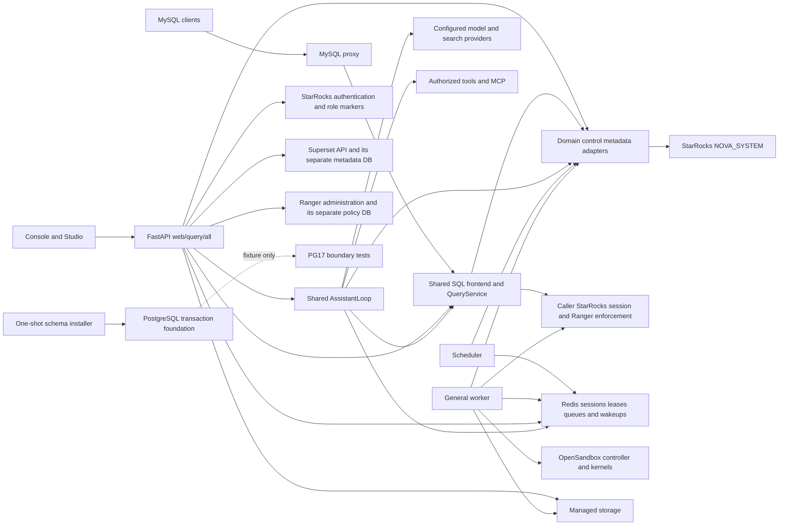

# Runtime dependencies and migration boundaries

Observed application tree:
`e3bcb3f5604f20c68c98e8beb3f5e9c67abfcee416c7ab4767dc8954ae546759`.
This is the current source dependency graph. It is not the target deployment
and does not imply that a process has the planned isolation already.

The graph omits HTTP ingress wiring and vendor connection credentials. It shows
logical dependencies, not permission to replace the caller's data session with
a system identity.

## Current process ownership

`backend/app/main.py::lifespan` opens the system pool and session store for each
API role. A role other than `query` owns schema bootstrap, LLM registration,
Search lifecycle, News refresh and Catalog refresh. A role other than `web`
starts ephemeral ML sweeping. Each API role runs its own Autopilot telemetry
and AI usage flushers. The `all` role can also embed the MySQL proxy. These are
current duties to retire or move, not the approved target separation.

`backend/app/worker/__main__.py::_run` creates Task execution, migration, ML,
automation, notebook and Autopilot loops in one process, with a worker heartbeat
and shared shutdown event. It initializes Task, Autopilot and migration schema
before consuming work. Awaiting the Task service while other loops run as
background tasks does not establish independent supervision or resource limits.
The target role assignments are recorded in `ENTRYPOINTS.csv`.

The scheduler uses Redis leadership/transport and StarRocks control rows. The
Task worker has an explicit dedicated unprivileged execution identity contract;
interactive SQL still uses the authenticated caller. These are separate data
execution paths and must not collapse into PG service credentials.

## Cross-system commit boundaries

| Operation | Current stores/effects | Required boundary after refactor |
| --- | --- | --- |
| Workspace or notebook save | Workspace rows and managed file bytes | Revision CAS, immutable object receipt and verified publication |
| Task dispatch | Task/graph/node rows, Redis notification and native engine Task | One PG admission/outbox transaction, fenced claims and external outcome verification |
| Stream consumption | Source/target engine data and transaction journals, Nova control receipts | Engine journal commits with data; PG cursor publication follows verified receipt |
| Agent/tool continuation | Message/run/event rows, process-local consent, external tool effect | Durable scoped consent consumption and immutable tool intent/receipt |
| ML publication | Registry/version rows, training process and artifact bytes | Isolated execution, provenance, fenced reservation and verified artifact receipt |
| Dataviz publication | Nova publication ledger and Superset objects | Fenced publication saga and external object identity verification |
| Governance change | Ranger policy DB, engine role marker and Nova projection | Independently verified enforcement and security revision invalidation |
| Usage reporting | Process buffers and appended control rows | Durable batch identity and reconciliation of uncertain commits |

`assistant/consent.py::ConsentBroker` currently keeps pending decisions in an
in-process dictionary of futures. Redis grants do not turn that dictionary into
a durable decision journal. The PG foundation is not used by these domains yet.
The one-shot schema installer uses a separate migration identity, serializes
DDL with the deployment lock and checks immutable revision hashes. It leaves
fresh schemas without an authoritative epoch; see [PG_MIGRATIONS.md](PG_MIGRATIONS.md).

## Security boundaries to preserve

StarRocks authenticates users; PG receives an already validated actor and one
active role. Metadata RLS must preserve private, shared-workspace, verified-role
sharing and deployment-wide stewardship semantics. A service identity is not an
implicit cross-user read grant. Table unions in `TABLE_ACCESS_REVIEW.csv` are
source dependencies, not grants that can be copied into a database role.

User kernels, Python Tasks, MCP and ML execution must not inherit the API's
control-plane credentials. The one-host exception permits the trusted sandbox
controller to use Docker; it does not permit a user runtime to mount the socket
or host files. The existing graph and passing functional tests do not prove
these execution boundaries. Isolation and dependency-failure tests remain open.
