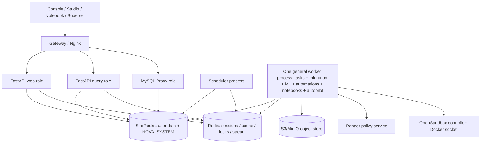
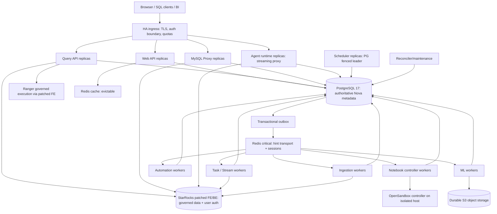
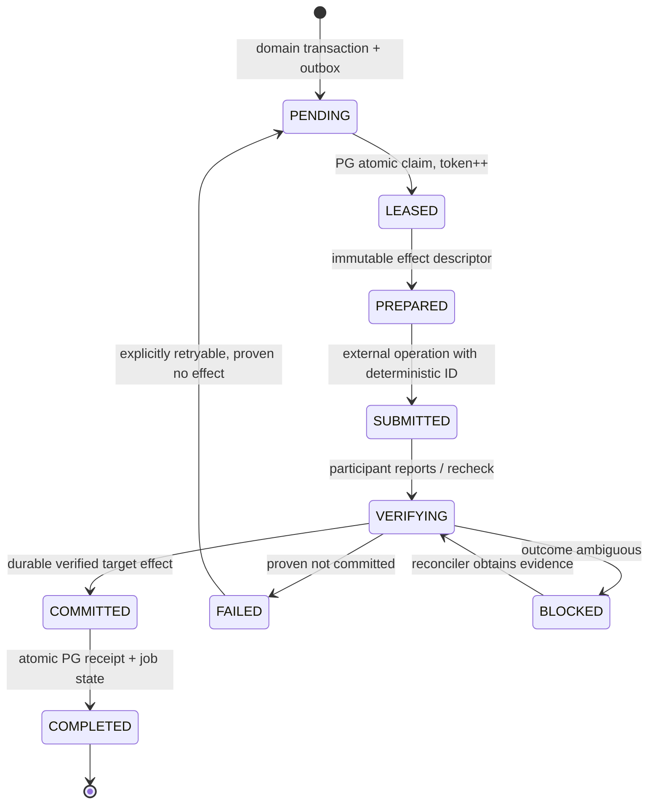
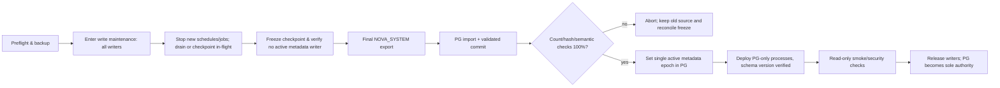

# NOVA — PRODUCTION ARCHITECTURE REFACTOR & SECURITY HARDENING
## Binding engineering specification for Codex: modular Python runtime, PostgreSQL transactional metadata, isolated workers, durable jobs, HA, and security

| Document | Value |
|---|---|
| Specification ID | `NOVA-ARCH-PROD-2026-11` |
| Version | **1.0 — implementation contract** |
| Date | 2026-11-11 (Asia/Jakarta) |
| Source baseline | User-provided `nova-main (2).zip`, inspected as `nova-main` |
| Status | **Design + static code audit. No code changes, deployment proof, penetration test, or performance certification have been performed by this document.** |
| Primary audience | Codex / coding agent, Nova maintainers, SRE, security reviewer |
| Primary objective | Migrate Nova's authoritative control plane to PostgreSQL, enforce process/workload isolation, prove crash-safe coordination, and harden security **without rewriting the Python product or StarRocks data plane**. |
| Companion | `NOVA_STREAMS_TASKS_PRODUCTION_SPEC.md`; this specification **supersedes its StarRocks `NOVA_SYSTEM` metadata-placement assumption**, not its CDC/atomicity requirements. |

> **NON-NEGOTIABLE:** The current root `AGENTS.md` prohibits a second Nova metadata database. **The user has explicitly authorized this architectural migration.** Codex MUST update root `AGENTS.md`, scoped backend/DB/Task/Streams/Docker agent guides, architecture docs, setup and runbooks to make **PostgreSQL the single authoritative Nova metadata store**, then eliminate the contradictory rule. This authorization does **not** permit weakening Ranger, StarRocks user authentication, active-role boundaries, SQL guarding, consent, or tests.
>
> **NO AMBIGUITY RULE:** A work package is complete only when code, schema, migrations, deployment manifests, tests, docs, and evidence for *every* acceptance criterion pass on an identified environment. Do not label scaffolding, mocked success, or unverified HA as production-ready. Any unproven cross-system atomicity or governance guarantee must fail closed.

---

## 0. Coding-agent execution charter

### 0.1 Required workflow, in order

1. Read this spec **completely** and the latest repo-local instructions (`AGENTS.md`, `backend/AGENTS.md`, `docker/AGENTS.md`, scoped guides) **before editing**. The snapshot referenced here may differ from the current checkout; re-check each code anchor and record differences.
2. Create `docs/architecture/production-refactor/BASELINE_AUDIT.md`, `METADATA_OWNERSHIP.csv`, `RISK_REGISTER.md`, and `TRACEABILITY.md` **from the current source**. No code migrations before the inventory gate (WP-00).
3. Create migration-safe schema and standalone metadata DB access, then port one domain at a time with tests. **Do not** use a blind `NOVA_SYSTEM.` string replacement or a general SQL dialect-rewrite proxy.
4. Prepare a disposable PostgreSQL 17 + **the repo-pinned patched StarRocks** + Redis + object store test stack, separated from production/shared data. Follow repository instructions on reusing existing disposable services. Never reset a shared engine or database to run tests.
5. Complete work packages in dependency order; run the corresponding gate and save actual commands, versions, logs, and results. Check all user-facing query and MySQL-proxy paths, not only REST.
6. Migrate operational metadata using the freeze/export/validate/cutover procedure in §8. **No simultaneous live writers to old and new metadata stores.**
7. Run authorization, adversarial, concurrency, restart, failover, recovery, and load tests. Incomplete or skipped mandatory tests block completion.
8. After each work package, report: commits/files, schema deltas, exact tests/results, known limitations, and production readiness state. Do not mark the full project done until §18 is satisfied.

### 0.2 Change prohibitions

- Do **not** rewrite Nova from Python; do **not** introduce a second SQL parser, agent harness, authorization subsystem, workflow scheduler, or data engine.
- Do **not** migrate business datasets, StarRocks catalog data, or Ranger policy enforcement to PostgreSQL. PostgreSQL is an **internal control plane**, not the user SQL engine.
- Do **not** treat Superset PostgreSQL or Ranger PostgreSQL as Nova's metadata database; production Nova metadata gets an **independent PostgreSQL cluster / failure domain**.
- Do **not** silently retain an old `NOVA_SYSTEM` write path, create shadow source-of-truth tables, or implement ongoing dual writes.
- Do **not** submit external side effects and subsequently claim that a PostgreSQL commit made them atomic. Cross-engine effects require explicit idempotency + visibility proof (§7).
- Do **not** add feature flags or user-facing backend-selector switches; after cutover, PostgreSQL is normal behavior. The maintenance/freeze mechanism is an **operator-controlled safety state** with documented boundaries, not a permanent product feature toggle.
- Do **not** let API pods bootstrap/migrate schemas opportunistically. Do **not** permit a fallback startup that skips a migration lock.
- Do **not** create extra Compose stacks, public PostgreSQL/Redis ports, new default passwords, privileged containers, or relaxed TLS as a shortcut.
- Do **not** remove `ACCOUNTADMIN` protections or bypass one active StarRocks role and patched FE/Ranger policy evaluation.
- Do **not** change SQL behaviors, user-facing APIs, task identities, notebook documents, Model/Agent IDs, or stored object URIs without explicit compatibility tests and mapping.

### 0.3 What counts as verified

Use status values `NOT_STARTED`, `IMPLEMENTED_UNVERIFIED`, `INTEGRATION_VERIFIED`, `FAULT_VERIFIED`, `PRODUCTION_READY`. A passing unit test never implies `PRODUCTION_READY`. Evidence must identify commit SHA, container/image digest, DB schema version, StarRocks patch version/topology, test data isolation, command, start/end times, and failures/skips.

---

## 1. Current architecture, code evidence, and risks

### 1.1 Architecture snapshot



Nova is already a **modular monolith with independent process entrypoints**, not simply a single-threaded Python server. This is worth preserving. The principal shortcomings are mixed workload lifecycles, overly broad system DB privileges, metadata concurrency semantics, fragile deployment defaults, and shared failure domains.

### 1.2 Direct source findings

| ID | Severity | Confirmed source anchor | What code establishes | Required outcome |
|---|---|---|---|---|
| F-01 | P0 | `backend/app/core/database.py` | `StarRocksConnectionFactory` multiplexes metadata/admin access through a root-capable `asyncmy` pool and `db.execute_system()` | Separate PostgreSQL metadata repository from restricted StarRocks engine-administration adapter |
| F-02 | P0 | `backend/app/main.py::_bootstrap_exclusively` | On Redis lock timeout/error the bootstrap continues **without the lock** | Dedicated migrator; schema mismatch causes startup refusal; never unguarded migration |
| F-03 | P0 | `backend/app/worker/__main__.py::_run` | Tasks, migration, ML, automation, notebook, and query-autopilot work are concurrently launched in one Python process | Distinct process roles; independent scaling, shutdown and failure handling |
| F-04 | P0 | `docker/docker-compose-engine.yml` Redis service | One Redis with `--maxmemory-policy allkeys-lru` holds sessions and job/lock coordination | Durable PG state + separate critical Redis (`noeviction`) and evictable cache Redis |
| F-05 | P0 | `backend/app/modules/task_orchestration/repository.py` | Many single-statement `INSERT ... WHERE NOT EXISTS`/conditional writes on StarRocks; not a proven cross-writer CAS protocol | PostgreSQL PK/unique constraints, row locking, monotonic revisions, transactional outbox |
| F-06 | P0 | `docker/docker-compose-engine.yml`, `.split.yml`, `.observability.yml` | Default single-node FE/BE, Redis, MinIO; scheduler defined in observability overlay; worker container name fixed | Production topology and main application manifest explicitly own all required processes |
| F-07 | P1 | `backend/app/main.py::create_app` and `core/config.py` | `web` and `query` roles register all routers; gateway is primary routing boundary | Server-side process-role route admission/registration and independent resource budgets |
| F-08 | P1 | `backend/app/main.py::lifespan` | Query/API lifespans start periodic flushers, search/news/catalog jobs and model sweeper | Move all durable/background jobs to supervised dedicated roles; keep metrics exporters only in API |
| F-09 | P1 | `backend/app/modules/assistant/consent.py` | Pending approvals backed by process-local `asyncio.Future` | Durable, owner-scoped approval/run state; safe denial on indeterminate recovery |
| F-10 | P1 | `backend/app/core/redis.py::set_active_role` | Role change is a read followed by HSET and numeric version increment, not one atomic CAS | Atomic role update with monotonic security-context version and cache invalidation |
| F-11 | P1/security | `backend/app/core/deps.py::require_role` | It tests **assigned roles**, while security design requires **active role** for authorization | Audit all call sites and adopt active-role authorization for sensitive actions, preserving intentional role-assignment listings only |
| F-12 | P1/security | `backend/app/modules/ml_engine/artifacts/serializer.py`, `runtime/model_runtime.py` | `joblib.load` deserializes model artifacts, including legacy payloads; checksum verifies integrity, **not origin or safe deserialization** | Signed/trusted provenance, strict ACLs, isolated deserialization/inference and legacy artifact policy |
| F-13 | P1/security | `docker/backend.Dockerfile`, `docker/docker-compose-engine.yml` | Runtime lacks explicit non-root user; several dev services use plaintext transport, permissive/default credentials, Docker-socket controller | Hardened image, network trust zones, secrets, egress restrictions, production override manifests |
| F-14 | P1 | `backend/app/modules/backup/bi_metadata.py`, `backup/service.py` | Backup ties Nova metadata to StarRocks snapshot and pairs Superset `pg_dump` | Independent PG PITR and coordinated recovery manifest for Nova/Superset/Ranger/S3 |
| F-15 | P1 | `backend/app/modules/task_orchestration/scheduler.py`, `service.py`, `transport.py` | Redis leadership and Redis Streams delivery coexist with StarRocks run records | PG is authority for run/lease/outbox; Redis wakeups may vanish without losing work |
| F-16 | P1 | `backend/app/modules/workspaces/repository.py`, `notebooks/documents.py` | Some mutations use StarRocks primary-key insert-as-update semantics; file edits serialize using Redis lock | Replace with PG `UPDATE`/CAS and object-store prepare/finalize protocol |
| F-17 | P1 | `backend/app/modules/superset/publication.py` | Dataviz publication spans Superset and `NOVA_SYSTEM` using saga/journal | Keep external saga, move authoritative publication state and retries to PostgreSQL |
| F-18 | P1 | `backend/app/modules/ml_engine/internal_auth.py` | Internal calls use peer allowlist + shared secret; not a general mTLS/workload-identity system | Network-bound, scoped rotating machine credentials; peer gating stays defense-in-depth |
| F-19 | P1 | `backend/app/modules/notebooks/runtime/opensandbox_provider.py`, Compose | Notebook runtime is isolated, but its OpenSandbox control host holds Docker socket | Separate hardened sandbox control node; no application pod may obtain Docker socket |
| F-20 | P1 | `backend/app/core/database.py`, `task_orchestration/repository.py` | Admin pool and schedule timestamps rely on engine timezone and naive `DATETIME` | Store PG UTC `timestamptz`; preserve task's named timezone in definition; handle DST explicitly |

These are **source-level observations**, not blanket claims of an exploitable vulnerability. For example, F-12 is a deserialization **trust-boundary risk**: its exploitability depends on who can place/alter model artifact bytes and control registry metadata. Codex must investigate the full authorization/write path rather than presume exploitability or dismiss it due to a SHA-256 digest.

### 1.3 Migration footprint (static first pass)

An automated regex inventory across `backend/app` (669 Python files in this upload) found approximately **153 distinct DDL table names, 714 explicit `NOVA_SYSTEM.` references in 103 Python files, and 735 direct `db.execute_system` / `db.system_conn` call sites in 91 Python files**. This is **not a semantic or complete DDL parser**: dynamic f-string names, migrations, generated names, unqualified references, and obsolete objects may be missing or misclassified. Rebuild and reconcile it in WP-00.

High-touch modules: `agents`, `intelligence`, `catalog`, `task_orchestration`, `assistant`, `workspaces`, `monitoring`, `superset`, `access_control`, `ml_engine`, `ontology`, `migration`, `query_autopilot`, `notebooks`, and common audit/setup code.

**No partial success:** A generic adapter that redirects 80% of queries is unacceptable if 20% continue to hit StarRocks as a hidden metadata authority. Every metadata call must have a recorded owner and destination.

---

## 2. Binding architecture decisions

| ADR | Decision | Reason / verification rule |
|---|---|---|
| A-01 | **Keep Python 3.11+ and the existing modular repository** | Do not rewrite the backend; profile CPU hotspots first |
| A-02 | **Dedicated PostgreSQL 17** is the authoritative Nova relational metadata store; schema **`nova_meta`** | PostgreSQL transaction, constraints, row locking, WAL/PITR; not an auth/database-replacement for StarRocks |
| A-03 | `NOVA_SYSTEM` StarRocks data becomes **read-only archived migration source**, then is retired/privilege-revoked | Never two authoritative metadata copies; no background dual-write |
| A-04 | **StarRocks stays the analytical SQL/data engine and user authentication authority; Ranger FE stays user-data authorization authority** | PostgreSQL access uses internal service accounts only |
| A-05 | `psycopg` v3 async + `psycopg_pool.AsyncConnectionPool` for metadata; do **not** use `asyncmy` for PG | Existing `psycopg` dependency can be reused; explicit transactions and type handling |
| A-06 | Production PG topology: **one primary + two standbys, one synchronous replica required**, managed by Patroni/equivalent consensus and a primary endpoint | Confirmed metadata writes target RPO=0 on tolerated single-node failure; reduced write availability if sync quorum absent is accepted |
| A-07 | PgBouncer **transaction pooling** only after driver/session compatibility is verified; migrations use direct primary | No session-level advisory locks, `SET` state, or session temp tables; `SET LOCAL` scoped to transactions |
| A-08 | Every durable job, state transition, and workflow event is in PG; **transactional outbox** drives Redis notification | Redis is an accelerator; lost Redis events cannot lose work |
| A-09 | **Separate critical Redis and cache Redis** | Critical Redis: `noeviction` + auth/TLS, ephemeral sessions/coordination. Cache Redis: evictable |
| A-10 | One backend image / repository, **separate process roles and deployments** | Isolation without distributed-domain microservice proliferation |
| A-11 | Scheduler uses **PG durable lease/fencing + unique due-occurrence key**; no Redis lock as proof of exclusive commit | Correct across leader loss/restart, not just best-effort coordination |
| A-12 | Workers lease job rows with `FOR UPDATE SKIP LOCKED` and idempotency key; every external side effect has a verification/recovery protocol | At-least-once dispatch must not imply duplicate effects |
| A-13 | API/web/query/proxy/agent tiers are **stateless with respect to durable execution** | SSE/socket connections may terminate, but runs/approvals must recover safely |
| A-14 | Production secrets are injected from a secret manager; TLS at every inter-zone boundary, restricted privileges, non-root containers | No checked-in credentials, no public internal DB/services |
| A-15 | A PostgreSQL metadata commit **does not** imply StarRocks/Superset/S3 commit atomicity | Required durable saga / outbox / participant receipts; unsupported effect must refuse |
| A-16 | Cutover is a **single, controlled maintenance event with write freeze**, verified snapshot and one-way switch | Avoids unprovable live dual-write correctness |
| A-17 | Deployment targets documented **SLOs and fault-injection gates** | HA claims need repeatable evidence, not Compose replica count |

### 2.1 Scope and non-goals

**In scope:** all Nova-owned relational configuration, execution state, catalog annotations, audit/usage metadata, task/stream state, notebooks/runtime metadata, Studio/Agent metadata, metadata backup, isolated process roles, scheduler/workers, security hardening, CI/observability, production Compose/Kubernetes equivalence docs.

**Out of scope for this refactor:** rebuilding StarRocks, changing Ranger authentication or governance decisions, redesigning Superset itself, rebuilding DuckDB notebook kernels, replacing OpenSandbox technology, and implementing full StarRocks change capture. The **interfaces and transactional metadata foundations** for Nova Streams/Task integration are in scope. Full CDC is governed by the companion spec and must not be prematurely marked ready.

---

## 3. Target logical architecture and failure domains



Physical instances for PostgreSQL HA, Redis HA, StarRocks HA, and object storage must be on separate failure domains. The diagram is logical; PostgreSQL replicas and Ranger's own metadata store are omitted for clarity.

### 3.1 Process roles — exact runtime ownership

| Role / entrypoint target | Owns | Must **never** own | Scaling/admission |
|---|---|---|---|
| `nova-web`: `python -m app.server --role web` | Auth/session APIs, management UI APIs, governance admin orchestration, metadata REST | SQL query execution, long-running agent loop, task scheduling, schema migrations | 2+ replicas; HTTP requests bounded |
| `nova-query`: `python -m app.server --role query` | SQL frontend, execution routing, query result streaming, cancellation | Schema bootstraps, ML training, periodic catalog/search jobs | 2+ replicas; per-user and global query concurrency budgets |
| `nova-proxy`: `python -m app.proxy` | MySQL protocol, session/role verification, streamed query execution | Schema bootstrap, agent run logic, metrics write-behind | 2+ replicas; connection and idle caps |
| `nova-agent-runtime`: new targeted entrypoint | Neva/Agent streaming execution, durable run events, tool/consent orchestration | User credential storage beyond sealed references; long-term process-local pending approval truth | 2+ replicas; per-principal runs/tokens budget |
| `nova-scheduler`: `python -m app.scheduler` | Due CRON/interval/stream scheduling, durable run creation + outbox | Executing task SQL, holding user-data credentials in queue payloads | 2 replicas, 1 valid PG-fenced leader |
| `nova-task-worker` | Task DAG nodes, Stream consumption, verified target commit, task statuses | Training, notebook kernel execution, schema bootstrap | Scale by queue depth; default 4 concurrent graph runs per replica; benchmark to tune |
| `nova-ingestion-worker` | Migration jobs, Pipes, bulk movement orchestration | Agent interactive calls, ML jobs | Scale by jobs/throughput and memory |
| `nova-ml-worker` | ML training/inference jobs using bounded child processes | API event loop; uncontrolled pickle deserialization | CPU/GPU/node-pool specific; per-job limits |
| `nova-notebook-controller` | Sandbox provision/terminate/reconcile, notebook execution lifecycle | Docker socket in API worker or user-facing kernel; running kernels directly | Scale controller by sessions; actual runtime in sandbox hosts |
| `nova-automation-worker` | Agent automations, query-autopilot and background agent work | Scheduling/leader roles and interactive SSE | Scale by automation queue; distinct limits from interactive agents |
| `nova-maintenance-reconciler` | Orphan object cleanup, database/object consistency, outbox replay, catalog/news refresh, model-sweeps | User SQL or training; migrations | 1 active per job partition, optionally multiple via PG claim |
| `nova-outbox-publisher` | Read PG outbox, publish Redis hints, mark delivery attempt | Decide business truth; delete unacknowledged work | 2 replicas, concurrent SKIP LOCKED partitions |
| `nova-migrator` (one-shot) | Versioned PG schema migrations and seed/bootstrap verification | Serving user requests or running continuously | Exactly one serialized migrator per deploy |

**Implementation detail:** the sample entrypoint syntax may be adapted to the repo's package layout, but the *named role and responsibility* are binding. Use `NOVA_PROCESS_ROLE` or a typed app-role enum extended with these values; do not add unrelated homegrown launcher frameworks. One immutable backend image, per-role command, separated metrics labels and readiness is the target. During migration, old general `nova-worker` must be retired after its work has drained and ownership has transferred.

### 3.2 Traffic routing and internal trust

- Ingress is the **only** public endpoint. Production StarRocks FE admin, PostgreSQL, Redis, object-store admin, Ranger Admin, OpenSandbox controller and worker metrics are private-only.
- Web process denies `/query`, `/assistant/run`, expensive AI/ML computation and MySQL proxy binding **inside the app**, even if Nginx is misconfigured. Query process denies admin mutation endpoints. Role admission happens before expensive body parsing.
- Health `/health` is liveness only. `/ready` checks appropriate role dependencies: web PG+critical Redis; query PG+StarRocks+Ranger capability; proxy listener+auth+StarRocks; agent PG+queue/runtime; worker PG+queue and healthy execution lanes; scheduler PG fencing/readiness. Use tight timeouts and no credential leakage.
- Service-to-service calls use mTLS/workload identity where supported; minimum launch condition is TLS, private network, least-privilege scoped rotating tokens. Client IP alone and `X-Forwarded-For` are not trust proofs.
- An agent or tool cannot bypass the central SQL frontend and Ranger authorization by calling StarRocks as `nova_admin`/`root`.
- Internal RPC requests include trace ID, caller service identity, request idempotency ID, and short authorization context (principal, **one** active role, security-context version). Never put decrypted passwords, S3 secrets, API keys or full SQL payload in Redis.

---

## 4. PostgreSQL metadata design — not a mechanical connection swap

### 4.1 Database identity and contract

**Baseline:** PostgreSQL major version **17**, dedicated database `nova_control`, schema `nova_meta`, UTC session time, UTF-8, strict migration version. Names are lowercase snake_case; e.g. `NOVA_SYSTEM.CONFIG_TASK_GRAPH_RUNS` becomes `nova_meta.config_task_graph_runs`. Preserve original opaque object IDs and users' *logical* qualified object names. PostgreSQL is **not reachable via the user's SQL endpoint**. Do not expose a `postgres://` management connection to Notebook/Agent tools.

**Drivers:** use `psycopg` v3 async, `psycopg_pool.AsyncConnectionPool` (explicitly add compatible `psycopg_pool` to `backend/pyproject.toml` and regenerate frozen `uv.lock`). One `app/core/metadata_db.py` owns connection/pool; **StarRocks administration remains** in a renamed, restricted `engine_admin` adapter. Stop using `db.execute_system` as a generic metadata API. Keep true user-data connections through `db.user_conn()` using StarRocks identity and active-role setup.

**Connection rules:**

- Each metadata call uses `async with pool.connection()` and explicit `transaction()` for writes or coordinated reads; no leaked cursors or implicit autocommit state machines.
- With PgBouncer transaction pooling, disable client-side named prepared statements (`prepare_threshold=None`) unless a tested compatible configuration is used. No session-scoped advisory locks, `LISTEN`, temporary tables that outlive transaction, or session `SET` assumptions. Use `SET LOCAL` inside a transaction for security context.
- Connection command deadline and statement timeout are bounded: reference starting values `connect_timeout=5s`, `statement_timeout=15s` for ordinary metadata, `lock_timeout=3s`, `idle_in_transaction_session_timeout=30s`. Long data migration uses separately bounded operations; tune only with load/latency evidence.
- Pool starting caps **per process**: web 10, query 8, proxy 4, agent 8, scheduler 3, each worker 4, reconciler 4. Sum across scaled replicas must remain below PgBouncer and PG `max_connections`; deploy validation computes and checks the total.
- Apply `synchronous_commit=on`, PG `timestamptz` in UTC, not naive `DATETIME`. Persist task timezone as an IANA string; schedule evaluation must have DST/nonexistent-time tests.
- Define stable exception types: `MetadataUnavailable`, `MetadataConflict`, `MetadataPermissionDenied`, `MetadataSchemaMismatch`, `MetadataTimeout`, `MetadataIntegrityViolation`, and `MetadataReadOnlyMaintenance`. Map errors to redacted API responses and retry only safe cases.
- Use SQL parameters for **values** and `psycopg.sql.Identifier` for dynamic *identifier* allowlists; no f-string interpolation of caller-provided table names, columns, sort fields, or expression fragments.

### 4.2 Canonical typed repository API

Every module ports to a domain repository using a single DB abstraction. A standalone example contract (exact Python signatures can be adapted; semantics cannot):

```python
class MetadataUnitOfWork(Protocol):
    async def __aenter__(self) -> "MetadataUnitOfWork": ...
    async def __aexit__(self, exc_type, exc, tb) -> None: ...
    async def fetch_one(self, query: Query, params: tuple = ()) -> Mapping | None: ...
    async def fetch_many(self, query: Query, params: tuple = ()) -> list[Mapping]: ...
    async def execute(self, query: Query, params: tuple = ()) -> int: ...
    async def append_outbox(self, event_type: str, key: str, payload: dict) -> None: ...

class MetadataStore(Protocol):
    def transaction(self, actor: "ActorContext | None" = None) -> MetadataUnitOfWork: ...
    async def ping(self) -> bool: ...
    async def schema_version(self) -> int: ...
```

`ActorContext` includes `principal`, **one** `active_role`, `security_context_version`, request ID and service identity. `None` context is restricted to verified internal background workflows, not a convenient authorization bypass. Repositories return typed records/mappings, not the StarRocks generic `{'rows': [[...]]}` shape. Backward-compat adapters may exist **temporarily in the migration branch only** and must not outlive cutover; their use is covered by the no-old-path linter gate (§16).

### 4.3 Hard relational invariants

- Stable `UUID`/opaque ID PKs, explicit `UNIQUE` constraints on logical business keys, FK for strict local relationships, `CHECK` status enums, monotonic `revision BIGINT` for optimistic concurrency, and `created_at` / `updated_at TIMESTAMPTZ`.
- Updates of mutable records use `UPDATE ... WHERE id=$id AND revision=$expected RETURNING revision` (with the real psycopg `%s` parameter style). Zero returned rows is **conflict or absent**, never success.
- Idempotent create uses `INSERT ... ON CONFLICT (...) DO NOTHING RETURNING ...`; compare incoming payload digest against existing record if conflict; never treat a conflicting different definition as success.
- Event and audit logs are append-only from the application. Restrict update/delete grants. High-volume event/audit tables use time partitions, indexes, retention/export policy and verified backup.
- Persist retries/claims/lease expiry with **Postgres server time**, not worker-local clocks; store `lease_token` / fencing counter and unique attempt identity.
- The outbox row and the domain state change must commit in the **same PG transaction**. A Redis publish happens **after** commit and can be replayed repeatedly.
- No two modules may mutate one table without explicit declared ownership and tests (see inventory gate).

### 4.4 Logical table migration scope

**All Nova-owned `NOVA_SYSTEM` relational metadata rows must be inventoried and assigned**; default is migrate to `nova_meta`. Classes include:

| Class | Examples from source | Target / retention |
|---|---|---|
| Identity/setup/role projections | `CONFIG_SECURITY_ROLE_PROJECTIONS`, `CONFIG_SECURITY_POLICIES`, `CONFIG_DATA_SCOPE_ASSIGNMENTS`, `CONFIG_TASK_ROLE_BINDINGS` | PG; Ranger/StarRocks remain policy/identity authority |
| Tasks and durable work | `CONFIG_TASKS`, `CONFIG_TASK_EDGES`, `CONFIG_TASK_GRAPH_RUNS`, `CONFIG_TASK_RUNS`, `CONFIG_AGENT_AUTOMATIONS`, `QUERY_AUTOPILOT_*` | PG; indexes + status constraints + outbox |
| Streams | `CONFIG_STREAMS`, `AUDIT_STREAM_*` | PG offsets/claims/receipts; immutable journal **payload** remains in object storage |
| Workspaces | `CONFIG_WORKSPACES`, `CONFIG_WORKSPACE_ENTRIES`, `CONFIG_WORKSPACE_SHARES`, `CONFIG_WORKSPACE_FILE_VERSIONS` | PG metadata; S3 file bytes untouched; uniqueness and CAS |
| Studio/Agents | `CONFIG_AGENTS`, `CONFIG_AGENT_*`, `CONFIG_ASSISTANT_*`, `CONFIG_STUDIO_*`, `CONFIG_MCP_SERVERS` | PG; encrypted secret refs; owner/role scoped |
| Catalog/semantic/ontology | `CATALOG_*`, `CONFIG_SEMANTIC_*`, `CONFIG_ONTOLOGY_*`, `CONFIG_ENTITIES`, `CONFIG_FEATURE_*` | PG annotations/definitions; StarRocks physical schema stays in engine |
| ML/Notebook | `ML_*`, `CONFIG_ML_JOBS`, `CONFIG_NOTEBOOK_*` | PG lifecycle; model files/notebooks/object payload remain in S3 |
| Admin/stages/AI | `CONFIG_STAGES`, `CONFIG_AI_MODELS`, `CONFIG_AI_PROVIDERS`, `CONFIG_USER_PREFERENCES`, `CONFIG_PINNED_QUERIES` | PG with encrypted/key-referenced secrets |
| Audit/usage | `AUDIT_LOG`, `USAGE_*`, `AI_SEARCH_QUERY_LOG`, `LINEAGE_LOAD_HISTORY`, `QUALITY_TABLE_STATS`, query-autopilot rollups | Authoritative event/control facts in PG; optional **read-only derived analytics projections** to StarRocks via outbox, never a second source of truth |
| Dataviz/Superset | `CONFIG_BI_AUTHOR_ROLES`, `CONFIG_DATAVIZ_PUBLICATIONS`, BI/semantic dashboard mappings | PG Nova state; independent Superset metadata DB, verified saga |

Some names live in Python DDL strings, not `docker/init-nova.sql`; some tables have legacy rename/alias variants. **Codex must generate a machine-readable, reviewed `METADATA_OWNERSHIP.csv` for all live tables and call sites**. When deciding if a particular legacy table is derived-only, explicitly prove it is rebuildable and not used for correctness, authorization, user configuration, retention, or recovery; otherwise migrate it to PG. Unknown classification is a release blocker, not an invitation to drop data.

### 4.5 SQL-dialect conversion contract

| Old StarRocks idiom | Required PostgreSQL behavior |
|---|---|
| `PRIMARY KEY` table `INSERT` acting as upsert | Explicit `INSERT ... ON CONFLICT (...) DO UPDATE` **or** `UPDATE ... WHERE revision` according to operation intent |
| `DISTRIBUTED BY HASH`, `BUCKETS`, `replication_num`, StarRocks properties | Remove; translate into deliberate PK/index/partition and PG HA config |
| `DATETIME`, `NOW()`/session `time_zone` | `TIMESTAMPTZ` UTC, aware Python datetimes; task timezones maintained separately |
| `JSON` text or engine JSON columns | `JSONB` with shape/version validation; canonical normalized serialization |
| `INSERT ... SELECT` to replace a row | Single PG `UPDATE ... RETURNING`, or transactional copy only if intended; preserve CAS |
| `SHOW`, `DESCRIBE`, `@@time_zone` | Use PG catalogs/metadata API and `SHOW TIMEZONE`; never blindly forward engine SQL |
| `affected_rows` / PK insertion semantics | Explicit `RETURNING`, constraints and transaction outcomes |
| Legacy SQL `CAST`, `BOOLEAN`, `TEXT`, arrays and default literals | Type-by-type conversion tests, lossless precision/timezone/NULL/JSON checks |
| `DELETE` plus object-store mutation | Durable prepare/commit/GC saga with orphan recovery |
| Engine-specific task/stream names | Preserve logical namespace and identifiers; keep StarRocks task execution as a separate adapter |

PG schema migrations use versioned files `backend/metadata_migrations/<revision>_*.sql` (or a single established migration framework if currently present). Track `nova_meta.schema_migrations(version, checksum, applied_at, app_version)` and refuse checksum drift. `docker/init-nova.sql` must no longer create Nova control-plane metadata after cutover; it retains **only** engine-user, engine-catalog, account and data-plane setup. Development bootstrap uses the same PG migrations as production, not a divergent SQL dump.

### 4.6 PostgreSQL roles and defense in depth

Create separate restricted PG roles (names binding): `nova_meta_owner` (NOLOGIN, table owner), `nova_meta_migrator` (DDL only in controlled migration job), `nova_meta_app` (limited DML through app), `nova_meta_readonly` (observability/read-only), `nova_meta_backup` (backup/PITR role as required). App must not use superuser, `BYPASSRLS`, `CREATEDB`, `CREATEROLE`, or table-owner login. REVOKE `PUBLIC` permissions to the `nova_meta` schema and default privileges. Bootstrap grants are generated by migration and tested.

For rows scoped to a principal or active role, enforce **application authorization plus PostgreSQL RLS as defense-in-depth** where feasible. RLS context is established by trusted middleware/repository using transaction-local `SET LOCAL nova.principal`, `nova.active_role`, `nova.security_context_version`; missing context denies scoped reads. Where tables contain legitimate cross-owner system operations, implement narrowly scoped stored procedures/services or separate explicit grants and audit — **not** an unrestricted global bypass role. Do not claim PG RLS is a replacement for StarRocks/Ranger policy checks on business data. Test under transaction pooling and ensure context cannot leak between pooled connections.

---

## 5. Execution architecture: worker isolation, backpressure, lifecycle

### 5.1 One codebase, many process roles

Refactor `backend/app/worker/__main__.py` into a role launcher plus independent supervised processes, not a collection of `asyncio.create_task()` jobs in one general process. Each worker has a **single primary workload class** and its own deployment, resource limit, consumer identity, metrics port/labels, start/stop behavior, and queue policy. Existing domain implementations may remain in their modules; do not duplicate logic in new runners.

**Required entrypoint structure:**

```text
backend/app/runtime/
  __init__.py
  roles.py                   # canonical role enum and admission
  shutdown.py                # signal, drain, cancellation, exit codes
  health.py                  # readiness/liveness/heartbeat contracts
backend/app/worker/
  __main__.py                # old all-in-one retired after cutover
  task_main.py
  ingestion_main.py
  ml_main.py
  notebook_main.py
  automation_main.py
  maintenance_main.py
  outbox_main.py
backend/app/agent_runtime/
  __main__.py                # interactive agent and SSE event bridge
backend/app/core/
  metadata_db.py             # sole PostgreSQL metadata connection manager
  engine_database.py        # StarRocks user/admin adapters, separate caps
```

Adapt file names only to align with an existing package convention; the **workload boundaries** and **single owner of metadata DB** are mandatory. Existing modules remain owned by their domains (`task_orchestration`, `notebooks`, `agents`, etc.). No cross-domain direct SQL to another domain's private metadata table.

### 5.2 Worker protocol and concurrency

All durable workers MUST implement:

1. `claim_next(capability, capacity)` using a PG transaction with `SELECT ... FOR UPDATE SKIP LOCKED`, an immutable job id, monotonic lease token, `lease_expires_at`, and defined attempt count.
2. `execute(job, cancellation_token, deadline)` with bounded concurrency and supported workload-specific time/memory limits.
3. `heartbeat(job_id, lease_token)` conditional on the **same** token and owner; inability to renew closes the right to submit new side effects.
4. `checkpoint(job_id, lease_token, state)` idempotently persist completed steps and external operation receipts.
5. `complete/failed/blocked(job_id, lease_token, result)` with a conditional fenced state transition. A token mismatch must never mark another owner's job finished.
6. `reconcile()` to recover stuck `leased`, `submitted`, and `unknown` jobs using durable evidence.
7. Graceful shutdown on SIGTERM: stop claiming, drain within the configured deadline, checkpoint state, release local resources. **Never** reset a possibly committed external operation to `pending` on blind timeout.
8. Metrics per process and job type; fatal supervisor exception terminates the unhealthy **role process** (nonzero exit) rather than leaving an apparently healthy API container.

**Backpressure rules:** fixed per-replica concurrency ceilings; maximum outbound StarRocks connections, PG transactions and object-store requests; budgets by principal/role/job class; queue admission returns typed `429` or `503` with retry hints, not infinite in-memory buffering. CPU-bound parsing, model loading, ML training, or `joblib.load` must not run on the FastAPI event loop. Chunked streaming/Arrow data processing should not materialize unbounded datasets in Python memory.

**Default starting budgets** (configuration/tuning, not product feature flags):

| Role | Concurrency | Resource boundary | Backlog trigger |
|---|---:|---|---|
| task worker | 4 graph runs; max 4 parallel nodes per graph | 1 vCPU / 1–2 GiB baseline; task SQL executes on StarRocks | pending run count + age |
| ingestion | 2 active transfers | 2 vCPU / 2 GiB; per-transfer streaming memory cap 256 MiB | bytes + job age |
| ML | 1 training child process per assigned CPU/GPU slot | strict per-job cgroup memory/CPU/GPU and wall deadline | train queue age |
| notebook controller | 8 in-flight control requests, **not** 8 kernels on controller | actual kernels limited per sandbox host/user | runtime create/execute queue age |
| automation | 4 background agent runs | model/tool budgets + timeout | automation queue age |
| reconciler | bounded batch of 100 records per sweep | only metadata/object checks, no model processing | oldest unresolved operation |
| outbox | 100 claims/batch | PG connection budget and Redis publish rate | undelivered outbox age |

These are **starting settings**, not promises of capacity. Store them as role configuration with validated ranges; load test before production. A role with no available worker must show an alert and growing durable backlog, never drop the job.

### 5.3 Background loop ownership migration

| Current background work | Existing location | New owner |
|---|---|---|
| `ml_engine_service.sweep_ephemeral()` | FastAPI lifespan | `nova-maintenance-reconciler` |
| `newsroom_refresher.run(...)` | FastAPI lifespan | `nova-maintenance-reconciler` |
| `catalog_refresher.run(...)` | FastAPI lifespan | `nova-maintenance-reconciler` |
| `search_service.start()` if it performs refresh/sweep | FastAPI lifespan | maintenance/search worker; API retains only request-scoped client |
| `autopilot_collector.run(...)` | API process | flush to durable outbox / automation ingestion; no billing-relevant volatile-only meter |
| `llm_gateway.meter.run(...)` | API process | write-through durable usage event / batched transactional flush with loss accounting |
| `MigrationJobWorker` | general worker | ingestion worker |
| `MLJobWorker` | general worker | ML worker |
| `AutomationWorker` | general worker | automation worker |
| `NotebookRuntimeWorker` | general worker | notebook controller |
| `AutopilotWorker` | general worker | automation worker |
| Task graph `WorkerService` | general worker | task worker |
| Periodic Task due planner | scheduler | scheduler (unchanged ownership) |
| Reconciliation of ambiguous external outcomes | mixed general/scheduler loops | dedicated reconciler with bounded participant-specific verifiers |

Startup of a Web/Query replica must not perform global schema creation, engine-wide UDF registrations, or recurring singleton maintenance. Treat external LLM UDF registration as a separate idempotent deployment reconciliation job with a PG operation fence; ensure an expired registration lease cannot issue destructive DROP/RECREATE after a successor has won.

### 5.4 API, Query, Proxy, Agent runtime boundaries

**Web API:** control operations require authenticated session + action-level permission. Metadata lookups use PG, physical database catalogue/user privilege checks use the caller's StarRocks connection. No user query results passed through PG.

**Query API:** SQL/frontend compiles once under explicit caller context; StarRocks performs actual distributed execution. Bound planning CPU, context size, metadata roundtrips, SQL timeout and cancellation. Large result sets stream through existing proxy/Arrow paths, not into PostgreSQL or a Python list. Reconcile cancelled query IDs on StarRocks after connection loss.

**MySQL Proxy:** limit concurrent connections/queries and packet sizes; isolate handshake slow clients, enforce TLS for external connections, active role and session expiration. Split mode must not require session affinity for correctness. Preserve current SQL frontend behavior and client metadata compatibility with Superset/JDBC.

**Agent Runtime:** interactive execution moves out of general Query/API processes. Store run state, step index, tool decisions, memory writes and redacted events durably in PG. SSE is a *view* over events, not the state owner. Reconnect with `(run_id, event_id)` and return replay within retention; prior process death must not silently approve a pending tool action. For approvals containing transient secure input, persist only the decision metadata and an encrypted short-lived sealed payload where allowed; otherwise require the user to re-enter secret input after restart. Never persist raw secure fields in logs or model context.

**Notebook controller:** maintain per-runtime lease/generation and stable execution ID in PG; OpenSandbox controller owns runtime creation/deletion, kernel belongs in sandbox container. On controller restart, discover/reconcile actual sandbox instances. All requests re-check workspace ownership + active role; an old runtime token/generation cannot attach to a new owner's sandbox. Docker socket is restricted to a separate trusted controller host.

---

## 6. Durable work, scheduling, and cross-system consistency

### 6.1 Canonical durable job state machine



Only workload types with **no external side effect** may skip PREPARED/SUBMITTED/VERIFYING, and must still use a durable job state. Never mark a job `COMPLETED` on successful HTTP submission or a Redis ACK alone. `BLOCKED/UNKNOWN` is an explicit operator-visible status, not a synonym for retry. All retry counters, next attempt time and error class are recorded.

### 6.2 Core PostgreSQL schema requirements (illustrative DDL contract)

This SQL illustrates the required invariants. Codex writes complete versioned migrations, constraints, indexes, owner grants and repository queries; it must not merely paste the example as a finished migration.

```sql
CREATE SCHEMA IF NOT EXISTS nova_meta;

CREATE TABLE nova_meta.job_queue (
  id uuid PRIMARY KEY,
  kind text NOT NULL,
  state text NOT NULL CHECK (state IN
    ('PENDING','LEASED','PREPARED','SUBMITTED','VERIFYING',
     'COMMITTED','COMPLETED','FAILED','BLOCKED','CANCELLED')),
  owner_principal text,
  owner_role text,
  security_context_version bigint,
  definition_version bigint NOT NULL,
  idempotency_key text NOT NULL UNIQUE,
  payload_ref text NOT NULL,          -- opaque, never plaintext credentials
  attempt integer NOT NULL DEFAULT 0 CHECK (attempt >= 0),
  lease_holder text,
  lease_token bigint NOT NULL DEFAULT 0,
  lease_expires_at timestamptz,
  next_attempt_at timestamptz NOT NULL DEFAULT now(),
  submitted_operation_id text,
  error_class text,
  created_at timestamptz NOT NULL DEFAULT now(),
  updated_at timestamptz NOT NULL DEFAULT now()
);
CREATE INDEX job_queue_eligible
  ON nova_meta.job_queue(kind, next_attempt_at, created_at)
  WHERE state IN ('PENDING','FAILED');
CREATE INDEX job_queue_unresolved
  ON nova_meta.job_queue(lease_expires_at)
  WHERE state IN ('LEASED','SUBMITTED','VERIFYING','BLOCKED');

CREATE TABLE nova_meta.outbox_events (
  id uuid PRIMARY KEY,
  aggregate_type text NOT NULL,
  aggregate_id text NOT NULL,
  event_type text NOT NULL,
  event_version integer NOT NULL,
  dedupe_key text NOT NULL UNIQUE,
  payload jsonb NOT NULL,             -- redact sensitive fields
  created_at timestamptz NOT NULL DEFAULT now(),
  published_at timestamptz,
  publish_attempt integer NOT NULL DEFAULT 0,
  next_publish_at timestamptz NOT NULL DEFAULT now()
);
CREATE INDEX outbox_due ON nova_meta.outbox_events(next_publish_at, created_at)
  WHERE published_at IS NULL;

CREATE TABLE nova_meta.scheduler_leases (
  name text PRIMARY KEY,
  holder text NOT NULL,
  token bigint NOT NULL CHECK (token > 0),
  expires_at timestamptz NOT NULL
);

CREATE TABLE nova_meta.external_effect_receipts (
  effect_id text PRIMARY KEY,
  job_id uuid NOT NULL REFERENCES nova_meta.job_queue(id),
  participant text NOT NULL,
  target_identity text NOT NULL,
  request_digest text NOT NULL,
  result_digest text,
  state text NOT NULL CHECK (state IN
    ('PREPARED','SUBMITTED','VISIBLE','FAILED','UNKNOWN')),
  evidence_ref text,
  verified_at timestamptz,
  created_at timestamptz NOT NULL DEFAULT now()
);
```

**Clarifications:**

- `FAILED` means the external effect is **proven** not committed and may be retried only if the typed error says retryable. A failed *Task execution* with an **unknown side effect** is `BLOCKED`, not `FAILED`.
- `payload_ref` is an opaque reference to an authorized versioned task definition or encrypted artifact. Only non-sensitive scheduling metadata belongs in Redis and the generic queue row.
- Queue operation details must be stored in domain-specific immutable tables where necessary. For tasks, preserve task/graph lineage and exact definition versions. For Stream consumption, preserve exact `(stream_generation, from_offset, through_offset, revision)` and target operation proof.
- As job table size grows, archive/partition old completed rows without breaking unique idempotency guarantees. Keep a compact permanent dedupe/receipt tombstone (or durable business outcome) for all operations whose side effects must never replay; **deleting an old job row must not reset idempotency**.

### 6.3 Atomic job claim and fencing

Within **one PG transaction**, select eligible jobs with `FOR UPDATE SKIP LOCKED`, update to `LEASED`, increment token, stamp holder and expiry using DB time, and return the new token. Separate workers may claim different jobs but **cannot claim the same live job**. A heartbeat/complete mutation is conditional on `(id, lease_holder, lease_token, state)`.

On lease expiry, a reconciler first reads any external-effect state. It must not create another StarRocks query/load/Task merely because a lease is stale. Jobs already SUBMITTED/VERIFYING remain fenced until the target outcome is classified. A newer worker token prevents an older worker from committing a PG state transition, but **external StarRocks actions also require deterministic operation IDs and participant verification**.

**Scheduler leadership:** acquire/renew a row in `scheduler_leases` using database server time and monotonic `token`. A new leader obtains the next token. Due occurrences have a unique constraint `(root_task_id, immutable_definition_version, schedule_instant_utc)` and are inserted with `ON CONFLICT DO NOTHING`. The scheduler writes run row + outbox in **one PG transaction** only if its lease token is still valid. A Redis lock is optional as a performance hint, never the correctness fence. If the leader crashes after run commit before Redis publication, outbox replay and queue polling recover it.

### 6.4 Transactional outbox and Redis role

- PG transaction writes domain state + `outbox_events` row; then commits.
- Outbox publisher claims due events, sends id/dedupe key to critical Redis, and records publish attempt; duplicate delivery is allowed.
- Worker always re-reads authoritative PG job/definition/authorization before acting. A forged/mutated Redis payload can at most cause a rejected lookup or redundant wakeup.
- Reconciler polls PG outbox and eligible jobs at a bounded interval **even when Redis is empty, evicted, partitioned, or restarted**.
- Critical Redis HA is still required to preserve live sessions and lower recovery latency, but its persistence/replication is **not** the durable transaction log.
- Cache Redis must not contain undisclosed raw result sets across active roles. Keys include principal, active role, security-context version, policy epoch and query shape, and carry explicit TTL and invalidation.

### 6.5 Scheduled Tasks and Stream-triggered Tasks

The new metadata/scheduler must implement the contract of `NOVA_STREAMS_TASKS_PRODUCTION_SPEC.md`; do not weaken it during this refactor.

**Explicit invariant:** For a Task declaring **both** `SCHEDULE` and `WHEN SYSTEM$STREAM_HAS_DATA('s')`, task execution is **logical AND**: the schedule occurrence must be due **and** the `WHEN` predicate true at its evaluation point. Stream activity **does not** wake an off-schedule task for immediate execution.

| Schedule occurrence due | `HAS_DATA('s')` | Result | Stream offset |
|---|---|---|---|
| No | No | no Task run | unchanged |
| No | Yes | no Task run; data remains pending | unchanged |
| Yes | No | `SKIPPED_WHEN_FALSE`; body not executed | unchanged |
| Yes | Yes | execute once for due occurrence if admitted | advances **only after legal verified consuming DML** |

`SYSTEM$STREAM_HAS_DATA` TRUE may be a false positive on Standard Stream net-zero changes; this is documented behavior, not a reason to skip authoritative interval consumption. Evaluation errors, stale streams, revoked Ranger authorization and unavailable source head are **errors/blocked**, not `FALSE`. A task with only `WHEN` and no schedule uses the durable stream-trigger planner, with coalescing and restart reconciliation. For multiple `AND/OR` stream predicates, compile a typed AST, not raw SQL injection into StarRocks. Existing graph child `AFTER`, finalizers and overlap policies must retain their documented semantics. Separate streams per independent consumer; two consuming Tasks sharing one stream are competing consumers.

### 6.6 Business operations that cross DB boundaries

| Operation | Atomic locally in PG | External participant | Required safeguard |
|---|---|---|---|
| Save workspace file | File revision/manifest intent | S3/object store | Upload content-addressed immutable object, verify checksum, PG CAS publish pointer; orphan GC after safe retention |
| Apply Stream to target | Stream claim/offset prepare | StarRocks | Deterministic sink operation id, visible target receipt, PG offset publication after proof; block unknown outcome |
| Run scheduled SQL Task | Run/attempt/definition snapshot | StarRocks native SQL/Task | Query/label id and terminal verification, never blind resubmit |
| Publish Dataviz artifact | Publication state and outbox | Superset API/metadata | Saga state steps + idempotent chart/dashboard identity + compensation/repair |
| Train model and save | Training run + registry revision | Isolated subprocess + S3 | Verify model hash/provenance and `READY` state only after validated object commit |
| Start notebook runtime | Runtime reservation/generation | OpenSandbox controller/Docker | Idempotent create/lookup/tag, reconcile orphan sandbox, refuse reused credentials |
| Update Ranger policy | Intent and audit | Ranger Admin + FE policy cache | Versioned desired state, published/verified Ranger policy, FE propagation proof before success |
| Agent tool execution | Approval + run step | External tool/HTTP/MCP | Explicit consent, immutable request hash, idempotency when available; unknown outcomes require confirmation |

**Exactly-once wording:** A PG transaction guarantees exactly-once **metadata state transition under the defined unique key**. It does **not** guarantee exactly-once arbitrary StarRocks writes, external emails, or network calls. Claims of effectively-once require an explicit participant contract, idempotency keys, receipts, and fault-injection proof. Unsafe participant operations are rejected or held for operator resolution.

---

## 7. State preservation and application compatibility

### 7.1 Domain-level mapping contract

For each table and consumer in `METADATA_OWNERSHIP.csv`, record:

```csv
source_table,source_ddl_paths,owner_domain,source_pk,target_pg_table,target_pg_pk,source_rows,requires_secret_redaction,read_call_sites,write_call_sites,migration_transform,validation_query,consumer_roles,cutover_status
```

Codex must generate **one mapping entry per live table** plus separate entries for aliases/retired tables. Do not exclude tables only because a static scanner did not find a DDL declaration. Search `init-nova.sql`, `backend/migrations`, Python `*_DDL`, f-strings, repository SQL, direct `system_conn`, dynamic identifiers, proxies, startup bootstrap and tests. For multi-table operations, map **transaction boundaries**, not only SQL statement text.

### 7.2 Specific compatibility cases to preserve

| Domain | Required preserved behavior | New strengthening |
|---|---|---|
| Auth | StarRocks verifies user credentials; one named active role; JWT/session lifecycle | Atomic Redis role CAS, same principal/session binding, reject stale auth policy epoch |
| Account admin | `ACCOUNTADMIN` protected against destructive SQL and privilege loss | PG migrations cannot expose an alternate admin data bypass |
| Task Orchestration | SQL CREATE TASK, graph definitions, due times, role impersonation, retries, history | PG unique due IDs, role-version snapshots, lease fencing, outbox, stream predicate AND schedule |
| Streams | Independent offsets, immutable journal, serialized consumption | PG receipts/CAS and authentic source-commit proof; no shortcut from metadata migration to CDC parity |
| Notebook | `.ipynb` revision edits, cell IDs, package state, runtime isolation and drag/drop behavior | PG version CAS, fenced notebook execution generations, sandbox reconciliation |
| Agent / Neva | Conversations, tool calling, consent, memory and usage | Durable run replay and approvals, no process-affinity dependence for correctness |
| ML | Model aliases/versions, train/predict, artifacts and per-owner scope | Signed artifact provenance, isolated deserialize, atomic registry version |
| Workspace | File hierarchy, soft delete, shares, revisions, stage references | Real PK/FK and unique `(entry_id, version)`; orphan cleanup |
| Catalog / ontology | Role-scoped visibility, lineage, releases, version pinning | Transactional release state, immutable published versions |
| Superset/Dataviz | Dashboard mappings, publish/repair saga, role-scoped access | PG publication ledger; keep Superset metadata store independent |
| Audit | Sensitive-action audit, denied actions, query attribution | Append-only PG records, minimal secrets, optional StarRocks analytical projection |
| Backup | StarRocks data snapshots + Superset BI consistency | Additional PG PITR and coordinated recovery references |

### 7.3 Query compatibility and `NOVA_SYSTEM` retirement

**Hard rule:** After cutover, `NOVA_SYSTEM` must not be silently queryable as a stale copy. Any internal code that tries to read/write old metadata fails a typed assertion in CI and fails closed at runtime. User-facing SQL introspection of Nova objects (`SHOW TASKS`, `SHOW STREAMS`, schema catalog, etc.) is implemented in the central Nova SQL frontend as governed virtual control-plane operations against PG, **not** by joining user SQL to physical PostgreSQL tables. If historical direct user access to `NOVA_SYSTEM` existed, enumerate those consumers and provide explicit compatible Nova views/APIs with authorization, or list a migration-required breaking change. No fake transparent cross-engine joins.

**Proxy and API parity tests must include:** qualified quoted identifiers, Unicode, case behavior, pagination/order, DDL/DML owner role, errors/status codes, timezones, JSON NULL vs SQL NULL, model aliases, task status, notebook revision conflicts, and event ordering. SQL frontend plans remain credential-free. PostgreSQL object IDs/DSNs cannot appear in user-facing explain plans.

### 7.4 Lifecycle time and storage rules

- All persisted timestamps become UTC `TIMESTAMPTZ`; migration interprets old naive StarRocks `DATETIME` according to **documented per-table original engine timezone** (default Nova session `Asia/Jakarta` when verified), rather than blindly assuming UTC. Ambiguous legacy timestamps are quarantined for operator review.
- Use monotonic process clocks only for short in-process elapsed durations; PG server time for durable lease expiry and due occurrences.
- JSONB arrays/dicts must preserve semantic content and ordering where application logic depends on it. Compare canonical JSON digests after export/import; do not normalize away `null`, decimal precision or Unicode.
- Backups and restore must include encryption key versions, policy/release epochs, S3 manifests and external participant receipts, not merely rows in PG.

---

## 8. Metadata migration: detailed one-way cutover plan

### 8.1 Why planned freeze instead of continuous dual-write

Nova currently has many direct StarRocks metadata call sites and weak cross-writer atomicity on some operations. Implementing reliable active-active metadata replication during refactor would create another distributed system. **Selected approach:** preparation with a production-like shadow PostgreSQL instance (not user-serving), followed by **a short, explicit write freeze**, consistent final export, transformation, count/hash validation, and deployment-wide switch. There is **one metadata source of truth at any instant**.

### 8.2 Preparatory gates

1. Discover exact running app+engine versions and live NOVA_SYSTEM schema: `SHOW TABLES`, `SHOW CREATE TABLE`, column types, keys, indexes, row counts, per-table sizes, orphan references, schema revision, owner module.
2. Inventory all writers from Web, Query, Proxy, Agent, Task, ingestion, ML, notebook, Superset publication, Ranger reconciliation, scheduler, tests/scripts and background jobs. Build `METADATA_OWNERSHIP.csv` and call-site-to-domain mapping. **100% identified.**
3. Back up StarRocks `NOVA_SYSTEM` with a verified, restorable snapshot **and** independent table-level exports/checksums. Back up object storage pointer manifests and the independent Superset/Ranger databases according to existing policy.
4. Create dedicated `nova_control` PG17 on isolated infrastructure; run approved versioned migrations; test role grants, TLS, PITR, sync standby, failover, and restore.
5. Implement migration extract/transform/import using **bounded chunks and deterministic ordering**. Values always parameterized; data never logged in plaintext. Maintain per-table export progress and validation digest; no `SELECT *` across an unbounded whole table.
6. For large append-only histories, bulk-load historical immutable partitions during preparation if stable; **repeat the final delta under freeze**. Never assume preparatory mirror is current.
7. Run shadow equality checks: PK uniqueness, counts, ordered canonical row digests, nullable/boolean/timestamp/decimal/JSON normalization, FK cross-table references, owner/active-role relations, encryption decryptability through existing secret key handling. Record immutable signed migration manifest.
8. Rehearse full workflow at least twice on a disposable clone, including one aborted import and one connection-loss scenario. Record measured freeze duration and restore drill. No production cutover before rehearsal passes.

### 8.3 Cutover protocol — strict sequence



**Exact ordering and visibility:**

- Maintenance endpoint/operator orchestration must reject **all metadata-mutating entrypoints** with explicit `503 MAINTENANCE_METADATA_WRITE_FROZEN`; includes HTTP, MySQL Nova DDL, tasks, background agents, notebooks, workspace writes, SQL frontend metadata commands, manual CLI, internal callbacks, scheduler and outbox consumers. StarRocks business queries may remain read-only if safety/resource isolation allows, but never read half-migrated Nova metadata.
- Stop new job submission, allow known in-flight attempts to reach terminal/verified state; unknown external effects are persisted as BLOCKED with exact participant IDs. Operators cannot declare cutover complete while any effect lacks a recoverable ledger.
- Acquire a global PG-independent migration ownership lease **and** verify all existing StarRocks metadata writers disabled; the lease is coordination, not proof by itself. Legacy API credentials must be revoked at cutover to prevent straggler writes.
- Export final source snapshot with a consistency strategy proven for actual StarRocks topology; if a consistent point-in-time export cannot be guaranteed, maintain freeze until all tables are read/hashed.
- Import to staging PG schema, validate **all tables**, then publish the authoritative `schema_version` / `metadata_epoch` marker in PG. App startup must reject absent, wrong or partially published epoch; no auto-create missing tables.
- Deploy all process roles configured to PG-only adapter. Start API read-only smoke tests; verify no SQL client can query stale metadata. Only then unfreeze writes.
- Retain old StarRocks snapshot + isolated raw export as **read-only forensic evidence** for the documented retention period. Remove active credentials and prevent any job from using the old source.

### 8.4 Failure and rollback policy

| Failure stage | Permitted operator action | Forbidden action |
|---|---|---|
| Before write freeze | Abort preparatory import; no user-visible change | Delete originals |
| Frozen, before PG promotion | Keep frozen; fix import and revalidate; or abort, return to the **unchanged** old StarRocks metadata source with confirmed writer restart | Release partially imported PG as authoritative |
| After PG promotion, before unfreeze | Stay frozen; repair PG or restore its cutover snapshot; revalidate | Let mixed-version pods write either store |
| After PG has accepted any new writes | **PG is source of truth**; restore PG from WAL/PITR and replay verified external receipts if needed | Flip back to stale StarRocks `NOVA_SYSTEM` and discard PG writes |
| External effect outcome unknown | Hold corresponding job/Stream offset `BLOCKED`; evidence-driven reconciliation | Blind retry or delete attempt log |

**No data-loss guarantee** means RPO=0 for confirmed PG commits in the supported synchronous HA failure model, plus proven external participant receipts. A DR loss of the whole PG sync quorum and WAL archive may exceed this guarantee; document the blast radius and block further writes rather than invent data.

### 8.5 Post-cutover clean-up

- Remove `init_nova_system()` from normal app lifecycle; move migrations to one-shot deployment job.
- Remove StarRocks metadata runtime queries and `asyncmy` error translations from metadata repositories.
- Rename StarRocks admin interface and narrow its credential grants. Old `NOVA_SYSTEM` objects become inaccessible/read-only and are only dropped after signed retention and external backup test.
- Update backup/recovery UI semantics. A StarRocks database snapshot is not a Nova control-plane backup anymore; document separate PG snapshots and coordinated restore.
- Update `AGENTS.md`, scoped guides, `README.md`, `HOW_TO_RUN.md`, Docker notes, SQL architecture, Task/Streams spec, telemetry and operational docs.

---

## 9. Security architecture — mandatory threat model and remediations

### 9.1 Trust boundaries and protected assets

**Protected assets:** user StarRocks credentials (encrypted session copy), JWT signing secrets, Fernet keys, model-provider credentials, catalog connection secrets, S3 credentials, model artifacts, notebook code/results, before-images in CDC, task impersonation bindings, Superset BI tokens, Ranger policies, agent consent decisions, metadata backups and audit trails.

**Trust zones (in increasing privilege):**

1. **Untrusted clients:** browsers, JDBC/MySQL clients, notebook cell code, Agent prompts, remote MCP/tool responses, arbitrary uploaded files and model artifacts until verified.
2. **Edge/API:** token parsing, input limits and authenticated principal; no root DB credentials visible to browser/user code.
3. **Execution services:** Query/Agent/Worker with *specific* delegated identities; may call StarRocks under user role, not grant themselves `ACCOUNTADMIN`.
4. **Metadata control plane:** PG service role restricted to authorized domain tables and audited operations; never exposed to client SQL.
5. **Privileged infrastructure:** migrator, DB administration, Ranger policy provisioner, secret manager, OpenSandbox Docker controller. These are separate service identities, containers/nodes and network policies, inaccessible to ordinary API/workers.

Never promote data from a lower trust zone to an authorization decision merely because it came from an internal Redis message, a prompt, or an object-store URI. Every action must re-bind identity, role, object ownership and permission at the execution boundary.

### 9.2 Security requirements matrix

| SEC | Severity | Threat / concrete code area | Binding mitigation | Required adversarial test |
|---|---|---|---|---|
| SEC-01 | P0 | Broken object-level authorization / IDOR across artifacts, Task runs, notebook runtime, file shares | Repository queries **always owner/role scope**; resolve object by `(id, principal, active_role, security_context_version)`; return 404/403 without existence leakage | User A attempts GET/UPDATE/DELETE of User B IDs across every router; no data leak |
| SEC-02 | P0 | Assigned-role vs active-role authorization (`core/deps.py::require_role`) | For all privileged mutations use `require_active_role`/verified active context; retain assigned-role checks only where explicitly an *assignment* operation | User assigned ACCOUNTADMIN but active ANALYST cannot perform admin action; active ACCOUNTADMIN can, with audit |
| SEC-03 | P0 | StarRocks root connection used broadly (`core/database.py`) | Split PG metadata role and restricted engine admin account; root only in isolated bootstrap migration | Request/worker cannot use root to read/modify user table or Ranger policy bypass |
| SEC-04 | P0 | PG metadata exposed through Nova SQL or MySQL protocol | No PG DSN/credentials to user query path; controlled virtual `SHOW`/API access | `SELECT * FROM nova_meta...` and retired `NOVA_SYSTEM` access denied/no stale contents |
| SEC-05 | P0 | Cross-user cache/result reuse | Scope all caches to principal, active role, security-context version and policy version; redact before cache; TTL/invalidation | Switch roles mid-session and revoke Ranger grants; hidden rows cannot persist from cache |
| SEC-06 | P0 | Redis session role version lost update (`core/redis.py`) | Atomic Lua compare-and-set or a fenced PG authoritative session revision; missing session fails closed; race retries | 100 concurrent role switches; versions monotone/unique, no stale role execution |
| SEC-07 | P0 | Job/lease spoofing and replay | PG authoritative job row, fencing token, deterministic idempotency + immutable definition digest | Forge Redis job payload, replay old token, simulate worker split brain; no duplicate effects |
| SEC-08 | P0 | Agent tool execution without live consent after reconnect | Durable owner-bound approval state; use one-time, expiring decision capability; reject cross-owner and stale attempts | Duplicate tool-call ID, lost SSE, restart and foreign approval attempts cannot execute tool |
| SEC-09 | P0 | Unsafe `joblib.load` of mutable/untrusted artifact | Require versioned trusted origin signature/authenticated manifest plus object-level authorization; deserialize/infer in constrained ML process, never API; quarantine unsigned legacy artifacts pending trusted re-sign | Crafted pickle payload cannot execute in privileged API/PG/S3 service context; tamper/mismatch rejected |
| SEC-10 | P0 | Docker socket controller escape | OpenSandbox Docker socket only on isolated non-API host; tightly controlled controller network, authn/authz, encrypted transport, sandbox non-root, limits, egress default deny | Notebook runtime cannot reach Docker socket, host files, metadata DB, internal infra or other runtimes |
| SEC-11 | P0 | SSRF via AI provider, catalog connector, MCP, notebook/package install, arbitrary URLs | Reuse `common/ssrf_guard.py` where applicable; DNS rebind protection; explicit admin allowlists for approved internal providers; egress firewall and metadata-IP deny at network layer | URL redirects/DNS rebinding/IPV6-mapped/169.254.169.254 blocked outside approved policy |
| SEC-12 | P0 | Secret exfiltration from PG logs, task transport, exception traces, LLM prompts | Secret references/encrypted values only; no credential-bearing SQL logging; sanitize error/metrics/trace; service-specific KMS access | Scan logs, Redis, queue, PG audit/events, trace exports for canary credentials; zero leaks |
| SEC-13 | P0 | Ranger unavailable or policy drift | Preserve patched FE enforcement; deny data-derived operations on unverifiable role/policy state; policy version fence for async jobs | Ranger API outage, FE policy propagation lag, role revocation during Task: no unauthorized read/effect |
| SEC-14 | P0 | Credential/service token theft | mTLS or strict TLS with short scoped workload credentials, rotation, no static shared token as universal superuser | Wrong audience/service identity/expired or rotated token denied |
| SEC-15 | P0 | Data leak via CDC before-image, audit and object history | Apply historical-data authorization policy or reject unsupported stream; encrypt object history; operator visibility restricted | Role allowed current rows but forbidden deleted/old rows cannot retrieve them via Stream/history/log |
| SEC-16 | P1 | SQL injection via dynamic metadata SQL | Structured query APIs, params for values and `psycopg.sql.Identifier` allowlist for identifiers; static guard over f-strings | Malicious sort/key/schema names and JSON expressions fail with no SQL side effect |
| SEC-17 | P1 | Stored XSS in SQL/Task/Agent output | Validate/sanitize rendered HTML and markdown; CSP with restricted script origins; no execution of untrusted notebook HTML in trusted parent origin | Inject script in data cell/agent answer/Task error; no cookie/token exfiltration |
| SEC-18 | P1 | CSRF/session token misuse | Bearer tokens not auto-sent via cookies; if cookie auth exists use SameSite+CSRF tokens; strict CORS origin allowlist | Cross-origin mutation blocked even with forged Origin or credentials |
| SEC-19 | P1 | Supply chain and image drift | Reproducible `uv.lock`, pin image digests, SBOM, dependency/secret/container scans, signed production artifacts | Build/publish fails on unsigned artifact or known critical vulnerability without approved documented exception |
| SEC-20 | P1 | Backup and export exfiltration | Encrypt PG base/WAL, S3 manifests, Superset exports and keys; restrict backup restore/admin; separate accounts | App credentials cannot download global backups or access other owners' snapshots |
| SEC-21 | P1 | Denial of service / budget abuse | Per-user/IP/service quotas, bounded PG pool, SQL plan CPU, query time, ML inference, Agent token/tool budgets, notebook runtime quotas | Oversized SQL/body, 1000 idle connections, decompression bomb, Agent infinite tool loop are bounded |
| SEC-22 | P1 | Misconfigured public service ports | Bind dev-only ports to loopback; prod network policies close PG/Redis/MinIO admin/Sandbox/Ranger | External network scan sees only ingress/approved endpoints |
| SEC-23 | P1 | Unsafe database restore/rollback | Separate migrator, signed recovery manifest, source epoch and audit fence; block sessions when restored policy/role epoch is older | PITR with revoked role cannot resurrect stale grants/tokens silently |
| SEC-24 | P1 | Unsafe privileged operations via `internal/*` | API gateway mTLS/token + narrow service audience; internal router ownership and per-operation authorization | User/external spoofed `X-Nova-Internal-Token` rejected; no trusting `X-Forwarded-For` alone |

**Required classification** after threat testing: `CONFIRMED`, `MITIGATED`, `EXPOSURE_NOT_REPRODUCED`, `OPEN`. Do not assert a vulnerability is fixed solely because it appears in a design; demonstrate the before/after test and mitigation evidence. Use OWASP API Security Top 10 authorization, authentication, resource consumption and SSRF classes as a structured review checklist (references in §19).

### 9.3 Authentication, active role and session protocol

1. StarRocks remains the login credential validator; **no new Nova user/password database** in PG. A PG identity/tenant/role snapshot may reference StarRocks username and validated role; it cannot grant more than StarRocks/Ranger.
2. Each user request authenticates JWT `sub` and `sid`, then verifies `session.username == token.sub`, session active role, expiry and current security-context version; any mismatch is 401. Session refresh and role updates are atomic/conditional.
3. Role switching is serialized with one Redis Lua script (or PG CAS if moving authoritative session revision to PG). The script validates session existence and permitted role, increments version atomically, refreshes TTL and returns the new value. Race tests must rule out two switches returning the same version.
4. Authorization-sensitive operations pin the security-context version and **re-check it immediately before external effect commit** (Task execution, Query, Stream consumption, notebook write, Agent consent). If revoked, fail closed; a stale worker cannot use a captured old role indefinitely.
5. Store session encrypted StarRocks password only in critical Redis, subject to KMS/Fernet key management and bounded TTL. Decrypted passwords exist only inside request/worker scope; are excluded from diagnostics, queue payloads and exceptions. Cross-node secret-key rotation follows a staged key-ring migration and forced session expiry for unsupported old keys.
6. Existing `require_role` assignment-based checks must be audited. For administrative actions such as AI provider modification, feature-store management or policy changes, the **active** role must authorize the operation, not just appear somewhere in the user's assigned-role list.
7. Machine tasks persist owner role and policy epoch/definition revision, and use a **dedicated minimum-permission** delegated StarRocks principal. Never impersonate `root` or `nova_admin`; explicit service-principal automation remains a distinct, audited capability.

### 9.4 PostgreSQL hardening and connection policy

Production PG controls:

- `sslmode=verify-full`, trusted private CA, unique client cert/service principal per workload where supported; SCRAM-SHA-256 for passwords; rotate credentials without logging them.
- PG listener private only; `pg_hba.conf` narrowed to app/pool/migrator sources, no public `0.0.0.0/0` trust; revoke `PUBLIC` schema/DB grants.
- Enable encrypted volumes and encrypted backup/WAL; separate `nova_meta_migrator`, app, backup, monitoring roles (§4.6).
- PG row-level security is supplementary; force RLS on scoped tables if feasible without making system workflows silently bypass. Reject missing `ActorContext` for any owner-scoped repository call.
- Lock and query budgets enforce `statement_timeout`, `lock_timeout`, `idle_in_transaction_session_timeout`; `statement_timeout` never used as an excuse to retry an uncertain external effect.
- Do not enable `log_statement='all'` with sensitive binds in production. PostgreSQL documents that bind values can appear in logs; central redaction and separate audit must be used. Verify with synthetic canary secrets.
- Monitor autovacuum, WAL archive lag, replication lag, deadlocks, long transactions, connection pools and disk exhaustion. Alert prior to WAL/disk saturation; no silent data-loss switch to asynchronous replication.
- Use PG grants to restrict access to historical and cross-owner metadata. Audit privileged readbacks, export, backup, role projection and policy mutation.

### 9.5 Secrets, key management and artifact provenance

**Secret lifecycle:** secret manager / KMS is the production source for `SECRET_KEY`, Fernet key-ring, Postgres credentials, StarRocks worker principal, Ranger admin bootstrap and service tokens. Runtime obtains short-lived projected secret references or protected mounted files; never checked-in `.env` defaults. Rotations must support overlap windows and a documented forced-revoke path. `docker/.env` is development only and must not be copied into a production image.

**Stored secret rule:** PG holds an opaque secret reference or authenticated ciphertext with key ID/version. If existing source rows hold ciphertext or encrypted service-provider credentials, migrate **without plaintext dumps**; decrypt only inside a bounded migration process if format conversion is unavoidable. Integrity and source authenticity are mandatory for ML artifacts; SHA-256 checksums alone are not signatures. Sign provenance `(model_id, version, owner_scope, payload_digest, serialization_version)` with trusted key, verify before ML deserialization, and isolate untrusted legacy loads.

**Agent/MCP rule:** tool definitions, stdio server commands and remote MCP endpoints are untrusted execution configuration. Grant per principal/role/tool, require explicit approvals for writes/destructive operations, run local executables in restricted worker/sandbox process with no PG admin/root env. Prompt content may not create permission or override consent by instruction.

### 9.6 Container, network and host hardening

For all production Nova app/worker containers:

- Run a dedicated non-root UID (e.g. 10001), read-only root filesystem, writable ephemeral `/tmp` with bounded size, dropped Linux capabilities, `no-new-privileges`, seccomp/AppArmor baseline, memory/CPU/pid limits, no host PID/network, and zero Docker socket mounts.
- Sandbox *runtime* additionally enforces its own isolation profile/egress deny-by-default; **OpenSandbox controller** is separately privileged and cannot share general API/worker host authority. Restrict its Docker API to only approved operations and nodes. Test breakouts and malformed lifecycle requests.
- Distinct ingress, app, data, management, and sandbox network segments. Services cannot traverse segments except explicit narrowly permitted flows.
- Terminate TLS with approved certificates; internal sensitive hops use TLS as well, verify certificates. Do not carry `RANGER_TLS_VERIFY=false` or plaintext `REDIS_URL` from dev examples into production.
- Pin image digest and record build provenance. All application images use one reproducible dependency lock; external controller/sandbox/agent helper images must be pinned, scanned and upgraded through CI.
- Block arbitrary outbound internet from Query/API/ML/sandbox default namespaces; allow only approved model providers and package registries through authenticated egress controls. Supply-chain downloads at build time, not uncontrolled runtime `pip install` in trusted service containers.

---

## 10. High availability, disaster recovery and topology

### 10.1 Required production topology

| Layer | Minimum production topology | Fault domain / failover rule |
|---|---|---|
| Ingress | 2 gateway replicas behind L4/L7 load balancer | TLS, session-independent correctness; one gateway failure does not lose API availability |
| Web API, Query, Proxy, Agent | 2+ replicas each | Readiness based on role; no durable state only in process memory |
| Scheduler | 2 processes with PG-fenced singleton planning | Failover within reconciler bound; duplicate ticks cannot create duplicate due run |
| Task/ingest/ML/notebook/automation/outbox | At least 2 worker replicas for stateless workloads; ML/GPU resources may be capacity-constrained but jobs remain durable | One worker death causes claim/recovery, not job loss |
| PostgreSQL | 3 PG nodes: 1 primary + 2 standbys; 1 sync standby required; Patroni or verified managed equivalent, 3-member consensus | Confirmed-commit RPO=0 for one tolerated node failure in tested sync mode; blocked writes if quorum/standby proof absent |
| PgBouncer | 2 proxies, transaction pooling verified | Pool capacity and primary route update; no session state assumptions |
| Redis critical | Primary + replicas + failover quorum; `noeviction`, auth/TLS, persistent where appropriate | Session loss fails closed; jobs recovered from PG regardless |
| Redis cache | Independent evictable instance/cluster | Cache loss affects latency only |
| StarRocks | Deployment-specific **HA FE quorum** and BE replication consistent with table/cluster type | Patched Ranger functionality tested on every FE, no single FE; verify source/target transaction topology |
| Object storage | HA S3-compatible backend, versioning, encryption, durability checks | Immutable object references survive node failure; GC is fenced |
| Ranger | Redundant policy/admin service with its own DB backup/HA as supported | User-data access blocked where policy state not sufficiently verified |
| OpenSandbox | Dedicated secured controller host/node pool and capacity-aware cleanup | Controller failover does not orphan accessible notebook runtime indefinitely |
| Superset | Existing independent Superset web/worker/beat and PG metadata HA plan | BI failure does not corrupt Nova PG; publication retries/repair from Nova ledger |

**Important:** This is the enterprise target; current Docker Compose remains a **development** topology and must not be represented as HA. Deployment implementation may use Kubernetes or an equivalent orchestrator, but the target must be realized and tested. Do not claim HA by increasing `--scale` on a single physical machine.

### 10.2 PostgreSQL HA guarantees and limits

Use WAL-backed replication, `synchronous_standby_names` requiring one synchronous standby and `synchronous_commit=on` (or managed equivalent with measured flushed-commit guarantee). The exact Patroni/cluster names are deployment configuration, not hard-coded in code. Verify promotion fencing: an old primary must not accept writes after new primary is promoted. If the last synchronous standby disappears, writes must block or return a clearly categorized unavailable result; **no automatic downgrade to async**. Read-your-writes and mutating transactions always go to current primary. Read replicas may serve explicitly stale, non-security-critical reporting only with an advertised lag bound; no authorization, job claim, lease, Task WHEN or Stream offset decisions on lagged reads.

For PostgreSQL 17 PITR, archive WAL continuously to encrypted independent storage and take regular base backups with manifest/checksum. **PG `pg_dump` is useful for logical export but is not a replacement for physical base+WAL PITR.** Backups must be restored and verified in a separate environment, not simply listed as successful.

### 10.3 Backup/restore contract

- Base backup at least daily; continuous WAL archiving; 35-day PITR retention as initial production policy; separate encryption keys and immutable backup bucket retention.
- Recovery manifests contain Nova PG logical schema version/epoch, StarRocks data snapshot references, Ranger policy export/version, Superset DB snapshot, S3 object bucket version markers, job/stream effect receipts, and relevant KMS key IDs (**not** secrets).
- Restore order: isolate traffic, select a coherent recovery point, restore PG, verify WAL/manifest, restore or reconcile dependent external systems, invalidate cached security contexts, inspect outstanding operations, verify Ranger and StarRocks engine reachability, resume in a controlled order.
- Default availability target: **RTO ≤ 15 min** for a single PG primary failure and **RPO=0 for acknowledged PG commits within the documented synchronous quorum failure model**. **Disaster across all failure domains is a separate DR scenario**; its RPO/RTO must be defined using tested offsite backup and explicitly labeled, not inherited from HA numbers.
- At least quarterly full restore drills, monthly single-node failover rehearsals and per-release schema recovery smoke tests. Data backups and restore procedures must be auditable.

### 10.4 Redis failure contract

Critical Redis `noeviction` does **not** magically provide durable transactional state: reaching memory limit must return a detectable error, raising a 503 or forcing the producer to rely on PG queue polling. Never ignore Redis publish failure. Worker and scheduler correctness comes from PG. Upon critical Redis loss, user sessions may be invalidated (safe re-login), while committed jobs/outbox remain and are replayed. Cache Redis loss is always disposable. Validate `maxmemory`, AOF behavior, eviction counts, latency and failover with real Redis, not only fakeredis.

---

## 11. Observability, operability, SLOs and dashboards

### 11.1 Service observability

Every service logs structured JSON fields: `timestamp_utc`, `service_role`, `instance_id`, `trace_id`, `request_id`, `principal_hash_or_id`, `active_role` (when safe), `job_id`, `attempt`, `lease_token` (non-secret), `definition_version`, `metadata_epoch`, `engine_query_id`, `outcome`, `error_class`, `latency_ms`. **No raw SQL bind values, decrypted credentials, joblib payloads, notebook code, or sensitive model prompts.** Redacted audit events may retain a safe SQL fingerprint and bounded statement category.

Minimum metrics:

| Metric family | Required series |
|---|---|
| Web/Query/Proxy | request rate/latency/errors, active connections, SQL execution queue wait, cancellation, result streaming bytes, role authorization failures |
| PostgreSQL | pool in-use/wait/exhaustion, transaction latency, deadlocks, serialization retry, CAS conflicts, schema-version mismatch, WAL archive/replication lag, failover status |
| Jobs/Tasks | queue length/oldest age by kind, claim/lease loss, active attempts, unknown-effect count, worker alive, reconciliation lag, duplicate wakeups suppressed |
| Scheduler | leader token/current lease, due discovery lag, due-to-run latency, skipped WHEN, late triggers, no active leader alert |
| Streams | source published head, offset lag, blocked/stale count, receipt ambiguity, storage retention left; see companion spec |
| Redis | evictions (must be zero critical), used memory, rejected writes, Redis Streams pending entries, failover count, queue publish error |
| Object store | PUT/GET latency, checksum failures, orphan count, upload completion, GC queue age |
| Security | denied actions by class, policy propagation lag, role-context mismatch, expired internal tokens, secrets scan violations, sandbox egress blocks |
| Agent/ML/Notebook | run/approval state, tool timeout, model artifact signature failures, child process OOM, sandbox provisioning failures, reconciler leaks |

### 11.2 Health vs readiness vs correctness

- `/health`: process responds; never queries a remote dependency.
- `/ready`: essential **role-specific** dependencies and schema epoch match; return 503 when unable to safely serve. Database read timeouts must not block indefinitely.
- Background worker health: heartbeat **and** loop-supervision state, queue access, last successful claim/reconcile; a live PID with dead worker coroutine is unhealthy.
- Correctness monitors: missing outbox rows, gap in Stream journal, task missing run, ambiguous external commit, unexpectedly idle scheduler, audit exporter lag. These are **separate alerts** even when `/ready` is green.

### 11.3 SLO and capacity reference profile

Initial explicit **release targets** (measure under a documented staging topology equal in failure-domain shape to production; tune hardware by evidence, never quietly relax criteria):

| Measure | Required target / interpretation |
|---|---|
| Web control-plane monthly availability | ≥ 99.9% at authenticated ingress, excluding declared planned maintenance window |
| Control-plane GET latency | p95 ≤ 250 ms and p99 ≤ 1 s for simple metadata reads at reference load, excluding StarRocks query time |
| Metadata write latency | p95 ≤ 200 ms for one-row domain updates/outbox transaction at reference load; verify p99 and lock conflicts |
| Job dispatch/recovery | 0 lost committed jobs, 0 unauthorized effects, no duplicate *business effect* under tested crash matrix |
| New job starts | p95 ≤ 10 s after enqueue while workers have capacity and dependencies healthy |
| Lost-Redis reconciliation | Recover eligible queued work without manual intervention within 60 s after Redis restart/availability |
| Task scheduled + Stream WHEN | 100% four-way AND truth table; no off-schedule execution or cursor advancement on skip |
| PostgreSQL primary failover | RTO ≤ 15 min; confirmed-commit RPO=0 in tested sync failure model |
| Resource isolation | One saturated ML/notebook/ingestion job cannot violate Web p95 target or stall Task scheduler heartbeat |
| Security | 0 successful unauthorized cross-owner reads/mutations and 0 secrets exposed in output/logs/transport |

**Reference workload** for preproduction load tests: 200 concurrent authenticated clients, 50 concurrent queries against StarRocks (respecting query tier limits), 500 metadata operations/s mixed read/write, 10,000 pending jobs, 25 concurrently active short Tasks, 20 interactive Agent runs, 100 active notebook runtimes on appropriately provisioned sandbox nodes, 10 ingestion jobs, and one isolated ML training saturation test. The test report must list actual hardware/DB configuration, whether each reference concurrency was attained, p50/p95/p99, throughput, error rate, CPU/RAM/GC and storage IOPS. If not attained, mark the gate **FAILED or CAPACITY_NOT_PROVISIONED**, never `PASS` by lowering the hidden workload. Tune only after proving correctness under fault cases.

### 11.4 Required operations dashboard

Build one consolidated Nova Production Health dashboard with role/service status, current metadata epoch, PostgreSQL HA node/lag, critical Redis health, StarRocks patched FE status, Ranger cache/policy status, outbox age, job queue heatmap, Task/Stream backlog, sandbox host capacity, error budgets, backup/WAL/PITR age, and a list of blocked ambiguous external operations. Each alert links to a documented runbook; dashboards have no secrets.

---

## 12. Exhaustive correctness and failure test matrix

**Test isolation rule:** Every test that mutates metadata, resets tables, kills processes, rotates credentials, promotes replicas, deletes Redis keys or stops S3 must use an explicitly disposable environment. Never run on user data. Use the exact patched FE/Ranger build for governed tests. Each matrix item has a test ID, test fixture/topology, action, expected state, negative assertion and collected evidence; tests must be automated wherever possible.

### 12.1 PostgreSQL metadata semantics

| Test ID | Scenario / injection | Pass condition |
|---|---|---|
| DB-01 | Fresh PG17 `nova_control` migration from zero, empty datasets | All tables/indexes/RLS/grants created once, checksum/version correct, app health returns ready |
| DB-02 | Re-apply migrations | No changes or errors, strict immutable checksum acceptance, no duplicate seed data |
| DB-03 | Change bytes of an already applied migration | Startup/migrator refuses checksum mismatch; no silent rewrite |
| DB-04 | Two migrators start concurrently | Exactly one migrates; other waits/fails safely; no partial DDL |
| DB-05 | Kill migrator after 50% of version steps | Transaction rollback or explicit resume from versioned checkpoint; no app points at half-schema |
| DB-06 | Two requests update same `(id, revision)` concurrently | One UPDATE RETURNING succeeds, the other receives typed `409 MetadataConflict`; no lost update |
| DB-07 | 100 concurrent upserts with same logical unique key | One effective row; conflicting different payload rejected; no silent overwrite |
| DB-08 | PG standby lag/failover during metadata write | No ack of uncommitted transaction; reconnect only to new fenced primary; acknowledged writes survive |
| DB-09 | PG pool exhausted, lock timeout, deadlock | Bounded result, retry only safe PG-only unit of work, no event-loop stall |
| DB-10 | PgBouncer transaction pooling with alternating users/roles | No cross-request `SET LOCAL` or RLS context leak, no prepared-session failure |
| DB-11 | JSONB, decimal, Unicode, timezone/NULL, booleans | Lossless round-trip and deterministic migration digest |
| DB-12 | Unauthorized PG role direct table read | Database denies read, including audit/secret/history tables |
| DB-13 | Query endpoint attempts PG table name | Guarded virtual metadata route or typed unsupported; no direct physical PG access |
| DB-14 | Attempt to use stale `NOVA_SYSTEM` metadata tables | Static boundary scanner blocks build; runtime reports retired namespace, never serves stale answer |
| DB-15 | PG disk full, WAL archive stops, synchronous standby lost | Visible unavailable/degraded state, writes do not silently switch to unsafe mode |

### 12.2 Durable queues, Scheduler, Task DAG and Streams

| Test ID | Scenario / injection | Pass condition |
|---|---|---|
| JOB-01 | PG transaction writes task + outbox, Redis is down | Task remains durable; once Redis/worker returns, exactly one logical run exists |
| JOB-02 | Redis message duplicated 100 times | One job claim at any time, one terminal business effect; duplicates audited/coalesced |
| JOB-03 | Redis flushed after PG commit | PG reconciliation recreates hint; queue latency recovers within SLO |
| JOB-04 | Two schedulers hold different historical leadership tokens | Only current fenced token can create/commit due occurrences |
| JOB-05 | Scheduler crashes before/after outbox commit | No missing run and no duplicate due run after restart |
| JOB-06 | Worker crashes after claim, before external submission | Claim expires, new worker resumes from durable prepare, not duplicate effect |
| JOB-07 | Worker crashes after external commit, before ACK | Reconciler verifies participant receipt; no blind resubmission |
| JOB-08 | Worker loses lease during 30-minute StarRocks Task | Old worker cannot advance metadata; new worker checks engine outcome before continuing |
| JOB-09 | Cancel/timeout while external commit outcome unknown | Job enters BLOCKED/VERIFYING, no automatic unsafe retry |
| JOB-10 | 10,000 queued jobs + worker saturation | Bounded RAM, no dropped jobs, queue age visible; web API responsive |
| JOB-11 | Task with malformed owner role / revoked policy | Rejected before target effect; audit records denial |
| JOB-12 | Task DAG graph updates during pending run | Pending run uses immutable definition version, old dependencies not silently remapped |
| JOB-13 | Two independent Streams on one table | Separate offsets; Task A consumption does not advance Stream B |
| JOB-14 | Two consumers racing same Stream offset | One winning fenced interval; no double application or skipped head |
| JOB-15 | `WHEN TRUE` but stream net changes zero | Legal consuming DML can acknowledge empty interval; no infinite hot loop |
| JOB-16 | `SCHEDULE` due, `WHEN FALSE` | Task body not executed, run marked skipped, Stream offset unchanged |
| JOB-17 | `SCHEDULE` not due, `WHEN TRUE` | No immediate run; data retained until eligible schedule |
| JOB-18 | `SCHEDULE` due, `WHEN TRUE` | One eligible run, effect/offset only after verified target commit |
| JOB-19 | `SCHEDULE` not due, `WHEN FALSE` | No Task body/run effect |
| JOB-20 | `WHEN` error, stale stream or missing privilege | Error/BLOCKED, not FALSE/skip; no offset advance |
| JOB-21 | Multiple stream predicates `AND/OR`, lost notifications | Correct typed AST semantics and durable trigger scan |
| JOB-22 | Scheduled job overlaps prior execution with skip/queue/allow | Existing overlap semantics preserved; outstanding stream data never silently discarded |
| JOB-23 | Task finalizer, child AFTER/WHEN, pause/resume | Correct dependency terminal states and no duplicate execution |

### 12.3 Cross-system sagas and object stores

| Test ID | Scenario / injection | Pass condition |
|---|---|---|
| SAG-01 | S3 object upload complete, PG pointer transaction aborts | Object not visible via API; orphan GC reclaims only after safe age |
| SAG-02 | PG prepare exists, S3 upload fails | Pointer not published; retry/reconcile or typed failed status |
| SAG-03 | Concurrent notebook edits from two tabs | Exactly one CAS revision wins; loser gets current version, no overwritten document |
| SAG-04 | Notebook runtime controller crashes after sandbox created | New controller discovers tagged sandbox; no duplicate runtime; unauthorized users cannot attach |
| SAG-05 | StarRocks insert acknowledged, PG offset publication dies | Receipt verified then offset published once; no second insert |
| SAG-06 | Superset chart created, Nova publication PG commit fails | Saga reconciles created chart, no duplicate chart or broken dashboard mapping |
| SAG-07 | Ranger API acknowledges policy but FE propagation delayed | Operation pending/blocked until actual FE enforcement meets contract |
| SAG-08 | ML artifact object is tampered or replaced under same logical path | Signed manifest/digest verification rejects load; model registry not marked ready |
| SAG-09 | External Agent tool returns timeout after potential action | Unknown effect retained for user/operator resolution; no automatic repeated irreversible action |
| SAG-10 | Object GC runs concurrently with Stream snapshot pin or notebook download | Referenced objects cannot be deleted before pin expires and is revalidated |

### 12.4 Security and multi-user isolation

| Test ID | Scenario | Pass condition |
|---|---|---|
| SEC-T01 | Full CRUD BOLA sweep over metadata APIs, arbitrary UUIDs | User A sees/modifies none of User B objects except explicitly shared grants |
| SEC-T02 | Assigned `ACCOUNTADMIN`, active analyst | Sensitive mutations denied despite role assignment; active-role change revokes cached authorization |
| SEC-T03 | Ranger row mask/filter with Agent, Query, Notebook, Task, ML | Same principal/role governed effect; no root fallback |
| SEC-T04 | Role changes 100 times concurrently on session | Strict monotone security version; no role-cache bleed or wrong-role effect |
| SEC-T05 | Redis restart and replay of old session record | No resurrection of expired/revoked authority; safe reauth |
| SEC-T06 | Rotate internal machine token, wrong audience and forged proxy header | Unauthorized calls rejected; no bypass via `X-Forwarded-For` |
| SEC-T07 | SSRF including DNS rebinding, redirect chain, IPv6-mapped loopback, cloud metadata | Blocked unless explicitly authorized approved internal target, with network enforcement |
| SEC-T08 | Malicious PG identifier/SQL expression/Task WHEN string | Parameterization/typed planner rejects injection; no data mutation |
| SEC-T09 | Malicious pickle/model bundle, unsigned legacy artifact | Privileged API unaffected, deserialization isolated/denied, alert generated |
| SEC-T10 | Run notebook cell probing Docker socket, PG, Redis, host filesystem | All denied; runtime can access only permitted outbound endpoints and own files |
| SEC-T11 | User attempts to read secret values from metadata, logs, tracing, Redis and error messages | No secret bytes visible; canary scan clear |
| SEC-T12 | Migrate credentials that contain quotes, newlines and Unicode | No SQL/log injection; same decryptable value after migration |
| SEC-T13 | Cross-tenant/role Task replay after object ownership transfer | Fenced old definition/refusal, no unauthorized action |
| SEC-T14 | Uploaded HTML/Markdown/SQL error XSS, oversized payloads | CSP/sanitization works; quota/size caps enforced |
| SEC-T15 | Drop/recreate table/Stream with same *name* but different UUID | Old task/stream refs fail stale generation, no mistaken data access |
| SEC-T16 | Backup user attempts online restore or reads another domain | Rejected, audited; backup identity cannot mutate app tables |

### 12.5 Availability and fault injection

| Test ID | Failure | Pass condition |
|---|---|---|
| HA-01 | Kill one Web API instance under 200 clients | Remaining instance serves without session affinity/corruption; latency within SLO |
| HA-02 | Kill one Query/Proxy instance midstream | Other new requests succeed; cancelled/unknown old query reconciled without duplicate effect |
| HA-03 | Kill one Agent runtime during consent wait | Durable run persists; decision not auto-granted; authorized reconnect works |
| HA-04 | Kill PostgreSQL primary after acked metadata commit | Promoted standby retains acknowledged record, no split-brain writes, ≤ 15 min RTO |
| HA-05 | Partition old PG primary from cluster | Stale leader cannot accept app commits after promotion; fencing verified |
| HA-06 | Remove synchronous standby/quorum | New PG writes block/fail transparently, not downgrade to async |
| HA-07 | Redis primary death/flush/eviction pressure | Durable jobs unaffected, sessions fail closed as needed, noeviction rejects safely |
| HA-08 | Kill scheduler leader while task due | Unique due event created by successor, no missed/double execution |
| HA-09 | Kill ML worker during training | Child process terminated/reclaimed, job state recoverable, Web unaffected |
| HA-10 | Saturate notebook sandboxes/ingestion with CPU/memory | API/Task scheduler resource isolation holds, clear quota/retry response |
| HA-11 | Fail object store for 10 minutes | Existing metadata integrity preserved, new object-dependent operations fail without broken refs |
| HA-12 | Restart patched StarRocks FE; Ranger temporarily unreachable | User-data requests fail closed where policy unproven; no root bypass |
| HA-13 | Outbox publisher offline for 1 hour | Backlog grows, alert fires, all events eventually delivered after recovery |
| HA-14 | Repeated task worker crash/restart through every state transition | No lost/duplicated business effects, bounded orphan count |

### 12.6 Migration / backup / upgrade / downgrade tests

| Test ID | Operation | Passing evidence |
|---|---|---|
| MIG-01 | Inventory all live tables and writers | `METADATA_OWNERSHIP.csv` has **100%** entries, no unknown destination, static scanner passes |
| MIG-02 | Convert each table data type, indexes, secret encryption | Counts, PK set equality, canonical digest + domain semantic validation match source |
| MIG-03 | Live preparatory copy while writers active, followed by final freeze | After final export/validation, no late/phantom write is missing |
| MIG-04 | Attempt write through every process during freeze | All rejected or durably checkpointed; legacy StarRocks metadata remains unchanged |
| MIG-05 | Crash importer at random chunk, rerun | Same target digest; no duplicate row/skip/partial promotion |
| MIG-06 | Cutover with one old API/worker intentionally left alive | Old instance cannot write StarRocks metadata and cannot be admitted by gateway |
| MIG-07 | Abort pre-promotion import | Old source remains authoritative and intact; apps can recover after verified unfreeze |
| MIG-08 | Restore after first PG post-cutover write | PG/WAL and external receipts used; no flip back to obsolete StarRocks snapshot |
| MIG-09 | PG/PgBouncer endpoint rotates during migration/normal use | Reconnect with bounded retries; no transaction duplicated across lost ACK |
| MIG-10 | Restore PG+Superset+Ranger+S3 from coordinated manifests | Referenced artifacts exist, policy and versions coherent, no unauthorized stale grants |
| MIG-11 | Old/new app schema compatibility in rolling upgrade | Only an explicitly supported expand/contract version pair is served; incompatible pod refuses ready |
| MIG-12 | 35-day retention and PITR test in disposable environment | All required backups/WAL/archive keys present; point-in-time recovery succeeds |

### 12.7 Performance and soak tests

- **PERF-01:** 30-minute load, 500 metadata ops/s, 200 authenticated clients; p50/p95/p99, pool use, locks, WAL, CPU/RAM. Repeat with a single worker class saturated. No cross-class resource starvation.
- **PERF-02:** 24-hour mixed load with 10k+ durable job queue, 25 active Tasks and periodic role switches; inspect growth of PG tables, dead tuples, Redis memory, pending entries and object orphan rate. No unbounded growth except intended retained history.
- **PERF-03:** 10M-event Stream journal/reducer test from companion spec with bounded memory and fast consumer catch-up; **cannot** pass without real authoritative capture under the pinned engine.
- **PERF-04:** 100 notebook sandbox runtimes on appropriately provisioned isolated sandbox nodes; controller process memory remains bounded and can restart/recover.
- **PERF-05:** Agent SSE reconnect/role switch/replay at 20 concurrent runs; no lost consent decision or cross-user event leakage.
- **PERF-06:** Controlled PG failover while 500 metadata ops/s are in flight; classify unknown commit outcomes without duplicates/lost acknowledged rows.

### 12.8 Test tooling and evidence format

- Use `pytest`/`pytest-asyncio` and actual PostgreSQL/Redis/StarRocks fixtures for integration. `fakeredis`, mock DB, and fake S3 are useful **unit** tools only.
- Property-based tests for state transitions, idempotency, SQL type mapping, Task schedule/WHEN truth tables, and arbitrary interleavings are strongly recommended. Explicit deterministic concurrent-writer test barriers are **mandatory**.
- Chaos tests must snapshot before destructive operations, tag only disposable resources, collect exact target-state checksums, and automatically restore only their **own** ephemeral artifacts.
- Test reports under `docs/reports/production-refactor/<WP>/`: `test-results.xml`, `evidence.json`, `performance.json`, `security-findings.md`, `known-limitations.md` and redacted logs.
- Each report includes test ID, code SHA, schema version, deployment topology, image digests, isolation proof, result `PASS/FAIL/SKIP/BLOCKED`, duration and evidence artifact. **A skipped mandatory test is NOT pass.**
- CI must fail if the required suite collects zero tests or all tests skip, if a source-to-PG table mapping is missing, if a secret sample appears in logs, or if a new forbidden metadata/privileged DB access is introduced.

---

## 13. Production security and database posture checklists

### 13.1 PostgreSQL schema enforcement

- [ ] `nova_meta_app` has no DDL, superuser, replication, `BYPASSRLS`, root/system access.
- [ ] Metadata schema is not exposed via JDBC/MySQL proxy/agent SQL tools.
- [ ] RLS and active-role authorization cannot be bypassed with empty/missing `SET LOCAL` context.
- [ ] Unique keys represent **logical** business uniqueness, not merely imported StarRocks hash distribution.
- [ ] No stored secret values or PII appear in generic outbox/queue payload, SQL debug logs or metrics labels.
- [ ] All schema changes are versioned and reversible within defined cutover phases; no startup DDL fallback.
- [ ] PG archive backups and synchronous replication protect acknowledged writes within tested HA model.

### 13.2 Process/worker enforcement

- [ ] One workload class per worker role; no surprise extra `asyncio.create_task()` loops at API startup.
- [ ] All critical background tasks have supervisor, heartbeat and nonzero crash exit behavior.
- [ ] All role images run non-root, drop privileges and have bounded memory/CPU/time.
- [ ] No API/Agent/worker container has Docker socket; sandbox host privilege is isolated.
- [ ] Every job uses PG durable claim/fencing and idempotent external effect semantics.
- [ ] Redis flush, restart or eviction cannot lose a committed job.
- [ ] Process scale-out does not change correctness, only throughput/latency.

### 13.3 SQL, Ranger, Agent and Notebook enforcement

- [ ] StarRocks native auth continues to verify the user; one active named role is enforced everywhere.
- [ ] No task/agent/notebook user-data query substitutes `root`, `nova_admin` or a privileged system pool.
- [ ] Ranger row filters/masks and active-role security-context version are revalidated at execution/commit boundaries.
- [ ] Stream before-image access cannot bypass current/historical policy proof.
- [ ] Consent is durable, scoped and not auto-approved after worker failover.
- [ ] Untrusted model artifact code and notebook runtime cannot execute in privileged API process.
- [ ] MCP/AI provider/catalog connectors have SSRF, egress, credentials, timeout, consent and audit controls.

### 13.4 HA/backup/release enforcement

- [ ] No unreviewed default production passwords, public management ports or disabled TLS validation.
- [ ] StarRocks FE uses the correct patched Ranger build, tested after FE failover.
- [ ] PostgreSQL failover blocks split-brain and preserves confirmed commits in tested model.
- [ ] Restore drill covers Nova PG, S3 manifests, Ranger, Superset and task/stream receipts.
- [ ] Dashboards/alerts exist for no scheduler leader, blocked jobs, PG WAL lag, cache error, and backup staleness.
- [ ] Runbooks and on-call escalation exist for every P0 fault class, including an unresolvable target commit.

---

## 14. Work packages, exact ownership, dependencies, exit gates

Each package below is **independently deliverable** with code/tests/docs. Codex should progress through them in order; may parallelize implementation only when dependencies are fully resolved and ownership conflicts are explicitly managed. A package may contain multiple commits/PRs, but **no package is complete with missing validation**.

| WP | Priority | Dependencies | Modules/files primarily affected | Required deliverables | Exit gate |
|---|---|---|---|---|---|
| **WP-00** Current baseline inventory | P0 | none | Entire repo; `docker/init-nova.sql`, Python DDL, migrations, SQL frontend, background loops | `BASELINE_AUDIT.md`, complete `METADATA_OWNERSHIP.csv`, table/source row counts, entrypoint/process map, dependency graph, risk register, traceability IDs | All live tables/writers mapped; unknown mappings = 0; source evidence validated |
| **WP-01** Repo rules and architecture contracts | P0 | WP-00 | Root/scoped `AGENTS.md`, architecture docs, `HOW_TO_RUN.md` | Replace old Nova metadata placement rule with PG policy, trust-boundary rules, migration safety, API/role contracts | No contradictory instructions; docs link audit+this spec; no unauthorized security weakening |
| **WP-02** PostgreSQL foundation | P0 | WP-01 | `backend/pyproject.toml`, `uv.lock`, new `core/metadata_db.py`, PG migrations, test fixtures, production Compose | Psycopg pool, typed UoW, exceptions, role grants, schema version, timezone, PG health, migration lock | DB-01/02/03/04/09/10/11/12 pass on PG17 |
| **WP-03** Complete schema translation | P0 | WP-02 | All `NOVA_SYSTEM` DDL owners, `backend/metadata_migrations`, migration scripts | Canonical `nova_meta.*` schema, all keys/FKs/checks/indexes/JSON types, no silent StarRocks semantics | Every live table has reviewed transform and uniqueness proof; DB-07/11/14 and MIG-01/02 |
| **WP-04** Metadata repositories migration, wave A | P0 | WP-03 | `common/nova_system.py`, `common/audit.py`, `auth`, `access_control`, `users`, `variables`, `workspaces`, `stages` | PG-only repositories, one-active-role/RLS, safe audit, no generic root metadata pool | DB-06/12/13, SEC-T01/02/04/11/12; existing auth/workspace tests |
| **WP-05** Metadata repositories migration, wave B | P0 | WP-04 | `task_orchestration`, `tasks`, `streams`, `migration`, `pipes`, `query_autopilot` | PG Task/Stream state, stable IDs, outbox-ready records and cron semantics | JOB-01/04/12/13; existing Task/Stream tests + real engine |
| **WP-06** Metadata repositories migration, wave C | P0 | WP-04 | `agents`, `assistant`, `intelligence`, `catalog`, `ontology`, `superset`, `viz` | PG Agent/Studio/Catalog/ontology/dataviz schemas; preserve saga | SAG-06/07, agent eval, Superset governed acceptance, no old writes |
| **WP-07** Metadata repositories migration, wave D | P0 | WP-04 | `notebooks`, `ml_engine`, `ai_ml`, `llm_functions`, `monitoring`, `backup`, `explorer`, leftovers | PG ML/Notebook/usage/monitoring metadata; bounded query paths | SAG-03/04/08, SEC-T09, notebook runtime, metadata ownership 100% |
| **WP-08** Outbox/queue/leases | P0 | WP-05 | `task_orchestration/{repository,scheduler,transport,worker_service,reconciler}`, new outbox/queue repositories | PG job state machine, unique due occurrence, lease token, outbox publisher, Redis hint | JOB-01..10, HA-07/08/13/14; 0 lost/duplicate effects |
| **WP-09** Worker/runtime decomposition | P0 | WP-05, WP-07, WP-08 | `worker/*`, `scheduler/*`, `main.py`, `core/config.py`, Compose and Dockerfile | One image/explicit processes, isolated budgets, supervisor/health, no API background singleton loops | HA-01/02/09/10, PERF-01/02; no old general worker required |
| **WP-10** Agent runtime durability | P1 | WP-06, WP-08, WP-09 | `assistant/{service,consent,router,state}`, `agents/{router,run_journal}`, new `agent_runtime` | Durable consent/run events, reconnect/replay, no correctness dependence on sticky routing | SEC-T01/03/13, HA-03, PERF-05, agent evaluation |
| **WP-11** Notebook/ML isolation | P0/security | WP-07, WP-09 | `notebooks/runtime/*`, `ml_engine/artifacts/*`, `ml_engine/runtime/*`, OpenSandbox manifests | PG runtime generation, sandbox reconciliation, signed artifact provenance, untrusted deserialization boundary | SEC-T09/10, SAG-04/08, HA-09/10, PERF-04 |
| **WP-12** Security boundary hardening | P0/security | WP-02, WP-04, WP-09 | `core/deps.py`, `core/redis.py`, `access_control`, `common/ssrf_guard.py`, gateway, Dockerfiles, secrets | Active-role-only privileged checks, role CAS, mTLS/token scopes, non-root, egress, SQL/IDOR audit | All SEC-T01..16 (applicable), patched Ranger acceptance |
| **WP-13** Stream + Task integration | P0 | WP-05, WP-08, WP-09, WP-12 | `streams/*`, `task_orchestration/*`, `sql_frontend/*` | PG receipts/offsets, stream-aware Task execution, schedule+WHEN AND, capability fail-closed | JOB-13..23 and companion spec gates; no false Snowflake parity claim |
| **WP-14** HA/backup/deployment | P0 | WP-02, WP-08, WP-09 | Docker/production manifests, backup service, `backup/bi_metadata.py`, SRE scripts | PG HA + PITR, critical/cache Redis separation, independent Superset and Ranger backups, HA gateways, hardened production profiles | HA-01..14, MIG-10/12, restore drills |
| **WP-15** Observability and CI | P0 | WP-08..14 | `observability/*`, Grafana, Prometheus, `.github/workflows/ci.yml`, tests | Dashboards/alerts, failure classifier, CI hard gates, redacted logs, SBOM/secret scans | Every required test reports non-skipped results; alerts trigger in drills |
| **WP-16** Migration rehearsal | P0 | WP-02..15 | Migration tools, `METADATA_OWNERSHIP.csv`, runbooks | Two full clone rehearsals: freeze, export, import, validate, failure recovery, timing and hash reports | MIG-01..09 and 11, production-like test provenance |
| **WP-17** Planned cutover | P0 | WP-16 | Deployment and operator execution | One-way switch to PG with freeze checkpoint, validated migration manifest, old-writer revocation | All P0 release gates pass; 100% tables converted, no old active path |
| **WP-18** Production verification & closure | P0 | WP-17 | Evidence, runbooks, docs, CI, on-call | Soak, DR drill, security tests, final architecture diagrams, explicit known limitations | §18 production Definition of Done signed; otherwise mark incomplete |

### 14.1 Dependency interpretation

WP-04/05/06/07 may use separate feature branches but **cannot be declared globally complete until all old metadata access disappears**. WP-08 may start after the Task/Stream repository contracts are stable, but all external-engine effect protocols require their own proof. WP-13 must treat `NOVA_STREAMS_TASKS_PRODUCTION_SPEC.md` as the behavioral contract except where it says `NOVA_SYSTEM` is the final metadata store; **this document's PostgreSQL placement decision wins.**

### 14.2 Required per-WP delivery packet

Every WP must produce a short `docs/reports/production-refactor/WP-XX/README.md` containing:

```text
WP ID / status:
Source commit SHA and schema version:
Changed modules and migration revisions:
Behavior changes / compatibility deltas:
Security threat IDs addressed:
Tests run (exact command, result, count, skips):
Integration topology (PG version, StarRocks patch digest, Ranger, Redis, S3):
Concurrency/chaos evidence and result:
Open risks / failed gates / operator action:
Rollback or recovery procedure for this WP:
```

No empty headings, optimistic status, or invented benchmark numbers. A `BLOCKED` item remains open with a precise reason and next engineering task.

---

## 15. Exact file-level change map and legacy compatibility gates

| Existing path | Required change |
|---|---|
| `AGENTS.md` and `backend/AGENTS.md` | Remove rule forbidding PG Nova metadata, replace with exclusive PG control-plane ownership, repository and security contract |
| `docker/AGENTS.md`, `HOW_TO_RUN.md`, `README.md` | New topology, PG services/secrets, migration/restore, no startup bootstrap and worker split |
| `backend/app/core/database.py` | Separate `StarRocksConnectionFactory` user/query/admin behavior; remove general metadata root pool call sites; consider renaming to `engine_database.py` |
| `backend/app/core/metadata_db.py` (new) | Psycopg3 pool, transaction/UoW, typed errors, actor/security context, schema-version/health |
| `backend/app/common/nova_system.py` | Retire `init_nova_system()` as runtime owner, move Nova table DDL/migrations to PG; preserve separate engine setup helpers |
| `docker/init-nova.sql` | Keep StarRocks users/data-plane initialization only; **do not** CREATE Nova metadata tables in new installs |
| `backend/migrations/*.sql` | Reclassify historic StarRocks metadata migrations; generate controlled PostgreSQL equivalents rather than running MySQL DDL against PG |
| `backend/app/main.py` | Remove `_bootstrap_exclusively` unsafe fallback; remove singleton background loops; role-specific router admission and `/ready` checks |
| `backend/app/worker/__main__.py` | Refactor/retire mixed runner; separate entrypoints, per-role resource budgets, supervision |
| `backend/app/scheduler/__main__.py` | PG schema version, fenced leader, no auto-schema mutation; due-Task planning only |
| `backend/app/modules/task_orchestration/{repository,scheduler,transport,worker_service,reconciler,execution}.py` | PG durable run/claim/outbox, conditional receipts, Task+Stream semantics, no Redis truth assumptions |
| `backend/app/modules/streams/{repository,claims,consumption,journal,verification}.py` | PG offset/claim receipts with CAS, source capture proof unchanged requirement |
| `backend/app/core/redis.py` | Atomic role switch and version, separation of Redis critical/cache connection clients; safe failure |
| `backend/app/core/deps.py` and `core/role_gates.py` | Audit assigned-role vs active-role use; enforce object-level scoping and security-context recheck |
| `backend/app/modules/assistant/consent.py`, `agents/run_journal.py`, `assistant/router.py` | Durable consent/run state, SSE reconnect, scoped approval, no process-affinity correctness |
| `backend/app/modules/ml_engine/artifacts/serializer.py`, `runtime/model_runtime.py` | Trusted provenance and isolated joblib deserialization; block unsafe legacy read |
| `backend/app/modules/notebooks/runtime/*` | PG execution generations/claims, OpenSandbox remote controller health and reconciliation |
| `backend/app/modules/workspaces/repository.py` | Replace PK `INSERT ... SELECT` update semantics with PG revisioned `UPDATE`; S3 manifest saga |
| `backend/app/modules/superset/publication.py`, `backup/bi_metadata.py` | PG publication source and coordinated restore, separate Superset PG16 version/client handling |
| `backend/app/sql_frontend/*` | SQL virtual metadata operations/guarded engine lowering only; no raw PG credentials in plans; preserve grammar drift checks |
| `docker/backend.Dockerfile`, `docker/docker-compose*.yml`, gateway | Non-root, role entrypoints, PG17, critical/cache/Superset Redis separation, scheduler first-class, internal TLS, health/restart |
| `.github/workflows/ci.yml` | PG17 integration fixture + real patched FE/Ranger, no skipped-suite pass, security/provenance/CHAOS lanes |

**Other mandatory source rules:**

- Modules such as `agents/repository.py`, `intelligence/search.py`, `assistant/repository.py` currently have dozens of direct metadata SQL queries. Port repositories to typed PG models with test parity. A one-line DSN swap will break StarRocks-specific upsert, date/time, `SHOW`, JSON, and result shape assumptions.
- Build `scripts/check_no_starrocks_metadata_access.py` that scans source AST + SQL literals for `NOVA_SYSTEM`, `db.execute_system`, `db.system_conn` in migrated domains; maintain a **small audited allowlist for intentional engine admin**. This gate must be blocking after cutover. It must inspect dynamic SQL builder modules, not only literal search.
- Build `scripts/check_runtime_roles.py` to fail CI when `main.py` or API roles start global recurring tasks, or a worker role imports/starts another workload class unintentionally.
- Build `scripts/check_metadata_ownership.py` that verifies every detected table has exactly one owner/destination and that all referenced live tables have migrations.
- Build `scripts/check_secret_exposure.py` on synthetic credential fixture logs; never scan real secrets into CI artifacts.
- Superset `pg_dump` currently uses a PG16 client in backend Dockerfile. Do **not** use that client to back up PG17 metadata. The Nova PG17 backup agent uses version-compatible `pg_basebackup`/WAL tools or approved pgBackRest/Barman; Superset PG16 is backed up separately.

---

## 16. CI validation commands and required gates

Existing CI jobs and commands are found in `.github/workflows/ci.yml`. Codex must preserve them and add the new explicit PG/reliability/security gates. Use the repo's `uv.lock` pin and existing fixture contracts.

### 16.1 Existing baseline gates

```bash
cd backend
uv sync --locked
uv run ruff check app tests  # for new/changed Python; full-tree debt policy may be staged
uv run mypy app --no-error-summary
uv run pytest tests/unit --cov=app --cov-branch --cov-report=term-missing --cov-report=xml:coverage.xml
uv run python -m tests.eval.report
uv run python scripts/check_user_data_system_access.py
```

If SQL grammar changes:

```bash
cd backend
uv run python scripts/check_grammar_drift.py
cd ..
bash backend/scripts/generate_grammar.sh
git diff --exit-code -- backend/app/sql_dialect/grammar
```

For real-engine integration, follow the current CI's tested Compose setup and actual `backend/tests/conftest.py`; do not run destructive seed fixtures against production/dev. Do not assume a mocked/unpatched StarRocks is sufficient for Ranger assertions.

If frontend is changed, run the repo's `pnpm lint`, `pnpm build`, and `pnpm test:coverage`; if Superset integration changes, run its image/package checks and governed Superset integration suites; if Notebook runtime image changes, run its own runtime/adapter suites.

### 16.2 New required CI lanes

1. `metadata-schema`: PG17 migration checksum, fresh install, reapply, schema lint and app startup version check.
2. `metadata-compat`: full ownership manifest, selected real migrated representative data, canonical digests, SQL-to-DB parity, no-old-system-access scanner.
3. `concurrency`: deterministically synchronized PG CAS/upsert, job lease, scheduler fencing, role-switch CAS, notebook revision races.
4. `task-stream`: real patched StarRocks + Ranger, Stream consumption receipts, four-way scheduled AND WHEN, Worker recovery; new `pytest` markers (`metadata_pg`, `governed_task_stream`) as appropriate.
5. `security`: BOLA/IDOR matrix, assigned/active role, SSRF, sandbox isolation, artifact integrity, secret canary, SAST/dependency scan.
6. `failover`: PG primary failover, Redis drop, scheduler/worker kill, S3 outage, split-brain fence. Execute in dedicated ephemeral chaos CI/staging environment with explicit resource labels.
7. `performance`: defined load/soak reference profiles and per-release comparative regression budgets. May run on scheduled CI/staging for long soak **but is mandatory before production approval**, not treated as waived if expensive.
8. `backup-restore`: PG17 base+WAL PITR, external-object reference validation, Superset/Ranger snapshot recovery.
9. `container-and-provenance`: non-root, read-only FS, cap drop, image digest, SBOM, signed release image, secret-free layers.

**CI enforcement:** Never add `|| true` to a new blocker. Existing full-tree Ruff report-only debt can remain temporarily only if changed-file Ruff is blocking and a separate cleanup issue exists; do not use report-only for new metadata/security code. Set **new/modified control-plane module line coverage ≥ 85%** and required branch tests for state-machine transitions (coverage percentage alone is insufficient). Existing full-app coverage must not regress; report its baseline. Any skipped mandated real-engine test is `BLOCKED`, not a release pass.

### 16.3 Test file targets

New focused test files should follow existing naming (examples; exact names may adapt to directories, not coverage scope):

```text
backend/tests/unit/test_metadata_db_uow.py
backend/tests/unit/test_metadata_schema_contract.py
backend/tests/unit/test_job_claim_fencing.py
backend/tests/unit/test_transactional_outbox.py
backend/tests/unit/test_role_switch_atomicity.py
backend/tests/unit/test_scheduler_stream_when_and.py
backend/tests/unit/test_agent_durable_consent.py
backend/tests/unit/test_model_artifact_provenance.py
backend/tests/integration/test_metadata_postgres_real.py
backend/tests/integration/test_metadata_migration_full.py
backend/tests/integration/test_metadata_failover.py
backend/tests/integration/test_jobs_redis_loss_recovery.py
backend/tests/integration/test_task_stream_schedule_and.py
backend/tests/integration/test_ranger_active_role_metadata.py
backend/tests/integration/test_sandbox_worker_isolation.py
backend/tests/integration/test_backups_pitr_restore.py
```

Retain and update current suites, including `test_process_role.py`, `test_stream_*`, `test_query_create_task_interception.py`, `test_auth_*`, `test_active_role_gate.py`, `test_notebook_*`, `test_agent_run_journal.py`, `test_mysql_proxy_*`, `test_backup_bi_metadata.py`, `test_security_revision.py` and governed Ranger acceptance.

---

## 17. Codex handoff prompt — executable implementation instructions

The user may paste this section together with the entire file into Codex. **The full document is the source of truth, not only the prompt below.**

> **TASK:** Refactor Nova from its StarRocks-hosted `NOVA_SYSTEM` metadata architecture into a production-grade Python modular monolith with PostgreSQL 17 transactional control plane, independently deployable workload processes, durable PG job/outbox/lease state, security hardening, and tested HA/recovery, according to `NOVA_PRODUCTION_ARCHITECTURE_REFACTOR_SPEC.md`.
>
> **START:** Open root and scoped `AGENTS.md`, inspect current checkout and source. The owner explicitly approves PostgreSQL migration, so update the current `AGENTS.md` prohibition against another Nova relational metadata DB. Preserve StarRocks authentication, patched FE Ranger, one named active role, SQL frontend, user credential protection, agent consent, and functional behavior.
>
> **FIRST DELIVER WP-00:** Generate a **complete** table/call-site/worker/dependency/security inventory. Compare the baseline findings in §1 with the current checkout. Save `METADATA_OWNERSHIP.csv`, `RISK_REGISTER.md`, `BASELINE_AUDIT.md`, and `TRACEABILITY.md`. If an ownership/write path is unknown, resolve it before proceeding. Do not take shortcuts by global SQL string replacement.
>
> **THEN DELIVER WP-01 THROUGH WP-18 IN DEPENDENCY ORDER.** Use one image with separate runtime entrypoints. PostgreSQL `nova_meta` owns durable Nova metadata; Redis is ephemeral coordination/cache; StarRocks remains governed analytical engine, Ranger governs user data, S3 stores object payloads. Implement Psycopg3 UoW, explicit PG migrations/constraints/RLS, one-shot migrator, PG outbox/queue/lease fencing, verified external effect receipts, isolated workers, role-aware API admission, security audits and production manifests. No unsafe startup bootstrap, no root metadata pool, no unbounded concurrency, no hidden stale `NOVA_SYSTEM` writes.
>
> **PRESERVE STREAMS/TASKS:** Apply `NOVA_STREAMS_TASKS_PRODUCTION_SPEC.md` with PostgreSQL metadata placement. A Task with both `SCHEDULE` and `WHEN SYSTEM$STREAM_HAS_DATA()` executes only when **both** conditions are true; off-schedule stream commits do not trigger it. False WHEN skips with no body and no cursor progress. Source CDC/target atomicity must remain fail-closed until proven on the pinned StarRocks topology.
>
> **SECURITY:** Implement and test threat IDs SEC-01..24; specifically active vs assigned role (existing `require_role`), durable consent, atomic session versioning, non-root containers, encrypted private PG, no Docker socket in app, signed ML artifact provenance and isolated `joblib.load`, policy-aware historical CDC, SSRF/egress, secret rotation, network isolation, IDOR tests. Never claim checksum alone makes pickle safe or PostgreSQL RLS replaces Ranger.
>
> **TEST:** For every WP use the exact test IDs of §12 and gates of §16. Run unit, patched-StarRocks/Ranger real-engine, PostgreSQL concurrency, Redis loss, cross-system ambiguous commit, agent/notebook/ML isolation, migration, PG failover/PITR, soak and security suites as applicable. Do not mark skipped/mocked tests as production evidence. Keep existing tests/eval and frontend/Superset quality gates.
>
> **MIGRATION:** Use §8 planned freeze, final export/validation, one-way PG cutover. Do not run destructive migration against user data or active dev stack without explicit authorized deployment context. After PG has accepted a write, do not rollback to stale StarRocks metadata.
>
> **DONE MEANS:** No unknown metadata table or write path, no shared general worker, no process-affinity correctness, no unfenced concurrency, no critical Redis eviction, no unauthorized data path, no lost/duplicate effects in tested contract, real restore/HA evidence and documentation. Report only verifiable outcomes; if environment blocks a required proof, record `BLOCKED` and the exact prerequisite rather than claiming completion.

---

## 18. Final Definition of Done (DoD) — hard release gate

A production approval requires **all** of the following (no implicit acceptance):

1. **Architecture:** one Python codebase/immutable image, distinct processes per §3.1, API roles enforce their own routes, all global background loops moved into supervised workers, and the legacy mixed `nova-worker` no longer runs.
2. **Metadata:** 100% of live Nova-owned `NOVA_SYSTEM` relational metadata tables and call sites inventoried, converted, tested and migrated to PG17 `nova_meta`; all source counts, key sets and canonical hashes verified; no active old metadata writer/reader, no stale `NOVA_SYSTEM` exposure.
3. **Correctness:** PG row constraints/CAS, unique Task due occurrence, job claims, scheduler lease fencing, outbox, external receipts and ambiguity recovery tested under concurrency and crash injection; no duplicate business effects within explicitly supported participant contracts.
4. **Streams/Tasks:** all implemented Nova Stream/Task metadata in PG; schedule+WHEN truth table passes; no stream offset advancement without verified consuming effect; unsupported full CDC remains explicitly blocked until companion parity suite passes.
5. **Security:** all P0 threat IDs mitigated with real evidence, no active-role bypass, no user credentials leaked, no root user-data path, no insecure model deserialization in privileged API, no direct PG/user SQL access, no notebook host privilege exposure, no public management network interfaces.
6. **Availability:** PG sync HA and PITR verified, RTO/RPO target within defined model, critical/cache Redis separated, scheduler and all worker roles deploy by default, HA gateways/StarRocks/Ranger/object-storage dependencies documented and tested.
7. **Operations:** dashboards, actionable alerts, backup/restore/rotation/runbooks, SLO load/soak and blocked-operation resolution procedures deployed and validated.
8. **Test evidence:** all mandatory unit/integration/security/chaos/performance/migration tests pass with no vacuous skips; CI blocks drift, mapping regressions and secrets. Reports include specific versions/hardware/topologies.
9. **Compatibility:** SQL frontend, JDBC/MySQL Proxy, Neva, Studio, Notebook, ML, Superset and Ranger behavior regressions pass. Any user-visible breaking change is documented and accompanied by a safe migration path.
10. **Documentation:** `AGENTS.md`, scoped guides, `README`, `HOW_TO_RUN`, architecture docs, migration runbooks, Task/Streams spec, backup and security policies all agree with the delivered runtime.

**Release decision:** if **any** P0 item is open, or an unverified external effect is claimed exactly-once, set status `NOT_PRODUCTION_READY`, present the specific failing gate and continue work. Never substitute a subjective percentage readiness score for evidence.

---

## 19. External standards and implementation references

The links below informed relevant technical choices. They are **not** substitutes for validating features on the deployed versions/topology.

- PostgreSQL 17 — [Concurrency Control](https://www.postgresql.org/docs/17/mvcc.html), [Explicit Locking](https://www.postgresql.org/docs/17/explicit-locking.html), [INSERT / ON CONFLICT](https://www.postgresql.org/docs/17/sql-insert.html), [Point-in-Time Recovery](https://www.postgresql.org/docs/17/continuous-archiving.html), [Logging and sensitive statement values](https://www.postgresql.org/docs/17/runtime-config-logging.html).
- PgBouncer — [Pooling mode feature compatibility](https://www.pgbouncer.org/features.html); especially transaction-pooling restrictions on session `SET`, `LISTEN`, session-level locks and prepared statements.
- Redis — [Key eviction policies](https://redis.io/docs/latest/develop/reference/eviction/); `allkeys-lru` allows eviction, `noeviction` refuses new writes under memory pressure.
- StarRocks — [SQL transactions and topology limitations](https://docs.starrocks.io/docs/loading/SQL_transaction), [Primary Key table semantics](https://docs.starrocks.io/docs/table_design/table_types/primary_key_table/), [Table capability differences](https://docs.starrocks.io/docs/table_design/table_types/table_capabilities/).
- OWASP — [API Security Top 10](https://owasp.org/projects/api-security-project) and ASVS; verify object-level authorization, authentication, resource limits, SSRF and output data safety.
- Nova code authoritative source anchors: `AGENTS.md`, `backend/AGENTS.md`, `backend/app/main.py`, `backend/app/core/database.py`, `backend/app/core/redis.py`, `backend/app/modules/task_orchestration/*`, `backend/app/modules/assistant/consent.py`, `backend/app/modules/ml_engine/artifacts/serializer.py`, `docker/docker-compose-engine.yml`, `docker/docker-compose.split.yml`, `docker/docker-compose-observability.yml`, `.github/workflows/ci.yml`, `docker/init-nova.sql` and `backend/migrations/`.

---

## Appendix A. Inventory methodology and caveats

The table in Appendix B is **seed data for WP-00**, not the approved final ownership matrix. It was generated by scanning DDL forms and `NOVA_SYSTEM.<TABLE>` literals. It can overcount historical aliases/syntactic names and undercount dynamically constructed names or unqualified tables. Codex must run real StarRocks schema introspection, inspect call sites, and obtain domain sign-off before destructive migration.

A separate convenience CSV generated with this spec is `NOVA_METADATA_INVENTORY.csv`. If the CSV is not available to Codex, this Markdown Appendix B still provides the initial names; regenerate the CSV from the current checkout rather than relying on the source snapshot.


## Appendix B. Initial DDL table-name registry (automated, **must verify**)

Initial scanner identified **153** distinct DDL-like names. Names are alphabetic; a name may be historic or generated. `Refs` counts files with explicit qualified occurrences, not query volume.

| # | Source name | Example DDL location | Refs |
|---:|---|---|---:|
| 1 | `AI_SEARCH_EVAL_RUNS` | `backend/migrations/20260923_ai_search.sql` (+1 locations) | 3 |
| 2 | `AI_SEARCH_QUERY_LOG` | `backend/migrations/20260923_ai_search.sql` (+1 locations) | 3 |
| 3 | `AUDIT_LOG` | `docker/init-nova.sql` | 16 |
| 4 | `AUDIT_SEMANTIC_QUERY_USAGE` | `docker/init-nova.sql` (+3 locations) | 6 |
| 5 | `AUDIT_STREAM_CLAIMS` | `docker/init-nova.sql` (+2 locations) | 3 |
| 6 | `AUDIT_STREAM_CONSUMPTIONS` | `docker/init-nova.sql` (+2 locations) | 3 |
| 7 | `AUDIT_STREAM_CONSUMPTION_OPERATIONS` | `docker/init-nova.sql` (+2 locations) | 3 |
| 8 | `AUDIT_STREAM_NAMESPACE_OPERATIONS` | `docker/init-nova.sql` (+2 locations) | 3 |
| 9 | `CATALOG_ANNOTATIONS` | `docker/init-nova.sql` (+1 locations) | 2 |
| 10 | `CATALOG_CATALOGS` | `docker/init-nova.sql` (+1 locations) | 2 |
| 11 | `CATALOG_COLUMNS` | `docker/init-nova.sql` (+1 locations) | 3 |
| 12 | `CATALOG_CONNECTIONS` | `docker/init-nova.sql` (+1 locations) | 3 |
| 13 | `CATALOG_CONNECTION_CREDENTIALS` | `docker/init-nova.sql` (+1 locations) | 3 |
| 14 | `CATALOG_CONNECTION_WRITE_CREDENTIALS` | `docker/init-nova.sql` (+1 locations) | 3 |
| 15 | `CATALOG_LINEAGE` | `docker/init-nova.sql` (+1 locations) | 2 |
| 16 | `CATALOG_OBJECTS` | `docker/init-nova.sql` (+1 locations) | 3 |
| 17 | `CATALOG_SECURABLES` | `docker/init-nova.sql` (+1 locations) | 2 |
| 18 | `CATALOG_SECURABLE_LINKS` | `docker/init-nova.sql` (+1 locations) | 2 |
| 19 | `CATALOG_SYNC_RUNS` | `docker/init-nova.sql` (+1 locations) | 3 |
| 20 | `CONFIG_AGENTS` | `docker/init-nova.sql` (+2 locations) | 6 |
| 21 | `CONFIG_AGENT_AUTOMATIONS` | `backend/app/modules/agents/automations.py` | 1 |
| 22 | `CONFIG_AGENT_HARNESS_LESSONS` | `docker/init-nova.sql` (+1 locations) | 2 |
| 23 | `CONFIG_AGENT_IMPROVEMENT_PROPOSALS` | `docker/init-nova.sql` (+1 locations) | 2 |
| 24 | `CONFIG_AGENT_MEMORIES` | `docker/init-nova.sql` (+2 locations) | 4 |
| 25 | `CONFIG_AGENT_MEMORY_EVIDENCE` | `docker/init-nova.sql` (+2 locations) | 5 |
| 26 | `CONFIG_AGENT_MEMORY_REVISIONS` | `docker/init-nova.sql` (+2 locations) | 4 |
| 27 | `CONFIG_AGENT_QUALITY_CASES` | `docker/init-nova.sql` (+1 locations) | 2 |
| 28 | `CONFIG_AGENT_QUALITY_MONITORING` | `docker/init-nova.sql` (+1 locations) | 3 |
| 29 | `CONFIG_AGENT_QUALITY_RUNS` | `docker/init-nova.sql` (+1 locations) | 2 |
| 30 | `CONFIG_AGENT_RELEASE_MANIFESTS` | `docker/init-nova.sql` (+2 locations) | 3 |
| 31 | `CONFIG_AGENT_ROLES` | `backend/app/modules/agents/repository.py` | 2 |
| 32 | `CONFIG_AGENT_RULE_PROPOSALS` | `docker/init-nova.sql` (+3 locations) | 4 |
| 33 | `CONFIG_AGENT_RUNS` | `docker/init-nova.sql` (+3 locations) | 7 |
| 34 | `CONFIG_AGENT_RUN_EVENTS` | `docker/init-nova.sql` (+3 locations) | 5 |
| 35 | `CONFIG_AGENT_SKILLS` | `backend/app/modules/agents/repository.py` | 1 |
| 36 | `CONFIG_AGENT_VERSIONS` | `backend/app/modules/agents/versions.py` | 1 |
| 37 | `CONFIG_AI_MODELS` | `docker/init-nova.sql` | 6 |
| 38 | `CONFIG_AI_PROVIDERS` | `docker/init-nova.sql` | 6 |
| 39 | `CONFIG_AI_SEARCH_INDEXES` | `backend/migrations/20260923_ai_search.sql` (+1 locations) | 3 |
| 40 | `CONFIG_AI_SEARCH_SYNC_STATE` | `backend/migrations/20260923_ai_search.sql` (+1 locations) | 3 |
| 41 | `CONFIG_AI_SEARCH_VERSIONS` | `backend/migrations/20260923_ai_search.sql` (+1 locations) | 3 |
| 42 | `CONFIG_ASSISTANT_MESSAGES` | `docker/init-nova.sql` (+1 locations) | 8 |
| 43 | `CONFIG_ASSISTANT_THREADS` | `docker/init-nova.sql` (+1 locations) | 6 |
| 44 | `CONFIG_ASSISTANT_UI_STATE` | `docker/init-nova.sql` (+2 locations) | 3 |
| 45 | `CONFIG_BI_AUTHOR_ROLES` | `backend/app/modules/superset/access.py` | 1 |
| 46 | `CONFIG_BUSINESS_POLICIES` | `docker/init-nova.sql` (+2 locations) | 3 |
| 47 | `CONFIG_CONTEXT_EDGES` | `docker/init-nova.sql` (+1 locations) | 2 |
| 48 | `CONFIG_CONTEXT_NODES` | `docker/init-nova.sql` (+1 locations) | 2 |
| 49 | `CONFIG_CUSTOM_TOOLS` | `backend/app/modules/agents/repository.py` | 1 |
| 50 | `CONFIG_DASHBOARDS` | `docker/init-nova.sql` | 1 |
| 51 | `CONFIG_DASHBOARD_WIDGETS` | `docker/init-nova.sql` | 1 |
| 52 | `CONFIG_DATA_SCOPE_ASSIGNMENTS` | `backend/app/common/nova_system.py` (+1 locations) | 3 |
| 53 | `CONFIG_DECISION_EVENTS` | `docker/init-nova.sql` (+1 locations) | 2 |
| 54 | `CONFIG_DECISION_OUTCOMES` | `docker/init-nova.sql` (+1 locations) | 2 |
| 55 | `CONFIG_DEEP_RESEARCH_RUNS` | `backend/app/modules/agents/deep_research.py` | 1 |
| 56 | `CONFIG_ENTITIES` | `docker/init-nova.sql` (+2 locations) | 5 |
| 57 | `CONFIG_FEATURE_GROUPS` | `backend/migrations/20260923_feature_store.sql` (+1 locations) | 3 |
| 58 | `CONFIG_FEATURE_GROUP_VERSIONS` | `backend/migrations/20260923_feature_store.sql` (+1 locations) | 3 |
| 59 | `CONFIG_FEATURE_ML_LINKS` | `backend/migrations/20260923_feature_store.sql` (+1 locations) | 3 |
| 60 | `CONFIG_FEATURE_TRAINING_SETS` | `backend/migrations/20260923_feature_store.sql` (+1 locations) | 4 |
| 61 | `CONFIG_FEATURE_VIEWS` | `backend/migrations/20260923_feature_store.sql` (+1 locations) | 3 |
| 62 | `CONFIG_FEATURE_VIEW_VERSIONS` | `backend/migrations/20260923_feature_store.sql` (+1 locations) | 3 |
| 63 | `CONFIG_I18N_MESSAGES` | `backend/app/modules/assistant/messages.py` | 1 |
| 64 | `CONFIG_INTELLIGENCE_ACTIONS` | `docker/init-nova.sql` (+1 locations) | 2 |
| 65 | `CONFIG_INTELLIGENCE_ACTION_EVENTS` | `docker/init-nova.sql` (+1 locations) | 2 |
| 66 | `CONFIG_INTELLIGENCE_COMPARISONS` | `docker/init-nova.sql` (+1 locations) | 2 |
| 67 | `CONFIG_INTELLIGENCE_DECISIONS` | `docker/init-nova.sql` (+1 locations) | 2 |
| 68 | `CONFIG_INTELLIGENCE_EDITIONS` | `docker/init-nova.sql` (+1 locations) | 2 |
| 69 | `CONFIG_INTELLIGENCE_INCIDENTS` | `docker/init-nova.sql` (+1 locations) | 2 |
| 70 | `CONFIG_INTELLIGENCE_INVESTIGATIONS` | `docker/init-nova.sql` (+1 locations) | 2 |
| 71 | `CONFIG_INTELLIGENCE_INVESTIGATION_UPDATES` | `docker/init-nova.sql` (+1 locations) | 2 |
| 72 | `CONFIG_INTELLIGENCE_MONITORS` | `docker/init-nova.sql` (+1 locations) | 2 |
| 73 | `CONFIG_INTELLIGENCE_NEWS` | `docker/init-nova.sql` (+1 locations) | 2 |
| 74 | `CONFIG_INTELLIGENCE_OBSERVATIONS` | `docker/init-nova.sql` (+1 locations) | 2 |
| 75 | `CONFIG_INTELLIGENCE_SIGNALS` | `docker/init-nova.sql` (+1 locations) | 2 |
| 76 | `CONFIG_INTELLIGENCE_STORIES` | `docker/init-nova.sql` (+1 locations) | 2 |
| 77 | `CONFIG_INTELLIGENCE_STORY_FEEDBACK` | `docker/init-nova.sql` (+1 locations) | 3 |
| 78 | `CONFIG_MCP_SERVERS` | `backend/app/modules/agents/repository.py` | 1 |
| 79 | `CONFIG_MIGRATION_JOBS` | `backend/app/modules/migration/repository.py` | 2 |
| 80 | `CONFIG_MIGRATION_SOURCES` | `backend/app/modules/migration/repository.py` | 1 |
| 81 | `CONFIG_ML_JOBS` | `docker/init-nova.sql` (+1 locations) | 2 |
| 82 | `CONFIG_MODEL_ALIASES` | `docker/init-nova.sql` | 2 |
| 83 | `CONFIG_NOTEBOOK_EXECUTIONS` | `backend/app/modules/notebooks/repository.py` | 1 |
| 84 | `CONFIG_NOTEBOOK_PACKAGES` | `backend/app/modules/notebooks/repository.py` | 1 |
| 85 | `CONFIG_NOTEBOOK_RUNTIMES` | `backend/app/modules/notebooks/repository.py` | 1 |
| 86 | `CONFIG_OBJECT_TAGS` | `docker/init-nova.sql` (+1 locations) | 2 |
| 87 | `CONFIG_ONTOLOGY_ALIASES` | `docker/init-nova.sql` (+1 locations) | 2 |
| 88 | `CONFIG_ONTOLOGY_COMPILATIONS` | `docker/init-nova.sql` (+1 locations) | 2 |
| 89 | `CONFIG_ONTOLOGY_CONCEPTS` | `docker/init-nova.sql` (+1 locations) | 2 |
| 90 | `CONFIG_ONTOLOGY_DERIVED` | `docker/init-nova.sql` (+1 locations) | 2 |
| 91 | `CONFIG_ONTOLOGY_DOMAINS` | `docker/init-nova.sql` (+1 locations) | 2 |
| 92 | `CONFIG_ONTOLOGY_EVAL_CASES` | `docker/init-nova.sql` (+1 locations) | 2 |
| 93 | `CONFIG_ONTOLOGY_EVAL_RESULTS` | `docker/init-nova.sql` (+1 locations) | 2 |
| 94 | `CONFIG_ONTOLOGY_EVAL_RUNS` | `docker/init-nova.sql` (+1 locations) | 2 |
| 95 | `CONFIG_ONTOLOGY_PROPOSALS` | `docker/init-nova.sql` (+1 locations) | 2 |
| 96 | `CONFIG_ONTOLOGY_RELATIONS` | `docker/init-nova.sql` (+1 locations) | 2 |
| 97 | `CONFIG_ONTOLOGY_RELEASES` | `docker/init-nova.sql` (+1 locations) | 2 |
| 98 | `CONFIG_ONTOLOGY_REPRESENTATIONS` | `docker/init-nova.sql` (+1 locations) | 2 |
| 99 | `CONFIG_PINNED_QUERIES` | `docker/init-nova.sql` | 1 |
| 100 | `CONFIG_SECURITY_POLICIES` | `backend/app/common/nova_system.py` (+1 locations) | 3 |
| 101 | `CONFIG_SECURITY_ROLE_PROJECTIONS` | `backend/app/common/nova_system.py` (+1 locations) | 3 |
| 102 | `CONFIG_SEMANTIC_MODELS` | `backend/app/modules/agents/repository.py` | 2 |
| 103 | `CONFIG_SEMANTIC_MODEL_VERSIONS` | `docker/init-nova.sql` (+3 locations) | 4 |
| 104 | `CONFIG_SEMANTIC_VERIFIED_QUERIES` | `backend/app/modules/agents/repository.py` (+1 locations) | 3 |
| 105 | `CONFIG_SEMANTIC_VIEWS` | `backend/migrations/20260923_semantic_views.sql` (+1 locations) | 7 |
| 106 | `CONFIG_SEMANTIC_VIEW_VERSIONS` | `backend/migrations/20260923_semantic_views.sql` (+1 locations) | 5 |
| 107 | `CONFIG_SKILL_BODY_CHUNKS` | `backend/app/modules/agents/repository.py` | 1 |
| 108 | `CONFIG_STAGES` | `docker/init-nova.sql` | 7 |
| 109 | `CONFIG_STREAMS` | `docker/init-nova.sql` (+2 locations) | 3 |
| 110 | `CONFIG_STUDIO_ARTIFACTS` | `backend/app/modules/agents/artifact_repository.py` | 2 |
| 111 | `CONFIG_STUDIO_DELIVERABLES` | `docker/init-nova.sql` (+2 locations) | 4 |
| 112 | `CONFIG_STUDIO_MISSIONS` | `docker/init-nova.sql` (+2 locations) | 4 |
| 113 | `CONFIG_STUDIO_RESOURCES` | `docker/init-nova.sql` (+2 locations) | 3 |
| 114 | `CONFIG_STUDIO_RESOURCE_GRANTS` | `docker/init-nova.sql` (+2 locations) | 3 |
| 115 | `CONFIG_STUDIO_SHARES` | `backend/app/modules/agents/sharing.py` | 1 |
| 116 | `CONFIG_TASKS` | `docker/init-nova.sql` (+1 locations) | 5 |
| 117 | `CONFIG_TASK_EDGES` | `docker/init-nova.sql` (+1 locations) | 3 |
| 118 | `CONFIG_TASK_GRAPH_RUNS` | `docker/init-nova.sql` (+1 locations) | 3 |
| 119 | `CONFIG_TASK_ROLE_BINDINGS` | `docker/init-nova.sql` (+1 locations) | 3 |
| 120 | `CONFIG_TASK_RUNS` | `docker/init-nova.sql` (+1 locations) | 3 |
| 121 | `CONFIG_TOOLS` | `backend/app/modules/agents/repository.py` | 1 |
| 122 | `CONFIG_USER_PREFERENCES` | `docker/init-nova.sql` | 14 |
| 123 | `CONFIG_VERIFIED_QUERY_CANDIDATES` | `backend/app/modules/agents/verified_candidates.py` | 1 |
| 124 | `CONFIG_WORKSPACES` | `docker/init-nova.sql` (+1 locations) | 3 |
| 125 | `CONFIG_WORKSPACE_ENTRIES` | `docker/init-nova.sql` (+1 locations) | 3 |
| 126 | `CONFIG_WORKSPACE_FILE_VERSIONS` | `docker/init-nova.sql` (+1 locations) | 3 |
| 127 | `CONFIG_WORKSPACE_SHARES` | `docker/init-nova.sql` (+1 locations) | 3 |
| 128 | `LINEAGE_LOAD_HISTORY` | `docker/init-nova.sql` | 2 |
| 129 | `ML_EPHEMERAL_RUNS` | `docker/init-nova.sql` (+2 locations) | 3 |
| 130 | `ML_MODELS` | `docker/init-nova.sql` | 6 |
| 131 | `ML_MODELS_PK` | `backend/app/common/nova_system.py` (+1 locations) | 2 |
| 132 | `ML_MODEL_ALIASES` | `docker/init-nova.sql` | 5 |
| 133 | `ML_MODEL_ALIASES_PK` | `backend/app/common/nova_system.py` (+1 locations) | 2 |
| 134 | `ML_MODEL_VERSIONS` | `docker/init-nova.sql` | 5 |
| 135 | `ML_MODEL_VERSIONS_PK` | `backend/app/common/nova_system.py` (+1 locations) | 2 |
| 136 | `ML_RUNS` | `docker/init-nova.sql` (+2 locations) | 4 |
| 137 | `QUALITY_TABLE_STATS` | `docker/init-nova.sql` | 1 |
| 138 | `QUERY_AUTOPILOT_ACTIONS` | `docker/init-nova.sql` | 1 |
| 139 | `QUERY_AUTOPILOT_BASELINES` | `docker/init-nova.sql` | 1 |
| 140 | `QUERY_AUTOPILOT_ENROLLMENTS` | `docker/init-nova.sql` | 1 |
| 141 | `QUERY_AUTOPILOT_EVIDENCE` | `docker/init-nova.sql` | 1 |
| 142 | `QUERY_AUTOPILOT_EXPERIMENTS` | `docker/init-nova.sql` | 1 |
| 143 | `QUERY_AUTOPILOT_FAMILIES` | `docker/init-nova.sql` | 1 |
| 144 | `QUERY_AUTOPILOT_INCIDENTS` | `docker/init-nova.sql` | 1 |
| 145 | `QUERY_AUTOPILOT_JOBS` | `docker/init-nova.sql` | 1 |
| 146 | `QUERY_AUTOPILOT_OBSERVATIONS` | `docker/init-nova.sql` | 1 |
| 147 | `QUERY_AUTOPILOT_OPPORTUNITIES` | `docker/init-nova.sql` | 1 |
| 148 | `QUERY_AUTOPILOT_OUTCOMES` | `docker/init-nova.sql` | 1 |
| 149 | `QUERY_AUTOPILOT_POLICIES` | `docker/init-nova.sql` | 1 |
| 150 | `QUERY_AUTOPILOT_ROLLUPS` | `docker/init-nova.sql` | 1 |
| 151 | `STAGE_FILE_MANIFEST` | `docker/init-nova.sql` | 1 |
| 152 | `USAGE_LLM_FUNCTIONS` | `docker/init-nova.sql` (+1 locations) | 3 |
| 153 | `USAGE_QUERY_STATS` | `docker/init-nova.sql` | 2 |

### Appendix B.1 Additional qualified-name references without matched DDL

These require manual resolution. Some are truncated `PREFIX_` string constructions or migration helpers, not tables. Do **not** create every name blindly.

| Referenced name | Files with literal occurrence | Analysis required |
|---|---:|---|
| `CATALOG_` | 2 | Inspect dynamic DDL, legacy alias, code-generated identifier or historical reference |
| `CONFIG_ASSISTANT_` | 2 | Inspect dynamic DDL, legacy alias, code-generated identifier or historical reference |
| `CONFIG_DATAVIZ_PUBLICATIONS` | 2 | Inspect dynamic DDL, legacy alias, code-generated identifier or historical reference |
| `CONFIG_EXTERNAL_CATALOGS` | 1 | Inspect dynamic DDL, legacy alias, code-generated identifier or historical reference |
| `CONFIG_ONTOLOGY_` | 1 | Inspect dynamic DDL, legacy alias, code-generated identifier or historical reference |
| `CONFIG_SEMANTIC_BI_DATASETS` | 2 | Inspect dynamic DDL, legacy alias, code-generated identifier or historical reference |
| `CONFIG_STUDIO_DASHBOARDS` | 1 | Inspect dynamic DDL, legacy alias, code-generated identifier or historical reference |
| `MIGRATE_TASK_ORCHESTRATION_COLUMNS` | 1 | Inspect dynamic DDL, legacy alias, code-generated identifier or historical reference |

---

## Appendix C. Scope-to-acceptance trace summary

| Goal | Code work | Primary proof |
|---|---|---|
| Transactional control plane | WP-02..07 | DB-01..15, MIG-01..12 |
| Durable scheduled jobs and Stream Tasks | WP-08, WP-13 | JOB-01..23, HA-08, companion Stream spec |
| Independent process roles | WP-09 | HA-01/02/09/10, PERF-01/02 |
| Durable Agent/Notebook/ML | WP-10/11 | HA-03, SAG-03/04/08/09, SEC-T09/10 |
| Security and auth boundaries | WP-12 | SEC-T01..16, patched FE/Ranger |
| HA, backup and operational evidence | WP-14/15/16 | HA-01..14, MIG-10/12, PERF-01..06 |
| Safe one-way metadata cutover | WP-16/17 | MIG-01..11; 100% table and writer inventory |
| Release signoff | WP-18 | §18 all hard gates pass |
