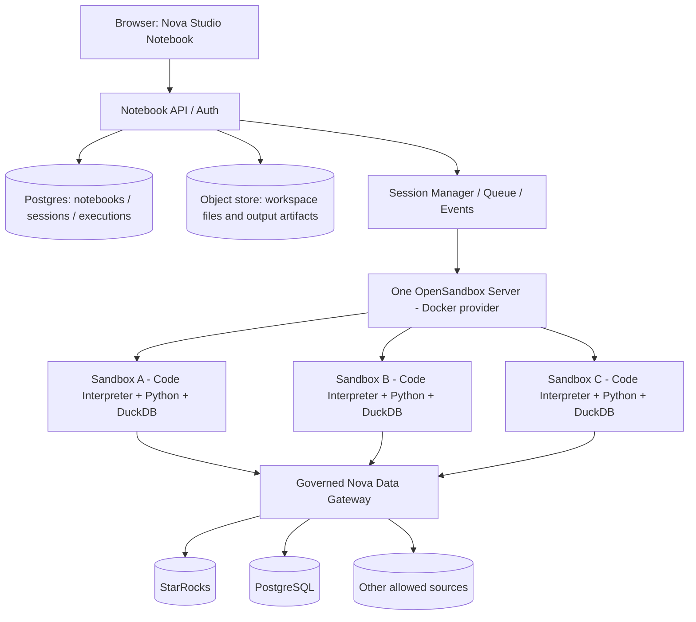

# NOVA NOTEBOOK - COMPLETE IMPLEMENTATION SPECIFICATION

Version: 1.0 Design | 2026-11-10 | Based on official upstream references; not a tested Nova/OpenSandbox deployment.


---

# Nova Notebook - Implementation Specification

Version: 1.0-design (supersedes initial v0.1 summary) | Date: 2026-11-10 | Status: implementation specification, NOT an implemented product

## Goal

Build a Snowflake Notebooks in Workspaces-inspired, custom Nova Notebook experience with:
1. Custom Next.js/React notebook editor for Python, SQL, Markdown and workspace files.
2. One OpenSandbox Server (Docker provider) that creates one sandbox container per active notebook runtime session.
3. Python/Jupyter persistence plus native DuckDB, automatically bootstrapped into each session; users do NOT call `nova.connect()`.
4. SQL <-> Python DataFrame references, rich output, package install, file upload/drag-and-drop, session lifecycle, resource limits, governance.
5. No custom NovaFrame query engine, no claim of arbitrary remote catalog pushdown without a validated connector.

## Design contracts / non-negotiables

- `Notebook` is a persistent document; `runtime_session` is ephemeral; `execution` is a versioned historical event.
- One sandbox **per active runtime session**, not per cell. One OpenSandbox Server may manage many sandbox containers.
- SQL and Python notebook cells execute on ONE serialized queue against ONE persistent Python kernel; SQL invokes DuckDB *inside that kernel*.
- `duckdb.sql()` and injected `db` use a preconfigured default connection in that kernel. Native standalone `.py` processes must bootstrap again.
- Remote Nova data must be governed by a **backend-enforced** authorization path. User Python can inspect its own environment; bootstrap is NOT a security boundary.
- Notebook save and output-save are separate. Do not embed huge output into `.ipynb`.
- Never rely on pure cell-order after drag-and-drop to infer valid Python state; mark downstream state potentially stale.
- OpenSandbox code interpreter rich MIME and interrupts must be verified against the pinned image/SDK before relying on them.

## Package contents

| File | Purpose |
|---|---|
| `docs/01-REFERENCE-UX-AND-DECISIONS.md` | Verified Snowflake patterns vs Nova decisions |
| `docs/02-ARCHITECTURE-AND-RUNTIME.md` | Components, isolation, lifecycle, bootstrap, recovery |
| `docs/03-UI-UX-INTERACTION-SPEC.md` | Precise layout, user interactions, drag/drop, keyboard, states |
| `docs/04-DUCKDB-NOVA-SESSION.md` | Zero-connect DuckDB, SQL/Python interoperability, remote governance |
| `docs/05-OUTPUTS-AND-DATAFRAME.md` | Event protocol, MIME, tables, chart, artifacts, export, limits |
| `docs/06-PACKAGES-AND-FILES.md` | Package manager, install and restart, uploads, workspace |
| `docs/07-API-DATA-CONTRACTS.md` | REST/SSE APIs, schemas, DB tables, event examples |
| `docs/08-SECURITY-AND-OPERATIONS.md` | Threat model, Docker security, governance, observability |
| `docs/09-TEST-PLAN.md` | Functional, UX, concurrency, security, regression tests |
| `docs/10-IMPLEMENTATION-ROADMAP.md` | Milestones, deliverables, definition of done |
| `docs/11-SOURCES.md` | Official documentation / source references |
| `design/WIREFRAME-AND-DESIGN-TOKENS.md` | Screen layout and states |
| `examples/nova_bootstrap_reference.py` | Illustrative local DuckDB bootstrap, NOT remote Nova connector |
| `AGENT_IMPLEMENTATION_BRIEF.md` | Task instructions for coding agent |
| `design/NOVA_NOTEBOOK_UX_DEMO.html` | Offline interactive UX mock; simulated only, no backend |

## Status terminology

- **Documented upstream**: behavior supported by cited Snowflake/OpenSandbox/DuckDB references.
- **Nova proposed**: product design decision requiring implementation.
- **Integration spike**: an explicit assumption needing version-pinned tests in the actual runtime.

## Suggested reading order

1. `AGENT_IMPLEMENTATION_BRIEF.md` for workflow.
2. Architecture, UI/UX, DuckDB, output, packages and contracts.
3. Security and tests.
4. Roadmap.

## Out of scope for initial PoC

Multi-user real-time collaborative editing, live debugger, GPU scheduling, Kubernetes, Firecracker/Kata, arbitrary remote SQL-to-Nova-catalog pushdown, autonomous package downloads, unbounded data materialization, full VS Code clone.

## Source provenance

The 2026 Snowflake "Notebooks in Workspaces" is the UI reference; the specification is a proposed Nova implementation, not a pixel-perfect reproduction. Refer to `docs/11-SOURCES.md`.


---

# 01. Snowflake Notebook UX Analysis and Nova Product Decisions

## 1. Sources and scope

**Reference**: Snowflake "Notebooks in Workspaces" (new experience; not Legacy Notebooks), documented as GA in February 2026. Sources [S1]-[S5] in `11-SOURCES.md`. We used official screenshots/documentation, not a live logged-in Snowflake tenant. Exact spacing, icon placement, and hover timing below are **Nova design proposals**, not verified Snowflake implementation details.

## 2. Snowflake experience: observed/documented

| Domain | Snowflake reference | How Nova should respond |
|---|---|---|
| Information architecture | Notebook is a file inside Workspace; tabs and file management | One Nova Workspace with tabs for notebook, Python, SQL, data files |
| Navigation | File tree + database explorer + center editor | Left collapsible Files/Data/Packages, center canvas, optional right Neva |
| Notebook cells | Python, SQL, Markdown, run/stop, names, multiple run modes | Full P0 cell system with deterministic queue and persistent names |
| References | SQL result `dataframe_x`, Python variable references, SQL `{{var}}` | SQL/Python bridged by a Nova-controlled reference registry in kernel |
| Output | Interactive datagrid, filter/search/sort, no-code charts | Native Nova table/chart renderer using typed result metadata |
| Tools | Variables, Terminal, Scratchpad, dependency graph | Variables P1; terminal P1; scratchpad P1; dependency graph P2 |
| Navigation within doc | Markdown-heading minimap, cell status, global find/replace | Outline P1; search P1 |
| Python dependencies | Preinstalled packages + pip + requirements + file/wheel upload | Packages UI + base image + manifest/lock + approval policies |
| Execution | Run All, cell, above, below, descendants; cancel queued | P0 Run, Run All, Run Above/Below; descendants P2 |
| Sharing | Export HTML; output not embedded in .ipynb by default | Separate document vs output policy; explicit snapshot/export |
| Compute | Service status, roles/warehouse and runtime tools | Simpler Nova runtime badge, CPU/RAM meter, Stop/Restart |
| AI | Cortex Code assistant integration | Optional Neva panel with edit diffs and explicit run approvals |

Reference notes:
- The legacy documentation describes drag-cell handles; current Workspaces docs explicitly document keyboard move-up/down. Nova will support drag reorder independently as an intentional UX requirement; do not represent it as a verified screenshot-matched new-Snowflake detail.
- Snowflake offers a service-level model which can be shared. Nova PoC intentionally chooses per-notebook-session containers for stronger workload separation.
- Snowflake notebooks may still ask users to set execution database/schema and use a Snowpark session. Nova intentionally avoids a Nova session creation call inside Python.

## 3. Target personas and jobs

1. Analyst: open existing catalog dataset, SQL, preview, chart, save.
2. Data scientist: Python + DuckDB + Pandas/Polars + package install and datasets.
3. Data engineer: multi-file project, modules, DuckDB SQL, import/export Parquet.
4. Manager: view/run existing notebook and inspect output without editing.
5. AI-assisted user: ask Neva to draft cells, review changes before insertion/execution.

## 4. UX principles

- **Zero-setup success**: a new notebook opens into an environment where `db.sql('SELECT 1')` works when Ready.
- **Progressive complexity**: advanced tools are secondary; the canvas and outputs are primary.
- **Explicit compute state**: do not display "Connected" solely because the container exists; kernel and DuckDB bootstrap must also pass readiness.
- **Safe-by-default**: no unbounded large result, no silent external network/package install, no automatic data exposure.
- **Reproducibility**: source files + dependency manifest + parameters survive container deletion; RAM state does not.
- **Predictable errors**: errors and stale cell dependencies are visible; never silently rerun unrelated cells.

## 5. Success measures (candidate PoC targets, not existing SLAs)

- First `SELECT 1` works without user credential/configuration after runtime Ready.
- 3 simultaneous notebook sessions run in separate Docker containers on one host.
- A user's notebook refresh does not create a second sandbox while runtime is alive.
- SQL output can be named, used in Python, then reused in downstream SQL without unnecessary full materialization.
- Reordering a cell is reversible; edit history and cell IDs are preserved.
- Package install progress/errors can be seen, and required packages can be restored after session recreation.
- A failing cell retains traceback and does not corrupt saved notebook source.

## 6. Feature priorities

### P0 - launchable PoC
- Workspace/file list, notebook tab, Python/SQL/Markdown cells, autosave/versioning, execution controls, cell DnD, runtime status, static results, safe table preview, package manager basic, upload, local DuckDB bootstrap, 3 isolated sandboxes.

### P1 - functional data workspace
- Bidirectional SQL/Python references, table filtering/sorting/paging, chart builder, Python modules, Variables Explorer, terminal, scratchpad, object storage outputs, share/export, graceful idle recovery.

### P2 - mature UX
- Dependency graph, run descendants, split editors, code review with Neva, Git integration, collaborative conflict resolution, remote Nova catalog native adapter, advanced remote pushdown and query profiling.

### Deliberately omitted
- Reimplementation of Snowpark DataFrame API (`NovaFrame`) is explicitly out of scope.
- Copying Snowflake brand/assets/pixel-perfect design is out of scope; use Nova design system.


---

# 02. Technical Architecture - OpenSandbox and Notebook Runtime

## 1. Architecture



- OpenSandbox **server container** is the control plane. Docker engine creates **new sibling workload containers**, one per notebook runtime session (not nested Docker inside the server).
- For macOS PoC, Docker Desktop Linux VM hosts Linux containers; gVisor does not execute natively on macOS. Use Docker `runc` locally. Production untrusted execution needs a security review for supported Linux gVisor/Kata.
- The Docker socket, if used by the control plane, is trusted-only and never mounted into user sandboxes.
- Each sandbox has one primary Python/Jupyter execution context for the notebook; that context also owns the default DuckDB connection.
- A notebook file can be open in several browser tabs; session reuse is keyed to persistent `runtime_session_id`, not browser socket.
- Multiple notebooks may belong to a workspace but active session isolation is per notebook runtime session (P0).

## 2. Components

| Component | Input | Output | Owner |
|---|---|---|---|
| Notebook API | UI auth, changes, runs | JSON/SSE | Nova backend |
| Document Service | cell edits, order/version | atomic notebook snapshots | Nova backend |
| Session Manager | notebook/user request | sandbox_id, context_id, state | Nova backend |
| Execution Queue | cell code + version | ordered executions, cancel, events | Nova backend |
| OpenSandbox Server | create/renew/connect/kill | sandbox lifecycle | upstream reused |
| Code Interpreter/execd | code/context | stdout/error/results | upstream reused |
| Nova Runtime Bootstrap | runtime identity/config | `db`, default DuckDB conn, references | Nova implementation |
| Package Installer | package spec + policy | install logs + manifest delta | Nova implementation |
| Nova Data Gateway | runtime-scoped identity/query | authorized data results | Nova backend integration |
| Result Adapter | execd/Jupyter result | normalized output records | Nova implementation |

## 3. Lifecycle state machine

`ABSENT -> PROVISIONING -> STARTING -> BOOTSTRAPPING -> READY -> BUSY -> READY -> IDLE -> STOPPING -> STOPPED`

Error paths: `PROVISIONING/STARTING/BOOTSTRAPPING -> FAILED`; `READY/BUSY -> DISCONNECTED` on transient link failure; `DISCONNECTED -> READY` after verified reconnect or `-> LOST` if container vanished. `STOPPED/LOST -> PROVISIONING` if a new session is requested.

Definition:
- `READY`: container healthy; execd reachable; Jupyter context exists; bootstrap `SELECT 1` succeeded; required base packages pass a smoke check.
- `BUSY`: one execution active; queued executions may exist.
- `IDLE`: no execution since activity threshold; still consumes allocated RAM.
- `DISCONNECTED`: backend lost contact, not a claim process died.
- `LOST`: sandbox missing or irrecoverably unreachable; previous Python variables cannot be restored.

### Runtime creation flow

1. `POST /notebooks/{id}/runtime` checks ownership and quotas, idempotency key.
2. Acquire distributed lock on notebook active runtime key to prevent duplicate create.
3. Allocate session row, request OpenSandbox create from **pinned** code-interpreter image; set resource, network and volumes.
4. Connect Code Interpreter, create explicit persistent Python context and record its ID.
5. Mount/synchronize workspace files to `/workspace` safely; restore package manifest into correct interpreter environment.
6. Run trusted bootstrap in same context: working directory, default DuckDB connection, permitted local catalog, helper functions, reference registry.
7. Probe `db.sql('SELECT 1')` and required local permissions; publish `READY` event.
8. Release lock. If any failure, tear down orphan container and transition `FAILED`, preserving diagnostics.

### Execution flow

1. UI commits current source revision (or includes exact code snapshot and revision); backend assigns monotonically increasing `execution_id` / `execution_count`.
2. Enforce one in-flight kernel execution per context, concurrency FIFO and global capacity.
3. For `python`, submit code to Code Interpreter in same context; for `sql`, use kernel SQL bridge in the SAME context; Markdown never executes Python.
4. Stream sequence-numbered output through SSE/WS adapter; store bounded output/metadata.
5. On completion commit status/duration/resource snapshot; next queued cell begins.
6. Cancel: cancel queued first, request kernel interrupt for current when supported; hard timeout triggers kernel restart / sandbox replacement according to policy. Never assume killing an HTTP request cancels running Python.

### Recovery

- Browser refresh -> fetch notebook + runtime status + output snapshot + `last_event_id` and resume stream. No new sandbox if active.
- Backend restarts -> restore sessions from DB, reconnect to existing sandbox IDs, reconcile actual status; missing sandbox is `LOST`.
- Sandbox restart -> recreate kernel and bootstrap; preserve workspace + package manifest, not Python variables.
- Runtime stop -> stop/kill sandbox after save+flush, revoke runtime access, delete ephemeral mounts; results/files persist per retention.
- Idle policy PoC recommendation: 15-20m no execution and no active useful background task -> warn then stop, configurable; 4h max wall-clock target with warning. Long jobs need explicit execution lease.
- Pause: Docker pause retains RAM allocation; does NOT reclaim kernel memory. Prefer stop/recreate for true resource recovery.

## 4. Resource policy (proposed defaults for laptop PoC)

| Parameter | Proposed default | Enforcement |
|---|---:|---|
| Simultaneous active sandboxes | 3 | session scheduler |
| CPU per sandbox | 1 core | Docker CPU quota |
| RAM per sandbox | 1.5 GiB | Docker cgroups |
| Disk per workspace | 2 GiB | quota/monitoring, not just Docker overlay |
| Log per cell | 2 MiB inline | output adapter truncation |
| Table preview | 100 rows initial | query/result broker |
| Export | bounded, confirmation | export service |
| Per-cell soft timeout | 60s | execution manager |
| Per-cell hard timeout | 5m PoC | interrupt/restart policy |

Defaults are tuning proposals and depend on machine capacity. Distinguish `timeouts` set for SDK requests from server-side CPU execution watchdogs.

## 5. Image and volume strategy

- Build a derivative image from the pinned official `opensandbox/code-interpreter` version. Do not use bare `python:3.12` for notebook kernels unless you add the required execd/Jupyter integrations.
- Include a pinned Python interpreter, `ipykernel`, DuckDB, PyArrow, Pandas, Polars, common visualization dependencies, and small `nova_runtime` bootstrap.
- Ensure installer and Jupyter kernel use the same `sys.executable` or a pinned venv. Do NOT install into a different Python and assume kernel sees it.
- Workspace: per-notebook named Docker volume for files (or persist to object storage, hydrate on boot). Separate temporary volume/overlay for scratch; per-container package cache.
- `.ipynb`, `.py`, `.sql`, manifests are persistent via Nova document/file service; never rely on overlay filesystem.
- Durable DuckDB file is optional for workspace-local tables. `.duckdb` persisted on a named volume can restore local tables, not Python state nor remote attachment definitions.

## 6. Capability and platform constraints

- Local macOS + Docker Desktop + runc = development only for trusted code.
- Linux + configured gVisor `runsc` is an alternative secure runtime; compatibility with DuckDB/Arrow must be proven through E2E tests.
- The OpenSandbox official Docker Compose example mounts Docker socket into the trusted server; production requires restricted network/exposure.
- SDK/image/server version compatibility: pin and verify. Official docs follow default branch and may describe features not in released images.

## 7. Implementation interfaces

Backend internal service:

```python
class RuntimeProvider(Protocol):
    async def start(self, notebook_id: str, user_id: str, spec: RuntimeSpec) -> RuntimeHandle: ...
    async def connect(self, runtime_id: str) -> RuntimeHandle: ...
    async def run_python(self, runtime_id: str, code: str, exec_id: str) -> AsyncIterator[RuntimeEvent]: ...
    async def run_sql(self, runtime_id: str, query: str, bindings: dict, exec_id: str) -> AsyncIterator[RuntimeEvent]: ...
    async def interrupt(self, runtime_id: str, execution_id: str) -> None: ...
    async def install(self, runtime_id: str, packages: list[PackageSpec]) -> AsyncIterator[RuntimeEvent]: ...
    async def stop(self, runtime_id: str) -> None: ...
```

This is a proposed Nova abstraction; actual OpenSandbox SDK method names and event structures are version-specific and must be adapted in one layer.


---

# 03. Nova Notebook UI/UX Interaction Specification

This file is normative for frontend interaction and accessibility. It is a **Nova product proposal** inspired by Snowflake Notebooks in Workspaces, not a claim of identical Snowflake UI behavior.

## 1. Information architecture

```
Nova Studio
  Workspace
    Files
      analyses/revenue.ipynb
      src/transform.py
      data/input.csv
      pyproject.toml
    Data
      Catalog > connection > schema > table
    Packages
    Open editor tabs
      Notebook | Python file | SQL file
```

Layout at >=1280px wide:

```
+------------------------------------------------------------------------------+
| Nova | Workspace / Analyses / revenue.ipynb | Saved | Runtime READY | Run All |
+-----+----------------------+----------------------------------------+---------+
| Nav | Files / Data         | Tab: revenue.ipynb | transform.py       | Neva    |
|     | project/             | Notebook title + runtime toolbar       | [opt]   |
|     |   revenue.ipynb      | [md]  # Revenue analysis               |         |
|     |   transform.py       | [sql] SELECT ... [Run]                 |         |
|     |   data/input.csv     |  [Table | Chart]  100 rows preview      |         |
|     | Packages             | [python] df = db.sql(...) [Run]        |         |
|     | Catalog              |  [stdout | plot | error]               |         |
+-----+----------------------+----------------------------------------+---------+
| [Output] [Variables] [Terminal] [Scratchpad]   | CPU | RAM | Problems         |
+------------------------------------------------------------------------------+
```

Suggested width (fluid; NOT exact Snowflake measurements): nav rail 48px, explorer 240-300px, right panel 320px when opened, bottom drawer 220-320px. Do not force fixed sidebars on small screens.

## 2. Navigation and responsive behavior

| Viewport | Proposed behavior |
|---|---|
| >=1440 desktop | left nav + resizable explorer, main canvas, optional right Neva and bottom tools |
| 1024-1439 | left explorer collapsible; Neva overlays when opened; horizontal editor area prioritized |
| 768-1023 | collapsed explorer by default, single active editor tab, tools in bottom sheet |
| <768 | browse/read & limited editing; no cramped 3-pane IDE; runtime actions stay reachable |

Keyboard navigation and focus indicators must work without drag-and-drop. Restore panel sizes and open tabs per user/workspace.

## 3. Global header and runtime toolbar

Header shows:
- Breadcrumb `Workspace / Folder / Notebook`, editable notebook title with validation, save state (`Saving...`, `Saved`, `Conflict`, `Offline`).
- Primary `Run All` action, split menu: Run All / Run Above / Run Below; Stop execution when active.
- Runtime state pill: `Not started`, `Starting`, `Initializing`, `Ready`, `Running`, `Idle`, `Disconnected`, `Stopped`, `Failed`. Use color + readable text, not color alone.
- Runtime dropdown: Start, Reconnect, Restart Kernel, Stop Runtime, View Resource Usage, Runtime Logs; destructive action requires confirmation when running work.
- Overflow: Import .ipynb, Export .ipynb, Export HTML, Clear All Outputs, Notebook Settings.
- Permission-aware controls: viewer may inspect/snapshot but not edit/run unless authorized.

Runtime UI events:
- On open with no runtime: display notebook immediately, show `Start runtime` CTA. Optional policy auto-start if user explicitly opens an editable notebook; default PoC manual start is cheaper and safer.
- On `Start`: one click, spinner + stage text (`Provisioning container`, `Starting Jupyter`, `Loading packages`, `Connecting data`, `Ready`). Cancel start available.
- On `Disconnected`: show non-blocking banner; edit/save still works, run disabled until reconnected.
- On kernel `Restart`: confirm "Variables and in-memory DuckDB tables will be cleared; files/packages remain". Mark previous cell outputs stale.
- On `Stop`: warn about running tasks and RAM state; persist files first; revoke runtime identity.

## 4. Notebook cell anatomy

- Cell types: Python, SQL, Markdown. Python/SQL are executable; Markdown is renderable and editable without runtime.
- Each cell stores **stable UUID** independent from visual order. Source revision hash identifies what was executed.
- Left gutter appears on hover/focus: drag handle (six dots), execution number `[7]` or status, plus add-cell affordance between cells.
- Header: language selector, editable name `dataframe_1`, execution count, status, duration, last executed time, run button, ellipsis actions.
- Body: Monaco/CodeMirror editor (Python/SQL) with syntax; Markdown markdown editor + rendered preview; default dynamic height with max height + internal scrolling.
- Output panel: below cell, resizable/collapsible, tabs or MIME priority chosen by renderer. Every output includes clear/copy/download if allowed.
- Footer: `+ Python`, `+ SQL`, `+ Markdown`, or a compact plus between cells.

Recommended visual states:

| Cell state | UI treatment | Allowed actions |
|---|---|---|
| clean | neutral border | edit, run, reorder, duplicate |
| modified | dot next to name; "Not executed since edit" tooltip | run, save |
| queued | queue icon + position | cancel queued run |
| running | spinner + "Running", elapsed timer | stop, view output stream; edits buffered |
| success | check icon + duration | run again, clear output |
| error | error bar + error summary | inspect traceback, fix, rerun |
| cancelled | stopped icon | retry |
| stale | "Output from earlier source/runtime" label | rerun, keep or clear |
| blocked | lock / connection warning | read/edit until runtime ready |

Output belongs to exact `execution_id` and `source_revision`, not just `cell_id`.

## 5. Keyboard contract

Use conventional notebook shortcuts with conflict-check against Nova global shortcuts:
- `Shift+Enter`: execute current cell then focus next (create one at end if needed).
- `Ctrl/Cmd+Enter`: execute current cell, stay in cell.
- `Alt+Enter`: execute current cell, insert new cell below.
- `Esc`: exit cell edit into command mode; `Enter`: reenter edit.
- In command mode: `A` add above, `B` add below, `M` Markdown, `Y` Python, `DD` delete (undoable).
- `Ctrl/Cmd+Z` while editing undoes text; in command mode undoes structural actions.
- `Ctrl/Cmd+Shift+P`: command palette, including insert SQL/Python, run, move, convert type.
- `Ctrl/Cmd+F`: find within selected editor; Global Find is a separate notebook toolbar action.
- Avoid stealing browser standard shortcuts without documenting conflicts. Show a shortcut help modal.

## 6. Drag-and-drop cell reorder (required P0)

### Pointer interaction

1. Hover/focus cell gutter -> show drag grip with accessible label `Move cell`.
2. Pointer-down on grip beyond 6px movement threshold -> drag preview (ghost of cell title/type/first line, not giant output).
3. Display insertion indicator as full-width horizontal line between target cells; scrolling autoscrolls when near edges.
4. On drop, reorder by cell UUID, not regenerate identities. Optimistic UI update; call reorder API with base document revision/ETag.
5. Success -> save/ack version; show toast `Cell moved`; undo shortcut restores previous order.
6. API conflict -> revert optimistic order; show `Notebook changed in another tab. Review latest version` with reload/merge option.
7. On cancel (Esc, drop outside canvas, permission lost) -> restore original position.

### Rules

- Drag handle only; do not start cell drag when selecting text, interacting with output, copying chart, or resizing panel.
- Works for multi-line cells, collapsed cells, and Markdown; output not embedded in drag preview.
- Do not allow drop into result panel, Neva panel, or file explorer.
- Reordering a running cell is either disabled until execution finishes or permitted only as **document** reorder with execution snapshot unchanged. PoC: disable reorder of running cell; other cells remain movable.
- After moving, show `Some outputs may be stale` and mark affected downstream cells `stale` (conservative propagation from first moved position). Never auto-rerun automatically.
- Stable execution order is the source snapshot taken at Run All press; dragging while Run All is active does not reorder the in-flight queue (show explanatory message).

### Accessibility fallback

- Cell ellipsis includes `Move up`, `Move down`, `Move to top`, `Move to bottom`, and `Move to position...`.
- Announce via live region `Moved cell 3 before cell 2`. Use drag library keyboard sensor (e.g. dnd-kit) with clear semantics.

## 7. File and dataset drag-and-drop

Different drop zones must be distinguishable:

| Drag source | Drop target | Behavior |
|---|---|---|
| External CSV/Parquet/JSON | Explorer | Upload file; show progress; virus/type/quota checks; never auto-execute contents |
| External `.ipynb` | Explorer | Import notebook, validate format, preview before overwrite |
| External `.py` / `.sql` | Explorer | Create file, prompt on name conflict |
| Explorer file | Notebook canvas gap | Add appropriately typed cell: `.py` -> Python `%run`/import suggestion, `.sql` -> SQL cell source, CSV/Parquet -> generated preview code; require confirmation |
| Data catalog table | SQL editor/canvas | Insert fully qualified reference or create SQL preview cell, NOT silently export full table |
| Notebook cell | Another notebook | P1 copy cell only (not move), preserve source and attribution, not same cell UUID |
| Explorer file/folder | Explorer folder | Move after permission check and path conflict validation |

Upload behavior:
- Dragover overlay names exact destination; highlight explorer/canvas separately.
- Multi-file upload displays queue, file sizes, per-file progress, cancel and retry.
- Directory upload optional P1, use File System Access API where supported; normalize paths to deny `..`, symlinks, traversal, absolute paths.
- Cancel partial uploads and clean abandoned temp objects.
- Drop large files produces upload action, never paste raw bytes into a Python cell.

## 8. Cell execution UX and failure handling

- `Run Cell`: user can edit while running, but execution uses immutable source snapshot; visually indicate `Code changed during execution` and output stale.
- `Run All`: freeze ordered list of cell IDs/revisions; Markdown is skipped; one queued execution per code cell; clear or append output according to settings.
- On failure: default `stop on error` for Run All, optional `continue` setting; show which remaining cells were skipped.
- On network disconnect: keep execution running on server as appropriate; reconnect via `last_event_id` and fetch status; never blindly retry a non-idempotent run.
- On timeout: visible soft timeout -> request interrupt; after grace period escalate kernel restart and mark context reset. Confirm destructive escalation when interactive; apply policy when backend auto-recovers.
- `Clear Output` removes displayed/persisted output artifact pointer subject to retention, not source.
- `Undo Delete` restores cell UUID/order/source, not an old runtime state.

## 9. DataFrame table UX

- Show columns with type badges, 100-row initial preview, header anchored, virtualized rows, horizontal scroll, resize/reorder/hide columns.
- Toolbar: Table/Chart toggle, search, filter builder, sort, expand, download, copy sample, row/column count and truncation indicator.
- Search/filter/sort against remote source must be applied server-side through a result handle or source query, never claim it affects all rows if only preview is cached.
- If preview-only: label `Searching first 100 rows only`; full-table filter action available only if backend supports it.
- Distinguish `total_count` (known) from `estimated` and `unknown`; do not issue automatic expensive count(*).
- Render null, NaN, inf, timezone, decimal, UUID, binary, arrays, structs, nested JSON, very long strings predictably.
- Link cell output to `result_id`; no direct table credentials in client.

## 10. Chart builder UX

- Open with Table/Chart segmented switch; side configuration inside output (not a global modal by default).
- P0: bar, line, area, scatter, pie (appropriate field rules); map and complex charts P2.
- Properties: X, Y metrics, aggregations, color/series, sort, max categories, legend, title, date formats.
- Data preview must be bounded or server-aggregated. Warn if data is sampled; show sampling method.
- `Save chart config` attaches a chart spec to output/cell; underlying data still follows result retention.
- `Add to Dataviz` appears ONLY when deterministic capability validation passes for chart kind, source provenance, data binding, and permissions; unsupported outputs get no action/badge.

## 11. Package Manager UI (P0)

Open from workspace `Packages` tab or Runtime dropdown. Show three tabs:
- `Installed`: name, version, source (`base`/`user`), installed at, compatible kernel, uninstall/change version where allowed.
- `Install`: search package, version picker, install target, allowed repo, package details/warning, `Install`.
- `Environment`: current image/Python/DuckDB versions, manifest, restore status, last failed installation, `Rebuild` (P1).

Install workflow:
1. User searches/chooses package/version; validate canonical name & configured policy on backend.
2. Show resolution and dependency changes, disk impact estimate when known, and approval if package is not in curated allowlist.
3. Display Installing state with log stream. Disable conflicting installs for same sandbox; do not block editor save.
4. On success refresh installed list. If package already imported, show `Restart kernel may be required` action.
5. Update manifest only after successful installation and smoke check; on failure preserve prior manifest and provide error/log + retry.
6. Warn if package requires native OS libraries; for unsupported system dependency request an administrator-curated base image.

Permission controls: viewer cannot install, operator may run, editor may install only within policy, admin can approve external registry packages.

## 12. Console, developer panels, and data explorer

- Bottom drawer tabs: Output, Problems, Variables (P1), Terminal (P1), Scratchpad (P1). Remember selected tab.
- Variable inspector enumerates safe `(name,type,shape,preview)` after an execution, never eagerly materializes giant objects; clicking a DataFrame previews via bounded result method.
- Terminal runs inside sandbox, is marked as untrusted shell, requires permission and resource policy; process lifecycle independent of code cell queue.
- Scratchpad runs in same kernel unless explicitly isolated; label `Changes kernel state / not saved to notebook` to avoid user confusion. Alternative separate scratchpad context should NOT pretend it shares variables.
- Data Explorer: authorized catalogs and schema; right-click `Preview`, `Describe`, `Insert SELECT`, `Copy qualified name`; expose no hidden/unpermitted tables.

## 13. Neva panel (P1)

- Context is notebook ID, selected cell IDs, runtime status, explicit schema info only within user access.
- Edits shown as diffs with `Accept`, `Reject`; never silently overwrite cells.
- AI calls to execute code or install libraries require action-specific user approval in the notebook.
- If AI-generated SQL refers to an unapproved table, fail closed via data gateway; do not trust LLM authorization.

## 14. Empty/loading/error microcopy (examples)

- Empty notebook: `Mulai analisis. Tambahkan SQL, Python, atau Markdown cell.`
- Runtime starting: `Menyiapkan Python dan DuckDB di runtime terisolasi...`
- Pending install: `Menginstal polars==... ke environment notebook ini.`
- Stale output: `Output berasal dari kode sebelumnya. Jalankan ulang untuk memperbarui.`
- Kernel lost: `Runtime terhenti. File tersimpan, tetapi variabel di memori perlu dihitung ulang.`
- Output clipped: `Output terlalu besar; bagian awal ditampilkan. Lihat artifact jika tersedia.`
- Broker denied: `Akses dataset tidak tersedia untuk sesi ini. Pilih data yang diizinkan.`

## 15. UX non-functional requirements

- 60fps target during cell drag on a sample 100-cell notebook via virtualization of non-editing content.
- Accessible name/role on all icon buttons; keyboard-only create/run/reorder/delete and screen-reader announcements.
- WCAG AA visual contrast target, color-blind-friendly state labels.
- No layout jump when output expands: keep measured/collapsible output region.
- Large notebooks (>300 cells) must use editor virtualization/lazy mounting and stable scroll position.
- User selection/cursor/scroll is restored on navigation; no lost edit during background autosave.
- Unsaved source prompt on exit only if autosave failed, not on normal successful save.


---

# 04. Native DuckDB and Nova Session Integration

## 1. User contract: zero manual Nova connection

The notebook opens with `db` already available in the same persistent Python kernel:

```python
# Both are valid once runtime is READY:
db.sql('SELECT 1 AS ready').show()

import duckdb
duckdb.sql('SELECT 1 AS ready').show()
```

There is NO required `NovaSession.builder`, `nova.connect`, user-entered database password, or per-notebook manual `ATTACH` step.

Internally an **OpenSandbox runtime session still exists**, with immutable user/workspace identity, runtime ID, kernel context, and Nova authorization context. This is hidden from the user but enforced server-side.

## 2. Bootstrap in the SAME Jupyter kernel

```python
# Conceptual trusted initialization executed by Session Manager BEFORE READY
import duckdb

# Recommended: choose per-session DuckDB :memory: for P0. Use a workspace .duckdb
# file for optional local persistence, never share a writable DB file across sandboxes.
_db = duckdb.connect(':memory:')
_db.execute("SET memory_limit = '768MB'")
_db.execute("SET threads = 2")
_db.execute("ATTACH ':memory:' AS nova")     # DEMO ONLY, NOT a remote connector
_db.execute("CREATE SCHEMA nova.sales")       # local demo catalog
_db.execute("CREATE TABLE nova.sales.transactions(region VARCHAR, amount BIGINT)")
_db.execute("INSERT INTO nova.sales.transactions VALUES ('Jakarta', 100), ('Bandung', 200)")

duckdb.set_default_connection(_db)
db = _db
assert duckdb.sql('SELECT 1').fetchone()[0] == 1
```

In real implementation, bind the connection into the Jupyter context global namespace and keep its reference for the kernel lifetime. `duckdb.set_default_connection()` is process-local: it does NOT automatically affect separate `python main.py` subprocesses or another Jupyter kernel.

### Bootstrap order

1. Validate runtime_id -> notebook ownership -> effective permissions in backend.
2. Select pinned base runtime image and resolved manifest; create sandbox.
3. Make workspace available, establish Python cwd and sys.path.
4. Load approved DuckDB extensions from pinned trusted repository/image, then apply security configuration.
5. Create DuckDB connection and configure memory/threads/temp dir.
6. Attach local workspace catalog; prepare optional source connectors if approved.
7. `duckdb.set_default_connection(con)` and `db=con`; register Nova helper functions and output hooks.
8. Verify `db.sql('SELECT 1').fetchone()`, generate `READY` event.

Do not give code within untrusted notebook the ability to modify authorization state in the Nova Data Gateway, even if it overwrites `db`.

## 3. SQL cell execution - one kernel

**Must** execute SQL and Python through the SAME kernel for shared in-memory DuckDB state.

Algorithm (design):
1. UI sends cell source + revision to backend.
2. Backend queues SQL command on same per-kernel execution queue as Python.
3. Backend invokes a trusted SQL bridge module inside kernel with the source, authorized bindings and execution ID. Never run SQL in a second FastAPI process and expect `db` shared.
4. Bridge validates cell reference placeholders (next section) and classifies read-only SELECT vs DDL/DML.
5. For read-only query, create a DuckDB relation, publish a named reference object in kernel namespace, fetch bounded preview.
6. For DDL/DML, execute once, return affected rows/status; do not accidentally preview by re-executing a side-effect query.
7. Stream structured result metadata/preview via result adapter.

### SQL cell example

```sql
-- cell SQL, output alias: sales_by_region
SELECT region, SUM(amount) AS revenue
FROM nova.sales.transactions
GROUP BY region
```

```python
# next Python cell - SQL result alias registered in kernel
sales_by_region.show()
# .limit(100).df() is a materialization - warn for large data
```

```sql
-- next SQL cell - see safe binding policy below
SELECT * FROM {{sales_by_region}} WHERE revenue > 100
```

`{{...}}` is a **Nova SQL-cell feature**, not general DuckDB SQL syntax. It must be implemented as a reference resolver; `db.sql()` typed by user is native DuckDB without implicit double-brace rewriting.

## 4. Cell reference registry and safety

Registry record:

```json
{
  "name":"sales_by_region",
  "kind":"duckdb_relation",
  "origin_cell_id":"cell-uuid",
  "source_revision":"sha256:...",
  "kernel_generation":3,
  "created_at":"2026-11-10T03:33:00Z",
  "status":"valid"
}
```

Rules:
- Names must be valid simple identifiers `[A-Za-z_][A-Za-z0-9_]*` and unique within registry; reserved names include `db`, `duckdb`, `__nova_*`, and Python builtins.
- Don't interpolate arbitrary user-provided strings into SQL. Parse expressions with a restricted grammar or SQL AST; only support `{{identifier}}` tokens in known valid contexts. A missing name raises a clear error.
- For pandas/Polars/Arrow DataFrames, register as a DuckDB relation using native `register()` in the same Python process; name is a generated safe identifier, e.g. `__nova_ref_c1...`, not raw user text.
- For a DuckDB relation, materialize a **temporary VIEW** (when supported) linked to the same connection, not an eagerly copied table; verify lifetime and name resolution under pinned DuckDB version.
- For scalar variable, use parameter binding instead of string replacement; no Python `eval()` for resolving `{{...}}`.
- On rerun/rename/delete or restart kernel, invalidate or version references; downstream outputs marked stale.
- Avoid accidental retention of large DataFrames in an unbounded registry; cap count and use reference lifetimes/cleanup.
- Keep preview execution bounded and avoid executing non-idempotent SQL more than once.

## 5. SQL and Python process boundaries

| Operation | Same Jupyter kernel? | State shared? |
|---|---|---|
| Python cell A -> Python cell B | yes | Python vars + db connection |
| SQL cell -> Python cell | yes, SQL bridge | relation aliases + connection |
| Python cell -> SQL cell | yes, explicit registry binding | registered DataFrame/views/scalars |
| Python cell -> native `python main.py` subprocess | no | shared files and installed packages ONLY |
| Separate notebook session / sandbox | no | no RAM/connection; optional explicitly shared read-only storage |

Standalone Python project: expose `nova_runtime.bootstrap_for_process()` as an **internal** entrypoint wrapper launched by Nova Runner before user script (or via trusted `sitecustomize` only if process controls are validated). Do not imply a connection in the notebook process is inherited by all future `python` processes.

## 6. Local DuckDB mode vs governed Nova remote mode

| Capability | P0 local PoC | P1 direct source adapter | P2 governed remote virtual catalog |
|---|---|---|---|
| `duckdb.sql` without manual session | yes | yes after bootstrap | yes after bootstrap |
| `nova.sales.transactions` | local demo `ATTACH` | requires explicit configured connector | requires Nova-aware DuckDB extension/protocol |
| Read CSV/Parquet | native DuckDB | native DuckDB | native DuckDB |
| StarRocks read | no | experiment `mysql` extension | broker / specialized adapter |
| Query pushdown | local DuckDB compute | connector-dependent, MUST verify | planned with explicit remote pushdown |
| Nova RBAC/RLS | local test data only | must be enforced at source | Nova Data Gateway policies |
| Credentials visible to user Python | none for demo | source credentials are risky | prefer workload identity + broker, no global DB password |

### Important limitation

An automatic Python bootstrap is NOT enough to implement a distributed Nova Catalog. It can only attach supported sources or create local views. `nova.sales.transactions` that resolves to remote governed data requires either:

A. **Direct connector** with per-user database-native roles/RLS and controlled egress, or

B. **Nova Data Gateway** and a DuckDB table function / extension / protocol that forwards scans or queries, plus enforced authorization, pushdown and result streaming.

A broker returning Arrow batches can be loaded into DuckDB, but subsequent DuckDB transformations may execute locally. This must not be represented as Snowpark-like pushdown unless measured.

### StarRocks compatibility checklist

- Protocol handshake using official DuckDB mysql extension; verify metadata, supported datatypes, reads, errors, TLS, timeouts.
- `ATTACH`, `CONNECT`, basic SELECT, aggregate, JOIN, projection/filter pushdown; inspect StarRocks audit/query logs.
- RLS at database vs Nova broker; role changes mid-session; negative tests.
- Never place shared root/admin credentials in user sandbox.
- On source network failure, notebook remains functional for local files and displays source-specific error.

DuckDB 2.0 documents `CONNECT` for PostgreSQL/MySQL remote routing, but StarRocks is not claimed officially tested by these documents. Verify before choosing this architecture.

## 7. Native DuckDB / SDK custom scope

**Not creating:** custom DataFrame class/engine, planner, SQL optimizer, custom `novaframe` Python package.

**Creating:**
- `nova_runtime` small bootstrap package with settings and namespace injection.
- SQL cell bridge and safe `{{name}}` resolver.
- Output formatting hooks / reference metadata provider.
- Backend Nova Data Gateway client to connect to approved sources; optional native DuckDB extension only if justified.

## 8. Resource and safety nuance

`df = db.sql('SELECT * FROM massive_table')` may remain lazy; `df.df()`, `.fetchall()`, `.to_arrow_table()` and similar calls may materialize unbounded data. P0 must show warnings where Nova controls the action, enforce container RAM/disk limits, and cap automatic preview. It cannot guarantee Python user code will never OOM; runtime memory kill/recovery UX must be implemented.

An untrusted Python user can access Python objects and environment variables in their own container. Any security claim of invisible database credentials inside the same Python process is invalid. Treat the sandbox as untrusted and enforce data permissions outside it.


---

# 05. Execution Output and DataFrame Interaction Contract

## 1. Three layers of output

1. **Kernel stream**: ordered `stdout`, `stderr`, progress and traceback segments.
2. **Rich MIME display**: text, HTML, SVG, PNG, Plotly (version-verified), and display-data updates.
3. **Nova structured result**: table handle/schema/preview, chart spec, file/artifact with signed retrieval endpoint.

Do not assume OpenSandbox SDK automatically forwards every custom Jupyter MIME type. Execute a **version-pinned capability spike** with pandas, Polars, DuckDB relation, matplotlib and Plotly in the exact image. If a MIME payload is unavailable, implement a trusted kernel-side display capture adapter or a result side-channel from the same sandbox; don't inspect stdout for guessed HTML tables.

## 2. Normalized output event envelope

```json
{
  "event_id":"evt-000021",
  "sequence":21,
  "runtime_session_id":"rt-uuid",
  "execution_id":"exe-uuid",
  "cell_id":"cell-uuid",
  "source_revision":"sha256:...",
  "time":"2026-11-10T03:34:11Z",
  "type":"display_data",
  "payload":{
    "mime":"application/vnd.nova.dataframe+json",
    "result_id":"res-uuid",
    "schema":[{"name":"region","type":"VARCHAR"},{"name":"revenue","type":"BIGINT"}],
    "preview_rows":[["Jakarta",100],["Bandung",200]],
    "limit":100,
    "total_rows":null,
    "is_preview":true
  }
}
```

Supported `type`: `queued`, `started`, `stream`, `display_data`, `update_display`, `progress`, `warning`, `error`, `finished`, `cancelled`, `truncated`, `artifact_created`. Sequence strictly increasing per execution; idempotent replay by `event_id`.

## 3. MIME handling and sanitization

| MIME/result | Renderer | Policy |
|---|---|---|
| `text/plain` | plain preformatted text | escape markup, line length cap |
| `text/markdown` | Markdown renderer | sanitize HTML and URLs |
| `text/html` | sanitized sandboxed iframe or restricted renderer | no unsafe script, CSP, trusted host origin isolation |
| `image/png`, `image/jpeg` | image display | byte limit, content-type validation |
| `image/svg+xml` | sanitized/rejected SVG | no scripts/external refs |
| `application/vnd.plotly.v1+json` | Plotly renderer | schema/version validation, disabled external callbacks |
| `application/vnd.nova.dataframe+json` | Nova Table/Chart viewer | result handle, bounded preview |
| Python traceback | error viewer | collapse stack, no credential leak, source links |
| Files (.csv/.parquet/.pdf etc.) | artifact chip | only validated signed download URLs |

Never embed arbitrary notebook-generated HTML directly into the trusted Nova app DOM. Implement CSP and sandboxing for outputs, not just markdown sanitization.

## 4. DataFrame detection and conversion

- Python code can return pandas DataFrame, Polars DataFrame/LazyFrame, DuckDBPyRelation, PyArrow Table/RecordBatchReader.
- For known types, return `result_id`, `schema`, limited `preview_rows` and a lazy fetch/export strategy. Do not auto-call `to_pandas()` on a remote relation to create a grid.
- For PyArrow, prefer streamed RecordBatches with bounded buffer and explicit backpressure; Arrow is not automatically zero-copy end-to-end over a network.
- DuckDB relation preview: use relation.limit(100) or equivalent bounded query. Preserve original relation for further computation if safe, and mark preview results with `snapshot_time` / source revision.
- `print(df)` stays textual; simply evaluating `df` at end of a Python cell may trigger enhanced display only through a verified display hook.

## 5. Table viewer interaction contract

- Initial view: at most 100 rows; clearly label `Showing first 100 rows` and known vs unknown total count.
- Display type-aware header icons, null indicators, sticky header, row virtualization, horizontal scroll, copy cell, inspect value modal.
- Client-side sort/filter only for explicitly labeled local preview. If result handle supports backed data, send filter/sort/page to result service.
- `GET /results/{id}/rows?offset=100&limit=100&sort=...&filter=...` must reject operations unsupported by a stale/non-query result. Prefer cursor/keyset pagination for remote sources that support stable ordering; offset alone can be expensive/non-deterministic.
- Data source output has `origin` (`local_duckdb`, `nova_gateway`, `arrow_snapshot`, `python_memory`); expose a concise tooltip `Processed locally` / `Computed remotely` only when measured.
- Row copy or export enforces governance and quotas. Column-level redaction at gateway must be applied before data reaches sandbox.

## 6. Chart builder and persistence

Chart spec example:

```json
{
  "version":1,
  "kind":"bar",
  "source_result_id":"res-uuid",
  "x":"region",
  "y":[{"column":"revenue","aggregation":"sum"}],
  "sort":{"column":"revenue","direction":"desc"},
  "limit_categories":20,
  "title":"Revenue by Region"
}
```

- Tables and charts share result data. Do not run expensive query twice just because user changes tabs.
- Implement chart validation using schema and data source; show helpful error if axis type unsupported.
- `Add to Dataviz` only when Nova's deterministic chart capability validator confirms compatible Superset chart type, source data binding, active user permission and materialization strategy.
- Chart config can be saved even when runtime is stopped; stale data requests prompt rerun.

## 7. Output lifecycle & storage

- `.ipynb` holds source/cell metadata. By default, strip or omit large/executable outputs from saved notebook. Provide an export mode that includes bounded static outputs if requested.
- Store execution output metadata in Postgres and blob payloads in object storage keyed to execution ID.
- Output policy examples: 2 MiB stdout inline per cell, 10 MiB image payload per display, 100 preview rows, 100 MiB user export soft limit. Values configurable per workspace.
- Truncate with indicator, do not silently discard. Logs and artifacts stored with TTL and retention policy.
- On rerun, keep previous result in history while showing new active output. Previous result may not be queryable after runtime stops unless materialized to output storage.
- On cell deletion, archive output pointers for Undo/session recovery; expire per retention.

## 8. Execution error states

- User syntax/runtime exception: show traceback, file/cell line mapping, duration, `Fix with Neva` optional.
- Kernel timeout/kill: show `Runtime restarted, variables cleared` and mark dependent results stale.
- Output serializer error: execution may have succeeded; show `Code completed, output could not be rendered` distinct from cell failed.
- Network disconnect: show partial output as available, replay events on reconnect; never create duplicate execution.
- Unauthorized remote table: show permission error without exposing raw secrets or hidden schema.

## 9. UI acceptance examples

1. `print('hello')`: `stream` text appears progressively; final status success.
2. `1/0`: traceback with cell line mapping; status error, no black screen.
3. Matplotlib chart: inline PNG/image with zoom/download only if permitted.
4. DuckDB result 1M rows: preview at most 100 rows; no full materialization at render.
5. Plotly rich output: safe schema rendering (or explicit fallback if MIME unavailable in current OpenSandbox stack).
6. SQL result named `df1` -> Python `df1.limit(10).show()` -> downstream SQL `{{df1}}`, with stale state after kernel restart.
7. Browser reload mid-execution: reattach and restore progress/result via event cursor.


---

# 06. Package Manager, Python Environment, Files and Upload

## 1. Package philosophy

- Base image includes pinned and tested Python/Jupyter/DuckDB/Pandas/Polars/PyArrow, visualization basics and `nova_runtime` bootstrap.
- **User-installed** packages are a persistent *manifest of requested dependencies*, not an assumed persistent installed filesystem.
- Packages are installed inside a sandbox's trusted runner using the **same** interpreter/venv as the kernel (`sys.executable`).
- `pip install` executes third-party code. Apply registry, dependency, network, supply chain, and CPU/disk constraints.
- Support package installation from UI, `requirements.txt`, approved `.whl` upload, and later an internal index. No unconstrained `apt` in PoC user runtime.

## 2. Proposed environment data model

```yaml
runtime_image: nova-notebook-runtime@sha256:<pinned_digest>
python_version: '3.12'
duckdb_version: '<pinned_tested_version>'
requirements:
  - name: polars
    version: '>=1.0,<2.0'  # server resolves and pins concrete version
  - name: matplotlib
    version: '==3.9.2'
index_profile: nova-curated
lockfile_sha256: '<checksum>'
```

Manifest is versioned with notebook/workspace; lock resolution happens server-side. Example versions are illustrative; implementation pins exact compatible build and image versions.

## 3. Installation semantics

1. UI selects package and desired version; validation on both client and server.
2. Server resolves canonical package name, index policy, license/approval if applicable, expected disk footprint if available.
3. Install queue lock per runtime. Freeze new cell executions while install manipulates interpreter environment (or explicitly warn/allow if safe policy is proven); jobs already running finish or are cancelled per user's choice.
4. Run `sys.executable -m pip install` using a controlled argument vector. Do not shell-interpolate raw user-provided package text. Use subprocess execution inside sandbox in trusted runner.
5. Stream pip stdout/stderr with a progress UI. On completion verify package metadata and import smoke check when feasible.
6. Commit dependency change to lockfile/manifest; update UI and package inventory.
7. If package was already imported, indicate `Restart kernel recommended` (do NOT implicitly reset all notebook state).
8. If install fails, maintain prior manifest and surface pip error code/log. Snapshot/restore environment at image/venv level only if supported; do not claim pip is transactional.

The command runner may use OpenSandbox `sandbox.commands.run`, but whether SDK expects string commands or command lists is version-specific; wrap it in a trusted `InstallPackage` adapter.

## 4. Package UI states

- `Not installed`: install action.
- `Already installed`: version, source, metadata.
- `Pending approval`: permission text and why approval is required.
- `Resolving`: show dependency plan.
- `Installing`: progress/log stream, cancel if interrupt support is verified.
- `Installed`: version + `Restart kernel may be required`.
- `Failed`: error snippet, retry, copy log.
- `Conflict`: present package conflict and actions `Cancel`, `Choose version`, `Rebuild environment`.

Do not show "Installed" before process exit code + verification.

## 5. Python environment longevity

| Event | Files | Installed libs | In-memory Python variables |
|---|---|---|---|
| Browser refresh | keep | keep | keep if kernel active |
| Restart kernel in same sandbox | keep | keep | lost |
| Stop and recreate sandbox | restore | reinstall from lock/image | lost |
| Switch base image | restore | re-resolve/rebuild | lost |

Some installations change packages on disk while active kernel still references old imports. UI must warn and offer restart; never claim package install automatically refreshes imported modules.

## 6. DuckDB extensions management

DuckDB extensions are binary code with process privileges. Provide a separate approved extensions list in admin settings, e.g., `parquet`/`json` built-ins, `httpfs` or `mysql` only if required by the deployment. Preinstall approved extensions in image, disable untrusted/autoinstall where possible; do not let user bypass policy through arbitrary `INSTALL` commands as a claimed strong security boundary. Enforce container network egress and OS isolation in addition to DuckDB settings.

User UI:
- `Python Packages` and `DuckDB Extensions` separate tabs, display allowed/installed status.
- A requested unapproved extension returns a useful policy error with route to approval (no fake success).

## 7. Filesystem model

```
/workspace/                 # durable files mounted from per-notebook volume or hydrated
  notebooks/analysis.ipynb
  src/helpers.py
  data/input.csv
  requirements.lock
  outputs/
/tmp/nova/                  # transient tmp, bounded and cleaned
/opt/nova/                  # runtime/internal binaries, read-only to user if feasible
```

- Folder permissions and workspace ownership enforced by Nova backend for all file API operations.
- User may edit/import Python code from `.py` in `/workspace/src` when import path is configured.
- Auto-save `.ipynb` in Nova document DB; reconcile into workspace file (single authoritative writer) and export on demand. Avoid dual independent writers with silent overwrite.
- `/workspace/outputs` may hold generated files while runtime runs; upload or sync to durable object store after execution, before stop.
- Output blob access must use signed short-lived URLs through an authorization service, not raw Docker paths.

## 8. File upload pipeline

1. Browser drag/drop or file picker obtains metadata, size, MIME and checksum (where feasible).
2. `POST /workspace/{id}/uploads/init` checks access/quota, returns upload target or brokered API.
3. Upload in chunks with progress, cancel and resume if supported.
4. Server verifies size/hash, scans if configured, canonicalizes filenames/paths, quarantines rejected files.
5. Persist object and register workspace file record. Sync/hydrate into runtime when needed.
6. UI file tree updates. Uploading `.py`/`.ipynb` does not execute it.

Security cases: path traversal, homoglyph collisions, symlink overwrite, decompression bomb, malicious wheels, HTML masquerading as CSV, oversized `ipynb` attachments, zip extraction paths.

## 9. File explorer behavior

- Create / rename / move / duplicate / delete file/folder with optimistic UI and rollback on conflict.
- Inline preview for CSV/Parquet/Image with bounded sample and type support; no automatic full import to RAM.
- `Insert as Python`: for `.py` suggest import or `%run`; for dataset insert `db.sql('SELECT ... FROM read_parquet(...)')`, with escaped, server-validated path.
- `Insert as SQL`: `.sql` file text inserted into new cell after confirmation, source file not automatically deleted/moved.
- Support same project files across notebook + Python file editor without duplicating content.

## 10. Runtime bootstrap and shared project imports

- Python notebook bootstrap uses `/workspace` or `/workspace/src` on sys.path according to a documented convention, or require proper package layout with editable install.
- Python `import src.helpers` is normal module loading. Editing helper after import may require `importlib.reload` or kernel restart.
- Native `python main.py` execution should use explicit cwd and environment; it does not inherit Jupyter RAM variables or in-memory DuckDB connection.

## 11. Permission matrix

| Action | Viewer | Editor | Runner | Workspace admin |
|---|---|---|---|---|
| Open notebook | yes | yes | yes | yes |
| Edit cells/files | no | yes | scope-dependent | yes |
| Run cells | no | policy | yes | yes |
| Install curated package | no | policy | policy | yes |
| Approve uncurated package | no | no | no | yes |
| Export result | policy | policy | policy | policy |
| Manage runtime limits | no | no | no | yes |

Map these to Nova existing RBAC; don't assume Snowflake privilege names.


---

# 07. Nova Notebook API, Events, Persistence, and Data Contracts

These are **proposed Nova API contracts**, not OpenSandbox upstream REST endpoints. `v1` represents Nova's first stable surface. All APIs authenticate through Nova identity and authorize notebook/workspace ownership on every call.

## 1. API endpoints

| Method | Path | Purpose |
|---|---|---|
| `POST` | `/api/v1/workspaces/{ws}/notebooks` | Create notebook |
| `GET` | `/api/v1/notebooks/{id}` | Document/cell order and save revision |
| `PATCH` | `/api/v1/notebooks/{id}` | Atomic document edits / reorder (If-Match) |
| `POST` | `/api/v1/notebooks/{id}/cells` | Add cell |
| `PATCH` | `/api/v1/notebooks/{id}/cells/{cell}` | Update source/name/type |
| `DELETE` | `/api/v1/notebooks/{id}/cells/{cell}` | Delete, undoable in document history |
| `POST` | `/api/v1/notebooks/{id}/runtime` | Start or attach, idempotent |
| `GET` | `/api/v1/notebooks/{id}/runtime` | Current runtime + readiness + limits |
| `POST` | `/api/v1/notebooks/{id}/runtime/restart-kernel` | Restart kernel and bootstrap |
| `POST` | `/api/v1/notebooks/{id}/runtime/stop` | Stop sandbox safely |
| `POST` | `/api/v1/notebooks/{id}/executions` | Enqueue run cell/run all snapshot |
| `POST` | `/api/v1/executions/{id}/cancel` | Cancel pending/running execution |
| `GET` | `/api/v1/notebooks/{id}/events?last_event_id=...` | SSE resume stream |
| `GET` | `/api/v1/executions/{id}` | Execution history/details |
| `GET` | `/api/v1/results/{result_id}` | Result metadata and preview |
| `POST` | `/api/v1/results/{result_id}/query` | Filter/sort/page if backed result |
| `POST` | `/api/v1/results/{result_id}/export` | Bounded export job |
| `GET` | `/api/v1/notebooks/{id}/packages` | Installed vs manifest state |
| `POST` | `/api/v1/notebooks/{id}/packages` | Request install/upgrade under policy |
| `DELETE` | `/api/v1/notebooks/{id}/packages/{name}` | Request uninstall under policy |
| `POST` | `/api/v1/workspaces/{ws}/uploads/init` | File upload authorization |
| `POST` | `/api/v1/workspaces/{ws}/files/move` | Move file/folder |
| `GET` | `/api/v1/notebooks/{id}/metrics` | CPU/RAM/session metrics |

No OpenSandbox internal URLs/credentials should reach the browser. The backend is the sole trusted caller.

## 2. Notebook document model

```json
{
  "id":"nb-123",
  "workspace_id":"ws-01",
  "name":"Revenue analysis",
  "version":18,
  "format":"ipynb-v4-compatible",
  "cells":[
    {"id":"c1","kind":"markdown","name":null,"source":"# Revenue","position":0,"source_revision":"sha256:1"},
    {"id":"c2","kind":"sql","name":"sales_by_region","source":"SELECT region, sum(amount) revenue FROM nova.sales.transactions GROUP BY region","position":1,"source_revision":"sha256:2"},
    {"id":"c3","kind":"python","name":null,"source":"sales_by_region.show()","position":2,"source_revision":"sha256:3"}
  ]
}
```

- Preserve stable cell IDs through reorder/import/export if valid; names are mutable display aliases.
- Use ETag/document version for lost-update protection and atomic cell order operations.
- The `.ipynb` exporter maps Nova SQL cells to Jupyter-compatible metadata as necessary. No assumption that foreign Jupyter notebook tools recognize Nova-specific SQL cell type natively; maintain explicit metadata extension.

## 3. Runtime record

```json
{
  "id":"rt-001",
  "notebook_id":"nb-123",
  "user_id":"user-123",
  "sandbox_id":"sb-opaque",
  "python_context_id":"ctx-opaque",
  "generation":3,
  "status":"READY",
  "image_digest":"sha256:...",
  "cpu_limit":1,
  "memory_limit_mb":1536,
  "bootstrapped_at":"2026-11-10T03:32:00Z",
  "expires_at":"2026-11-10T04:32:00Z"
}
```

- `sandbox_id` and `context_id` are backend-only, never user-authoritative identifiers.
- Client sees runtime ID and state; cannot submit an arbitrary sandbox ID in a run request.
- Runtime generation increments on kernel restart to invalidate old references, output live handles, and variables.

## 4. Execution request and response

Request:

```json
{
  "mode":"cells",
  "cell_ids":["c2","c3"],
  "notebook_version":18,
  "on_error":"stop",
  "idempotency_key":"b0cf5e24-...."
}
```

Response:

```json
{"run_id":"run-001","queued_executions":["exe-001","exe-002"],"status":"queued","event_stream_url":"/api/v1/notebooks/nb-123/events"}
```

- Freeze source text and positions server-side against document version; do not trust caller-supplied code beyond authorization and explicit source revision contract.
- Idempotency key prevents double execution on HTTP retries, but never implies code execution is transactionally exactly-once after process crashes.
- For SQL cells that mutate remote sources, require explicit elevated mode and audit; initially reject remote DDL/DML.

## 5. SSE event stream

```text
event: cell.started
id: evt-001
data: {"execution_id":"exe-001","cell_id":"c2","source_revision":"sha256:2","sequence":1}

event: cell.output
id: evt-002
data: {"execution_id":"exe-001","cell_id":"c2","sequence":2,"mime":"text/plain","text":"processing..."}

event: cell.finished
id: evt-003
data: {"execution_id":"exe-001","cell_id":"c2","sequence":3,"status":"succeeded","duration_ms":54}
```

SSE is preferred for server->browser output streaming; use REST for commands. PTY terminal may require WebSockets separately. Keep heartbeats, replay window, bounded backlog and last-event-id resume.

## 6. Database tables (logical)

- `nova_notebooks(id, workspace_id, owner_id, name, version, created_at, updated_at, deleted_at)`.
- `nova_notebook_cells(id, notebook_id, kind, name, source, position, source_revision, metadata_json)`.
- `nova_notebook_document_history(id, notebook_id, version, patch_json, actor_id, created_at)`.
- `nova_notebook_sessions(id, notebook_id, user_id, sandbox_id, context_id, generation, status, image_digest, created_at, last_activity_at, expires_at, error_json)`.
- `nova_notebook_runs(id, notebook_id, session_id, requested_by, document_version, status, created_at, ended_at)`.
- `nova_notebook_executions(id, run_id, cell_id, source_revision, status, sequence, started_at, ended_at, error_json)`.
- `nova_notebook_output_refs(id, execution_id, kind, mime, storage_key, bytes, retention_until, visibility_policy, result_metadata_json)`.
- `nova_notebook_package_manifest(id, notebook_id, version, image_digest, lock_sha256, requirements_json)`.
- `nova_notebook_package_operations(id, session_id, package_spec, status, logs_ref, actor_id, created_at, finished_at)`.
- `nova_notebook_files(id, workspace_id, logical_path, storage_key, version, size_bytes, checksum, created_at, updated_at)`.
- `nova_notebook_audit_events(id, tenant_id, actor_id, session_id, action, outcome, trace_id, created_at)`.

Indexes: `(notebook_id, position)`, `(notebook_id, status)`, `(session_id, created_at)`, `(execution_id, sequence)`, `(workspace_id, logical_path)` unique, plus TTL/partitioning for logs.

## 7. Execution transaction boundaries

- Notebook source save is a DB transaction independent from execution lifecycle.
- Run record + source revisions committed before enqueue.
- A cell side effect may occur even if network response is lost. Do not auto-retry non-idempotent execution without user action.
- Package install manifest commits only after package manager reports success; pip's filesystem changes are not transactionally rolled back on failure.
- File sync state should be tracked separately from notebook document source to prevent silent divergence.

## 8. Error response types

```json
{
  "error":{
    "code":"RUNTIME_NOT_READY",
    "message":"Runtime is initializing; retry when Ready.",
    "retryable":true,
    "trace_id":"tr-..."
  }
}
```

Error code categories: `FORBIDDEN`, `NOTEBOOK_CONFLICT`, `RUNTIME_NOT_READY`, `RUNTIME_LOST`, `QUOTA_EXCEEDED`, `PACKAGE_NOT_ALLOWED`, `PACKAGE_CONFLICT`, `EXECUTION_TIMEOUT`, `QUERY_DENIED`, `RESULT_EXPIRED`, `OUTPUT_TOO_LARGE`, `UNSUPPORTED_FORMAT`.


---

# 08. Security, Governance, Resource Safety and Operations

## 1. Threat model and trust boundaries

Untrusted:
- User Python/SQL/Markdown, uploaded files, installed Python packages, generated HTML/JS/charts, notebook extensions, AI-generated code, DuckDB community extensions.

Trusted boundary:
- Nova Notebook API, Session Manager, data authorization gateway, audit service, artifact store, Docker/OpenSandbox control plane.

The browser and sandbox are NOT authoritative for permissions; they are requestors. A user who runs Python controls code in that kernel and can inspect local environment, memory and filesystem allowed by OS permissions. "Hidden" connection variables are convenience, NOT a secret vault.

## 2. Docker sandbox requirements

PoC Mac: one Docker Desktop engine + one OpenSandbox Server container + child sandbox containers with `runc`. Suitable for trusted developer testing, not strong isolation against malicious tenants.

Linux production hardening target:
- Per-session sandbox container; no Docker socket, no privileged mode, non-root UID, read-only root FS where compatible, writable mounted workspace and /tmp only.
- Drop capabilities, `no-new-privileges`, seccomp, PID quota, CPU/memory caps, disk quota, tmpfs budget, cgroup enforcement, limit open files.
- Minimal network access, DNS restrictions, deny host internal metadata endpoint, block cross-sandbox bridges and lateral service access.
- gVisor `runsc` or Kata where supported and compatibility validated; gVisor is not required for OpenSandbox but strongly consider for untrusted code.
- Pin image digest, sign images, scan dependencies, minimal base image and non-root processes.
- Disable unsafe container features and unrestricted file mounts; never pass arbitrary host paths from notebook user input.

## 3. Docker socket risk

OpenSandbox Docker Compose reference binds `/var/run/docker.sock` into trusted control plane. Anyone gaining code execution in that control plane can generally control Docker daemon; do NOT make it user-accessible. Options: isolate server on host, reverse proxy with auth, runtime socket proxy with least privilege where feasible, or move toward stronger orchestration for production.

## 4. Data access security, RLS and roles

- Nova Data Gateway validates `(tenant, user, active roles, workspace, data source/table, action)` on EVERY remote query/request, not just session initialization.
- Effective roles are resolved server-side and may change while a notebook stays open; a stale runtime authorization must be rejected/refreshable.
- Source-side database roles/RLS can be used only if correctly mapped to a user-scoped identity; do not use a shared root connection and assume Python prevents bypass.
- Notebook user may edit SQL/Python arbitrarily; data protections must be enforced where data is retrieved and before results enter sandbox.
- Use short-lived runtime identity scoped to notebook/workspace; preferably broker-bound identity or service-managed attestation. Code inside sandbox should not hold broad database credentials.
- Never expose raw OpenSandbox API token or Docker endpoints to the frontend; backend validates notebook ownership and binds session to an actual sandbox ID.
- Disable direct egress from sandbox to underlying StarRocks/Postgres unless the direct connector security model is explicitly approved.
- SQL query policy: read-only at P0 for remote sources, resource/time limits; grant mutations only with explicit permissions and audit later.

## 5. Python package and DuckDB extension risks

- Python wheel/setup hooks can execute code during install, `pip` is not just fetching data. Use curated index, signed artifacts/lock, approved versions, no unregulated native system packages.
- DuckDB extensions execute inside process with DuckDB parent privileges. Disable community/unsigned extensions and known auto-install/auto-load as appropriate; preinstall approved extensions in image and enforce network-level access.
- Avoid arbitrary `INSTALL` from untrusted extension repositories. Hard runtime isolation is still required because users can run their own Python code independent of DuckDB settings.
- Validate package source, checksum, license policy, security advisories, and dependency resolution. Cache from trusted artifact proxy.

## 6. Rich output sanitization

- CSP and sandboxed origin for untrusted HTML/JS, no direct scripts in Nova DOM, sanitize SVG and markdown, reject `javascript:` and exfil URLs where policy requires.
- Disable arbitrary remote URLs in chart configs; sanitize error traceback and logged environment secrets.
- Render outputs with type-specific components; never `innerHTML` on notebook-provided content without safe sandbox.
- Blob URLs and artifact downloads always authorized and expire.

## 7. Limits and blast radius

- Cap per-user active sessions, per-workspace quotas, concurrent cell executions, output size, package cache, file upload size, disk/RAM usage and session lifetime.
- Code may launch subprocesses or background daemons; enforce PID quotas and cleanup at runtime stop.
- `duckdb.sql()` can scan huge tables, use `.fetchall()` to exhaust RAM, or spill disk. Cgroups and disk quotas are last-resort limits; detect OOM and provide recovery UI.
- Avoid blanket `read_only` filesystem config without verifying OpenSandbox/Jupyter start, Arrow/DuckDB temp and pip install paths; test security and function together.

## 8. Observability

Every run should have stable `trace_id`, `user_id`, `notebook_id`, `runtime_id`, `sandbox_id` (internal only), `execution_id`, `cell_id`, `source_revision`, `image_digest`, `kernel_generation`.

Metrics:
- Sandbox start success/latency, bootstrap success/latency, concurrent sandboxes, CPU/RAM/PID, idle duration, OOM and restart counts.
- Cell queue wait, execution duration, errors, cancellation latency, bytes output, result preview rows, package installation latency/conflicts.
- Nova Gateway query latency, denied queries, returned rows/bytes, backend pushdown vs local compute (where measurable).

Logs:
- Structured server, execd, pip, data broker, storage audit. No passwords/tokens/raw sensitive query results in logs.
- Retention configurable; run-level diagnostics accessible to authorized operators.

## 9. Disaster and error recovery

- Startup worker crashes between sandbox create and DB commit -> orphan cleanup reconciler.
- Backend restarts -> reconnect to existing sandbox, do not duplicate runtime.
- Sandbox OOM -> status `LOST`, prior output preserved, notebook source intact, restart option.
- User deletes notebook with runtime active -> stop lease, detach references and enforce retention.
- Dependency install corrupts env -> offer Rebuild runtime from last successful manifest + base image; never claim rollback of pip changes.
- Gateway permissions revoked mid-session -> subsequent query denied immediately, invalidate cached results according to Nova policy and retention.

## 10. Must-not-ship conditions

- Any other user can guess a session ID and run inside it.
- Any sandbox can read another sandbox's workspace volume without permission.
- Sandbox has Docker socket/root host access.
- Raw admin DB password/connection injected into kernel and treated as hidden.
- User output can run JS in Nova origin.
- "Runtime Ready" shown before successful DuckDB bootstrap.
- Package install claims success before installer exits and package import works.
- Unbounded result materialization automatically triggered by UI preview.
- Silent deletion of outputs/source on restart or browser refresh.


---

# 09. Test Plan, Acceptance Criteria and Quality Gates

## 1. Test pyramid

- Unit: cell order/revisions, SQL ref parsing, event normalization, package name validation, state machines, MIME sanitization.
- Component: editor/drag-drop/keyboard, package manager states, result viewer, runtime controls, a11y.
- API/integration: Postgres + object storage + Session Manager + OpenSandbox mock/real, result replay, locking, quota.
- E2E: Mac/Linux Docker with official code-interpreter image + DuckDB + browser test runner, real package install from test artifact mirror.
- Production hardening suite: Linux gVisor if selected; verify cgroups, FS/network segmentation and egress controls.

## 2. P0 test matrix

| ID | Test | Expected |
|---|---|---|
| ISO-001 | 3 notebooks start simultaneously via one OpenSandbox server | 3 distinct Docker sandbox IDs and kernels |
| ISO-002 | notebook A sets `x=1`; B reads `x` | B cannot access A's variable |
| ISO-003 | A writes `/workspace/private`; B reads same path | blocked/not present absent explicit shared grant |
| ISO-004 | A heavy CPU task; B `SELECT 1` | B can still run within resource limits |
| ISO-005 | Run All A and Run All B | run concurrently across sandboxes, serialized within each kernel |
| ISO-006 | Two tabs open same notebook/runtime | same runtime ID, one sandbox; no duplicate create |
| ISO-007 | Stop notebook A | B unchanged, A file persisted |
| ISO-008 | Browser refresh while cell executing | no duplicate run, output resumes, state correct |
| ISO-009 | Backend crash/restart | reconnect or report LOST; no orphan leak |
| ISO-010 | Malformed/missing sandbox image | FAILED with diagnostic and cleanup |
| DB-001 | `db.sql('SELECT 1')` first cell | success with no user connect |
| DB-002 | `import duckdb; duckdb.sql('SELECT 1')` | uses same default connection as `db` |
| DB-003 | Python creates DuckDB local table; SQL queries it | table visible (same kernel conn) |
| DB-004 | SQL cell named `df1`, Python uses `df1.show()` | valid named relation reference |
| DB-005 | SQL uses `{{df1}}` | resolver maps safe registered relation (P1) |
| DB-006 | Missing/invalid `{{unknown}}` | explicit error, no arbitrary code eval |
| DB-007 | Kernel restarted | variables gone, bootstrap ready, file/package remains |
| DB-008 | Separate `python main.py` | does not inherit kernel RAM; standalone bootstrap if configured |
| UI-001 | Create/rename/delete cell + Undo | stable IDs, persisted order, keyboard works |
| UI-002 | Drag cell 5 to slot 2 | correct DOM/model order, optimistic save/rollback, stale warning |
| UI-003 | DnD while text selection/output drag | no accidental reorder |
| UI-004 | Drag CSV into explorer | upload, progress, checksum, file shown, no auto-run |
| UI-005 | Drag table from Data Explorer to canvas | generated SELECT preview cell, no full download |
| UI-006 | Structural editing concurrently in two tabs | version conflict surfaced, no silent overwrite |
| UI-007 | Markdown editor with runtime stopped | editable/renderable, no need to start kernel |
| UI-008 | Run All stops on first error | remaining cells skipped, source preserved |
| UI-009 | Cancel running cell | interrupts or escalates visibly; queued work cancelled per policy |
| UI-010 | Keyboard-only cell move | works with screen reader live message |
| OUT-001 | stdout + stderr interleaving | ordered stream event sequence retained |
| OUT-002 | traceback | error view with cell line link, no secret leak |
| OUT-003 | Matplotlib PNG / Plotly JSON | supported via verified MIME or safe fallback |
| OUT-004 | DataFrame > 1M rows | 100-row preview, no auto full materialization |
| OUT-005 | Chart builder | chart from bounded/aggregated result; schema validation |
| OUT-006 | Reopen after sandbox stop | notebook restored; output snapshot policy explicit |
| PKG-001 | Install curated `polars` | logs, success check, manifest update |
| PKG-002 | Install invalid/not-approved package | denied before arbitrary pip command |
| PKG-003 | Restart kernel after package install | package import still succeeds |
| PKG-004 | Stop/recreate sandbox | exact locked dependencies restored |
| PKG-005 | Dependency conflict | failed state, manifest not incorrectly committed |
| SEC-001 | User B requests A's cell execution | 403 and audit record |
| SEC-002 | Sandbox tries Docker socket/host metadata | inaccessible |
| SEC-003 | HTML output contains script | rendered inert/sandboxed |
| SEC-004 | Invalid path `../../secret` upload | rejected |
| SEC-005 | Revoked Nova data role | future broker query denied, session not security authority |

## 3. P1 integration tests

- DataFrame interop: DuckDB relation, pandas df, Polars df, Arrow Table via registry and safe bindings.
- Remote StarRocks adapter: schema discovery, metadata, filter/aggregate/JOIN pushdown verification, TLS, large streamed result, RLS positive/negative.
- Variables Explorer: preview small and gigantic DataFrames without pulling all rows.
- Scratchpad state behavior and unsaved note UX; terminal PTY resize/interrupt.
- Result export: bounded, permission-aware, signed URL, cancel and cleanup.
- Package install approved `.whl`, private index authentication, offline mode, checksum/lock.
- Artifact to Dataviz: action only on capability-approved compatible chart output.

## 4. Browser UX automation

Recommend Playwright for Chrome/Firefox/WebKit; React component tests with Testing Library; axe accessibility checks. Browser flow fixtures:

1. Open Workspace -> create notebook -> start runtime -> add SQL cell -> run -> see table.
2. Add Python cell -> use same DuckDB connection -> plot -> output.
3. Reorder/undo cell with mouse and keyboard -> reload page -> order remains.
4. Upload file -> insert preview cell -> run -> table result.
5. Install package -> run import -> restart kernel -> run import.
6. Disconnect browser mid-stream -> reconnect -> no duplicate execution.

## 5. Performance targets (hypotheses to validate)

- UI first contentful interaction <= 2s on local dev fixture with 100-cell notebook, not counting runtime startup.
- Input typing < 100ms visible lag for active cell; drag >= 30fps under 100-cell fixture (60fps aspirational).
- Stream chunk presentation < 500ms after server receives chunk on local Docker (SLO candidate).
- `SELECT 1` ready after bootstrap, target startup to be measured empirically rather than promised.
- CPU/memory resource enforcement verified with synthetic stress; do not use only application-level alarms.
- 3 active sessions + 2 simultaneous runs while package install happens in third, with no cross-session failure.

## 6. Release acceptance gates

### P0 acceptance - ALL must pass

- Functional: isolated session control, notebook CRUD, autosave, Python/SQL/Markdown, Run/Stop/Run All, DuckDB default, basic preview, DnD cells/files, package install, persistence.
- Security: identity enforcement, resource caps, no Docker socket in user sandbox, output sanitization.
- Stability: cleanup/reconciliation, kernel loss UX, no double-run on reconnect.
- Compatibility: tested pinned version matrix for server+execd+image+SDK+Python+DuckDB.

### P1 acceptance

- governed Nova source access with RLS enforcement tested, SQL/Python references, table server operations, charts, variables/terminal/scratchpad, signed output artifacts.

## 7. Evidence requirements for coding agent

Every milestone must attach:
- source commit and exact dependency/image versions,
- automated test summary (pass/fail, commands),
- browser screenshots at 1440px and 1024px,
- Docker `ps`-equivalent evidence showing distinct sandbox IDs for 3 sessions,
- logs showing cell stdout stream and kernel refresh/recovery,
- known limitations and security review findings.

Do not mark E2E integration complete merely because SDK mocks pass.


---

# 10. Implementation Roadmap and Engineering Tasks

The milestones are capability-based, not date promises. Build vertical slices with tests. No separate NovaFrame engine.

## M0 - Validate upstream contracts and reproducible Docker PoC

Deliverables:
- Pin compatible OpenSandbox server, execd, Code Interpreter image and SDK versions; pin DuckDB and Python versions.
- Docker Compose for OpenSandbox Server (trusted Docker socket) on Mac and Linux, local-only exposure.
- Script creates 3 sandboxes simultaneously; test CPU/RAM/working directories, tear down safely.
- Test Jupyter persistent context, stdout streaming, rich results, interrupt, lifecycle, named volume, package install, reconnect.
- Determine actual image entrypoint, supported Python version, resource fields from installed versions; don't copy unchecked examples.
- Document exact OpenSandbox Code Interpreter MIME capabilities and missing APIs; decide if a kernel-side output adapter is required.

Exit: verified end-to-end `SELECT 1` and 3 independent kernels on local Docker.

## M1 - Notebook data model + UI skeleton

Deliverables:
- Document service (versioned `.ipynb` and extensions), workspace explorer, multi-tab views, Monaco editor.
- Add/edit/delete/duplicate cells; autosave with optimistic versions; independent Markdown render.
- Cell drag handle DnD + keyboard reorder + Undo; per-cell status components.
- Runtime toolbar and state display, error/empty/loading states.
- Unit + Playwright tests for structural editing and files.

Exit: users can author notebook with stable cell ordering and no sandbox dependency for editing.

## M2 - OpenSandbox session manager and real execution

Deliverables:
- Backend `RuntimeProvider` adapter, sessions DB, quotas, orphan cleanup/reconcile, SSE event bus.
- Start/reconnect/stop/restart; 1 sandbox per active session; same runtime reused on refresh.
- Persistent kernel Python execution, Run Cell, Run All, cancel/timeout/recovery.
- Source snapshot consistency and ordered output stream.

Exit: running Python cells in parallel across 3 notebooks, each state isolated.

## M3 - Native DuckDB bootstrap and SQL cells

Deliverables:
- Pinned runtime image derivative with DuckDB + approved packages.
- Bootstrap in kernel: `db`, `duckdb.set_default_connection`, local `nova` demo catalog, readiness probe.
- SQL cell bridge in the **same** kernel, read-only SELECT initially; basic named DuckDB relation output.
- File + named volume mount, DuckDB local data preview, startup recovery.

Exit: first cell `db.sql('SELECT 1')` succeeds with no user session setup, SQL and Python share local tables.

## M4 - Package Manager, uploads and rich outputs

Deliverables:
- Install/search UI with curated repo, manifest/lock, logs, approval; kernel restart suggestion.
- Explorer upload/drag/drop with quota/checksum; file preview, Python project imports.
- Output adapters for stdout/stderr/traceback/png/HTML safe fallback; result references and table preview.
- Bounded export and artifact store integration.

Exit: install a new package, import it, preview a CSV/Parquet, render tabular and chart outputs safely.

## M5 - DataFrame interoperability + stronger UX

Deliverables:
- SQL result names and `{{identifier}}` reference registry with SQL AST validation; conversion of pandas/Polars/Arrow in same kernel.
- Interactive table and chart builder, Variables Explorer, terminal, scratchpad, minimap.
- A11y and multi-cell performance hardening.
- Neva preview/diff action integration optional after permission and execution controls stable.

Exit: SQL -> Python -> SQL chain works without unexpected memory copies; large data preview bounded.

## M6 - Nova Data Gateway and governed catalog (production-critical)

Deliverables:
- Authorization contract (user roles/workspace/tenant), query audit, RLS enforced OUTSIDE sandbox.
- First real data source adapter: StarRocks exploratory connector path, with tested pushdown/explain/logs; fallback broker Arrow bounded queries.
- Catalog explorer with authorized tables; permission revoke and role switch mid-session.
- Performance/security tests and negative bypass tests.

Exit: two users with different Nova roles access same source and get enforced different row/column access; no direct privileged DB creds in sandbox.

## M7 - Production hardening

Deliverables:
- Linux secure runtime validation, if applicable gVisor/Kata compatibility (DuckDB, package install, network).
- Monitoring, quotas, cleanup, logs, retention, disaster recovery, load test.
- Workspace sharing policy, export, audit, package policy admin UI.

Exit: production go/no-go security review and all critical tests pass.

## Dependency graph

`M0 -> M2 -> M3 -> M4 -> M5 -> M6 -> M7`; `M1` can start after M0 and run parallel to M2. UI should use mock API fixtures to avoid blocking M1 on Docker integration.

## Parallel agent workstreams (non-overlapping ownership)

- Agent A: `apps/notebook-web/**` UI shell, cells, dnd, accessibility.
- Agent B: `services/notebook-api/**` API, DB, session locks, events, quotas.
- Agent C: `packages/nova-runtime/**` bootstrap, SQL bridge, result adapters, pinned image.
- Agent D: `tests/**` fixture/test harness, E2E, security checks.
- Agent E: Nova Data Gateway connector adapter and role/RLS tests (starts in M6).

Coordinate interfaces in `07-API-DATA-CONTRACTS.md` before parallel implementation.

## Definition of Done per milestone

- Exact upstream APIs checked in pinned versions.
- Builds and automated tests passing (unit/integration/e2e per milestone).
- Design behavior demonstrable through browser with screenshots and logs.
- No stubbed "real" remote catalog features mislabeled as working.
- Security controls verified, cleanup and negative tests included.
- Docs reflect what is actually implemented versus still proposed.


---

# 11. Sources, provenance and verified upstream boundaries

Research date: November 10, 2026. Public official documentation and upstream repository only, NOT access to Snowflake account or actual Nova runtime.

## Snowflake reference

[S1] Snowflake - Notebooks in Workspaces overview (GA, replaces legacy):
https://docs.snowflake.com/en/user-guide/ui-snowsight/notebooks-in-workspaces/notebooks-in-workspaces-overview

[S2] Snowflake - Editing and running Notebooks in Workspaces: cell modes, referencing, interactive datagrid, minimap, shortcuts, output policy:
https://docs.snowflake.com/en/user-guide/ui-snowsight/notebooks-in-workspaces/notebooks-in-workspaces-edit-run

[S3] Snowflake - Developer tools: Variables Explorer, Terminal, Scratchpad, Dependency Graph:
https://docs.snowflake.com/en/user-guide/ui-snowsight/notebooks-in-workspaces/notebooks-in-workspaces-developer-tools

[S4] Snowflake - Managing packages and runtime: base packages, pip, requirements, wheels, image policies:
https://docs.snowflake.com/en/user-guide/ui-snowsight/notebooks-in-workspaces/notebooks-in-workspaces-packages-runtime

[S5] Snowflake - Workspaces: file moves, tabs and split panes:
https://docs.snowflake.com/en/user-guide/ui-snowsight/workspaces-working

[S6] Snowflake - Legacy Notebooks developer guide: historical cell drag-and-drop pattern (not proof of current Workspaces implementation):
https://docs.snowflake.com/en/user-guide/ui-snowsight/notebooks-develop-run

[S7] Snowflake announcement - Notebooks in Workspaces General Availability 2026-02-05:
https://docs.snowflake.com/en/release-notes/2026/other/2026-02-05-notebooks-in-workspaces

[S8] Snowflake product notebook screenshot / overview:
https://www.snowflake.com/en/product/features/notebooks/

## OpenSandbox reference

[O1] OpenSandbox architecture - Docker backend, persistent Jupyter/code interpreter, volumes, pause/resume, execd:
https://open-sandbox.ai/architecture/

[O2] OpenSandbox getting started - server and SDK quick start:
https://open-sandbox.ai/getting-started/

[O3] OpenSandbox Python SDK - lifecycle, run, streaming, filesystem:
https://open-sandbox.ai/sdks/python

[O4] OpenSandbox Python Code Interpreter SDK README - create context, code execution and streaming:
https://github.com/opensandbox-group/OpenSandbox/blob/main/sdks/code-interpreter/python/README.md

[O5] Official OpenSandbox Docker Compose server example - Docker socket, network, host-mapped ports:
https://github.com/opensandbox-group/OpenSandbox/blob/main/server/docker-compose.example.yaml

[O6] OpenSandbox SDK availability and version caveats:
https://open-sandbox.ai/sdks/

## DuckDB reference

[D1] DuckDB 2.0 Python DB-API default connection / set_default_connection:
https://duckdb.org/docs/2.0/clients/python/dbapi

[D2] DuckDB `ATTACH` catalog/schema naming:
https://duckdb.org/docs/2.0/sql/statements/attach

[D3] DuckDB 2.0 CONNECT: PostgreSQL/MySQL remote routing and pushdown where supported:
https://duckdb.org/docs/2.0/sql/statements/connect

[D4] DuckDB MySQL extension (direct reads, credential warning, CONNECT in 2.0):
https://duckdb.org/docs/current/core_extensions/mysql

[D5] DuckDB Python concurrency/shared global connection:
https://duckdb.org/docs/stable/clients/python/overview

[D6] DuckDB security/extension restrictions:
https://duckdb.org/docs/current/operations_manual/securing_duckdb/securing_extensions

[D7] DuckDB SQL file read restrictions and controlled external access:
https://duckdb.org/docs/preview/operations_manual/securing_duckdb/overview

## Statements requiring Nova integration validation

- DuckDB `ATTACH` to StarRocks using MySQL extension: MySQL wire-compatible does **not** guarantee full metadata/dialect/pushdown compatibility; test against real StarRocks.
- Native `nova` remote DuckDB catalog: DOES NOT EXIST from default DuckDB bootstrap alone; requires connector/broker/extension and strict auth design.
- OpenSandbox rich MIME dispatch / kernel interrupt APIs: may vary by server, SDK, execd and Code Interpreter image version, require pinned integration spike.
- Production security with Docker `runc`: not VM-grade isolation; gVisor/Kata compatibility needs Linux environment validation.
- Nova UX drag-and-drop, package manager UI, table viewer, short-cuts: defined here as Nova choices; Snowflake current product is a research inspiration, not an identical clone.


---

# Nova Notebook UX Wireframe and Design Tokens

Status: proposed Nova UI layout. No claim of pixel-identical Snowflake design.

## 1. Desktop default layout

```
+------------------------------------------------------------------------------------------+
| Nova | Workspace / Customer Analytics / analysis.ipynb | Saved  | Ready | [Run All v] |
+-----+-----------------------+----------------------------------------------------+-------+
| NAV | FILES / DATA / PKG    | analysis.ipynb    | transform.py                  | Neva  |
|     | > analytics/          +----------------------------------------------------+       |
| W   |   analysis.ipynb      | Revenue Analysis                                   | AI    |
| D   |   src/                | [SQL] sales_by_region        [Run]  [more ...]    | panel |
| A   |     transform.py      |    SELECT region, SUM(amount) AS revenue          |       |
|     |   data/sales.csv      |    FROM nova.sales.transactions GROUP BY region   |       |
|     |                       |    [Table] [Chart]   100 rows preview              |       |
|     | DATA / CATALOG        |    Region       Revenue                           |       |
|     |  > StarRocks          |    Jakarta      100,000                           |       |
|     |    > sales            |                                                    |       |
|     |      transactions     | [Python]                     [Run]   [more ...]   |       |
|     |                       |   df = sales_by_region                             |       |
|     |                       |   df.show()                                        |       |
|     |                       |    [output text/table/plot]                        |       |
|     | [+ New file]          |      [+ Python]  [+ SQL]  [+ Markdown]            |       |
+-----+-----------------------+----------------------------------------------------+-------+
| Tools: [Output] [Variables] [Terminal] [Scratchpad] | CPU: 24% | RAM: 0.8 / 1.5GiB       |
+------------------------------------------------------------------------------------------+
```

## 2. Component inventory

| Name | Suggested primitive | Data source |
|---|---|---|
| `NotebookWorkspaceShell` | CSS grid/resizable pane | UI state |
| `WorkspaceExplorer` | tree/virtualized list | workspace files API |
| `NovaDataExplorer` | lazy tree + table preview | Nova catalog API (authorized) |
| `NotebookTabBar` | tabs and unsaved markers | document state |
| `NotebookRuntimeControl` | status badge + dropdown | runtime state service |
| `NotebookCellList` | virtualized sortable list | notebook document |
| `NotebookCell` | editor + toolbar + result | cell document and execution |
| `CellDragHandle` | dnd-kit sortable grip | DnD reorder contract |
| `NotebookRichOutput` | MIME dispatch | events/result store |
| `NovaDataGrid` | virtual table and server operations | result IDs |
| `NotebookChartBuilder` | config + chart canvas | chart spec/result |
| `PackageManagerPanel` | installed/install/environment tabs | package API |
| `RuntimeMetricsFooter` | meters + logs link | resource telemetry |
| `NevaNotebookPanel` | assistant/diff | Nova agent harness |

## 3. Suggested spacing / style

- Base spacing increments: 4/8/12/16/24 px.
- Main editor cell max readable width around 1100px; width fluid and responsive.
- Cell gutter 32-40px, drag handle appears on focus/hover; no dense inline action list on mobile.
- Border radius 6-10px; thin border used to group cell editor/results; avoid heavy card shadow per cell.
- Code font: existing Nova monospace token; 13-14px typical. UI text 12-14px for metadata, 14-16px body. Avoid hard dependency on a proprietary font.
- Use semantic state colors and icon+text; do not rely on color alone.
- Theme: inherit Nova light/dark tokens; notebook output sandbox adjusts colors for readability.

## 4. Cell hover/focus states

**Idle:** neutral outline, visible language and run action on hover.

**Focused:** stronger outline, gutter actions visible, keyboard shortcut hint in tooltip.

**Drag:** condensed ghost shows `SQL - sales_by_region`; drop indicator only in canvas gaps. Use autoscroll and announcement.

**Queued/running:** spinner in left gutter + elapsed time; source editor may remain editable but queued source snapshot is immutable.

**Failed:** red semantic icon, error summary and stack details in output. `Fix with Neva` optional.

**Stale:** small badge `Not run after edit/reorder`, results remain visible but visually marked historical.

## 5. Package install dialog

```
+--------------------------------------------------+
| Install Python Package                           |
| Search: [polars                  ]                |
| Version: [latest approved v]                     |
| Source: [Nova curated index v]                   |
|                                                  |
| This package can execute code during install.    |
| Dependency changes: [view details]               |
|                                                  |
| [Cancel]                            [Install]    |
+--------------------------------------------------+
```

After Install -> progress pane `Resolving -> Downloading -> Installing -> Verifying -> Installed`, logs expandable, manifest only committed after success. If kernel restart required, show action but do not restart automatically.

## 6. Output table/chart switch

```
[SQL result: sales_by_region] [Table | Chart]  [Search] [Filter] [Export]
Showing first 100 rows; total unknown
+---------+----------+
| region  | revenue  |
+---------+----------+
| Jakarta | 100000   |
| Bandung | 200000   |
+---------+----------+
```

- Filter/sort scope indicator: `Preview only` or `Source query`, based on real backend ability.
- Chart uses same result reference; avoid silent second query.
- Sending chart to Nova Dataviz only after deterministic capability check.

## 7. Screenshot review checklist

- 1440x900: editor receives most width; explorer visible; 3 representative cell types; no clipped actions.
- 1024x768: Explorer collapsible, Neva overlays; table horizontal scroll.
- 768x1024: notebook readable, runtime button always visible, no invisible add-cell controls.
- Light/dark themes and 200% zoom; keyboard focus visible.
- Loading, disconnected, error, package install, dragging, 1M-row result preview states documented.


---

# Coding Agent Brief - Nova Native Notebook (OpenSandbox + DuckDB)

## Your mission

Implement Nova Notebook in the existing Nova codebase following `README.md` and `docs/01..11`. Do NOT invent a new DataFrame engine or `NovaFrame` package. Preserve existing Nova Studio Agent and Dataviz integrations. Prefer vertically complete milestones with tests over UI-only mocked demos.

## First actions

1. Audit Nova repository architecture and existing auth/roles, Workspace/Studio modules, chart/Dataviz capability validator, agent harness and data access services.
2. Produce gap analysis mapping existing capabilities to spec; do not rewrite existing working systems.
3. Pin versions and perform M0 upstream compatibility spike for OpenSandbox Server, execd, code-interpreter image/SDK, DuckDB and Python.
4. Define interfaces before parallel frontend/backend/runtime work. Document mismatches requiring architecture decision.
5. Implement milestones M1 to M7 incrementally with test evidence and changelog.

## Non-negotiable behaviors

- One OpenSandbox server may manage many sandbox containers; each active notebook runtime session owns a distinct container and Python execution context.
- Browser refresh never creates a duplicate sandbox.
- Python and SQL cell execution MUST share the same persistent kernel's DuckDB connection. No separate API-side local `duckdb.connect()` for notebook SQL cells.
- After ready, user can call `db.sql('SELECT 1')` and `import duckdb; duckdb.sql('SELECT 1')` without explicit Nova session setup.
- Remote `nova.*` catalog is demo-only until governed connector/authorization is implemented and tested; do not fake remote integration.
- Install package only in the interpreter environment used by the running kernel; package manifest persists across sandbox lifecycle.
- Markdown, HTML, and SVG output must never execute untrusted script in Nova origin.
- P0 UI has drag/drop cell reorder, file upload, output viewer, runtime lifecycle and package manager with proper feedback and keyboard accessibility.
- No raw DB admin credentials in sandbox, no Docker socket in user sandbox, broker enforces RLS and roles server-side.
- Never claim a package install, query pushdown, result pagination, or security control works without corresponding version-pinned integration tests.

## Do not do

- Do not treat an IPC/named pipe/REST bridge as magically sharing an in-memory DuckDB connection.
- Do not silently pull a full remote table into Pandas/Polars to show an output preview.
- Do not interpolate `{{df}}` references with Python `eval()` or unsanitized SQL text.
- Do not implement unbounded user-installed packages against the open Internet by default.
- Do not rebuild JupyterLab frontend; custom Nova UI only.
- Do not clone Snowflake branding or proprietary assets.
- Do not append debug/feature flags that silently weaken production authorization.

## Output per milestone

- Source changes with tests, exact dependencies/image digests, API schema changes, screenshot of UI states, result from genuine Docker E2E tests, performance/safety observations, known limitations.
- Update `docs/10-IMPLEMENTATION-ROADMAP.md` checklist and document decisions.
- If upstream OpenSandbox SDK does not expose expected output type or interrupt operation, record actual method signatures and add a minimal verified adapter. Do not invent SDK methods.

## User acceptance demo script

1. Create notebook A and B; start A/B/C simultaneously, show distinct runtime IDs and Docker containers.
2. In A: `db.sql('SELECT 1')`. In B: different vars/files. Verify no leak.
3. Run SQL local demo catalog, name result `sales_by_region`, consume in Python and SQL reference (when P1 implemented).
4. Upload CSV by DnD, insert preview cell, run, switch Table/Chart.
5. Drag a cell across notebook and undo; show stale output warning; refresh browser and verify order persists.
6. Install approved Python package, show logs, import, restart kernel, import again, stop/recreate from lock manifest.
7. Stop A; verify B unaffected, A files preserved and RAM variables reset when restarted.
8. Attempt cross-user access and unauthorized table; show `403/denied` with audit trace.

