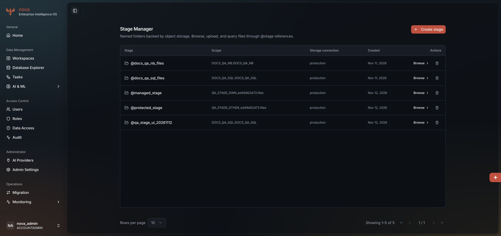
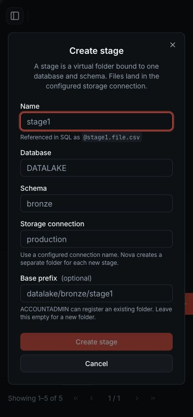
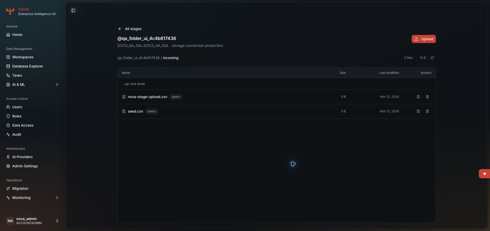
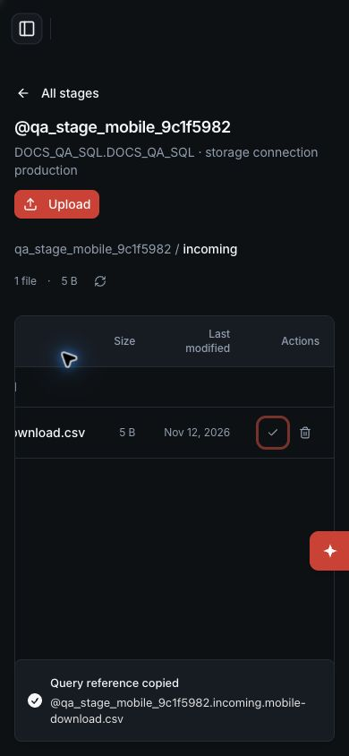

# Stage fixes and AI configuration QA

This packet covers the live Stage correction in
[the boundary review](../../../architecture/production-refactor/STAGE_REGISTRATION_BOUNDARY.md).
StarRocks remains the metadata authority. This is neither a PG Stage port nor
all-feature release acceptance. The source parent is `b4389d1d`; final source
hashes and commands are recorded with the completed checks.

## Live attempts

| Attempt | Observed result |
| --- | --- |
| [Before the fix](before-live.json) | Direct foreign download refused, but alias registration accepted and exposed the synthetic canary: two passing prerequisites and two failing acceptance cases |
| [After, first run](after-live-1.json) | Nine cases passed; cross-scope custom-prefix registration refused, ordinary file operations preserved, unknown connection and oversized name rejected; cleanup completed |
| [After, broader run](after-live-2-timeout.json) | Eight checks passed before a fixture table-creation timeout. The docs SQL checks did not run. Cleanup failed for a canary and the CSV remained after its registration was removed |
| [Owned-file recovery](owned-file-recovery.json) | Both exact test locations were found, content-verified and emptied, then recovery registrations removed. The original timeout/cleanup attempt remains failed |
| [Upload before the fix](folder-before-live.json) | Upload returned 200 but selected-folder and no-root-file checks failed; cleanup completed |
| [Upload after the fix](folder-after-live.json) | Seven cases passed: selected folder, exact contents and three invalid folder refusals; cleanup completed |
| [Normal UI upload](folder-ui-live.json) | Native macOS file selection and the Nova Upload button placed the CSV in `incoming`; both files were content-verified, removed and the empty registration deleted |
| [After, complete run](after-live-3.json) | Fifteen cases passed, including LIST, SELECT, COPY and exact loaded rows. All owned resources were cleaned up |

The existing `docker` project supplied patched StarRocks, Ranger and storage.
Each cross-scope attempt created its own user, role, two databases and synthetic
files, then removed only those resources. No development seed/reset or duplicate
stack was used. Passwords and session tokens were never written to these reports.
The API probes used the running product, not mocked authorization or storage.

UI verification created `qa_stage_ui_20261112` in the existing docs fixture scope.
The form kept its draft after an unknown connection, then created the stage
with the configured connection. The administrator-only field was visible;
390 × 844 layout and Tab focus from Name to Database were checked. A later API
check confirmed the new stage contained zero files, then removed its registration.
The browser's viewport override was reset and the updated docs page was viewed.
The initial file-browser request remained loading during the resource-pressure
episode, so that observation is not counted as a successful file-list UI check.

The browser extension could not select a local file because file-URL access
was unavailable. The native macOS picker completed the upload without changing
extension permissions.

[Populated mobile and keyboard checks](mobile-ui-live.json) used a second
owned fixture at 390 × 844. The table scrolls horizontally, its file browser
opens folders, and Enter downloaded the five-byte CSV. The browser automation
download event timed out; native Chrome showed the file as Done. Tab reached
the copy control. The first native-key clipboard read differed despite the
success toast; its cause is unverified. Semantic click matched, and a separate
keyboard check replaced the clipboard with distinct synthetic text before Enter
and verified the exact reference. The copied reference executed as SQL and
returned `[[7]]`. File contents were verified, then the file and empty stage
registration were removed. The temporary viewport override was reset.

## Controlled checks and retained failures

- [Focused attempt 1](unit-focused-1.xml): 111 passed, one failed. The new test
  fixture restored a bound instance method, which masked a later class-level
  patch and changed a missing-stage test from 404 to 500. The fixture now patches
  the class; no product exception handler or assertion was weakened.
- [Focused attempt 2](unit-focused-2.xml): 112 passed, one warning.
- [Focused attempt 3](unit-focused-3.xml): 121 passed, one warning, including
  all eight new upload-folder cases and the existing streaming-memory check.
- Browser attempt 1: four new tests failed because they used `getByLabel`
  instead of this installed Vitest browser API's `getByLabelText`; the eleven
  existing Stage API cases passed. Attempt 2 selected the repository root and
  collected no tests. Attempt 3 passed all fifteen cases. Final docs and Stage
  browser verification passed all 30 cases after the upload documentation edit.
- [Full browser coverage attempt 1](frontend-interruption-1.json): a table-card
  test timed out while unit and browser coverage ran concurrently. SIGINT
  ended the owned coverage process with exit 130. The attempt is not a pass.
  The complete rerun executed files sequentially and passed all 1,605 tests
  across 194 files in 382.97 seconds; no tests or assertions were removed.
- The first full backend run passed 10,792 tests, four warnings, 65% combined
  coverage in 955.47 seconds. It precedes the subsequently discovered subfolder
  upload correction; final validation must cover that correction too.

## Final local checks

[Commands and source hashes](commands.json) bind the final backend checks to
application tree `7eb228332adf4d4c057078735decbc7709759b682bc4165ac3917468d80cf6c8`.
The complete unit suite passes 10,800 cases with four warnings in 575.49 seconds;
full-application mypy, Ruff on 91 changed Python files, the user-data boundary
scan and all 54 agent scenarios / 189 checks pass.

[The final PG run](pg-final.xml) passes all 410 cases without skips in 296.26
seconds. Its 21 server log lines contain no credential marker or encrypted
envelope. Cleanup finds zero fixture schemas or roles. All eleven prior
migration checksums remain unchanged. Frontend lint and build pass; final
coverage passes 1,605 tests across 194 files in 351.34 seconds. Lint reports
zero errors and 32 existing warnings. Files run sequentially on this device;
all tests remain selected.

## AI configuration regression found during the gate

[PG attempt 1](pg-attempt-1.json) passed 408 cases and failed one: provider
deletion and alias creation deadlocked with SQLSTATE 40P01. Direct registry
writes took provider row locks before the shared configuration lock, while alias
writes used the opposite order. Every registry mutation now acquires the same
configuration lock first. A deterministic regression holds that lock, waits for
the deletion to queue behind it, then creates the alias before releasing it.
The provider must remain live and deletion must be refused as referenced;
a generic conflict or deadlock is not accepted as a passing result. The focused
registry/alias/configuration suite passed all [117 cases](ai-lock-focused.xml).
Its first lint check found one overlong assertion line; wrapping it corrected
the warning without changing the assertion.

## CI and remaining acceptance

The parent CI run was queued when these edits began. The earlier audit run completed with a failed engine job because report
upload failed. Its [recovered job log](prior-ci-final.json) records 217 passing
engine tests, 24 skips and two warnings; the report artifact is absent. Neither run is represented as a complete pass for this change.
A later [status observation](github-status-recovery.json) reports Actions
operational, but the parent run still has no jobs. The
[retry attempts](ci-retry-attempt.json) retain conflicting cancellation/rerun
responses; no restart succeeded.

The [status observation](github-status-observation.json) records GitHub's
announced Actions outage; it does not prove the root cause of the earlier upload
failure, which preceded that announcement.

Dependency fault acceptance, historical prefix provenance, PG uniqueness/CAS,
the Stage domain cutover and the complete feature release gates remain open.
The ordinary unpatched CI engine suite does not prove Ranger enforcement. Its
opt-in custom SQL L3 fixture also remains unproven; updating that fixture's
Stage service call is not evidence that its live trajectory passed.
