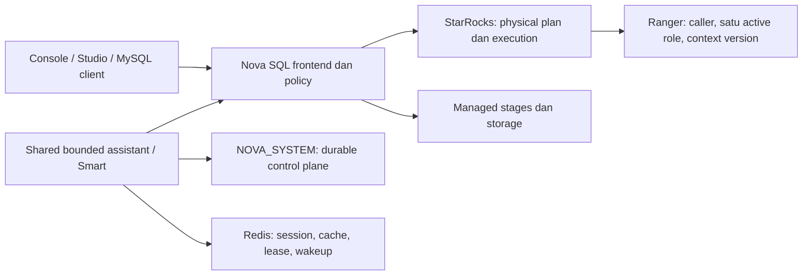

# Snowflake dan Nova: perbandingan, gap, dan rencana perbaikan

Tanggal audit: **13 Oktober 2026**, Asia/Jakarta. Tujuan: memilih perbaikan Nova berdasarkan perilaku Snowflake yang diteliti, source Nova, dan pengujian engine. Laporan ini mencakup **96 kemampuan dalam 14 keluarga fitur**, pengujian dialect SQL, analisis arsitektur, prioritas produk, dan satu perbaikan kode yang telah dikerjakan.

## Daftar isi

1. [Keputusan prioritas](#1-keputusan-yang-paling-bernilai)
2. [Metode dan batas bukti](#2-metode-dan-batas-bukti)
3. [Perbedaan arsitektur](#3-perbedaan-arsitektur-yang-menentukan-desain)
4. [Matriks 96 kemampuan](#4-matriks-kemampuan)
5. [SQL dan migrasi dialect](#5-sql-kompatibilitas-hasil-lebih-penting-daripada-nama-fungsi)
6. [Gap operasional](#6-gap-operasional-yang-paling-memengaruhi-pengguna)
7. [Semantic, AI, agents, dan ML](#7-semantic-ai-agents-dan-ml-bangun-dari-komponen-yang-ada)
8. [Implementasi pipe](#8-implementasi-prioritas-pertama-governed-pipe-administration)
9. [Roadmap dan acceptance](#9-roadmap-berdasarkan-manfaat-dan-dependency)
10. [Validasi dan reproduksi](#10-validasi-implementasi-dan-reproduksi)
11. [Koreksi klaim](#11-koreksi-terhadap-roadmap-dan-klaim-yang-mudah-keliru)
12. [Artefak](#12-artefak-dan-appendix-sql)

## 1. Keputusan yang paling bernilai

Nova sudah mempunyai banyak komponen yang sering dianggap belum ada: semantic views, verified queries, hybrid search, feature store, model registry, task graphs, SQL workspace, dan kolaborasi agent Smart. Prioritasnya adalah membuat komponen tersebut konsisten, aman, dapat dioperasikan, dan mudah dipakai. Menambah nama fitur yang serupa dengan Snowflake tanpa menyelesaikan kontrak eksekusinya akan menyembunyikan masalah.

**Perbaikan pertama yang dipilih adalah Pipe Manager.** Pada baseline, endpoint pipe memang meminta login, tetapi service membuka koneksi langsung sebagai `root` dengan password kosong. Identitas login tidak diteruskan untuk eksekusi. Beberapa nama kolom metadata juga salah untuk engine yang dipin. Perbaikan mengganti jalur tersebut dengan SQL pipeline sebagai pemanggil, memperbaiki metadata, menyamarkan credential, dan menutup background execution di Ranger ketika engine belum mempertahankan principal serta active role.

**Status kode:** perbaikan telah di-commit dan di-push sebagai `c70156b` pada draft [PR #184](https://github.com/dwickyfp/nova/pull/184). Pengguna mengizinkan pengecualian untuk satu required integration check lokal yang gagal. Seluruh lima job GitHub CI untuk commit ini lulus, termasuk 214 tes integrasi real engine. Kegagalan lokal tetap dicatat terpisah. [Hasil dan diagnostik lengkap](#10-validasi-implementasi-dan-reproduksi).

Prioritas lanjutan yang paling dekat dengan manfaat pengguna adalah:

1. **Kontrak migrasi SQL**, khususnya perbedaan yang menghasilkan nilai salah tanpa error: quoting identifier, cast buruk, pembagian nol, JSON, timezone, dan transaksi.
2. **Lineage data dan kualitas/freshness**, agar pengguna mengetahui sumber angka, dampak perubahan, dan apakah data masih layak dipakai.
3. **Export hasil lengkap dan query lifecycle**, karena chart/download hasil yang terbatas bisa disalahartikan sebagai seluruh dataset.
4. **CDC dan transformasi deklaratif yang benar-benar beroperasi**, memakai provider/offset serta scheduler yang sudah ada.
5. **Runtime analisis terisolasi, observability compute, dan atribusi biaya**, sebelum mengklaim notebook, Python agent, elastic warehouse, atau managed ML serving.

SSO/MFA dan deployment network controls juga merupakan gap enterprise yang perlu dirancang. Mereka tidak dapat diselesaikan dengan menambahkan user/password store baru; StarRocks tetap menjadi sumber autentikasi Nova.

## 2. Metode dan batas bukti

### 2.1 Baseline yang dibandingkan

| Lingkungan | Identitas yang diperiksa | Implikasi |
| --- | --- | --- |
| Snowflake | Engine `10.37.100`, AWS ap-southeast-3 | SQL dan fitur inti diuji pada akun yang diberikan; edition belum terkonfirmasi |
| Nova checkout pengguna | `ae61bbce956347053d871da54d850794a3cba762`, branch `feat/studio-intelligent-ui`, dengan perubahan lokal | Perubahan Studio yang sedang berlangsung dicatat sebagai in-flight |
| Worktree implementasi | Base `origin/main` `f46e4c9b2589a729afaeff9bf0d20438c49ebab8` | Perbaikan pipe dipisahkan pada `feat/governed-ingestion-pipes` |
| Engine Nova uji SQL | `4.1.4-4a9848e` | Tidak mengasumsikan dukungan dari StarRocks versi yang lebih baru |
| Stack uji integrasi | StarRocks/Redis/MinIO lokal khusus audit | Terpisah dari stack kerja pengguna |
| Acceptance Ranger | FE lokal yang dipatch, policy/role fixtures yang telah tersedia | Menguji jalur nyata; bukan klaim audit seluruh policy produksi |

Tidak ditemukan sesi DevMesh aktif saat handoff diperiksa. Audit mengikuti kontrak repository: metadata relational pada `NOVA_SYSTEM`, Redis untuk runtime, payload pada managed storage, satu SQL frontend, satu bounded assistant engine, dan akses data melalui caller yang sesuai.

### 2.2 Label yang digunakan

| Label | Arti |
| --- | --- |
| LIVE | Perilaku benar-benar dieksekusi dan hasilnya tersedia |
| UI | Entry atau kontrol terlihat; belum tentu seluruh lifecycle bekerja |
| DOC | Dokumentasi resmi vendor, bukan bukti entitlement akun |
| ADA | Source aktif dan bukti terkait ditemukan; tidak berarti seluruh konfigurasi sudah diuji |
| PARSIAL / BERBEDA | Ada kemampuan yang berhubungan, dengan kontrak atau coverage berbeda |
| FONDASI | Schema/metadata/extension point tersedia, tanpa bukti layanan lengkap beroperasi |
| TERBLOKIR | Runtime secara eksplisit menolak karena prasyarat belum tersedia |
| BELUM / BELUM FIRST-CLASS | Tidak ditemukan implementasi produk dengan kontrak yang dibandingkan dalam scope audit |
| IN-FLIGHT | Pekerjaan lokal yang belum menjadi baseline committed/main |

Label BELUM tidak membuktikan semua primitive upstream mustahil digunakan. Sebaliknya, sebuah tabel metadata, folder service, atau menu tidak cukup untuk label LIVE. Persentase parity tidak dihitung karena satu baris matriks bisa mencakup kontrak yang jauh lebih besar daripada baris lain.

Penelitian Snowflake sebelumnya merekam **224 statement connector dan 2 query browser**, termasuk setup, metadata, error, retest, dan cleanup. Lihat [laporan Snowflake lengkap](snowflake-deep-research-2026-10-13.md), [katalog statement](snowflake-deep-research-2026-10-13/test-catalog.md), dan [log hasil](snowflake-deep-research-2026-10-13/events.jsonl). Count tersebut bukan 224 fitur yang semuanya lulus.

Audit tambahan Nova merekam **49 record: 48 probe SQL dan satu identitas engine**. Bentuk alternatif sengaja dicoba ulang setelah error. Ini corpus diagnostik kecil, bukan benchmark throughput atau bukti kompatibilitas seluruh dialect.

### 2.3 Biaya dan tindakan

Pengujian Snowflake menggunakan warehouse yang sudah tersedia. Tidak dibuat compute pool, layanan Cortex Search, model training, Snowpipe/serverless ingestion, Postgres instance, atau layanan tambahan berbayar. Warehouse akhir telah diverifikasi suspended dan object eksperimen terjadwal dihapus. Metering sementara pada laporan Snowflake bukan atribusi biaya eksklusif maupun tagihan final.

Audit Nova memakai compute lokal dan data sintetis kecil. Tidak dilakukan paid inference, mengirim pesan melalui connector, publishing/share data lintas akun, atau membuat automation eksternal. Kredensial Snowflake tidak ditulis ke laporan. Credential pada fixture integrasi adalah nilai throwaway milik stack pengujian repository.

## 3. Perbedaan arsitektur yang menentukan desain

Snowflake menyediakan storage, compute, dan cloud services sebagai platform terkelola. Nova menggabungkan aplikasi/control plane dengan analytical engine StarRocks serta dependency operasionalnya. Banyak kemampuan Snowflake bergantung pada layanan vendor, edition, region, dan metering. Menyalin endpoint atau SQL object tidak memindahkan layanan tersebut ke Nova. [Arsitektur Snowflake](https://docs.snowflake.com/en/user-guide/intro-key-concepts), [warehouse](https://docs.snowflake.com/en/user-guide/warehouses-overview).



Diagram menunjukkan ownership utama; jalur internal metadata yang diotorisasi tidak boleh dipakai sebagai pengganti caller untuk data pengguna. Perbaikan harus memperluas owner yang sudah ada, termasuk SQL frontend, storage, access control, task orchestration, assistant, dan registry.

### 3.1 Resource group bukan warehouse independen

Resource groups Nova menyediakan classifier/quota pada engine. Itu berguna untuk pembagian CPU, memori, dan concurrency, tetapi tidak membuktikan physical isolation, autoscaling cluster, auto-resume warehouse, atau billing credits per warehouse. API quota dapat menjadi dasar workload management; provisioning cluster dan shared-data operation memerlukan rancangan infrastruktur tersendiri. Source: [resource group service](../../backend/app/modules/resource_groups/service.py).

### 3.2 Recovery bukan Time Travel

Nova mempunyai backup snapshots/repositories serta recycle-bin recovery. Snowflake Time Travel melakukan query atas versi historis dan zero-copy clone memanfaatkan storage semantics. Membuat snapshot kemudian mengembalikan tabel tidak menghasilkan kontrak `SELECT ... BEFORE STATEMENT`, temporal query, atau clone independen yang sama. Fitur ini harus diperkenalkan melalui kemampuan engine/storage yang diuji. [Nova backup](../../backend/app/modules/backup/service.py), [Snowflake Time Travel](https://docs.snowflake.com/en/user-guide/data-time-travel), [cloning](https://docs.snowflake.com/en/user-guide/object-clone).

### 3.3 Satu active role adalah keputusan Nova

Snowflake memadukan ownership, role privileges, user grants, dan primary/secondary roles. Penelitian menunjukkan `PUBLIC` saja belum cukup mengisolasi akses ketika secondary roles masih aktif. Nova Ranger memilih satu named active role dan security-context version. Tidak ada alasan untuk mengadopsi `SECONDARY ROLES ALL` jika itu melemahkan kontrak Nova. Evaluasi parity harus berfokus pada akses yang benar dan hasil yang konsisten. [Access control Snowflake](https://docs.snowflake.com/en/user-guide/security-access-control-overview), [SecurityContext Nova](../../backend/app/modules/access_control/security_context.py).

## 4. Matriks kemampuan

Matriks ini tersedia juga sebagai [JSON](nova-snowflake-comparison-2026-10-13/feature-matrix.json). Kolom bukti menunjuk owner Nova yang diperiksa. Detail hasil Snowflake LIVE berada dalam laporan dan katalog statement sebelumnya. BARIS bertanda DOC tidak diuji dengan layanan berbayar.

### 4.1. Arsitektur

Referensi vendor: [Snowflake warehouses](https://docs.snowflake.com/en/user-guide/warehouses-overview), [interactive analytics](https://docs.snowflake.com/en/user-guide/interactive).

| ID / kemampuan | Snowflake | Nova dan bukti | Perbaikan / keputusan |
| --- | --- | --- | --- |
| F009 Analytical engine | LIVE: managed SQL engine 10.37.100 | BERBEDA: StarRocks pin 4.1.4, distributed physical execution. [backend/app/sql_frontend/capabilities/starrocks.py](../../backend/app/sql_frontend/capabilities/starrocks.py) | Pertahankan ownership parser/policy Nova dan execution StarRocks |
| F010 Storage-compute separation | DOC: managed storage dan warehouse terpisah | PARSIAL: mode engine dan deployment memengaruhi pemisahan; storage payload dikelola Nova. [backend/docker-compose.yml](../../backend/docker-compose.yml) | Uji shared-data secara terpisah; jangan menyamakan semua deployment |
| F011 Elastic virtual warehouses | LIVE metadata, DOC elasticity | BERBEDA: resource groups membatasi workload pada engine, bukan warehouse independen. [backend/app/modules/resource_groups/service.py](../../backend/app/modules/resource_groups/service.py) | P1 observability dan isolation; physical elasticity membutuhkan infrastruktur |
| F012 Application tiers | DOC: layanan cloud terkelola | ADA: web, query, proxy dapat dipisah dengan kontrak gateway. [backend/docker-compose.yml](../../backend/docker-compose.yml) | Uji load balancing, cancellation dan failover proses |
| F013 Managed availability | DOC: layanan cloud dan opsi edition | PARSIAL: readiness checks tersedia; operasi cluster menjadi tanggung jawab deployment. [backend/app/modules/monitoring/readiness.py](../../backend/app/modules/monitoring/readiness.py) | Tetapkan SLO dan lakukan failure drill sebelum klaim HA |
| F014 Interactive analytics | DOC: interactive warehouse/table | BERBEDA: StarRocks diarahkan untuk analytics interaktif; tidak ada lifecycle warehouse Snowflake. [backend/app/modules/query/service.py](../../backend/app/modules/query/service.py) | Benchmark workload nyata dengan concurrency yang setara |

### 4.2. SQL

Referensi vendor: [Snowflake query syntax](https://docs.snowflake.com/en/sql-reference/constructs), [StarRocks window/QUALIFY](https://docs.starrocks.io/docs/sql-reference/sql-functions/Window_function). Hasil per-probe dibedah di bagian 5.

| ID / kemampuan | Snowflake | Nova dan bukti | Perbaikan / keputusan |
| --- | --- | --- | --- |
| F015 Central SQL frontend | LIVE: SQL Snowflake | ADA: parse, AST, analyze, bind, plan, route bersama. [backend/app/sql_frontend/analysis/validation.py](/Users/dwickyferiansyahputra/.codex/worktrees/snowflake-gap-improvements/nova/backend/app/sql_frontend/analysis/validation.py) | Perluas dialect di frontend ini; hindari deteksi ad-hoc |
| F016 Analytical SELECT dan windows | LIVE: CTE, aggregate, windows | LIVE: CTE, SUM, ROWS window, ROLLUP versi alternatif. [backend/app/sql_frontend/parser.py](../../backend/app/sql_frontend/parser.py) | Pertahankan result-based regression corpus |
| F017 QUALIFY | LIVE: alias window dapat digunakan | PARSIAL LIVE: bentuk langsung ROW_NUMBER bekerja; probe alias ditolak engine. [backend/app/sql_frontend/capabilities/starrocks.py](../../backend/app/sql_frontend/capabilities/starrocks.py) | Dokumentasikan subset dan lowering berbasis AST bila diperlukan |
| F018 SQL convenience syntax | LIVE: GROUP BY ALL, BY NAME, wildcard modifiers, trailing comma | PARSIAL LIVE: EXCLUDE dan alias reuse bekerja; bentuk lain gagal pada probe. [backend/app/sql_frontend/parser.py](../../backend/app/sql_frontend/parser.py) | P1 GROUP BY ALL dan UNION BY NAME dengan binding schema |
| F019 Null-safe comparison | LIVE: EQUAL_NULL dan IS NOT DISTINCT FROM | BERBEDA LIVE: operator <=> bekerja; dua bentuk Snowflake ditolak. [backend/app/sql_frontend/parser.py](../../backend/app/sql_frontend/parser.py) | Sediakan migration guide atau lowering teruji |
| F020 JSON dan arrays | LIVE: VARIANT path, FLATTEN, ARRAY_CONSTRUCT | BERBEDA LIVE: PARSE_JSON, -> path, array literal, lateral UNNEST. [backend/app/sql_frontend/parser.py](../../backend/app/sql_frontend/parser.py) | P1 contract type, null, flatten dan shape sebelum alias fungsi |
| F021 Date dan timezone | LIVE: DATEADD, CONVERT_TIMEZONE, timestamp types | BERBEDA LIVE: DATE_ADD dan CONVERT_TZ; sintaks dan type berbeda. [backend/app/sql_frontend/parser.py](../../backend/app/sql_frontend/parser.py) | Uji timezone, DST dan precision; jangan rename fungsi saja |
| F022 Casting dan arithmetic | LIVE: cast buruk dan pembagian nol error pada sesi uji | BERBEDA LIVE: kedua probe Nova menghasilkan NULL. [backend/app/modules/query/service.py](../../backend/app/modules/query/service.py) | P1 tangani silent semantic difference dalam migration tooling |
| F023 Identifier quoting | LIVE: tanda petik ganda untuk identifier | BERBEDA LIVE: petik ganda dibaca string; backtick mengakses kolom. [backend/app/sql_frontend/parser.py](../../backend/app/sql_frontend/parser.py) | P1 linter/rewrite AST dengan dialect eksplisit |
| F024 MERGE dan schema evolution | LIVE: MERGE update dan insert | BELUM: capability native_merge dan all_by_name false. [backend/app/sql_frontend/capabilities/starrocks.py](../../backend/app/sql_frontend/capabilities/starrocks.py) | Jangan forward MERGE; desain conflict/update semantics lebih dahulu |
| F025 Transactions | LIVE: UPDATE rollback memulihkan data | ADA BERSYARAT: engine version, mode dan table type menentukan dukungan. [backend/app/sql_frontend/capabilities/starrocks.py](../../backend/app/sql_frontend/capabilities/starrocks.py) | Pertahankan transaction/session tests; shared-data acceptance terpisah |
| F026 Constraints | LIVE: NOT NULL/CHECK enforced, PK/UNIQUE standard table tidak | BERBEDA: key models StarRocks bukan informational key Snowflake. [backend/app/sql_frontend/capabilities/starrocks.py](../../backend/app/sql_frontend/capabilities/starrocks.py) | Uji constraint per table model; jangan membuat janji universal |
| F027 PIVOT, UNPIVOT, ASOF, patterns | LIVE: bentuk yang benar bekerja | BELUM PADA PROBE: PIVOT ulang, UNPIVOT, ASOF, MATCH_RECOGNIZE gagal. [backend/app/sql_frontend/parser.py](../../backend/app/sql_frontend/parser.py) | Prioritaskan berdasarkan query migrasi nyata |
| F028 Recursive CTE dan pipe operator | LIVE: recursive CTE dan SQL chain | BELUM PADA PROBE: recursive CTE ditolak engine; chain ditolak parser. [backend/app/sql_frontend/parser.py](../../backend/app/sql_frontend/parser.py) | Jangan memberi fallback diam-diam atau membuat parser kedua |
| F029 MySQL client integration | DOC: Snowflake drivers/SQL API; bukan protokol MySQL | ADA: proxy berbagi pipeline Nova dan caller context. [backend/app/proxy/server.py](../../backend/app/proxy/server.py) | Nilai lebih integrasi; verifikasi role dan transaction secara end to end |

### 4.3. Storage

Referensi vendor: [Time Travel](https://docs.snowflake.com/en/user-guide/data-time-travel), [cloning](https://docs.snowflake.com/en/user-guide/object-clone), [Iceberg tables](https://docs.snowflake.com/en/user-guide/tables-iceberg).

| ID / kemampuan | Snowflake | Nova dan bukti | Perbaikan / keputusan |
| --- | --- | --- | --- |
| F030 Managed stages | LIVE: PUT, LIST, COPY, unload, GET | ADA: stage, configured connections, storage abstraction dan SQL lowering. [backend/app/modules/stages/service.py](../../backend/app/modules/stages/service.py) | Perbaiki UX data movement dengan bukti dan error yang jelas |
| F031 Workspace payload storage | UI/LIVE: file SQL di Workspaces | ADA: payload managed storage, metadata NOVA_SYSTEM, optimistic concurrency. [backend/app/modules/workspaces/service.py](../../backend/app/modules/workspaces/service.py) | Pertahankan ETag dan version history; tambah UX diff/restore bila perlu |
| F032 Time Travel SQL | LIVE: BEFORE statement mengambil nilai historis | BELUM: backup/recovery berbeda dari SELECT historis. [backend/app/modules/backup/service.py](../../backend/app/modules/backup/service.py) | P2 discovery untuk engine retention; tidak dapat ditiru dengan metadata saja |
| F033 Zero-copy clone | LIVE: temporary clone independen dari sumber | BELUM: belum ada kontrak clone setara yang ditemukan. [backend/app/modules/backup/service.py](../../backend/app/modules/backup/service.py) | Tunda sampai storage/engine mendukung semantics dan retention |
| F034 Fail-safe dan recovery | DOC: vendor-managed recovery dengan aturan object | BERBEDA: snapshots, repositories, recycle bin dan RECOVER. [backend/app/modules/backup/service.py](../../backend/app/modules/backup/service.py) | Tentukan RPO/RTO dan restore drill; hindari label Fail-safe |
| F035 External catalogs | DOC: Iceberg/Open Catalog | ADA/PARSIAL: API Hive/Iceberg, HMS/REST dan engine catalogs. [backend/app/modules/external_catalogs/schemas.py](../../backend/app/modules/external_catalogs/schemas.py) | P2 validasi read/write, schema evolution dan credential rotation |
| F036 Iceberg ownership | DOC: external-volume dan Snowflake-managed storage adalah pilihan berbeda | PARSIAL: Nova catalog integration bukan Snowflake-managed table lifecycle. [backend/app/modules/external_catalogs/service.py](../../backend/app/modules/external_catalogs/service.py) | Nyatakan catalog/storage ownership dan support matrix |

### 4.4. Ingestion

Referensi vendor: [Snowpipe](https://docs.snowflake.com/en/user-guide/data-load-snowpipe-intro), [Snowpipe Streaming](https://docs.snowflake.com/en/user-guide/snowpipe-streaming/data-load-snowpipe-streaming-overview), [streams](https://docs.snowflake.com/en/user-guide/streams-intro), [StarRocks pipe task builder 4.1.4](https://github.com/StarRocks/starrocks/blob/4.1.4/fe/fe-core/src/main/java/com/starrocks/scheduler/TaskBuilder.java).

| ID / kemampuan | Snowflake | Nova dan bukti | Perbaikan / keputusan |
| --- | --- | --- | --- |
| F005 External data migration | DOC: connectors/Openflow dan migration ecosystem | ADA/PARSIAL: migration preflight, planner, worker dan data mover tersedia. [backend/app/modules/migration/service.py](../../backend/app/modules/migration/service.py) | Uji resumability dan per-source support; bukan otomatis broad connector catalog |
| F006 Producer/backpressure contract | DOC: ingestion APIs memiliki offset dan error contract spesifik | PARSIAL: existing engine paths belum membuktikan unified producer channel contract. [backend/app/modules/query/service.py](../../backend/app/modules/query/service.py) | Tentukan bounded buffering, retry dan rejected-record evidence |
| F037 Batch COPY | LIVE: CSV dua baris; repeated COPY skip file | ADA: shared stage and SQL path. [backend/app/modules/query/service.py](../../backend/app/modules/query/service.py) | Uji retry, schema mismatch, labels dan idempotency per operation |
| F038 File ingestion pipes | DOC: Snowpipe memakai layanan tambahan; tidak dinyalakan | DIPERBAIKI: API StarRocks Pipe caller-scoped, redacted, metadata benar. [backend/app/modules/pipes/service.py](/Users/dwickyferiansyahputra/.codex/worktrees/snowflake-gap-improvements/nova/backend/app/modules/pipes/service.py) | P0 implementasi di worktree; native RBAC saja untuk background execution |
| F039 Governed background pipes | DOC: product security contract Snowflake | TERBLOKIR RANGER: task engine tidak membawa principal/role yang dibutuhkan. [backend/app/sql_frontend/analysis/validation.py](/Users/dwickyferiansyahputra/.codex/worktrees/snowflake-gap-improvements/nova/backend/app/sql_frontend/analysis/validation.py) | P0 fail closed; desain caller-preserving task sebelum membuka gate |
| F040 Streaming ingestion channels | DOC: Snowpipe Streaming high-performance channels dan offsets | BELUM SETARA: engine ingestion primitives tidak menyediakan kontrak channel API yang sama. [backend/app/modules/streams/runtime.py](../../backend/app/modules/streams/runtime.py) | Discovery offset, retry, schema, backpressure dan auth; jangan sekadar membuat endpoint |
| F041 CDC streams | LIVE: SELECT tidak consume; commit/rollback mengatur offset | TERBLOKIR: stream runtime selalu disabled atau provider unavailable. [backend/app/modules/streams/runtime.py](../../backend/app/modules/streams/runtime.py) | P1 provider nyata dan transactional offset consumption |
| F042 Stream metadata/journal | LIVE: object stream dan CDC lifecycle | FONDASI: catalog, namespace, claims dan journal tersedia. [backend/app/modules/streams/catalog.py](../../backend/app/modules/streams/catalog.py) | Jangan melabeli DDL/journal sebagai CDC yang beroperasi |

### 4.5. Transformasi

Referensi vendor: [Tasks](https://docs.snowflake.com/en/user-guide/tasks-intro), [dynamic tables](https://docs.snowflake.com/en/user-guide/dynamic-tables/overview), [dbt Projects](https://docs.snowflake.com/en/user-guide/data-engineering/dbt-projects-on-snowflake), [DCM Projects](https://docs.snowflake.com/en/user-guide/dcm-projects/dcm-projects-overview).

| ID / kemampuan | Snowflake | Nova dan bukti | Perbaikan / keputusan |
| --- | --- | --- | --- |
| F043 Tasks dan schedules | LIVE: user-managed task dieksekusi sekali | ADA: native/managed tasks, caller ownership dan schedule. [backend/app/modules/task_orchestration/scheduler.py](../../backend/app/modules/task_orchestration/scheduler.py) | Perbaiki observability/retry dalam scheduler yang sama |
| F044 Task graphs | DOC: DAG, predecessor dan operational history | ADA: DAG, conditions, finalizers, rerun dan durable worker/reconciler. [backend/app/modules/task_orchestration/dag.py](../../backend/app/modules/task_orchestration/dag.py) | Uji resume after crash dan idempotent side effects |
| F045 Dynamic tables | LIVE: init 12, refresh manual 13, lag sebelum refresh | PARSIAL: MV refresh/task primitives; kontrak Dynamic Table lengkap tidak ditemukan. [backend/app/modules/task_orchestration/native.py](../../backend/app/modules/task_orchestration/native.py) | P1 declarative freshness dan refresh contract di owner yang ada |
| F046 dbt Projects | UI/DOC: project deployment dan execution | BELUM FIRST-CLASS: workspace SQL file bukan deployment dbt. [backend/app/modules/workspaces/service.py](../../backend/app/modules/workspaces/service.py) | Integrasikan artifact/manifest jika kebutuhan pelanggan jelas |
| F047 DCM desired state | DOC: definitions, plan dan deploy | BELUM: desired-state project/object reconciliation tidak ditemukan. [backend/app/sql_frontend/planning/planner.py](../../backend/app/sql_frontend/planning/planner.py) | P1 plan/diff/apply terotorisasi melalui frontend dan repository yang sama |

### 4.6. Governance

Referensi vendor: [Access History](https://docs.snowflake.com/en/user-guide/access-history), [row policies](https://docs.snowflake.com/en/user-guide/security-row-intro), [masking](https://docs.snowflake.com/en/user-guide/security-column-ddm-intro), [SSO](https://docs.snowflake.com/en/user-guide/admin-security-fed-auth-overview), [MFA](https://docs.snowflake.com/en/user-guide/security-mfa), [OAuth](https://docs.snowflake.com/en/user-guide/oauth-intro), [network policies](https://docs.snowflake.com/en/user-guide/network-policies), [encryption](https://docs.snowflake.com/en/user-guide/security-encryption-end-to-end).

| ID / kemampuan | Snowflake | Nova dan bukti | Perbaikan / keputusan |
| --- | --- | --- | --- |
| F001 Federated auth, OAuth dan MFA | DOC: federated auth, OAuth dan MFA punya lifecycle/policy tersendiri | BELUM FIRST-CLASS: login Nova yang diperiksa memakai autentikasi StarRocks, encrypted session dan JWT. [backend/app/modules/auth/service.py](../../backend/app/modules/auth/service.py) | P1 enterprise identity discovery; jangan membuat user/password database baru |
| F002 Network/private connectivity | DOC: network policies/rules dan private connectivity | BERBEDA: deployment gateway/TLS/network controls; account network-policy object setara tidak ditemukan. [backend/app/core/config.py](../../backend/app/core/config.py) | P1 deployment acceptance dan explicit ingress/egress policy |
| F003 Secrets dan session lifecycle | DOC: secret integrations dan session policies | ADA/PARSIAL: encrypted Redis password/session, encrypted provider persistence dan secret references. [backend/app/core/security.py](../../backend/app/core/security.py) | Uji rotation/revocation dan pastikan secret readback tidak diekspos |
| F004 Data encryption/KMS | DOC: encryption dan key management sebagai layanan | BERBEDA: managed storage/config dan deployment menentukan encryption; customer-managed KMS lifecycle tidak dibuktikan. [backend/app/core/config.py](../../backend/app/core/config.py) | Dokumentasikan encryption boundaries dan key rotation yang benar-benar didukung |
| F048 Authentication dan roles | LIVE: primary/secondary role behavior | BERBEDA: StarRocks auth, satu active role, Ranger context version. [backend/app/modules/access_control/security_context.py](../../backend/app/modules/access_control/security_context.py) | Pertahankan deliberate one-role contract dan ACCOUNTADMIN protection |
| F049 Row filters dan masks | LIVE: policy membatasi Jakarta dan menyamarkan nilai | LIVE NOVA: patched-FE role, regional filtering, masking acceptance lulus. [backend/app/modules/access_control/security_context.py](../../backend/app/modules/access_control/security_context.py) | Perluas parity evidence ke setiap background workload dan cache |
| F050 Query audit | LIVE: query IDs/history | ADA: redacted audit, caller context dan engine-query correlation. [backend/app/modules/query/service.py](../../backend/app/modules/query/service.py) | Bedakan audit execution dengan lineage data/Access History |
| F051 Data/column lineage | DOC: Access History dan lineage | FONDASI/TERBATAS: load-lineage table ada; tidak ditemukan extractor/query graph aktif lengkap. [docker/init-nova.sql](../../docker/init-nova.sql) | P1 AST-derived read/write lineage plus engine evidence |
| F052 Tags dan classification | DOC: catalog tags/classification | FONDASI: CONFIG_OBJECT_TAGS DDL; CRUD/enforcement aktif lengkap tidak ditemukan. [docker/init-nova.sql](../../docker/init-nova.sql) | P1 lifecycle tags dan discoverability; masking tetap owner access-control |
| F053 Data quality monitoring | DOC: metric functions dan scheduled monitoring | PARSIAL/GATED: quality/monitor structures bukan layanan DMF lengkap. [backend/app/core/config.py](../../backend/app/core/config.py) | P1 assertion, freshness, alerts memakai task/monitor owner yang ada |
| F054 Secure data sharing | DOC: share ke consumer account | BELUM: first-class governed cross-account sharing tidak ditemukan. [backend/app/modules/external_catalogs/service.py](../../backend/app/modules/external_catalogs/service.py) | P2 hanya jika multi-tenant sharing menjadi kebutuhan produk |
| F055 Marketplace dan clean rooms | UI/DOC: distribusi dan kolaborasi data | BELUM: fitur first-class tidak ditemukan. [README.md](../../README.md) | Tunda; jangan menyamakan export atau MCP connector dengan clean room |

### 4.7. Semantic

Referensi vendor: [Native semantic views](https://docs.snowflake.com/en/user-guide/views-semantic/overview), [Analyst evaluations](https://docs.snowflake.com/en/user-guide/snowflake-cortex/cortex-analyst-evaluations).

| ID / kemampuan | Snowflake | Nova dan bukti | Perbaikan / keputusan |
| --- | --- | --- | --- |
| F056 Business semantic views | LIVE: dimensions dan metrics menghasilkan agregasi kota | ADA: versioned views, relationships, grains, metrics dan compiler. [backend/app/modules/intelligence/semantic_views.py](../../backend/app/modules/intelligence/semantic_views.py) | P1 interoperability dan UX; jangan membuat semantic executor kedua |
| F057 Verified queries | DOC: konteks/evaluasi Analyst | ADA: verified queries, quality validation dan publish regression. [backend/app/modules/intelligence/semantic_regression.py](../../backend/app/modules/intelligence/semantic_regression.py) | Pisahkan contoh training dari held-out evaluations |
| F058 Semantic access scope | DOC: object privileges dan agent integration | ADA: source checks dan agent-private/resource scoping. [backend/app/modules/intelligence/semantic_views.py](../../backend/app/modules/intelligence/semantic_views.py) | Uji deny, role switch dan changed source policy |
| F059 Cross-tool metric portability | DOC: semantic views dapat diquery dan dipakai client | PARSIAL: syntax/compiler Nova berbeda dari object Snowflake. [backend/app/modules/intelligence/semantic_migration.py](../../backend/app/modules/intelligence/semantic_migration.py) | P1 deterministic export/import dan compatibility diagnostics |

### 4.8. AI/Search

Referensi vendor: [AI SQL](https://docs.snowflake.com/en/user-guide/snowflake-cortex/aisql), [Cortex Search](https://docs.snowflake.com/en/user-guide/snowflake-cortex/cortex-search/cortex-search-overview), [analytical search](https://docs.snowflake.com/en/user-guide/snowflake-cortex/cortex-agents-analytical-search), [AI Gateway](https://docs.snowflake.com/en/user-guide/snowflake-cortex/cortex-ai-gateway).

| ID / kemampuan | Snowflake | Nova dan bukti | Perbaikan / keputusan |
| --- | --- | --- | --- |
| F060 Natural-language SQL | DOC/UI: Analyst dan CoCo; inference tidak diuji | ADA: shared assistant loop, validated SQL dan evidence constraints. [backend/app/modules/assistant/service.py](../../backend/app/modules/assistant/service.py) | Ukur execution correctness dan result fidelity pada held-out corpus |
| F061 AI SQL functions | DOC: model/region/privilege-specific AI SQL | ADA/PARSIAL: complete, sentiment, classify, summarize, extract, translate, filter. [backend/app/modules/llm_functions/service.py](../../backend/app/modules/llm_functions/service.py) | Uji model/provider behavior dan accounting; tidak ada paid inference pada audit ini |
| F062 Embeddings dan hybrid search | DOC: managed Cortex Search | ADA: lexical/hybrid/semantic, RRF dan versioned projections. [backend/app/modules/intelligence/search.py](../../backend/app/modules/intelligence/search.py) | P1 refresh/freshness, multilingual retrieval dan policy acceptance |
| F063 Search rights model | DOC: Cortex Search menggunakan owner’s rights | BERBEDA: Nova membaca projection lalu requery sumber dengan caller. [backend/app/modules/intelligence/search.py](../../backend/app/modules/intelligence/search.py) | Pertahankan source recheck; audit candidate side channels dan cache versioning |
| F064 Document AI | DOC: parse/extract dokumen dan multimodal | PARSIAL: generic AI extraction belum membuktikan layout/OCR corpus support. [backend/app/modules/llm_functions/service.py](../../backend/app/modules/llm_functions/service.py) | P2 benchmark dokumen nyata dan source citation completeness |
| F065 Analytical document search | DOC: retrieval bersama SQL/AI functions | PARSIAL: search tersedia; exhaustive corpus aggregation tidak dibuktikan. [backend/app/modules/intelligence/search.py](../../backend/app/modules/intelligence/search.py) | Bedakan top-k answer dengan complete count/aggregate |
| F066 AI gateway dan budgets | DOC: Gateway preview dengan privilege/logging | PARSIAL: provider gateway, encrypted keys, usage; bukan managed vendor gateway. [backend/app/modules/monitoring/ai_usage.py](../../backend/app/modules/monitoring/ai_usage.py) | P1 token/tool attribution, redaction dan budget behavior yang eksplisit |

### 4.9. Agents

Referensi vendor: [Cortex Agents](https://docs.snowflake.com/en/user-guide/snowflake-cortex/cortex-agents), [CoCo](https://docs.snowflake.com/en/user-guide/cortex-code/cortex-code), [CoWork](https://docs.snowflake.com/en/user-guide/snowflake-cortex/snowflake-cowork), [managed MCP server](https://docs.snowflake.com/en/user-guide/snowflake-cortex/cortex-agents-mcp).

| ID / kemampuan | Snowflake | Nova dan bukti | Perbaikan / keputusan |
| --- | --- | --- | --- |
| F067 Bounded tool execution | DOC: Cortex Agents orchestration | ADA: satu shared bounded loop dengan consent dan context control. [backend/app/modules/assistant/service.py](../../backend/app/modules/assistant/service.py) | Perluas eval dari trajectories ke real model outcome bila budget tersedia |
| F068 Delegation dan durable collaboration | DOC: CoWork Deep Research dan agent threads | ADA: Smart, sessions, mailbox, journal dan bounded delegation. [backend/app/modules/agents/AGENTS.md](../../backend/app/modules/agents/AGENTS.md) | Perkuat provenance, recovery dan inherited security context |
| F069 Skills dan memory | DOC: agent skills/CoWork memory | ADA: scoped skills/resources/memory; permission bukan berasal dari skill. [backend/app/modules/agents/AGENTS.md](../../backend/app/modules/agents/AGENTS.md) | Uji private/public memory leakage dan context hygiene |
| F070 External MCP client | DOC: connector tools | ADA/PARSIAL: discovery HTTP/SSE, invocation HTTP, bounded SSRF-checked requests. [backend/app/modules/agents/mcp_client.py](../../backend/app/modules/agents/mcp_client.py) | Prioritaskan auth/consent/error handling sebelum menambah transport |
| F071 Managed MCP server | DOC: Snowflake-managed MCP server | BELUM: MCP client Nova tidak otomatis mengekspos server untuk client eksternal. [backend/app/modules/agents/mcp_client.py](../../backend/app/modules/agents/mcp_client.py) | P2 server publication dengan caller auth, scope dan audit |
| F072 Python analysis workspace | DOC: agent code execution/runtime | TERBLOKIR: enabled path tetap BLOCKED_BY_INFRASTRUCTURE. [backend/app/modules/assistant/analysis_workspace.py](../../backend/app/modules/assistant/analysis_workspace.py) | P1 isolated executor, bounded IO dan explicit artifact lifecycle |
| F073 Business decisions/actions/outcomes | DOC: agent/artifact/automation platform | ADA BERBEDA: Nova intelligence mengikat entities, decisions, actions dan learning. [backend/app/modules/intelligence/decisions.py](../../backend/app/modules/intelligence/decisions.py) | Prioritas diferensiasi: pastikan outcome dan source evidence dapat ditelusuri |

### 4.10. ML

Referensi vendor: [Model Registry](https://docs.snowflake.com/en/developer-guide/snowflake-ml/model-registry/overview), [Feature Store](https://docs.snowflake.com/en/developer-guide/snowflake-ml/feature-store/overview).

| ID / kemampuan | Snowflake | Nova dan bukti | Perbaikan / keputusan |
| --- | --- | --- | --- |
| F074 Task coverage | DOC: ML dan model functions/registry | ADA: classification, regression, forecast, anomaly, clustering, simulation, analysis. [backend/app/modules/ml_engine/spec.py](../../backend/app/modules/ml_engine/spec.py) | Roadmap lama dua-task harus dikoreksi; uji setiap worker contract |
| F075 Model registry | DOC: versions, metrics dan inference | ADA: version/artifact/checksum/signature metadata dan lifecycle. [backend/app/modules/ml_engine/registry/repository.py](../../backend/app/modules/ml_engine/registry/repository.py) | Perbaiki promotion, rollback dan monitoring dalam registry yang sama |
| F076 Feature store | DOC: feature views, training datasets, PIT | ADA: versioned feature views, entity/time schema dan point-in-time helpers. [backend/app/modules/intelligence/feature_store.py](../../backend/app/modules/intelligence/feature_store.py) | P1 edge-case PIT, late arrivals dan reproducible training lineage |
| F077 Online features | DOC: serving integration tergantung produk/runtime | ADA: Redis TTL/version/monotonic publication, durable source tetap NOVA_SYSTEM/storage. [backend/app/modules/intelligence/online_features.py](../../backend/app/modules/intelligence/online_features.py) | Uji stale-write rejection dan role/security-version cache isolation |
| F078 Training budgets dan data access | DOC: compute/runtime-specific controls | ADA: scoped data adapters dan row/byte/time execution budgets. [backend/app/modules/ml_engine/spec.py](../../backend/app/modules/ml_engine/spec.py) | Perluas fault/cancel acceptance; provider bukan bypass data rights |
| F079 GPU/distributed serving | DOC: Container Services dan serving runtimes | BELUM DIBUKTIKAN: managed GPU/distributed serving parity tidak ditemukan. [backend/app/modules/ml_engine/jobs.py](../../backend/app/modules/ml_engine/jobs.py) | P2 hanya berdasarkan model/workload yang membutuhkan |

### 4.11. Programming

Referensi vendor: [Snowpark DataFrames](https://docs.snowflake.com/en/developer-guide/snowpark/python/working-with-dataframes), [Notebooks in Workspaces](https://docs.snowflake.com/en/user-guide/ui-snowsight/notebooks-in-workspaces/notebooks-in-workspaces-overview), [Container Services](https://docs.snowflake.com/en/developer-guide/snowpark-container-services/overview).

| ID / kemampuan | Snowflake | Nova dan bukti | Perbaikan / keputusan |
| --- | --- | --- | --- |
| F080 SQL scripting/procedures | LIVE: loop/procedure sum 15 | BELUM SETARA: managed SQL syntax tidak membuktikan Snowflake scripting runtime. [backend/app/sql_frontend/parser.py](../../backend/app/sql_frontend/parser.py) | P2 pilih subset yang dibutuhkan; routine owner dan auth harus jelas |
| F081 Python UDF/Snowpark | LIVE: Python UDF 12 dan Snowpark procedure 33 | BERBEDA: engine UDF/ML workers bukan lazy Snowpark API. [backend/app/modules/ml_engine/jobs.py](../../backend/app/modules/ml_engine/jobs.py) | Jangan mengekspos host Python sebagai user sandbox |
| F082 Notebooks | UI/DOC: SQL/Python/Markdown notebook runtimes | BELUM: full isolated notebook lifecycle tidak ditemukan. [backend/app/modules/assistant/analysis_workspace.py](../../backend/app/modules/assistant/analysis_workspace.py) | P2 setelah isolated analysis executor tersedia |
| F083 Container jobs/services | DOC: image repository, compute pool, service/job | BELUM: aplikasi Nova di Docker tidak sama dengan user workload platform. [backend/docker-compose.yml](../../backend/docker-compose.yml) | Tunda managed container platform sampai ada tenant isolation model |

### 4.12. Developer UX

Referensi vendor: [CoCo in Snowsight](https://docs.snowflake.com/en/user-guide/cortex-code/cortex-code-snowsight), [SQL API result handling](https://docs.snowflake.com/en/developer-guide/sql-api/handling-responses).

| ID / kemampuan | Snowflake | Nova dan bukti | Perbaikan / keputusan |
| --- | --- | --- | --- |
| F084 SQL workspace | LIVE/UI: files, tabs, role/warehouse selector dan results | ADA: Monaco, file context, SQL tabs, multi-results, history, cancel, EXPLAIN. [frontend/src/routes/_authenticated/workspaces/index.tsx](../../frontend/src/routes/_authenticated/workspaces/index.tsx) | P1 error/recovery dan consistency antara Console/Studio |
| F085 Results dan exports | UI: Table/Chart/Pivot/download; full REST partitions DOC | PARSIAL: chart/XLSX memakai qr.rows yang sudah diambil. [frontend/src/routes/_authenticated/workspaces/index.tsx](../../frontend/src/routes/_authenticated/workspaces/index.tsx) | P1 governed full-result export, async job dan bounded artifacts |
| F086 Query history/profiles | LIVE: IDs dan profile untuk query kecil | ADA: history, EXPLAIN, engine correlation dan query-autopilot primitives. [backend/app/modules/query_autopilot/profile.py](../../backend/app/modules/query_autopilot/profile.py) | P1 profiler UI dan actionable evidence; jangan mengklaim tidak ada infrastructure |
| F087 File versions/concurrency | DOC/UI: workspace project lifecycle | ADA: stored file versions dan optimistic ETag conflict. [backend/app/modules/workspaces/service.py](../../backend/app/modules/workspaces/service.py) | Tambahkan user-visible version restore tanpa silent overwrite |
| F088 Studio intelligent UI | DOC: CoCo/CoWork integration | IN-FLIGHT: perubahan primary checkout belum committed sebagai baseline audit. [backend/app/core/config.py](../../backend/app/core/config.py) | Jangan membangun fitur UI paralel atau menghitungnya sebagai shipped main |

### 4.13. Operations

Referensi vendor: [Resource monitors](https://docs.snowflake.com/en/user-guide/resource-monitors), [replication/failover](https://docs.snowflake.com/en/user-guide/account-replication-intro), [SQL API](https://docs.snowflake.com/en/developer-guide/sql-api), [Postgres instances](https://docs.snowflake.com/en/user-guide/snowflake-postgres/postgres-create-instance).

| ID / kemampuan | Snowflake | Nova dan bukti | Perbaikan / keputusan |
| --- | --- | --- | --- |
| F007 Event/alert notifications | DOC: alerts dan notification integrations | PARSIAL: monitoring alerts tersedia; channel/trigger support bukan seluruh layanan Snowflake. [backend/app/modules/monitoring/alerts.py](../../backend/app/modules/monitoring/alerts.py) | Uji delivery lifecycle; task audit tidak mengirim notifikasi eksternal |
| F089 Query API | DOC: async handles, cancel dan result partitions | ADA/PARSIAL: execute, streaming, explain, history, cancel; bounded default results. [backend/app/modules/query/router.py](../../backend/app/modules/query/router.py) | P1 durable result handles jika diperlukan untuk export/background clients |
| F090 Usage dan billing | DOC: credits, storage, AI/serverless metering | PARSIAL: duration/rows/query usage bukan actual dollar/credit ledger. [backend/app/modules/monitoring/repository.py](../../backend/app/modules/monitoring/repository.py) | P1 actual attribution model; pisahkan observed usage dan estimated cost |
| F091 Resource quotas | DOC: warehouse monitors/budgets dengan coverage berbeda | ADA: engine resource-group quota/classifier. [backend/app/modules/resource_groups/service.py](../../backend/app/modules/resource_groups/service.py) | P1 concurrency/backpressure dan tested cancellation; jangan sebut universal financial cap |
| F092 Query optimization | DOC: pruning, services, MV dan profile | ADA: engine planning/MV/indexes; query autopilot evidence/proposals gated. [backend/app/modules/query_autopilot/service.py](../../backend/app/modules/query_autopilot/service.py) | P1 benchmark dan review safe changes; no invented speedup |
| F093 Replication/failover | DOC: groups dan edition-specific failover | BELUM SETARA: backup/readiness tidak membuktikan cross-region promotion. [backend/app/modules/monitoring/readiness.py](../../backend/app/modules/monitoring/readiness.py) | P2 infrastructure roadmap dengan RPO/RTO dan drills |
| F094 Postgres service | DOC/UI: separate provisioned instances | BELUM / BEDA SCOPE: Nova bukan managed Postgres service. [README.md](../../README.md) | Tunda; jangan menambah database metadata relational kedua |

### 4.14. Applications

Referensi vendor: [Streamlit rights](https://docs.snowflake.com/en/developer-guide/streamlit/object-management/owners-rights), [restricted caller rights](https://docs.snowflake.com/en/developer-guide/streamlit/features/restricted-callers-rights), [Native Apps](https://docs.snowflake.com/en/developer-guide/native-apps/native-apps-about).

| ID / kemampuan | Snowflake | Nova dan bukti | Perbaikan / keputusan |
| --- | --- | --- | --- |
| F008 Multi-tenant product distribution | DOC: organization/accounts dan Native Apps roles | BERBEDA: Nova sessions/resource scoping tidak membuktikan managed account provisioning. [backend/app/modules/access_control/security_context.py](../../backend/app/modules/access_control/security_context.py) | P2 isolated tenancy model sebelum cross-organization publishing |
| F095 Streamlit | DOC/UI: Python app dan rights model runtime-specific | BELUM: Console/Studio bukan general user Python app hosting. [frontend/AGENTS.md](../../frontend/AGENTS.md) | P2 setelah sandbox, app auth dan artifact lifecycle siap |
| F096 Native Apps/listings | DOC/UI: packaging dan distribution | BELUM: first-class consumer installation/publishing tidak ditemukan. [README.md](../../README.md) | Tunda sampai distribusi lintas organisasi menjadi tujuan produk |

## 5. SQL: kompatibilitas hasil lebih penting daripada nama fungsi

### 5.1 Perbedaan yang berhasil tetapi berbahaya

Pada sesi Nova yang diuji, ketiga statement berikut berhasil:

```sql
SELECT CAST('bad' AS INT); -- hasil NULL
SELECT 1 / 0;             -- hasil NULL
SELECT "MixedCase" FROM (SELECT 7 AS "MixedCase") v;
-- hasil string 'MixedCase', bukan nilai 7
```

Snowflake pada sesi uji menolak cast buruk dan pembagian nol. Tanda petik ganda digunakan untuk identifier di Snowflake. Di Nova, probe kolom tersebut baru menghasilkan `7` dengan backtick. Nilai `NULL` kemudian dapat diabaikan `SUM`/`AVG`, sedangkan string literal dapat berulang di semua baris. Migrasi yang hanya memeriksa query berhasil bisa menerima hasil bisnis yang salah.

Ini observasi versi dan sesi yang diuji, bukan klaim bahwa semua mode SQL atau seluruh setting engine selalu identik. Jangan mengubah global SQL mode diam-diam. Jika Nova menyediakan mode migrasi Snowflake, mode itu harus eksplisit, versioned, konsisten antara Console/Studio/proxy, dan memiliki contract tests berbasis hasil.

### 5.2 Dukungan parsial yang tidak boleh dilabeli tidak ada

`QUALIFY` tersedia dalam bentuk langsung yang dicoba ulang:

```sql
SELECT id
FROM (SELECT 1 AS id UNION ALL SELECT 2) v
QUALIFY ROW_NUMBER() OVER (ORDER BY id) = 1;
-- 1
```

Bentuk awal memakai alias `rn` pada QUALIFY dan ditolak engine. Karena itu gap-nya adalah subset syntax/expression support. Demikian pula, `ROLLUP` bekerja setelah `GROUPING(id)` diproyeksikan menjadi alias untuk ORDER BY, dan `UNNEST` bekerja melalui lateral join:

```sql
SELECT x
FROM (SELECT [1,2] AS arr) v, UNNEST(v.arr) AS u(x);
-- 1, 2

SELECT id, SUM(amount), GROUPING(id) AS g
FROM (SELECT 1 AS id, 10 AS amount UNION ALL SELECT 2, 20) v
GROUP BY ROLLUP(id)
ORDER BY g, id;
-- (1,10,0), (2,20,0), (NULL,30,1)
```

`SELECT * EXCLUDE(b)`, alias reuse, regular-expression replacement, CTE aggregate, ROWS windows, dan EXPLAIN juga berhasil. Menambahkan implementation untuk kemampuan yang sudah bekerja akan menciptakan jalur baru yang tidak diperlukan.

### 5.3 Peta migrasi praktis

| Snowflake | Alternatif Nova yang diuji | Catatan semantik |
| --- | --- | --- |
| `EQUAL_NULL(a,b)` / `IS NOT DISTINCT FROM` | `a <=> b` | Uji null/non-null, coercion dan boolean representation |
| `IFF(cond,a,b)` | `IF(cond,a,b)` | Verifikasi type resolution, lazy evaluation dan null condition |
| `ARRAY_CONSTRUCT(1,2)` | `[1,2]` | Tipe element array berbeda dari VARIANT Snowflake |
| `PARSE_JSON(...):x::INT` | `CAST(PARSE_JSON(...)->'$.x' AS INT)` | Missing key, JSON null, array path dan invalid value perlu kasus tambahan |
| `FLATTEN(INPUT=>...)` | Lateral `UNNEST` untuk array yang cocok | Tidak otomatis menghasilkan index/key/path/value metadata FLATTEN |
| `DATEADD('day',1,...)` | `DATE_ADD(..., INTERVAL 1 DAY)` | Return type, DATE versus DATETIME dan timezone harus eksplisit |
| `CONVERT_TIMEZONE(...)` | `CONVERT_TZ(...)` | Timestamp types Snowflake tidak dapat dipetakan hanya dengan rename |
| `TABLE(GENERATOR(ROWCOUNT=>3))` | `TABLE(generate_series(0,2))` | Bound inclusivity dan generated-column semantics berbeda |
| `GROUP BY ALL` | Daftar non-aggregate eksplisit | Binding harus memahami wildcard, expression dan alias |
| `UNION BY NAME` | Proyeksi dan align kolom eksplisit | Missing columns harus typed NULL; tentukan duplicate/case rules |
| `MERGE` | Belum ada lowering yang dinyatakan didukung | Upsert primary-key bukan pengganti seluruh matched/not-matched semantics |

Tidak semua baris di atas layak menjadi auto-rewrite universal. Literal timezone, implicit cast, alias shadowing, nullability, dan aggregate grain memerlukan semantic analysis. Lowering harus masuk `backend/app/sql_frontend/`, menggunakan AST/binder/planner yang sama, dengan refusals yang jelas ketika equivalence tidak dapat dibuktikan.

### 5.4 Syntax yang masih ditolak pada probe

Probe gagal untuk Snowflake VALUES relation, `GROUP BY ALL`, wildcard REPLACE/ILIKE, trailing comma, `TRY_TO_NUMBER`, `ARRAY_CONSTRUCT`, named FLATTEN/GENERATOR, `UNION BY NAME`, SQL pipe operator, ASOF JOIN, UNPIVOT, recursive CTE, dan MATCH_RECOGNIZE. PIVOT dicoba ulang dengan alias derived-table dan tetap ditolak parser. Ini cukup untuk menyatakan query corpus tersebut tidak portable secara langsung, tetapi bukan bukti bahwa semua bentuk fungsi/algorithm alternatif mustahil di StarRocks.

Untuk transaksi dan DML, capability Nova sudah konservatif berdasarkan version/mode/table model. `native_merge`, `merge_all_by_name`, dan merge schema evolution masih false pada profile. Jangan mengaktifkan capability hanya karena upstream yang lebih baru menyebut dukungan. Upgrade engine juga harus mempertahankan patch Ranger serta penerimaan query/proxy/role yang relevan. [Capability profile](../../backend/app/sql_frontend/capabilities/starrocks.py), [patch baseline](../../patches/starrocks/README.md), [rilis StarRocks 4.1](https://docs.starrocks.io/releasenotes/release-4.1/).

CHECK Snowflake sudah enforced pada engine uji untuk INSERT dan UPDATE; PRIMARY KEY/UNIQUE standard table tetap menerima duplikasi. Nova menggunakan table/key model berbeda. Audit ini tidak membuat klaim constraint Nova yang belum diuji pada setiap table model.

## 6. Gap operasional yang paling memengaruhi pengguna

### 6.1 Ingestion dan CDC

Stream Nova punya catalog, namespace, claims, dan journal. Namun `streams/runtime.py` menolak karena Streams disabled atau provider unavailable. Memberi UI stream tanpa provider tidak membuat CDC bekerja. Kontrak yang diperlukan mencakup source identity, offset, retention, schema change, replay, late data, dan consumption yang terikat commit/rollback.

Snowflake LIVE menunjukkan SELECT stream tidak consume offset; committed DML consume, rollback mempertahankannya, dan UPDATE menghasilkan delete/insert pair. Kontrak itu harus menjadi acceptance provider, bukan hanya test bahwa CREATE/SHOW stream berhasil. Snowpipe Streaming merupakan API producer dengan channel/offset contract; ia juga berbeda dari stream CDC yang dibaca consumer. Dokumentasi terbaru membedakan Elastic Channels, yang memberi at-least-once tanpa jaminan urutan, dan Named Channels, yang memberi ordering serta exactly-once di dalam channel melalui offset tokens. Acknowledgement buffering Elastic belum berarti data sudah query-visible. Karena itu, klaim exactly-once tidak boleh diterapkan ke seluruh mode ingestion. [Channel semantics](https://docs.snowflake.com/en/user-guide/snowpipe-streaming/data-load-snowpipe-streaming-overview). [Streams](https://docs.snowflake.com/en/user-guide/streams-intro), [Nova stream runtime](../../backend/app/modules/streams/runtime.py).

Pipe API kini lebih aman, tetapi belum menjadi jawaban lengkap untuk governed continuous ingestion. Background principal/role propagation harus diterapkan di engine atau melalui worker caller-scoped yang ada, termasuk revocation saat task sedang berjalan, stage authorization, secret rotation, audit, cancellation, dan stale security-version handling. Jangan membuka gate Ranger berdasarkan keberhasilan CRUD native RBAC.

### 6.2 Transformasi, freshness, dan desired state

Nova sudah memiliki scheduler/worker/reconciler, native tasks dan managed DAG. Dynamic tables Snowflake menunjukkan nilai produk: pengguna menyatakan hasil transformasi dan freshness, lalu melihat state serta refresh evidence. Audit hanya menjalankan incremental initialization dan manual refresh untuk satu query kecil; tidak menguji semua refresh modes yang kini didokumentasikan.

Perbaikan Nova sebaiknya menambahkan contract freshness/refresh pada existing owners. Definition harus menyatakan dependencies, ownership, execution identity, refresh mode yang didukung, target freshness, last successful version, retry policy, dan error evidence. Jika engine hanya dapat full refresh, tampilkan itu. Jangan mengiklankan incremental lewat default yang sebenarnya recompute penuh. [Dynamic tables](https://docs.snowflake.com/en/user-guide/dynamic-tables/overview).

DCM dan dbt menjawab masalah lain: desired-state object deployment dan transformation project lifecycle. Workspace version history belum menggantikan plan/diff/apply object, dependency manifests, drift detection, atau rollback. Satu object harus mempunyai owner reconciliation yang jelas. [DCM](https://docs.snowflake.com/en/user-guide/dcm-projects/dcm-projects-overview), [dbt Projects](https://docs.snowflake.com/en/user-guide/data-engineering/dbt-projects-on-snowflake).

### 6.3 Lineage yang dapat dipercaya

Query audit menjawab siapa mengeksekusi apa. Column/data lineage menjawab input mana yang membentuk output dan apa yang terdampak perubahan. Context graph keputusan Nova menjawab bukti serta tindakan bisnis. Ketiganya berhubungan, tetapi tidak dapat saling menggantikan.

`CONFIG_OBJECT_TAGS` dan `LINEAGE_LOAD_HISTORY` di bootstrap adalah fondasi schema; audit tidak menemukan lifecycle tags dan extractor/graph lineage lengkap yang membuatnya setara Horizon/Access History. P1 dapat dimulai dari existing bound plan: resolved read/write objects, column dependencies untuk subset yang dapat dibuktikan, stage source, task/model/semantic-view versions, engine query ID, caller context, dan confidence. Tandai unknown dependencies ketika UDF/dynamic SQL tidak transparan. Jangan menyimpulkan lineage lengkap dari pencarian string SQL. [Access History](https://docs.snowflake.com/en/user-guide/access-history), [bootstrap Nova](../../docker/init-nova.sql).

### 6.4 Hasil, export, dan evidence numerik

Workspace Nova sudah mendukung editor, history, multi-results, chart, EXPLAIN dan cancel. Masalah yang lebih bernilai daripada membuat editor baru adalah kejelasan completeness. Chart dan XLSX menggunakan `qr.rows` yang telah diambil; query API memiliki default/max row bounds. Download yang sukses belum berarti seluruh hasil berhasil diekspor.

Desain export penuh harus mempunyai async job/handle, identity dan active role, security-context version, cancellation, byte/row/time budgets, managed-stage artifact, expiry, audit, dan status completeness. Permission harus diperiksa saat execution dan download sesuai kontrak revocation. Hindari menaruh semua hasil besar pada sessionStorage/browser memory. Jangan membolehkan service credential menyelesaikan export caller ketika session kedaluwarsa. [Workspace](../../frontend/src/routes/_authenticated/workspaces/index.tsx), [query API](../../backend/app/modules/query/router.py), [SQL API partitions](https://docs.snowflake.com/en/developer-guide/sql-api/handling-responses).

### 6.5 Compute dan biaya

Monitoring Nova mengagregasi durasi/rows dari audit. Data itu useful untuk workload accounting, tetapi belum merupakan actual billed cost. Engine quota membatasi resource tertentu; quota bukan saldo finansial. Perlu model atribusi compute, storage, provider tokens, external tool usage, dan background refresh, dengan status actual versus estimate serta coverage yang dinyatakan.

Snowflake resource monitor juga tidak merupakan universal cap untuk semua AI/serverless service. Nova tidak perlu meniru nama credits tanpa metering yang nyata. Tampilkan pemakaian yang benar-benar diketahui, estimate dengan asumsi yang terbuka, dan alerts/caps hanya ketika tindakan enforcement telah diuji. [Resource monitors](https://docs.snowflake.com/en/user-guide/resource-monitors), [Nova monitoring](../../backend/app/modules/monitoring/repository.py).

## 7. Semantic, AI, agents, dan ML: bangun dari komponen yang ada

### 7.1 Semantic layer

Nova sudah mempunyai versioned semantic views, dimensions/metrics/relationships/grains, source checks, verified queries, quality validation, publish regressions, dan migration/compiler helpers. Snowflake native semantic views menjadi object schema yang dapat diquery dan diintegrasikan dengan agent. Perbedaannya berada pada syntax, privilege/lifecycle dan interoperabilitas, bukan sekadar ada/tidak ada semantic layer. [Nova views](../../backend/app/modules/intelligence/semantic_views.py), [Snowflake semantic views](https://docs.snowflake.com/en/user-guide/views-semantic/overview).

Prioritas berikutnya: import/export deterministik, diagnostics untuk unsupported expressions, join-grain/fanout tests, changed-source-policy rejection, metric provenance, dan held-out result evaluations. Verified query yang digunakan sebagai contoh konteks tidak boleh dihitung sebagai held-out performance. Nilai bisnis berasal dari angka yang konsisten, bukan SQL yang terlihat mirip.

### 7.2 Search dan AI SQL

Nova mempunyai lexical/hybrid/semantic search, RRF, versioned projections, dan embeddings. Jalur pencarian yang diperiksa membaca projection lalu memeriksa ulang source melalui caller. Cortex Search menggunakan owner’s rights. Meniru model tersebut dapat mengubah izin Nova. Source recheck harus dipertahankan; candidate visibility, ranking, snippets, indexes, policy revocation, dan cache security-version tetap memerlukan acceptance tersendiri. Audit ini tidak membuktikan semua side channel atau seluruh index-build rights telah terselesaikan. [Nova search](../../backend/app/modules/intelligence/search.py), [Cortex Search](https://docs.snowflake.com/en/user-guide/snowflake-cortex/cortex-search/cortex-search-overview).

AI SQL Nova sudah memiliki complete/sentiment/classify/summarize/extract/translate/filter. Generic extract tidak otomatis setara document layout parsing, OCR, multimodal extraction, aggregate AI, atau seluruh typed Snowflake API. Lakukan corpus-specific evaluation dengan field-level accuracy, source citations, null/error handling, batching, cancellation dan token attribution. Audit ini tidak memanggil provider berbayar sehingga tidak membuat perbandingan kualitas model. [AI SQL Snowflake](https://docs.snowflake.com/en/user-guide/snowflake-cortex/aisql), [Nova functions](../../backend/app/modules/llm_functions/service.py).

Top-k retrieval juga bukan exhaustive analytical aggregation. Jika pengguna menanyakan berapa banyak dokumen memenuhi kondisi, sistem harus menyatakan coverage, atau memakai retrieval/scan/SQL plan yang memenuhi kontrak complete counting.

### 7.3 Smart dan runtime analisis

Nova Smart sudah memiliki delegation bounds, sessions/mailbox, journals, resources, scoped skills dan memory. Console/Studio/specialists harus tetap memakai shared bounded engine. Infrastruktur agent ini layak diperkuat dengan result fidelity, inherited caller context, crash recovery, provenance, tool consent, dan memory isolation. Menambah loop agent kedua untuk meniru CoWork akan merusak ownership yang sudah ada. [Assistant guide](../../backend/app/modules/assistant/AGENTS.md), [Smart guide](../../backend/app/modules/agents/AGENTS.md), [CoWork](https://docs.snowflake.com/en/user-guide/snowflake-cortex/snowflake-cowork).

`analysis_workspace.py` masih terblokir oleh infrastructure meskipun gate diaktifkan. Model tidak boleh mendapat arbitrary Python di host backend sebagai substitusi. Executor perlu sandbox, blocked host paths, network egress policy, CPU/memory/time bounds, caller-scoped data materialization, secret exclusion, cancellation dan managed artifacts. Notebook baru sebaiknya mengikuti runtime yang sama setelah tersedia. [Analysis workspace](../../backend/app/modules/assistant/analysis_workspace.py), [Snowflake notebooks](https://docs.snowflake.com/en/user-guide/ui-snowsight/notebooks-in-workspaces/notebooks-in-workspaces-overview).

MCP client Nova bukan managed MCP server. Tool invocation HTTP yang ada mempunyai batas payload/timeout/SSRF dan consent, sementara discovery transport tidak otomatis sama dengan invocation transport. External publication membutuhkan server auth, caller mapping, role/version propagation, resource scoping, audit dan rate budgets. [Nova MCP client](../../backend/app/modules/agents/mcp_client.py), [Snowflake MCP server](https://docs.snowflake.com/en/user-guide/snowflake-cortex/cortex-agents-mcp).

### 7.4 ML dan feature store

Current MLTask Nova mencakup tujuh jenis task; registry menyimpan versioned artifacts/checksums/signatures/metadata. Feature store mempunyai versioning, entity/time schema, PIT helpers, training links dan online Redis publication dengan monotonicity/TTL. Roadmap lama yang menyebut hanya classification/regression atau registry belum ada tidak boleh dipakai sebagai inventaris current runtime. [ML spec](../../backend/app/modules/ml_engine/spec.py), [feature store](../../backend/app/modules/intelligence/feature_store.py), [online features](../../backend/app/modules/intelligence/online_features.py).

Perbaikan yang berguna: PIT edge cases, late arrivals, null entity/time handling, immutable reproducibility, promotion/rollback, inference monitoring, changed role/source policies dan serving cancellation. Redis tetap cache/runtime, bukan durable model/feature metadata database. Model registry yang sudah ada harus menjadi owner; menambahkan database registry lain hanya karena proposal lama menyebut framework lain perlu keputusan arsitektur eksplisit.

Managed GPU serving/distributed training, Snowpark lazy DataFrame API, dan Python UDF runtime belum dibuktikan setara. Audit Snowflake berhasil menjalankan Python UDF dan stored procedure Snowpark kecil; itu tidak membuktikan platform GPU atau notebook production. [Snowflake Registry](https://docs.snowflake.com/en/developer-guide/snowflake-ml/model-registry/overview), [Feature Store](https://docs.snowflake.com/en/developer-guide/snowflake-ml/feature-store/overview), [Snowpark](https://docs.snowflake.com/en/developer-guide/snowpark/python/working-with-dataframes).

## 8. Implementasi prioritas pertama: governed pipe administration

### 8.1 Masalah sebelum perubahan

| Temuan | Dampak |
| --- | --- |
| Service membuka direct root connection | Login API tidak menentukan hak eksekusi pipe |
| Caller role/session/version tidak diteruskan | Jalur berbeda dari SQL/Studio/proxy governance |
| Source SQL/error tidak selalu disanitasi di service | Persisted FILES credentials berpotensi muncul pada metadata/error |
| Mapping memakai `name`, `database`, `create_time` | Output engine 4.1.4 memakai `PIPE_NAME`, `DATABASE_NAME`, `CREATED_TIME` |
| `SHOW PIPES FROM db LIKE ...` | Bentuk kombinasi tidak sesuai query yang digunakan engine |
| File query memakai `state`, `error_message`, `last_modified` | Field sebenarnya `LOAD_STATE`, `ERROR_MSG`, timestamps load/staged |
| CREATE/ALTER pipe dianggap DDL tanpa data side effects | Assistant risk/consent dapat tidak mencerminkan background data operation |
| Native pipe task builder tidak membawa caller context | Ranger-safe background execution belum dapat dibuktikan |

### 8.2 Perubahan yang dikerjakan

Semua operation service kini memakai `query_service.execute` dengan username, encrypted session password, session ID, active role dan security-context version. Router memvalidasi named assigned active role pada konteks yang memerlukannya. Simple identifiers dan property values divalidasi sebelum DDL dibuat; parsing/policy/routing tetap dilakukan pipeline yang sama.

Uji engine memastikan `poll_interval` hanya menerima 1 sampai 3.600 detik pada pin 4.1.4. Nilai 7.200 ditolak engine, sehingga API mempertahankan batas yang sama; pengujian lifecycle memakai nilai maksimum 3.600 dan unit test menolak nilai di atas batas sebelum SQL dieksekusi. Batas tersebut juga tersedia pada [source engine yang dipin](https://github.com/StarRocks/starrocks/blob/4.1.4/fe/fe-core/src/main/java/com/starrocks/load/pipe/Pipe.java).

Metadata detail memakai SHOW dengan WHERE NAME lalu DESCRIBE. File-status query memakai field engine yang benar, dibatasi database, dan baru dilakukan setelah visibility pipe diketahui. Source statement/error string disanitasi di service dan HTTP response memakai sanitizing response class. DROP melalui explicit API action menyampaikan destructive confirmation ke pipeline yang sudah ada.

Frontend semantic validation menolak CREATE dan ALTER yang dapat memulai/mengubah execution ketika Ranger aktif. Pemeriksaan memakai parsed statement context, bukan regex pendeteksi SQL. SHOW/DESCRIBE/SUSPEND/DROP tetap dapat direncanakan; permission engine masih berlaku. Gate terletak pada shared frontend sehingga jalur SQL/proxy/assistant tidak dapat melewatinya hanya dengan menghindari API pipe.

CREATE/ALTER pipe diberi data-write/external-IO effects dalam semantic analysis. Hal ini membuat rencana lebih konservatif bagi consumer tools. Perubahan tidak membuat scheduler, storage resolver, audit subsystem, authorization engine, atau parser baru.

Source perubahan ada pada worktree implementasi:

- [Pipe service](/Users/dwickyferiansyahputra/.codex/worktrees/snowflake-gap-improvements/nova/backend/app/modules/pipes/service.py)
- [Pipe router](/Users/dwickyferiansyahputra/.codex/worktrees/snowflake-gap-improvements/nova/backend/app/modules/pipes/router.py)
- [Schemas](/Users/dwickyferiansyahputra/.codex/worktrees/snowflake-gap-improvements/nova/backend/app/modules/pipes/schemas.py)
- [SQL validation](/Users/dwickyferiansyahputra/.codex/worktrees/snowflake-gap-improvements/nova/backend/app/sql_frontend/analysis/validation.py)
- [Plan effects](/Users/dwickyferiansyahputra/.codex/worktrees/snowflake-gap-improvements/nova/backend/app/sql_frontend/analysis/semantics.py)
- [Unit tests](/Users/dwickyferiansyahputra/.codex/worktrees/snowflake-gap-improvements/nova/backend/tests/unit/test_pipes.py)
- [Real-engine tests](/Users/dwickyferiansyahputra/.codex/worktrees/snowflake-gap-improvements/nova/backend/tests/integration/test_pipes_live.py)
- [Current pipe guide](/Users/dwickyferiansyahputra/.codex/worktrees/snowflake-gap-improvements/nova/docs/09-pipe-manager.md)

Referensi engine yang menentukan gate: [4.1.4 TaskBuilder](https://github.com/StarRocks/starrocks/blob/4.1.4/fe/fe-core/src/main/java/com/starrocks/scheduler/TaskBuilder.java). Builder pipe tidak menetapkan initiating identity seperti builder task umum. Audit tidak menemukan patch pipe yang memenuhi kontrak Nova. Gate adalah keputusan fail-closed untuk Ranger, bukan klaim semua native-RBAC pipe tidak dapat digunakan.

### 8.3 Batas hasil implementasi

Uji lifecycle menggunakan auto-ingest false dan file sintetis. Keberhasilan create/list/detail/suspend/resume/drop tidak mengukur throughput, error recovery jangka panjang, deduplication end to end, atau background delivery guarantees. Native RBAC masih mengikuti security behavior engine untuk background loading. Mode Ranger belum memiliki continuous pipe execution yang aman; perbaikan menolak jalur tersebut secara eksplisit.

Gate perencanaan tidak menghentikan task pipe yang sudah berjalan di engine. Deployment yang berpindah dari native RBAC ke Ranger harus terlebih dahulu menyuspend pipe lama. Audit ini tidak mengubah konfigurasi atau menghentikan pipe milik pengguna.

## 9. Roadmap berdasarkan manfaat dan dependency

Prioritas ini adalah penilaian audit, bukan janji jadwal atau hasil benchmark.

| Urutan | Pekerjaan | Owner yang harus diperluas | Acceptance yang membuatnya layak dianggap selesai |
| --- | --- | --- | --- |
| P0, dikerjakan | Governed pipe administration | pipes + shared query/frontend/access context | Semua routes caller-scoped; unauthorized caller ditolak; secrets tidak muncul; metadata benar; Ranger execution ditolak sebelum statement pipe diteruskan ke engine |
| P1a | SQL migration diagnostics/contract corpus | SQL frontend/capabilities + migration | Silent differences terdeteksi; exact/adapted results dibandingkan; Console/proxy/assistant sama; unsupported form ditolak jelas |
| P1a | Full result/export lifecycle | query + workspaces/stages + existing storage | Tidak silent truncation; role/version dan revocation diuji; artifact expiry/cancel/bounds; browser tidak memuat hasil tanpa batas |
| P1b | Read/write dan column lineage | bound plans/query audit + intelligence graph/repositories | Query/task/model/semantic source dapat ditelusuri; unknown diberi label; sensitive schema tidak bocor lintas role |
| P1b | Tags, quality dan freshness | existing access-control, monitoring/task/intelligence | CRUD tags terotorisasi; quality checks caller-scoped; freshness/error history benar; alerts tidak menggantikan permission |
| P1b | CDC provider dan transactional consumption | streams + existing engine adapter/journal | Real source changes; commit consumes; rollback retains; retry/replay, schema and retention tests; restart durability |
| P1c | Declarative transformation contract | task orchestration + SQL frontend + MV primitives | Dependency plan/diff, supported refresh modes, freshness state, retries, crash recovery, ownership dan drift evidence |
| P1c | Isolated analysis executor | assistant analysis workspace + managed artifact storage | Host/secret isolation, egress/budgets, caller data materialization, cancellation, cleanup dan deterministic artifacts |
| P1c | Enterprise identity/deployment controls | StarRocks auth integration + gateway/access context | Principal mapping, role assignment, MFA/SSO session lifecycle, revocation dan proxy/API consistency; no second password store |
| P1c | Compute and cost accounting | resource groups + monitoring/query/provider telemetry | Usage versus estimate versus billed cost terpisah; queue/cancel metrics; enforcement coverage dites |
| P2 | Semantic interop, catalog breadth, ML serving, managed MCP | respective existing owners | Scoped contract tests, credential safety, workload evidence; jangan membuat parallel subsystem |
| Ditunda | Zero-copy clone, Time Travel penuh, Fail-safe, multi-region managed failover | engine/storage/infrastructure | Engine support, retention/cost/RPO/RTO, failure drills; API scaffolding tidak dihitung sebagai fitur |
| Ditunda | Marketplace, clean rooms, Native Apps, managed Postgres | product/infrastructure decision | Kebutuhan distribusi/tenancy terbukti; tidak menggeser tujuan Nova Intelligence OS |

### 9.1 Paket acceptance SQL yang disarankan

Corpus harus mencakup invalid casts, numeric overflow/decimal precision, null arithmetic, identifier/case behavior, timestamp zones/DST, missing JSON keys/JSON null, array flatten shape, wildcard evolution, alias resolution, join fanout, null-safe equality, and transaction rollback. Setiap kasus mempunyai source dialect, target capability profile, expected columns/types/rows/errors, query IDs, caller context dan evidence version.

Bandingkan hasil, bukan string SQL saja. Query yang berbeda bisa ekuivalen; query yang terlihat identik bisa berbeda semantics. Auto-rewrite harus menolak ketika equivalent behavior tidak dapat dibuktikan. DML cases membutuhkan disposable data dan assertion rollback/idempotency, bukan hanya parser success.

### 9.2 Paket acceptance ingestion berikutnya

Gunakan synthetic stage/table dan dua user dengan role berbeda. Uji create/inspect/load/consume/stop/retry, revocation di tengah job, stage secret rotation, expired session/context version, duplicate/replaced files, failure sebelum/sesudah commit, late records, dan restart worker. Counter loaded/rejected/retried harus berasal dari engine/journal evidence. Jangan mengganti credential caller dengan root supaya job terlihat berhasil.

### 9.3 Ukur pengalaman bisnis Nova

Nova dapat mempertahankan diferensiasi dalam hubungan data, business meaning, keputusan, tindakan, outcomes dan learning. Definisikan evaluasi dari pertanyaan hingga hasil bisnis: sumber lengkap, angka benar, akses sesuai role, uncertainty ditandai, proposed action terotorisasi, eksekusi diaudit, dan outcome dapat diperiksa. Audit ini menemukan fondasinya dalam code; belum melakukan longitudinal experiment yang membuktikan improvement outcome bisnis.

## 10. Validasi implementasi dan reproduksi

Validasi terakhir berlanjut pada **14 Oktober 2026 WIB**. Source audit dan nama artefak tetap memakai tanggal awal penelitian, 13 Oktober.

| Pemeriksaan | Hasil lokal setelah edit kode terakhir |
| --- | --- |
| Full unit + branch coverage | 7.482 passed, 7 warnings; coverage dibulatkan 61% |
| Unit pipe | 35 passed |
| Full seeded real-engine integration | 213 passed, **1 failed**, 16 skipped karena opt-in/prasyarat, 30 deselected non-engine |
| Lifecycle pipe dan Ranger gate pada stack uji | 4 passed, termasuk poll interval maksimum 3.600 detik |
| Agent eval | 48/48 scenario, 165/165 check |
| Changed-file Ruff | Passed |
| User-data system-access scan | Passed pada scope scanner yang tersedia |
| Patched-FE/Ranger acceptance | Passed untuk role, row filter, mask, session, root guard, agent tools, dan pipe execution gate |
| Isolated Studio replay dengan diagnostik timing | 1 failed; assertion dan deadline asli dipertahankan |

**Riset dan rancangan prioritas selesai; patch dipublikasikan sebagai draft untuk review.** Delapan file perbaikan di branch `feat/governed-ingestion-pipes` telah di-commit sebagai `c70156bc860339e4cd4af1156cbf15a7d4d0f59f` dan di-push pada [PR #184](https://github.com/dwickyfp/nova/pull/184). Pengguna secara eksplisit mengizinkan pengecualian untuk kegagalan integrasi lokal dan meminta verifikasi melalui GitHub CI. Fetch sebelum commit dan sebelum push memastikan tidak ada commit `main` yang tertinggal. [Run CI untuk commit patch](https://github.com/dwickyfp/nova/actions/runs/38437368134) selesai dengan seluruh lima job lulus; hasil lokal tetap dipertahankan sebagai bukti tersendiri.

Satu kegagalan full suite terjadi saat retry evaluasi outcome Studio menerima HTTP 404 `semantic_version_unavailable`. Replay terpisah pada stack baru gagal lebih awal ketika consolidate knowledge menerima 404. Diagnostik merekam empat pembatalan query sekitar deadline source probe 10 detik, lalu `_source_access` mengembalikan false setelah 27,407 detik. Log engine juga mencatat logical planner melampaui batas waktunya. Ini bukti gangguan pada query/access availability; belum membuktikan penyebabnya GC, kapasitas, bug aplikasi, atau patch pipe. Service semantic views, engine outcome, dan test Studio identik dengan fetched `origin/main`; tidak ada statement CREATE/ALTER PIPE pada skenario itu.

Percobaan awal lain disimpan sebagai diagnosis: 18 kegagalan nested Docker mount diselesaikan dengan folder sementara yang dibagi dengan host; seluruh 30 kasus proxy kemudian lulus. Uji interval 7.200 ditolak engine sehingga API mengikuti batas 3.600. Tidak ada test yang dinonaktifkan, assertion yang dilonggarkan, atau deadline aplikasi yang diperpanjang.

Tambahkan prioritas observability pada owner semantic views/intelligence/query: bedakan missing object, denial dan source-probe timeout di diagnostik internal yang redacted; korelasikan dengan query ID, planner latency dan queue state. Pertahankan fail-closed authorization. Error 404 saja tidak cukup untuk menjelaskan availability failure kepada operator. Lihat [diagnostik tanpa credential](nova-snowflake-comparison-2026-10-13/runtime-diagnostic.json).

Pengujian lokal dan GitHub Actions dicatat terpisah; hasil CI untuk commit yang dikirim tersedia pada bagian 10.2. Test backend full memakai Linux ketika wheel SciPy macOS gagal dimuat; pin/dependency repository tidak diubah untuk menghindari kegagalan tersebut.

### 10.1 Commands dan scope

```sh
# Di backend worktree implementasi, dengan dependency uv.lock
uv run ruff check --force-exclude app/modules/pipes/router.py \
  app/modules/pipes/schemas.py app/modules/pipes/service.py \
  app/sql_frontend/analysis/semantics.py app/sql_frontend/analysis/validation.py \
  tests/unit/test_pipes.py tests/integration/test_pipes_live.py
uv run pytest tests/unit --cov=app --cov-branch \
  --cov-report=term-missing --cov-report=xml:coverage.xml
uv run python -m tests.eval.report
uv run python scripts/check_user_data_system_access.py

# Stack lokal disposable, sudah diseed seperti CI
uv run pytest tests/integration -m engine -v -rs \
  --log-cli-level=WARNING --junit-xml=integration.xml
```

Full tests dijalankan dalam Linux container task dengan Python 3.11.13 dan `uv sync --locked`; command pytest/eval sama dengan route CI. Port stack audit dipindahkan agar tidak mengganggu stack pengguna. Script seeded integration memakai throwaway test principals dan sintetik stage payloads.

Acceptance patched-FE/Ranger memakai verification script repository melalui proxy sementara: role switch, row-filter regional, masking, transaction role stability, concurrent sessions, denied roles, root guard, agent query tools, dan explicit pipe gate. Itu bukti integrasi live untuk skenario tersebut, bukan audit seluruh tenant, policy, transport atau background worker.

### 10.2 GitHub CI pada commit yang dikirim

[GitHub Actions run 38437368134](https://github.com/dwickyfp/nova/actions/runs/38437368134) memverifikasi commit `c70156bc860339e4cd4af1156cbf15a7d4d0f59f` pada draft [PR #184](https://github.com/dwickyfp/nova/pull/184). Kelima job selesai dengan conclusion `success` pada 14 Oktober 2026 WIB:

| Job/check | Hasil GitHub CI |
| --- | --- |
| Backend static | Lulus; changed-file Ruff blocking, full-tree Ruff/mypy report-only sesuai workflow |
| Grammar drift | Lulus pin/drift dan regenerasi byte-identical |
| Backend unit | 7.482 passed, 8 warnings, 448,12 detik; coverage dibulatkan 61% |
| Agent harness eval dalam job unit | 48/48 scenario, 165/165 check |
| Frontend lint/build/coverage | Lulus; 1.197 tes pada 150 file, 131,44 detik untuk tes |
| Backend integration | **214 passed**, 16 skipped, 30 deselected, 3 warnings, 1.612,94 detik; 230 collected, nol failures/errors |

Keempat kasus pipe lulus dalam CI. Suite engine yang sama selesai tanpa kegagalan; kegagalan Studio lokal tidak muncul pada run ini. Hasil tersebut tidak menetapkan akar penyebab kegagalan lokal. Skip tetap membutuhkan instalasi opt-in/provider, patched-FE/Ranger, shared-data, cross-cluster atau konfigurasi khusus sebagaimana dicatat workflow/test. Acceptance patched-FE/Ranger lokal tetap bukti terpisah dari suite CI default.

[Bukti CI ringkas](nova-snowflake-comparison-2026-10-13/github-ci.json) menyimpan revision, job URL, conclusion dan jumlah tes. Log job yang dikembalikan provider terpotong, tetapi ringkasan akhir pytest/eval/vitest terlihat. PR tetap draft dan belum digabung ke `main`.

## 11. Koreksi terhadap roadmap dan klaim yang mudah keliru

| Klaim yang perlu dihindari | Koreksi berdasarkan audit |
| --- | --- |
| Nova belum punya semantic layer/search/feature store/model registry | Implementasi aktif tersedia; depth, interop, UX dan operational acceptance masih perlu diperluas |
| SQL frontend bisa diteruskan langsung karena StarRocks mendukung MySQL | Managed syntax/policy/semantics Nova harus melalui frontend yang sama |
| Streams ada karena DDL dan metadata ada | Runtime provider belum tersedia |
| Pipe API aman karena login diperlukan | Baseline service tidak memakai login principal; perbaikan mengubah jalur eksekusinya |
| Native RBAC CRUD pipe membuktikan Ranger-safe loading | Background task identity tetap menjadi blocker |
| Semua SQL berbeda pasti tidak didukung | QUALIFY, ROLLUP dan UNNEST punya bentuk alternatif yang terbukti bekerja |
| SQL berhasil berarti data migrasi benar | Cast, divide-by-zero dan quoting menghasilkan silent differences |
| Standard Snowflake hanya enforce NOT NULL | CHECK juga enforced pada engine yang diuji; PK/UNIQUE standard tetap informational |
| Resource groups sama dengan elastic warehouses | Quota/classifier engine berbeda dari managed physical compute lifecycle |
| Backup/recycle bin sama dengan Time Travel/clone | Temporal version query dan storage clone semantics berbeda |
| Monitoring durasi/rows adalah billing aktual | Perlu metering dan atribusi finansial terpisah |
| Python ML worker sama dengan user notebook sandbox | Analysis workspace terblokir dan host Python tidak aman sebagai user runtime |
| MCP client sudah berarti managed MCP server | Arah integration dan server auth/lifecycle berbeda |
| Chart/XLSX selalu mewakili seluruh hasil query | Export saat ini memakai rows yang telah diambil |
| Query History/decision graph sama dengan column lineage | Perlu object/column dependency evidence tersendiri |
| In-flight Studio UI sudah shipped | Baseline main dan uncommitted user work harus dibedakan |

Roadmap dan dokumen historis berguna sebagai konteks. Current source/tests, pin/patches, dan status runtime menentukan apa yang benar-benar tersedia. Fitur opt-in/gated tidak dihitung sebagai default active hanya karena code-nya ada.

## 12. Artefak dan appendix SQL

- [Penelitian Snowflake lengkap](snowflake-deep-research-2026-10-13.md).
- [Matriks 96 kemampuan](nova-snowflake-comparison-2026-10-13/feature-matrix.json).
- [43 record probe awal Nova](nova-snowflake-comparison-2026-10-13/sql-audit.json).
- [6 record retest dan identitas engine](nova-snowflake-comparison-2026-10-13/sql-retest.json).
- [Katalog probe SQL](nova-snowflake-comparison-2026-10-13/sql-test-catalog.md).
- [Manifest evidence](nova-snowflake-comparison-2026-10-13/manifest.json).
- [Fingerprint 50 file source Nova](nova-snowflake-comparison-2026-10-13/nova-source-manifest.json).
- [Verifikasi 51 URL sumber](nova-snowflake-comparison-2026-10-13/source-link-check.json).
- [Hasil validasi implementasi](nova-snowflake-comparison-2026-10-13/implementation-validation.json).
- [Hasil GitHub CI pada commit PR](nova-snowflake-comparison-2026-10-13/github-ci.json).

Katalog mempertahankan error awal, termasuk percobaan dengan bentuk/alias yang salah. Retest memperbaiki interpretasi tanpa menghapus data historis. Tidak tersedia apples-to-apples performance benchmark: Snowflake cloud dan Nova lokal berbeda hardware, network, warm-up, concurrency serta workload.
