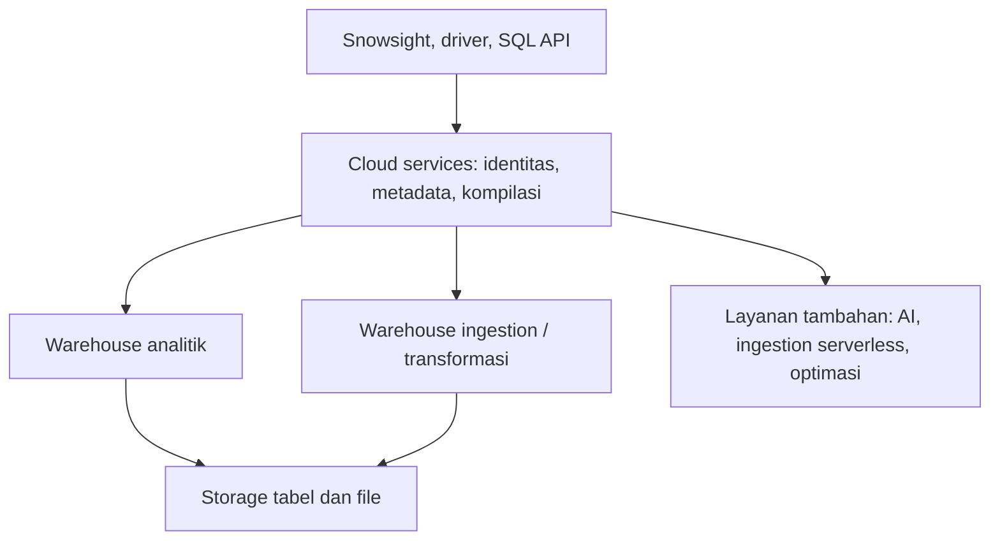
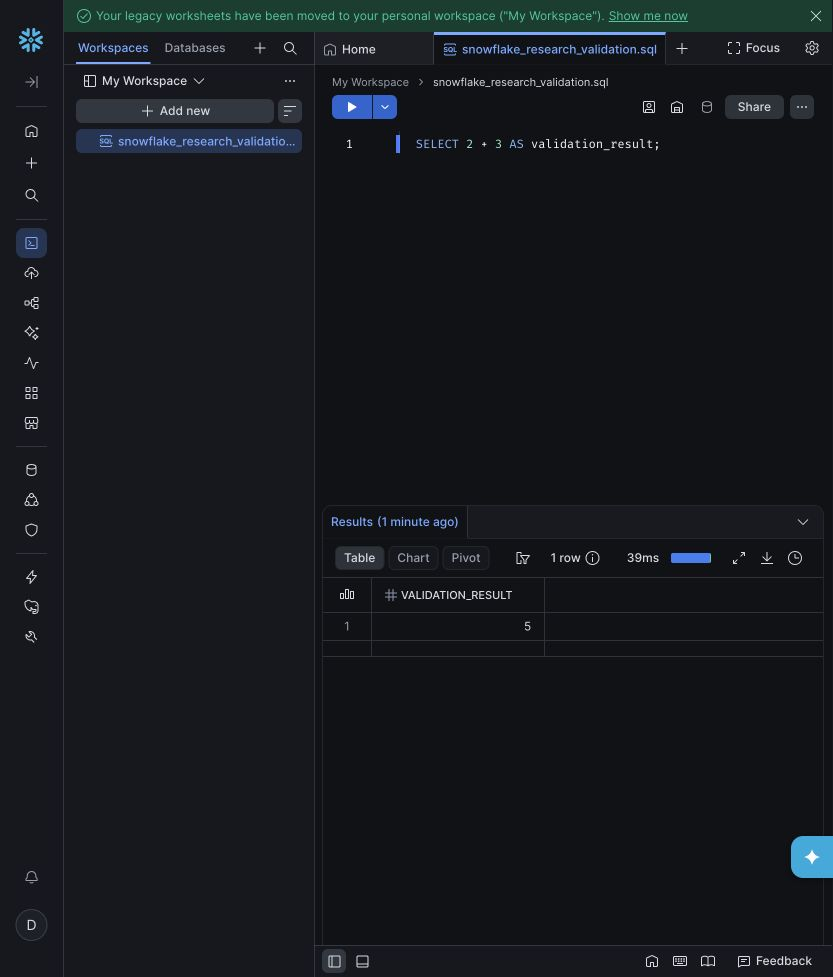
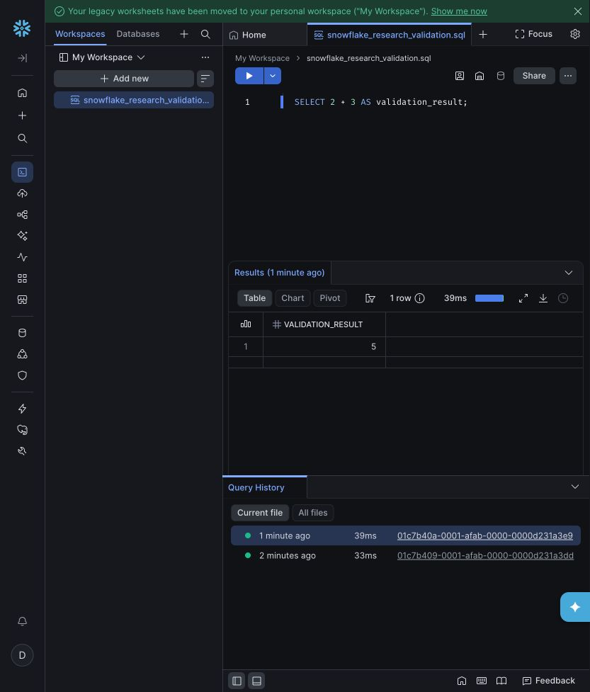
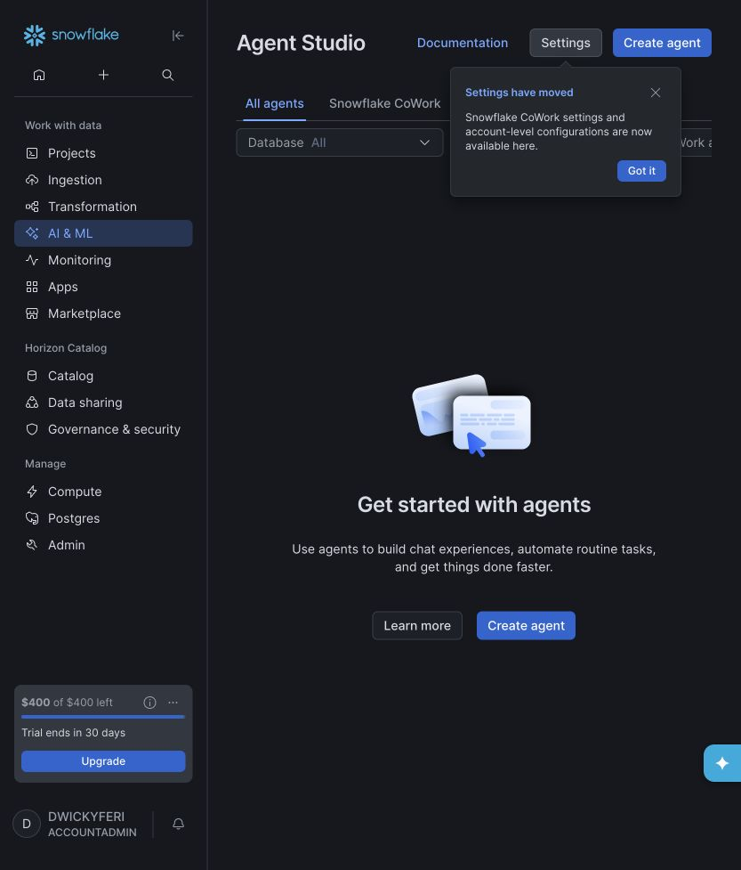

# Snowflake: penelitian mendalam dan pengujian langsung

Tanggal penelitian: **13 Oktober 2026**, zona waktu Asia/Jakarta. Engine yang benar-benar diakses: **10.37.100**, region **AWS_AP_SOUTHEAST_3**. Laporan ini membahas Snowflake berdasarkan dokumentasi resmi, pemeriksaan Snowsight, dan eksperimen SQL pada akun yang diberikan pengguna.

## Daftar isi

1. [Hasil utama dan tingkat bukti](#1-hasil-utama-dan-cara-membaca-laporan)
2. [Lingkungan dan metode](#2-lingkungan-dan-metode-penelitian)
3. [Arsitektur](#3-bedah-arsitektur-snowflake)
4. [Snowsight dan Workspaces](#4-snowsight-dan-pengalaman-developer)
5. [SQL dan dialect](#5-sql-hasil-pengujian-dan-perilaku-dialect)
6. [Storage, cloning, recovery](#6-storage-cloning-dan-recovery)
7. [Ingestion dan transformasi](#7-ingestion-dan-transformasi)
8. [Semantic layer dan AI](#8-semantic-layer-dan-ai)
9. [Programming, Snowpark, ML](#9-programming-snowpark-dan-ml)
10. [Security, governance, sharing](#10-security-governance-dan-data-sharing)
11. [Aplikasi, DevOps, API](#11-aplikasi-devops-api-dan-workload-lain)
12. [Error, koreksi, batas kesimpulan](#12-error-koreksi-dan-batas-kesimpulan)
13. [Implikasi desain](#13-implikasi-desain-dari-hasil-penelitian)
14. [Bukti akhir dan artefak](#14-bukti-akhir-dan-cara-menggunakan-artefak)

## 1. Hasil utama dan cara membaca laporan

Fitur inti Snowflake berhasil dijalankan pada akun ini: SQL analitis, JSON, transaksi DML, MERGE, temporary table, cloning, Time Travel, pemuatan dan ekspor CSV, stream, semantic view, task satu kali, dynamic table incremental dengan refresh manual, row access policy, masking policy, SQL/Python UDF, SQL stored procedure, dan prosedur Snowpark Python. Editor Workspaces juga berhasil membuat file, menjalankan SQL, menampilkan hasil, dan memperlihatkan query ID.

Pengujian merekam **224 statement melalui Python Connector**, ditambah **2 query langsung dari browser**. Jumlah 224 mencakup setup, metadata, cleanup, percobaan yang gagal, dan pengujian ulang. Ini bukan klaim bahwa 224 fitur atau 224 assertion semuanya lulus. Task juga menjalankan satu statement anak di luar sesi connector.

Ada tiga temuan yang perlu diperhatikan sejak awal:

1. Personal database `USER$` adalah konteks penyimpanan workspace, dengan batas object yang berbeda dari database standar. Pembuatan tabel non-temporary, stream, dan semantic view ditolak di sana. Ketiganya bekerja setelah eksperimen dipindahkan ke schema khusus di `SNOWFLAKE_LEARNING_DB`.
2. Pada standard table yang diuji, PRIMARY KEY dan UNIQUE tidak menolak duplikasi. Sebaliknya, NOT NULL dan CHECK benar-benar menolak pelanggaran. CHECK sudah tersedia pada engine ini; penjelasan lama bahwa hanya NOT NULL yang enforced tidak akurat untuk versi yang diuji.
3. Primary role saja tidak menjelaskan seluruh akses. Uji `PUBLIC` awal masih bisa membaca metadata karena secondary roles aktif. Dengan `USE SECONDARY ROLES NONE`, akses ke schema metadata akun dan schema eksperimen ditolak.

Bukti teknis tersedia di [katalog seluruh statement](snowflake-deep-research-2026-10-13/test-catalog.md), [log JSONL](snowflake-deep-research-2026-10-13/events.jsonl), [arsip SQL](snowflake-deep-research-2026-10-13/executed-statements.sql), dan [ringkasan mesin](snowflake-deep-research-2026-10-13/summary.json).

### 1.1 Tingkat bukti

| Label | Makna | Yang tidak boleh disimpulkan |
| --- | --- | --- |
| **LIVE** | Statement atau alur benar-benar dijalankan; hasil dicatat | Performa produksi, seluruh kombinasi fitur, atau keamanan semua role |
| **UI** | Kontrol atau halaman terlihat pada akun; beberapa alur editor dieksekusi | Menu yang terlihat pasti dapat digunakan atau sudah berlisensi |
| **DOC** | Perilaku dijelaskan dokumentasi resmi yang ditelaah | Fitur pasti tersedia pada akun, region, atau versi tertentu |
| **BELUM DIUJI** | Tidak dijalankan dalam penelitian ini | Fitur gagal atau tidak didukung Snowflake |
| **ANALISIS** | Implikasi dan penilaian penulis berdasarkan bukti | Pernyataan produk atau benchmark vendor |

Peta fitur dalam laporan ini luas. Pengujian langsung berfokus pada komponen yang dapat dijalankan dengan warehouse yang sudah ada dan data sintetis kecil. Layanan AI, ingestion serverless, compute pool, deployment aplikasi, replication lintas akun, dan integrasi penyedia eksternal dibahas melalui dokumentasi. Akurasi jawaban AI, throughput streaming, performa TB, dan ketahanan failover belum diuji.

### 1.2 Batas biaya dan tindakan yang dilakukan

Pengguna menetapkan: **gunakan compute yang sudah ada; hindari layanan tambahan berbayar**. Pengujian menggunakan `COMPUTE_WH` yang telah tersedia, ukuran X-Small, Standard Gen 2, satu cluster. Tidak dibuat warehouse baru, interactive warehouse, compute pool, Postgres instance, pipe ingest, Cortex Search service, atau model training.

Task menggunakan `WAREHOUSE=COMPUTE_WH`, dijalankan sekali dengan `EXECUTE TASK`, lalu dihapus. Dynamic table menggunakan `SCHEDULER=DISABLE` dan warehouse yang sama. Inisialisasi serta satu refresh manual tetap memakai compute; tidak ditinggalkan jadwal refresh otomatis.

Tidak dikirim prompt chat CoCo atau pemanggilan AI SQL secara sengaja. Namun, dialog rename SQL file menampilkan **“Suggested by CoCo”** dan **“Generating CoCo filename suggestions...”** secara otomatis. Nama file dimasukkan manual. Biaya fitur UI otomatis tersebut tidak teratribusi dalam penelitian ini. Karena itu, laporan tidak mengklaim tidak ada aktivitas AI latar belakang atau biaya tambahan sama sekali.

Query Acceleration Service sudah aktif dalam konfigurasi awal warehouse. Audit `Z01_QAS_FINAL` mengamati 216 query yang cocok dengan tag penelitian atau query ID task: **0 acceleration bytes** dan **0 acceleration partitions**. Sampel ini diambil sebelum statement cleanup dan audit UI terakhir. Dua query UI juga mencatat 0 acceleration bytes. Ini bukti bahwa query yang diamati tidak memakai akselerasi, bukan bukti biaya seluruh akun nol.

Metering sementara `Z02_METERING` mengembalikan **0.045000000 compute credits** dan **0.003515000 cloud-services credits** untuk bucket waktu yang dikembalikan saat itu. Angka ini bukan atribusi eksklusif penelitian, bukan total final, dan bukan tagihan dalam dolar. Query UI serta audit terakhir terjadi sesudah pengambilan sampel. UI trial menampilkan sekitar `$400 of $400 left`, tetapi tampilan yang dibulatkan tersebut tidak cukup untuk menghitung biaya.

Resource monitor berfokus pada warehouse; pengeluaran AI dan serverless perlu dipantau dengan mekanisme biaya yang sesuai. Menetapkan resource monitor tidak membuat semua layanan mempunyai batas keras yang sama. [Resource monitors](https://docs.snowflake.com/en/user-guide/resource-monitors).

## 2. Lingkungan dan metode penelitian

### 2.1 Kondisi akun yang diamati

| Komponen | Observasi langsung |
| --- | --- |
| Akun/region | Locator `vd82948`, AWS Asia Tenggara 3 |
| User sesi | `DWICKYFERI` |
| Primary role awal | `ACCOUNTADMIN` |
| Secondary roles | `ALL`; output konteks mencantumkan `ORGADMIN` |
| Engine | `10.37.100` |
| Connector | `snowflake-connector-python 4.8.0` |
| Database awal sesi connector | Tidak ada database/schema aktif |
| Database terlihat | `SNOWFLAKE`, `SNOWFLAKE_LEARNING_DB`, `SNOWFLAKE_SAMPLE_DATA`, `USER$DWICKYFERI` |
| Warehouse terlihat | `COMPUTE_WH`, `SNOWFLAKE_LEARNING_WH`, `SYSTEM$STREAMLIT_NOTEBOOK_WH` |
| Kondisi awal warehouse | Ketiganya suspended, ukuran X-Small |
| Warehouse yang digunakan | Hanya `COMPUTE_WH` |
| Auto suspend `COMPUTE_WH` | 600 detik, auto resume aktif |
| Edition | **Belum terkonfirmasi**; query ORGANIZATION_USAGE untuk locator ini mengembalikan kosong |
| Kondisi akhir `COMPUTE_WH` | **SUSPENDED**, diverifikasi dengan `SHOW WAREHOUSES` |

Edition dan entitlement harus dibedakan. Berhasilnya masking dan row access policy membuktikan fungsi tersebut dapat digunakan dalam eksperimen ini. Itu tidak menetapkan nama edition kontrak akun. Dokumentasi membedakan Standard, Enterprise, Business Critical, dan VPS; fitur tertentu juga dibatasi region serta status preview. [Snowflake editions](https://docs.snowflake.com/en/user-guide/intro-editions).

### 2.2 Metode pengujian

Login Snowsight dilakukan melalui browser dalam aplikasi. Untuk pengujian berulang, dipakai connector resmi dalam lingkungan Python sementara di luar dependensi Nova. Password dibaca dengan `getpass`, tidak ditulis ke source atau bukti hasil.

Sesi connector menetapkan query tag `SNOWFLAKE_RESEARCH_20261013`, statement timeout 60 detik, lock timeout 10 detik, serta timeout koneksi/jaringan. TLS dan validasi sertifikat tidak dinonaktifkan. Query memakai data sintetis 2 sampai beberapa baris; generator hanya membuat 10 baris.

Runner menyimpan ID kasus, SQL yang dijalankan, timestamp UTC, query ID, nama kolom, hasil, error code, SQLSTATE, dan durasi dari sisi client. Decimal diserialisasi sebagai string agar tidak kehilangan presisi. Beberapa assertion memakai cast ke VARCHAR agar hasil deterministik. Metadata account merupakan bukti konteks dan tidak berisi password, token sesi, atau private key. [Python Connector API](https://docs.snowflake.com/en/developer-guide/python-connector/python-connector-api), [koneksi connector](https://docs.snowflake.com/en/developer-guide/python-connector/python-connector-connect).

**Batas runner:** DDL tanpa assertion dianggap PASS ketika berhasil; jadi PASS tidak selalu menguji hasil lanjutan. Runner awal tidak menghentikan kasus dependen ketika setup gagal. Akibatnya, kegagalan membuat source di personal database menghasilkan rangkaian object-not-found. Semua kegagalan dipertahankan, ditelaah, dan pengujian terkait diulang dalam konteks yang sesuai.

Durasi client mencakup overhead koneksi, network, driver, kompilasi, dan eksekusi. Durasi pada UI adalah metrik query Snowflake. Kedua angka tidak diperlakukan sebagai benchmark yang setara.

### 2.3 Hasil mentah dan interpretasinya

| Status runner | Jumlah | Interpretasi |
| --- | ---: | --- |
| PASS | 154 | Eksekusi berhasil; memenuhi assertion jika tersedia |
| OBSERVED | 37 | Metadata atau hasil dicatat tanpa assertion deterministik |
| EXPECTED_ERROR | 10 | Penolakan sesuai pola yang diharapkan |
| ERROR | 21 | Penemuan batas, error harness/syntax, atau kegagalan dependen |
| FAIL | 2 | Ekspektasi harness salah atau konteks role belum diisolasi |
| **Total** | **224** | Termasuk setup, query substantif, dan cleanup |

Query browser di luar runner berhasil dengan query ID:

- `01c7b409-0001-afab-0000-0000d231a3dd`: fungsi konteks dan ekspresi aritmetika; UI mencatat 33 ms.
- `01c7b40a-0001-afab-0000-0000d231a3e9`: `SELECT 2 + 3 AS validation_result;`; hasil **5**, UI mencatat 39 ms.

Task anak yang berhasil mempunyai query ID `01c7b404-0001-afbc-0000-d2310001501e`. Angka statement di atas tidak menghitung seluruh query internal Snowflake atau statement yang dikeluarkan runtime Snowpark.

## 3. Bedah arsitektur Snowflake

### 3.1 Tiga lapisan platform

Snowflake merupakan layanan data cloud. Arsitekturnya memisahkan penyimpanan data, compute untuk eksekusi query, dan cloud services untuk metadata, autentikasi, koordinasi, kompilasi, dan pengelolaan query. Standard table disimpan dalam bentuk kolumnar dengan micro-partitions. Warehouse menjadi unit compute yang dapat dipisahkan antar-workload. [Arsitektur Snowflake](https://docs.snowflake.com/en/user-guide/intro-key-concepts).



**ANALISIS:** Pemisahan ini memudahkan isolasi kapasitas. Query BI dan batch besar dapat memakai warehouse berbeda sambil mengakses dataset yang sama. Isolasi compute tidak otomatis mengisolasi izin data, transaksi, atau biaya account-wide. Role, policy, query context, dan layanan tambahan tetap perlu dikelola.

### 3.2 Warehouse, ukuran, dan concurrency

Warehouse menyediakan compute untuk SELECT dan DML seperti INSERT, UPDATE, MERGE, serta COPY. Warehouse yang berhenti dapat otomatis dihidupkan oleh query jika auto resume aktif. Pada eksperimen, audit metadata terakhir menghidupkan `COMPUTE_WH` lagi, sehingga suspend diverifikasi setelah audit selesai. [Warehouses](https://docs.snowflake.com/en/user-guide/warehouses).

Untuk standard warehouse, provisioning mempunyai minimum tagihan 60 detik; sesudah itu pengukuran berjalan per detik. Suspend lalu resume berulang dapat menambah minimum provisioning baru. Warehouse lebih besar dan multi-cluster menjawab masalah berbeda: kapasitas eksekusi satu workload versus concurrency banyak workload. Performa tetap bergantung pada bentuk query dan data. [Warehouse considerations](https://docs.snowflake.com/en/user-guide/warehouses-considerations).

**LIVE:** Semua eksperimen memakai X-Small satu cluster. Tidak dilakukan resize, pengujian parallel clients, pressure test, spill test, atau tuning concurrency. Ukuran sistem notebook dengan maksimum 10 cluster hanya diamati; warehouse tersebut tidak digunakan.

### 3.3 Micro-partition, cache, dan optimasi

**DOC:** Result cache menyimpan hasil query selama 24 jam. Reuse bergantung antara lain pada query, data, privilege, dan parameter yang relevan; memenuhi persyaratan tidak menjamin reuse. Reuse dapat memperpanjang retensi, dengan batas 31 hari sejak hasil awal. Cache hasil berbeda dari cache data warehouse. [Persisted query results](https://docs.snowflake.com/en/user-guide/querying-persisted-results).

**LIVE:** `RESULT_SCAN` berhasil memproses hasil query sebelumnya: nilai awal 8 diolah menjadi 16. Ini membuktikan post-processing hasil; tidak membuktikan query kedua mendapatkan result-cache hit. Query kecil yang melaporkan 0 bytes scanned juga bukan bukti throughput atau cache hit tanpa bukti profil tambahan.

| Mekanisme optimasi | Tujuan utama menurut dokumentasi | Status penelitian |
| --- | --- | --- |
| Automatic Clustering | Menata data menurut clustering key untuk membantu pruning | DOC; tidak diaktifkan |
| Search Optimization Service | Lookup selektif, substring, elemen semi-structured, dan beberapa pencarian lain | DOC; tidak dibuat |
| Materialized View | Hasil pra-komputasi untuk pola query tertentu | DOC; tidak dibuat |
| Query Acceleration Service | Mengalihkan bagian query yang eligible ke sumber daya layanan tambahan | Konfigurasi awal diamati; pemakaian sampel 0 |
| Query Profile/operator stats | Menjelaskan scan, join, aggregate, dan bottleneck | LIVE untuk query kecil |

Optimasi penyimpanan dapat menambah biaya storage dan pemeliharaan serverless. Materialized view tidak sama dengan normal view atau dynamic table; batas query dan cara refresh-nya berbeda. [Storage optimizations](https://docs.snowflake.com/en/user-guide/performance-query-storage), [query optimization options](https://docs.snowflake.com/en/user-guide/performance-query-options).

## 4. Snowsight dan pengalaman developer

### 4.1 Workspaces yang benar-benar dicoba

Akses pertama menampilkan **“Workspaces failed to load”**. Setelah pemeriksaan halaman lain, kunjungan ulang berhasil tanpa perubahan account settings. Penyebab awal tidak diketahui. Karena alur akhir berhasil, kegagalan awal tidak dianggap blocker permanen.

Workspaces menampilkan file explorer, database explorer, tab file, role/warehouse selector, database/schema selector, Run selected, pilihan Run, results, Table/Chart/Pivot, download results, serta Query History. Welcome page menyediakan entry untuk SQL file, Notebook, dbt Project, Streamlit App, Agent, dan Semantic view. Label Agent pada welcome page bertanda preview; ini bukan bukti bahwa semua kemampuan Cortex Agents berstatus preview.

Alur LIVE yang diselesaikan:

1. Membuat SQL file dari halaman welcome.
2. Menulis query konteks.
3. Mengganti nama menjadi `snowflake_research_validation.sql` dengan nama manual.
4. Menjalankan query dan melihat satu baris hasil.
5. Mengganti isi dengan query aritmetika, menjalankan, dan memverifikasi nilai 5.
6. Membuka Query History dalam file dan mencocokkan kedua query ID dengan metadata connector.

File kecil tersebut dipertahankan sebagai contoh yang dapat dibuka pengguna. File tidak mengandung credential atau data bisnis. Editor, chart, pivot, download, shared workspace, Git push, dan notebook bukan satu kelompok bukti: hanya alur editor dan query history di atas yang dieksekusi.





**DOC:** Workspaces menyediakan pengelolaan file dan integrasi Git. Dokumentasi deprecation menetapkan penggantian Legacy Worksheets; jangan menggunakan panduan lama untuk mematikan Workspaces sebagai solusi umum. [Workspaces](https://docs.snowflake.com/en/user-guide/ui-snowsight/workspaces), [Git dalam Workspaces](https://docs.snowflake.com/en/user-guide/ui-snowsight/workspaces-git), [SQL dalam Workspaces](https://docs.snowflake.com/en/user-guide/ui-snowsight/workspaces-sql).

### 4.2 Personal database dan database data

**LIVE:** Nama `USER$` di SQL merujuk ke personal database pengguna. Temporary table, temporary stage, file format, SQL UDF, dan temporary view yang dicoba dapat dipakai dalam sesi penelitian. Namun, CREATE TRANSIENT TABLE, CREATE STREAM, dan CREATE SEMANTIC VIEW ditolak dengan error **060119** dalam konteks personal database.

Schema eksperimen `SNOWFLAKE_LEARNING_DB.SF_RESEARCH_20261013` dibuat terpisah. Source tabel, stream, semantic view, recovery table, task, policy, dan dynamic table di sana berhasil. Schema tersebut dihapus setelah pengujian.

Dokumentasi menempatkan PDB sebagai lokasi personal object dan workspace, bukan database serbaguna untuk menyimpan tabel data. Akses PDB juga tidak memberi privilege baru ke database lain. Hasil temporary object sesi tidak boleh digeneralisasi menjadi dukungan permanent object. [Personal Databases](https://docs.snowflake.com/en/user-guide/personal-databases).

### 4.3 Halaman lain yang diperiksa

| Halaman | Observasi UI | Kedalaman uji |
| --- | --- | --- |
| Compute | Tiga warehouse, ukuran, state, jumlah cluster | Daftar dan metadata; existing warehouse dipakai SQL |
| Monitoring | Individual/Grouped Queries, filter waktu/user, status, durasi, query ID | Query connector terlihat; operator stats diuji SQL |
| Ingestion | Load to Table, Load to Stage, stage, S3, Azure, GCS, OneLake, connector links | Daftar UI; bulk load CSV diuji connector |
| Horizon Catalog | Empat database, object explorer, pencarian | Struktur halaman; metadata SQL |
| Agent Studio | All agents, Snowflake CoWork, Create agent, Settings | UI saja; tidak membuat/menjalankan agent |
| Apps | My apps, Shared with me, Create new app, Marketplace | UI saja; tidak deploy atau install app |
| Navigasi lain | Data sharing, Governance & security, Postgres, Admin | Entry terlihat; alur operasional belum dieksekusi |



Peta Snowsight mengelompokkan pekerjaan data, catalog/governance, dan administrasi. UI yang terlihat pada akun ini menggunakan nama CoCo dan CoWork; beberapa dokumentasi atau judul historis masih menggunakan Cortex Code dan Snowflake Intelligence. Laporan memakai nama sesuai sumber yang sedang dibahas. [Snowsight quick tour](https://docs.snowflake.com/en/user-guide/ui-snowsight-quick-tour).

## 5. SQL: hasil pengujian dan perilaku dialect

### 5.1 SQL analitis dan kenyamanan penulisan

| Fitur LIVE | ID bukti | Hasil atau pelajaran |
| --- | --- | --- |
| VALUES, CTE, SUM, GROUP BY | Q01 | Bandung dan Jakarta masing-masing 30 |
| QUALIFY + ROW_NUMBER | Q02 | Memilih satu baris dengan amount tertinggi per kota |
| GROUP BY ALL | Q03 | Kelompok berdasarkan ekspresi non-aggregate pada SELECT |
| Star EXCLUDE, REPLACE, RENAME | Q04 | Kota dikeluarkan, amount menjadi 20, id diganti order_id |
| Star ILIKE | Q05 | Memilih kolom berdasarkan pola nama |
| Trailing comma di SELECT | Q06 | Query `SELECT 1 AS a,2 AS b,` diterima |
| Alias dalam SELECT yang sama | Q07 | Alias x=4 digunakan untuk menghasilkan y=8 |
| Recursive CTE | Q17 | Penjumlahan 1 sampai 5 menghasilkan 15 |
| PIVOT | Q18 | Sales dan costs menjadi kolom 10 dan 20 |
| UNPIVOT | Q19 | Kolom menjadi baris berlabel COSTS dan SALES |
| GENERATOR | Q20 | Menghasilkan tepat 10 baris |
| UNION ALL BY NAME | Q21 | Baris kedua mengikuti nama kolom: a=10,b=20 |
| Pipe operator `->>` | Q22 | Hasil pertama 2 digunakan untuk menghasilkan 6 |
| ASOF JOIN | Q23 | Trade 10:05 cocok dengan quote sebelumnya 10:00, harga 100 |
| MATCH_RECOGNIZE | R01 | Pola naik mencakup posisi awal 1 sampai akhir 3 |
| GROUPING/ROLLUP | Q25 | Total 30 disertai grouping flag |
| Window frame eksplisit ROWS | Q26 | Running sum 10,30,60 |
| Quoted identifier | Q27 + negative test | `"MixedCase"` berhasil; nama unquoted yang tidak cocok ditolak |

Contoh yang benar-benar dijalankan:

```sql
WITH x(id, city, amount) AS (
  SELECT * FROM VALUES
    (1, 'Jakarta', 10),
    (2, 'Jakarta', 20),
    (3, 'Bandung', 30)
)
SELECT id, city, amount
FROM x
QUALIFY ROW_NUMBER() OVER (
  PARTITION BY city ORDER BY amount DESC
) = 1
ORDER BY id;
```

Hasil: `(2, Jakarta, 20)` dan `(3, Bandung, 30)`. QUALIFY membuat filter hasil window lebih ringkas. Dokumentasi menyatakan QUALIFY merupakan syntax Snowflake, bukan klausul standar ANSI SQL. [QUALIFY](https://docs.snowflake.com/en/sql-reference/constructs/qualify).

```sql
WITH x(id, city, amount) AS (
  SELECT * FROM VALUES (1, 'Jakarta', 10)
)
SELECT * EXCLUDE city
         REPLACE (amount * 2 AS amount)
         RENAME id AS order_id
FROM x;
```

Hasil: `(order_id=1, amount=20)`. Urutan modifier penting. Negative test dengan urutan tidak sah ditolak. `ILIKE` dan `EXCLUDE` memiliki aturan kombinasi sendiri; dukungan masing-masing tidak berarti semua kombinasi valid. [SELECT](https://docs.snowflake.com/en/sql-reference/sql/select).

```sql
SELECT 1 AS a, 2 AS b
UNION ALL BY NAME
SELECT 20 AS b, 10 AS a;

SELECT 2 AS n
  ->> SELECT n * 3 FROM $1;
```

Query pertama menghasilkan `(1,2)` dan `(10,20)`. Query kedua menghasilkan 6. **ANALISIS:** Union berdasarkan nama membantu pipeline yang urutan kolomnya berubah, tetapi kontrak schema tetap diperlukan. Pipe operator mempermudah post-processing hasil SHOW atau SELECT tanpa memisahkan query ID secara manual.

GROUP BY ALL berhasil pada fixture sederhana. Untuk model yang berubah sering, ekspresi baru dalam SELECT dapat mengubah tingkat agregasi. Gunakan grouping eksplisit jika grain merupakan kontrak bisnis yang penting. Dokumentasi juga menjelaskan precedence ketika nama kolom bertabrakan dengan alias. [GROUP BY](https://docs.snowflake.com/en/sql-reference/constructs/group-by).

### 5.2 MATCH_RECOGNIZE: koreksi syntax, bukan kegagalan fitur

Percobaan awal menggunakan `PREV` dalam DEFINE dan gagal dengan **“Unknown function PREV”**. Penelitian dokumentasi menunjukkan posisi pemakaian fungsi tersebut berbeda: PREV untuk MEASURES, sedangkan LAG dapat digunakan dalam DEFINE. [MATCH_RECOGNIZE](https://docs.snowflake.com/en/sql-reference/constructs/match_recognize).

Pengujian ulang LIVE:

```sql
SELECT *
FROM (
  SELECT column1 AS pos, column2 AS value
  FROM VALUES (1,10), (2,20), (3,30)
)
MATCH_RECOGNIZE (
  ORDER BY pos
  MEASURES FIRST(pos) AS start_pos,
           LAST(pos) AS end_pos
  ONE ROW PER MATCH
  PATTERN (A B+)
  DEFINE A AS TRUE,
         B AS value > LAG(value)
);
```

Hasil R01 adalah `(1,3)`. Pattern recognition ini relevan untuk urutan kejadian dan time-series. Pengujian tidak mencakup overlapping patterns, AFTER MATCH SKIP, banyak partition, atau pola besar. Error pertama tetap disimpan agar penjelasan akhir tidak menyembunyikan proses koreksi.

### 5.3 NULL, cast, kondisi, dan identifier

Query LIVE berikut menghasilkan `NULL, TRUE, TRUE, 'fallback'`:

```sql
SELECT NULL = NULL,
       NULL IS NOT DISTINCT FROM NULL,
       EQUAL_NULL(NULL, NULL),
       COALESCE(NULL, 'fallback');
```

Kesetaraan normal mengikuti three-valued logic. Null-safe equality berguna untuk deduplication atau join yang perlu menganggap dua NULL setara. Keputusan tersebut harus mengikuti makna data, bukan diterapkan pada semua join.

TRY_TO_NUMBER dan TRY_CAST pada fixture malformed mengembalikan NULL. Strict cast malformed dan division by zero sengaja dijalankan sebagai negative test dan ditolak. IFF serta ZEROIFNULL menghasilkan nilai yang diharapkan. **ANALISIS:** TRY_* membuat pipeline tetap berjalan, tetapi dapat menyamarkan data rusak jika jumlah NULL hasil konversi tidak diukur.

Identifier ber-quote mempertahankan penamaan yang sensitif terhadap case. Fixture `"MixedCase"` menghasilkan 7; rujukan unquoted yang tidak sesuai gagal. Untuk interoperabilitas aplikasi, normalisasi nama dan aturan quoting perlu diuji bersama, terutama pada metadata SHOW dan RESULT_SCAN.

### 5.4 Semi-structured data: VARIANT, JSON, ARRAY, OBJECT

Bukti LIVE Q10 sampai Q14:

```sql
SELECT
  PARSE_JSON('{"customer":{"city":"Jakarta"},"items":[10,20]}')
    :customer.city::VARCHAR,
  PARSE_JSON('{"items":[10,20]}'):items[1]::NUMBER;
```

Hasil: Jakarta dan 20. Index array pada contoh menggunakan posisi 1 untuk elemen kedua.

```sql
SELECT PARSE_JSON('null') IS NULL,
       IS_NULL_VALUE(PARSE_JSON('null')),
       PARSE_JSON('{}'):missing IS NULL;
```

Hasil: **FALSE, TRUE, TRUE**. JSON null, SQL NULL, dan path yang tidak ada harus dibedakan. Menyamakan ketiganya dapat mengubah filter kualitas data dan jumlah record.

FLATTEN pada array `[10,20,30]` menghasilkan pasangan index/value `(0,10),(1,20),(2,30)`. LATERAL FLATTEN pada data dengan id=7 menghasilkan dua baris yang tetap membawa id tersebut. ARRAY_SIZE, OBJECT_CONSTRUCT, akses object, dan TYPEOF berhasil. TRY_PARSE_JSON pada teks yang tidak valid menghasilkan NULL pada fixture.

**ANALISIS:** VARIANT memungkinkan landing raw payload tanpa memaksa semua kolom di awal. Untuk analitik yang stabil, field penting tetap perlu diproyeksikan ke tipe eksplisit, diberi aturan NULL, dan divalidasi. FLATTEN mengubah grain: satu record dapat menjadi banyak baris, sehingga SUM setelah join perlu diperiksa untuk menghindari penggandaan.

### 5.5 Tanggal, waktu, regex, dan bentuk query

Q15 menguji DATEADD, DATEDIFF, dan CONVERT_TIMEZONE. Dua hari sesudah 13 Oktober 2026 menjadi 15 Oktober; jam UTC dikonversi menjadi +7 untuk Jakarta. Sesi connector juga mengatur TIMEZONE Asia/Jakarta. Itu perubahan parameter sesi, bukan perubahan timezone account atau user permanen.

Q16 memverifikasi REGEXP_LIKE, SPLIT_PART, dan TRY_PARSE_JSON. Q25 memverifikasi ROLLUP serta penanda grouping. Q26 menggunakan frame `ROWS BETWEEN UNBOUNDED PRECEDING AND CURRENT ROW` untuk running total deterministik.

**BELUM DIUJI:** perilaku DST, TIMESTAMP_LTZ versus TIMESTAMP_TZ pada round trip lintas driver, seluruh collation, GEOGRAPHY/GEOMETRY, tipe VECTOR, approximate aggregate, interval ekstrem, dan validasi semua data type. Keberadaan syntax SQL yang luas tidak membuktikan kompatibilitas penuh dengan PostgreSQL, MySQL, atau dialect lain.

### 5.6 MERGE, transaksi, DELETE, dan bentuk hasil DML

Temporary ORDERS diisi dua baris. MERGE memperbarui amount id=2 dari 20 menjadi 25 dan memasukkan id=3 dengan amount 30. Hasil sesudah MERGE cocok dengan tiga baris yang diharapkan. DELETE id=3 kemudian menyisakan dua baris.

Transaksi LIVE:

```sql
BEGIN;
UPDATE SF_RESEARCH_20261013_ORDERS
SET amount = 99
WHERE id = 1;
ROLLBACK;
```

Query setelah rollback tetap membaca amount 10. Ini menguji atomicity untuk DML yang digunakan. Implicit commit karena DDL, savepoint, isolation pada concurrent sessions, deadlock, dan transaksi lintas jenis tabel tidak diuji.

Hasil UPDATE melalui connector mempunyai dua kolom: **number of rows updated** dan **number of multi-joined rows updated**. Dalam kasus N12, engine mengembalikan `[[1,0]]`, sedangkan harness mengharapkan `[[1]]`. Itu FAIL assertion bentuk hasil; update sebenarnya berhasil. F01 mengulang dengan assertion `[[1,0]]` dan F02 memverifikasi nilai baru.

**ANALISIS:** Client SQL sebaiknya membaca nama/metadata kolom hasil DML. Mengasumsikan UPDATE dan INSERT mempunyai tuple hasil yang sama dapat membuat aplikasi salah mengartikan operasi yang sukses.

### 5.7 Constraints: enforcement yang benar-benar diamati

| Constraint pada standard temporary table | Uji LIVE | Hasil |
| --- | --- | --- |
| PRIMARY KEY | Dua record id yang sama dimasukkan | Duplikasi diterima |
| UNIQUE | Dua nilai unik yang sama dimasukkan | Duplikasi diterima |
| NOT NULL | Nilai NULL dimasukkan pada kolom wajib | Ditolak, error 100072 pada fixture |
| CHECK `n > 0` | INSERT -1 | Ditolak, SQLSTATE 23514 |
| CHECK `n > 0` | UPDATE menjadi negatif | Ditolak, SQLSTATE 23514 |
| CHECK `n > 0` | INSERT 5 dan NULL | Keduanya diterima |

CHECK TRUE atau NULL tidak gagal; FALSE gagal. Jika NULL juga harus dilarang, tambahkan NOT NULL. Setelah INSERT negatif ditolak, jumlah baris tetap 2. Karena fixture negative INSERT hanya berisi satu record, penelitian ini tidak mengklaim telah menguji semua bentuk batch atomicity.

Dokumentasi terbaru menyatakan CHECK enforced pada standard tables. Primary key, unique, dan foreign key standard tables tetap bersifat informational; hybrid tables mempunyai enforcement berbeda. COPY INTO ke tabel dengan CHECK juga mempunyai batas yang harus dibaca sebelum menyusun pipeline. [Constraints overview](https://docs.snowflake.com/en/sql-reference/constraints-overview).

CHECK standard tables diumumkan GA dalam release 10.12 pada April 2026; dukungan CHECK hybrid memiliki pembaruan GA September 2026. Jangan menerapkan matriks constraint lama ke engine 10.37.100 tanpa verifikasi. [Release 10.12](https://docs.snowflake.com/en/release-notes/2026/10_12), [CHECK hybrid GA](https://docs.snowflake.com/en/release-notes/2026/other/2026-09-24-hybrid-tables-check-constraints-ga).

### 5.8 EXPLAIN, operator stats, dan jejak eksekusi

EXPLAIN USING TEXT pada SUM(amount) menampilkan aggregate dan TableScan dengan satu partition terpilih serta 1.536 bytes pada fixture. GET_QUERY_OPERATOR_STATS dan QUERY_HISTORY_BY_SESSION berhasil dipanggil. Snowsight Monitoring juga menampilkan query yang menggunakan PythonConnector 4.8.0.

Pada audit UI, query history ikut menampilkan statement audit yang masih RUNNING, termasuk nilai durasi yang belum layak digunakan sebagai hasil final. Dua query UI yang dianalisis dipilih berdasarkan query ID dan status SUCCESS. **ANALISIS:** Snapshot riwayat dapat memuat query pembacanya sendiri; filter status dan waktu selesai sebelum membuat statistik.

Satu partition kecil dan durasi puluhan milidetik tidak mewakili workload nyata. Tidak dihasilkan klaim bahwa Snowflake lebih cepat dari engine lain. Benchmark yang dapat dipakai untuk keputusan perlu dataset representatif, cache state yang terkendali, concurrency, warehouse sizing, dan cost attribution.

## 6. Storage, cloning, dan recovery

### 6.1 Jenis tabel dan view

| Object | Fungsi | Bukti penelitian |
| --- | --- | --- |
| Permanent standard table | Data tahan lama dengan lifecycle perlindungan data | DOC; tidak membuat tabel produksi |
| Temporary table | Object/data sepanjang sesi | LIVE, dibuat dan dibersihkan |
| Transient table/schema | Object lintas sesi tanpa Fail-safe seperti permanent table | LIVE pada schema eksperimen |
| Normal view | Definisi query di atas sumber | LIVE, aggregate view mengembalikan hasil benar |
| Secure view | View dengan perlindungan tambahan untuk definisi/akses tertentu | DOC; tidak diuji |
| Materialized view | Hasil tersimpan dengan pemeliharaan layanan | DOC; tidak dibuat |
| Semantic view | Model bisnis native dengan dimensi, metric, dan relasi | LIVE; dibahas pada bagian 8 |
| Dynamic table | Hasil transformasi yang dipelihara lewat refresh | LIVE; dibahas pada bagian 7 |
| Hybrid table | Layout row store, index, row locking, constraints enforced | DOC; tidak dibuat |
| Iceberg table | Format terbuka dengan pilihan storage dan catalog | DOC; integrasi tidak dibuat |
| Interactive table | Tabel untuk interactive analytics bersama compute yang sesuai | DOC; tidak dibuat |
| External/event table | Referensi data eksternal atau penyimpanan telemetry sesuai object | BELUM DIUJI |

Temporary dan transient mengurangi lifecycle tertentu, tetapi tetap memakai storage selama data ada. Data yang dihapus dapat berada pada Time Travel; cleanup tidak selalu berarti semua bytes langsung hilang. Stage internal juga menyimpan file dengan biaya storage. [Data storage considerations](https://docs.snowflake.com/en/user-guide/tables-storage-considerations).

Hybrid tables menggunakan row store utama, mendukung row-level locking dan indexes, serta mewajibkan primary key yang enforced. Mereka tetap dapat digunakan bersama query engine dan warehouse Snowflake. Penelitian tidak menguji latency transactional, contention, atau dukungan region akun ini. [Hybrid tables](https://docs.snowflake.com/en/user-guide/tables-hybrid).

Iceberg memisahkan pertanyaan format data, lokasi file, dan catalog. Dokumentasi saat penelitian mencakup storage Snowflake-managed serta external volume. Fail-safe dan tanggung jawab recovery berbeda menurut pilihan storage; jangan memakai asumsi bahwa semua Iceberg selalu berada di bucket eksternal tanpa Fail-safe. Catalog integration menghubungkan metadata catalog eksternal; external volume menghubungkan lokasi storage. [Iceberg tables](https://docs.snowflake.com/en/user-guide/tables-iceberg).

### 6.2 Cloning

**LIVE:** Temporary clone dibuat dari ORDERS. Amount id=1 pada clone diubah menjadi 50; sumber tetap 11. Query pembanding menghasilkan `11.00` dan `50.00`. Ini membuktikan perubahan clone tidak mengubah baris sumber pada fixture.

**DOC:** Zero-copy clone standard object awalnya berbagi storage yang ada. Modifikasi menghasilkan data baru dan lifecycle storage tersendiri. Clone bukan jaminan total biaya nol setelah perubahan. Perilaku object yang ikut clone dan jenis tabel lain mempunyai batas khusus. [Cloning](https://docs.snowflake.com/en/user-guide/object-clone).

### 6.3 Time Travel dan UNDROP

**LIVE:** Sesudah amount id=1 diubah dari 10 menjadi 11, query ID update disimpan dalam variable sesi. Query `BEFORE(STATEMENT => $SF_RESEARCH_UPDATE_QID)` membaca nilai lama **10.00**. Pemakaian query ID menghindari penentuan timestamp perkiraan.

**LIVE:** Transient RECOVERY di database standar diisi id=7, di-drop, lalu `UNDROP TABLE RECOVERY` berhasil. Query selanjutnya kembali membaca 7. Task kemudian menambahkan id=8 sebelum cleanup akhir.

**DOC:** Time Travel memungkinkan akses keadaan lama serta pemulihan object dalam periode retensi. Retensi standard versus extended bergantung edition dan object. Fail-safe merupakan lapisan recovery yang berbeda dan melibatkan Snowflake; tidak sama dengan query historis mandiri atau backup yang bebas diakses. [Time Travel](https://docs.snowflake.com/en/user-guide/data-time-travel).

**BELUM DIUJI:** recovery setelah retensi habis, Fail-safe melalui support, database clone historis, schema UNDROP, recovery lintas region, atau recovery storage eksternal. DROP pada schema penelitian mengikuti retensi transient yang ditetapkan; penelitian tidak melakukan purge retensi.

## 7. Ingestion dan transformasi

### 7.1 Round trip file: PUT, stage, COPY, UNLOAD, GET

Alur CSV benar-benar dijalankan dengan dua record sintetis:

```csv
id,city,amount
1,Jakarta,10
2,Bandung,20
```

Temporary FILE FORMAT dengan TYPE=CSV dan SKIP_HEADER=1 serta temporary named STAGE dibuat. Connector mengunggah file lokal dengan PUT. LIST memperlihatkan file; query staged data menghasilkan dua baris yang diharapkan. COPY INTO temporary table menghasilkan count=2 dan SUM(amount)=30. COPY kedua tanpa FORCE tidak menggandakan data; count tetap 2.

Data lalu diekspor dengan COPY INTO stage, SINGLE=TRUE, HEADER=TRUE, COMPRESSION=NONE. GET mengunduh `out.csv`, ukuran 41 bytes. Isi hasil:

```csv
ID,CITY,AMOUNT
1,Jakarta,10
2,Bandung,20
```

Perbedaan kapitalisasi header berasal dari nama kolom hasil. Nilai record sama. Ini verifikasi round trip logis, bukan kesamaan byte input/output.

Percobaan GET pertama gagal karena direktori lokal belum ada. Sesudah direktori dibuat, pengujian ulang N41 mengembalikan status **DOWNLOADED**. Kegagalan awal adalah prasyarat filesystem client, bukan kegagalan stage atau export Snowflake.

File format menyatakan cara parsing; stage menyatakan lokasi file. Jangan menyatukan dua kontrak tersebut dalam aplikasi. File format Snowflake mencakup banyak format, tetapi penelitian hanya menjalankan CSV. [CREATE FILE FORMAT](https://docs.snowflake.com/en/sql-reference/sql/create-file-format), [data loading](https://docs.snowflake.com/en/user-guide/data-load-overview).

### 7.2 Perbandingan mekanisme ingestion

| Mekanisme | Sumber dan cara kerja | Compute | Bukti |
| --- | --- | --- | --- |
| Bulk COPY INTO | File di stage, dijalankan eksplisit atau melalui task | Warehouse | LIVE untuk CSV kecil |
| Snowpipe | Pipe mengatur COPY untuk file yang datang; event atau API memicu ingest | Serverless | DOC; tidak dibuat |
| Snowpipe Streaming | Row/event melalui SDK/REST atau connector yang sesuai | Serverless | DOC; tidak dijalankan |
| Openflow/connectors | Alur konektivitas sistem sumber dan transformasi ingestion | Sesuai deployment/runtime | DOC; tidak deploy |
| External table/Iceberg | Akses data dengan model storage/catalog yang dipilih | Sesuai fitur | DOC; tidak dibuat |

Snowpipe file-based dan bulk COPY tidak identik dalam scheduling dan billing. Dokumentasi terbaru menjelaskan Snowpipe sebagai serverless ingest file; bulk COPY memakai warehouse. Klaim latency vendor merupakan karakteristik dokumentasi, bukan hasil ukur penelitian. [Snowpipe](https://docs.snowflake.com/en/user-guide/data-load-snowpipe-intro).

Snowpipe Streaming high-performance menggunakan pipe dan channel untuk ingest record. Semantik exactly-once membutuhkan penanganan offset serta checkpoint yang tepat di client; tidak diperoleh hanya dengan retry sembarang. Login SQL juga belum membuktikan endpoint ingestion dapat diakses. [Streaming overview](https://docs.snowflake.com/en/user-guide/snowpipe-streaming/data-load-snowpipe-streaming-overview), [konfigurasi](https://docs.snowflake.com/en/user-guide/snowpipe-streaming/snowpipe-streaming-high-performance-configurations), [best practices](https://docs.snowflake.com/en/user-guide/snowpipe-streaming/snowpipe-streaming-high-performance-best-practices), [network prerequisites](https://docs.snowflake.com/en/user-guide/snowpipe-streaming/snowpipe-streaming-network-connectivity).

Halaman overview dan limitations yang ditelaah memuat angka batas throughput yang berbeda. Karena itu laporan tidak memilih satu angka sebagai kapasitas empiris akun. Untuk sizing ingestion, validasi versi SDK, arsitektur, quota, dokumentasi limitations terbaru, dan pengukuran workload sendiri. [Streaming limitations](https://docs.snowflake.com/en/user-guide/snowpipe-streaming/snowpipe-streaming-high-performance-limitations).

Openflow menyediakan connector untuk sistem sumber dan pipeline integrasi; contoh Kafka menggunakan arsitektur Snowpipe Streaming yang dijelaskan dalam dokumentasi connector. Itu tidak berarti semua connector mempunyai semantik delivery atau persyaratan deployment yang sama. [Openflow Kafka connector](https://docs.snowflake.com/en/user-guide/data-integration/openflow/connectors/kafka/about).

### 7.3 Stream: offset, consumption, dan transaction

**LIVE:** Stream DELTA dibuat sebelum dua record dimasukkan ke SRC. Query pertama menghasilkan dua INSERT dengan METADATA$ISUPDATE=FALSE. SELECT kedua masih membaca dua record: SELECT biasa tidak memajukan offset.

INSERT INTO SINK SELECT FROM DELTA menghasilkan dua record. Sesudah DML tersebut commit, stream menjadi kosong. UPDATE amount dari 10 menjadi 11 menghasilkan pasangan DELETE nilai lama dan INSERT nilai baru, keduanya METADATA$ISUPDATE=TRUE.

Consume di dalam BEGIN lalu ROLLBACK tidak memajukan offset; query sesudah rollback masih menghitung dua record delta. Hasil ini membuktikan consumption terikat transaksi pada alur yang diuji.

**DOC:** Stream mewakili posisi perubahan sumber, bukan salinan permanen seluruh event. Retensi sumber dan staleness perlu dipantau; beberapa consumer memerlukan strategi stream terpisah. Tidak semua perubahan intermediate harus muncul sebagai audit event. [Streams](https://docs.snowflake.com/en/user-guide/streams-intro).

**ANALISIS:** Stream cocok untuk pemrosesan delta, tetapi tidak menggantikan audit log immutable. Implementasi consumer harus menentukan kapan commit dilakukan, bagaimana replay ditangani, serta apa yang dilakukan jika stream stale.

### 7.4 Task: eksekusi satu kali yang diverifikasi

**LIVE:** Task INSERT_ONCE dibuat dengan `WAREHOUSE=COMPUTE_WH` dan definisi INSERT INTO RECOVERY VALUES(8). SHOW TASKS memperlihatkan state **suspended**, schedule NULL. EXECUTE TASK menjadwalkan satu run. Sesudahnya TASK_HISTORY mencatat **SUCCEEDED**, tanpa error, dan tabel berisi id 7 serta 8.

Task tidak pernah di-resume untuk jadwal berkelanjutan. Task dihapus setelah keberhasilan diverifikasi. Response “scheduled to run immediately” sendiri belum merupakan bukti selesai; bukti akhir berasal dari task history dan tabel hasil.

**DOC:** Task dapat berbasis jadwal atau trigger, user-managed warehouse atau serverless, serta disusun sebagai graph. Task mempunyai konteks eksekusi owner yang perlu dipahami ketika logic mengakses data. Penelitian tidak membuat graph, retry policy, event integration, atau serverless task. [Tasks](https://docs.snowflake.com/en/user-guide/tasks-intro).

### 7.5 Dynamic table: incremental dan manual refresh

**LIVE:** Dibuat dynamic table berikut di schema eksperimen yang terisolasi:

```sql
CREATE TRANSIENT DYNAMIC TABLE CITY_TOTALS
  SCHEDULER = DISABLE
  WAREHOUSE = COMPUTE_WH
  REFRESH_MODE = INCREMENTAL
  INITIALIZE = ON_CREATE
AS
SELECT city, SUM(amount) AS total
FROM SRC
GROUP BY city;
```

SHOW DYNAMIC TABLES menyatakan scheduler DISABLE, refresh mode INCREMENTAL, dan warehouse COMPUTE_WH. Inisialisasi menghasilkan Bandung=20 serta Jakarta=12. SRC lalu diperbarui sehingga Jakarta=13, tetapi query dynamic table masih membaca 12. Sesudah `ALTER DYNAMIC TABLE CITY_TOTALS REFRESH`, hasil menjadi 13.

Refresh history memperlihatkan dua SUCCEEDED: CREATION dan MANUAL, keduanya INCREMENTAL. INSERT langsung ke CITY_TOTALS ditolak dengan **Invalid Operation INSERT on Dynamic Table**. Dynamic table dihapus sesudah uji.

Untuk scheduler disabled, refresh dikendalikan manual; parameter target lag tidak dipakai pada statement yang diuji. Dokumentasi mengizinkan refresh manual pada dynamic table yang suspended dan menjelaskan isolasi scheduling ketika SCHEDULER=DISABLE. [CREATE DYNAMIC TABLE](https://docs.snowflake.com/en/sql-reference/sql/create-dynamic-table), [ALTER DYNAMIC TABLE](https://docs.snowflake.com/en/sql-reference/sql/alter-dynamic-table).

Dokumentasi saat penelitian juga mencakup mode seperti ADAPTIVE dan CUSTOM_INCREMENTAL serta bentuk REFRESH USING. Penolakan INSERT pada dynamic table SELECT-based yang diuji tidak boleh diperluas menjadi larangan seluruh bentuk pengelolaan custom incremental. Fitur tersebut belum diuji di akun ini.

| Pilihan transformasi | Cocok ketika | Tradeoff analitis |
| --- | --- | --- |
| View | Hasil boleh dihitung saat query | Tidak memelihara hasil terpisah |
| Dynamic table | Transformasi deklaratif dengan freshness dan refresh | Scheduling, eligibility incremental, biaya refresh |
| Stream + task | Perlu consumption delta, DML eksplisit, atau kontrol prosedural | State/offset, commit, retry, dan staleness |
| dbt Project | Model SQL dan workflow dbt sebagai project | Deploy/version/profile dan orchestration perlu dikelola |
| Stored procedure | Logic bertahap yang harus dieksekusi sebagai unit | Hak eksekusi, dependencies, dan error handling |

Panduan pemilihan dynamic table dibanding streams/tasks dan materialized views membantu menentukan pola yang sesuai. Stream pada dynamic table juga mempunyai syarat khusus; penelitian hanya membuat stream di atas standard transient table. [Decision guide](https://docs.snowflake.com/en/user-guide/dynamic-tables/decision-guide), [streams on dynamic tables](https://docs.snowflake.com/en/user-guide/dynamic-tables/streams-on-dts).

## 8. Semantic layer dan AI

### 8.1 Semantic view native: pengujian tanpa inference AI

**LIVE:** Semantic view SALES dibuat dengan logical table `orders` yang menunjuk ke SRC, logical primary key id, dimensi city, dan metric total_amount. Query N19 menghasilkan Bandung=20 serta Jakarta=11, sesuai keadaan sumber pada saat pengujian.

```sql
CREATE SEMANTIC VIEW SALES
  TABLES (orders AS SRC PRIMARY KEY (id))
  DIMENSIONS (orders.city AS city)
  METRICS (orders.total_amount AS SUM(amount));

SELECT *
FROM SEMANTIC_VIEW (
  SALES
  DIMENSIONS orders.city
  METRICS orders.total_amount
)
ORDER BY city;
```

SHOW SEMANTIC METRICS IN SALES memperlihatkan logical table ORDERS, metric TOTAL_AMOUNT, dan tipe NUMBER(38,0). Percobaan syntax `IN SEMANTIC VIEW ...` sebelumnya salah; bentuk yang dijalankan ulang memakai langsung nama view.

Pengujian ini mengeksekusi model semantic melalui SQL. Tidak ada permintaan natural language atau inference LLM. Logical primary key dalam definisi semantic juga tidak menjadi bukti bahwa physical standard table menegakkan unique constraint.

Semantic view memodelkan konsep bisnis melalui logical tables, dimensions, facts, metrics, dan relationships. Metadata menjadi object native yang dapat diakses dan diatur privilege-nya. Join multi-table, derived metric, private metric, synonym, verified query, dan sharing semantic view belum diuji. [Semantic view overview](https://docs.snowflake.com/en/user-guide/views-semantic/overview), [CREATE SEMANTIC VIEW](https://docs.snowflake.com/en/sql-reference/sql/create-semantic-view), [SHOW SEMANTIC METRICS](https://docs.snowflake.com/en/sql-reference/sql/show-semantic-metrics).

**ANALISIS:** Semantic layer mengubah kontrak pertanyaan dari nama kolom menjadi makna bisnis dan grain. SUM(amount) saja belum menjelaskan status transaksi, diskon, currency, timezone, dan deduplication. Definisi metric yang konsisten perlu disertai data-quality rule dan query pembanding.

### 8.2 Cortex Analyst

**DOC; BELUM DIUJI inference:** Cortex Analyst menghubungkan pertanyaan bahasa alami dengan structured data melalui model semantic. Dokumentasi mengutamakan semantic views native, sementara model YAML legacy mempunyai jalur dukungan tersendiri. Jangan menganggap YAML file dan native semantic view memiliki surface privilege, lifecycle, atau SQL access yang sama. [Cortex Analyst](https://docs.snowflake.com/en/user-guide/snowflake-cortex/cortex-analyst), [models versus views](https://docs.snowflake.com/en/user-guide/views-semantic/semantic-models-vs-views).

REST API Analyst dan orchestration Agents juga perlu dibedakan: menghasilkan SQL adalah satu langkah, menjalankan SQL dan menyusun jawaban adalah langkah tambahan sesuai client/tool. Dokumentasi REST saat penelitian menyarankan jalur Cortex Agents untuk pengalaman yang menggabungkan kemampuan tersebut. [Analyst REST API](https://docs.snowflake.com/en/user-guide/snowflake-cortex/cortex-analyst/rest-api).

Evaluasi sebaiknya menggunakan pertanyaan yang dipisahkan dari verified queries yang dipakai untuk memberi konteks. Membandingkan hanya teks SQL dapat menolak query yang setara atau menerima query dengan hasil berbeda. Dokumentasi evaluasi membahas eksekusi dan pembandingan hasil; layanan evaluasi tersebut tidak dijalankan. [Analyst evaluations](https://docs.snowflake.com/en/user-guide/snowflake-cortex/cortex-analyst-evaluations).

### 8.3 Cortex AI Functions

**DOC; BELUM DIUJI:** AI_COMPLETE, AI_CLASSIFY, AI_FILTER, AI_EXTRACT, AI_EMBED, AI_AGG, AI_SENTIMENT, serta fungsi dokumen memungkinkan AI menjadi bagian query atau pipeline. Fungsi tertentu memiliki status preview, privilege, model, dan region availability yang berbeda. Mereka memakai metering AI di luar durasi warehouse biasa. [Cortex AI Functions](https://docs.snowflake.com/en/user-guide/snowflake-cortex/aisql), [regional availability](https://docs.snowflake.com/en/user-guide/snowflake-cortex/aisql-regional-availability).

Pemrosesan dokumen mencakup parsing layout, ekstraksi field/tabel, dan klasifikasi. Hasil model harus divalidasi pada format dokumen yang nyata; tidak ada pengujian OCR, gambar, PDF, embedding quality, atau hallucination dalam penelitian ini. [AI document functions](https://docs.snowflake.com/en/user-guide/snowflake-cortex/ai-documents).

**ANALISIS:** Memasukkan fungsi AI ke SELECT tidak membuatnya menjadi operasi deterministik seperti SUM. Untuk enrichment produksi, simpan provenance, versi fungsi/model, biaya, confidence jika tersedia, dan evaluasi kasus gagal. Uji sample sebelum menerapkan fungsi terhadap seluruh tabel.

### 8.4 Cortex Search dan hak eksekusi

**DOC; BELUM DIUJI:** Cortex Search menggabungkan pencarian vector dan keyword untuk retrieval/RAG. Layanan mengelola indexing dan refresh; cost-nya berbeda dari query SELECT biasa. Hal penting pada dokumentasi: pencarian berjalan dengan **owner’s rights**. User yang dapat memakai service tidak otomatis dibatasi persis seperti SELECT langsung sebagai caller ke semua sumber. [Cortex Search](https://docs.snowflake.com/en/user-guide/snowflake-cortex/cortex-search/cortex-search-overview).

**ANALISIS:** Service retrieval merupakan boundary publikasi data. Periksa siapa yang boleh membuat index, data apa yang masuk, siapa yang mempunyai USAGE, filter akses, dan apakah dokumen sudah terlanjur tersalin ke index. Label governed tidak menggantikan penelaahan konteks eksekusi object.

### 8.5 Cortex Agents, tool loop, dan analytical search

**DOC; UI untuk Agent Studio; BELUM DIUJI run:** Cortex Agents mengorkestrasi planning, pemilihan tools, eksekusi, dan jawaban. Tools dapat meliputi Analyst, Search, code execution, chart, stored procedure/UDF, skills, MCP connectors, dan web search. Agent dan thread merupakan object/context yang dapat digunakan melalui API atau aplikasi. Biaya orchestration serta tools perlu diperhitungkan terpisah. [Cortex Agents](https://docs.snowflake.com/en/user-guide/snowflake-cortex/cortex-agents).

Agent skills mengemas instruksi dan file pendukung yang dibaca sesuai kebutuhan dari lokasi yang dikonfigurasi. Skill adalah konteks/tooling agent, bukan otorisasi baru. Privilege dan konfigurasi tool tetap menentukan akses. [Agent skills](https://docs.snowflake.com/en/user-guide/snowflake-cortex/cortex-agents-skills).

Analytical search berstatus preview pada halaman yang ditelaah. Ia menggabungkan retrieval untuk mempersempit corpus, AI functions, dan SQL untuk pertanyaan agregasi atas dokumen. Pendekatan ini berbeda dari mengambil top-k passage lalu merangkum, dan dapat menambah biaya warehouse serta AI. Ketepatan counts dan coverage corpus belum diuji. [Analytical search](https://docs.snowflake.com/en/user-guide/snowflake-cortex/cortex-agents-analytical-search).

### 8.6 CoCo dan CoWork

**DOC; UI tombol CoCo dan tab CoWork; BELUM DIUJI chat:** CoCo merupakan pengalaman agent untuk pengembangan dan pengelolaan Snowflake, dengan Snowsight, desktop, serta CLI. Dokumentasi Snowsight menjelaskan context catalog, SQL generation/edit, diff review, dan suggestions yang dapat muncul otomatis. Restricted Session Scope dapat mempersempit akses chat. Kehadiran tombol tidak membuktikan account siap inference; dokumentasi trial menjelaskan prasyarat aktivasi AI. Tidak diubah kartu pembayaran atau konfigurasi AI. [CoCo overview](https://docs.snowflake.com/en/user-guide/cortex-code/cortex-code), [CoCo in Snowsight](https://docs.snowflake.com/en/user-guide/cortex-code/cortex-code-snowsight).

**DOC:** CoWork adalah aplikasi agentic untuk pengguna bisnis, dengan percakapan atas structured/unstructured data, source/query traceability, visualisasi, artifact, automation, user skills, serta document generation. Dokumentasi juga menjelaskan memory dan Deep Research yang dapat membagi investigasi menjadi sub-pekerjaan. Memory CoWork berbeda dari state panggilan langsung Cortex Agent API. Semua kemampuan tersebut dipelajari tanpa menjalankan agent, membuat automation, atau mengirim email. [CoWork overview](https://docs.snowflake.com/en/user-guide/snowflake-cortex/snowflake-cowork).

**ANALISIS:** Penilaian assistant data sebaiknya menguji rantai question → semantic interpretation → SQL → result → chart/narrative → action. Jawaban yang terdengar benar belum memastikan join grain, access scope, metric, atau action sudah benar. Trace query ID yang dapat diperiksa merupakan bagian penting dari pengalaman tersebut.

### 8.7 MCP dan AI Gateway

**DOC; BELUM DIUJI:** Snowflake-managed MCP server menyediakan jalur untuk menghubungkan client agent dengan kemampuan Snowflake yang dikonfigurasi. Jangan menyamakan server MCP milik Snowflake dengan MCP connector eksternal yang dipakai Cortex Agents. Keduanya mempunyai arah integrasi dan surface otorisasi berbeda. [Snowflake-managed MCP server](https://docs.snowflake.com/en/user-guide/snowflake-cortex/cortex-agents-mcp).

**DOC; preview pada halaman yang ditelaah:** Cortex AI Gateway mengatur jalur inference, observability, cost attribution, dan privilege gateway. Privilege menggunakan gateway tidak memperluas entitlement model. Logging metadata dan payload request/response mempunyai konfigurasi berbeda; jika payload direkam, trace dapat berisi data sensitif. AI Gateway juga berbeda dari gateway routing model dalam Snowflake ML. Tidak dibuat atau diubah konfigurasi gateway. [Cortex AI Gateway](https://docs.snowflake.com/en/user-guide/snowflake-cortex/cortex-ai-gateway).

## 9. Programming, Snowpark, dan ML

### 9.1 Scripting, UDF, stored procedure

**LIVE:** Anonymous Snowflake Scripting dengan loop 1 sampai 5 menghasilkan 15. Temporary SQL UDF yang menggandakan bilangan menghasilkan 14 untuk input 7. SQL procedure ADD_NUM menghasilkan 9 untuk input 4 dan 5.

Python UDF menggunakan runtime Python 3.12, handler sederhana, dan menghasilkan 12 untuk input 6. Prosedur Snowpark memakai package `snowflake-snowpark-python`, `EXECUTE AS CALLER`, dan data sintetis SRC. Handler membaca tabel, menghitung SUM(AMOUNT), collect satu hasil, lalu mengembalikan string **33**.

```python
from snowflake.snowpark.functions import sum as sf_sum

def main(session):
    result = (
        session.table('SRC')
        .agg(sf_sum('AMOUNT').alias('TOTAL'))
        .collect()
    )
    return str(result[0]['TOTAL'])
```

Ini pengujian Snowpark di dalam Python stored procedure. Tidak diuji Snowpark client local, deployment UDTF, vectorized UDF, Java/Scala/JavaScript handlers, external functions, network access, atau dependency policy khusus. Package version server untuk Snowpark tidak dipin atau diukur; versi 4.8.0 dalam laporan adalah versi connector client.

Snowpark DataFrame bersifat lazy: transformasi membangun rencana, action seperti collect memicu evaluasi. Collect juga memindahkan hasil ke runtime handler/client; perlu dibatasi untuk dataset besar. [Snowpark DataFrames](https://docs.snowflake.com/en/developer-guide/snowpark/python/working-with-dataframes), [CREATE FUNCTION](https://docs.snowflake.com/en/sql-reference/sql/create-function).

### 9.2 Model Registry dan Feature Store

**DOC; BELUM DIUJI:** Model Registry menyimpan model versions, metadata, dan metrics sebagai object yang dapat diatur aksesnya. Model dapat dipakai untuk inference melalui warehouse atau serving yang sesuai. Registry API untuk model Python tidak sama dengan seluruh model class SQL; misalnya model dari ML Functions tidak otomatis dikelola melalui registry API tersebut. [Model Registry](https://docs.snowflake.com/en/developer-guide/snowflake-ml/model-registry/overview).

Feature Store mengelola definisi dan penggunaan features, termasuk feature views serta point-in-time correctness. Integrasinya dengan training, datasets, lineage, dan registry membantu mengurangi perbedaan feature training/inference. Refresh otomatis tetap memiliki cost dan scheduling. Tidak dibuat model, feature store, training dataset, atau GPU workload. [Feature Store](https://docs.snowflake.com/en/developer-guide/snowflake-ml/feature-store/overview).

**ANALISIS:** Registry menjawab lifecycle model; semantic view menjawab definisi business metrics; feature store menjawab features untuk prediksi. Ketiganya bisa memakai sumber data yang sama, tetapi mempunyai grain, governance, versioning, dan acceptance test yang berbeda.

### 9.3 Notebook dan container runtime

**UI welcome entry; DOC; BELUM DIUJI runtime:** Notebooks in Workspaces mendukung Jupyter-style SQL/Python/Markdown, file projects, Git, collaboration, dan scheduling. Dokumentasi menunjukkan perubahan dari pengalaman notebook legacy. Menjalankan notebook baru dapat melibatkan container runtime dan sumber daya CPU/GPU; tidak digunakan sebagai pengganti warehouse yang sudah ada dalam penelitian ini. [Notebooks in Workspaces](https://docs.snowflake.com/en/user-guide/ui-snowsight/notebooks-in-workspaces/notebooks-in-workspaces-overview).

Snowpark Container Services memakai image repository, compute pool, dan service/job service. Long-running service dan finite job mempunyai lifecycle berbeda. Compute pool adalah sumber daya tambahan yang harus dibatasi dan dihentikan sesuai workload. Tidak dibuat image repository, pool, endpoint, service, atau job container. [Container Services](https://docs.snowflake.com/en/developer-guide/snowpark-container-services/overview).

## 10. Security, governance, dan data sharing

### 10.1 Primary/secondary role: eksperimen akses

**LIVE:** USE ROLE PUBLIC awal tidak menghasilkan penolakan yang diharapkan ketika SELECT COUNT(*) dari SNOWFLAKE.ACCOUNT_USAGE.USERS. Secondary roles masih ALL. Jumlah record user dicatat sebagai aggregate; detail user tidak diekstrak.

Pengujian ulang dilakukan berurutan:

```sql
USE SECONDARY ROLES NONE;
USE ROLE PUBLIC;
SELECT CURRENT_ROLE(), CURRENT_SECONDARY_ROLES();
```

Output menunjukkan PUBLIC dan secondary roles kosong. SELECT ke ACCOUNT_USAGE.USERS dan SRC di schema eksperimen kemudian ditolak dengan error object/schema tidak ada atau tidak authorized. Sesudahnya primary role kembali ACCOUNTADMIN dan secondary roles ALL dalam sesi connector. Tidak diubah default role user atau grants account.

Snowflake memadukan ownership/DAC, RBAC, dan user-based grants. Dokumentasi saat penelitian menjelaskan bahwa grants langsung ke user dipertimbangkan dengan secondary roles ALL. Account roles dan database roles juga mempunyai mekanisme berbeda. [Access control overview](https://docs.snowflake.com/en/user-guide/security-access-control-overview).

**ANALISIS:** Untuk evaluasi policy, catat identity, primary role, secondary role state, dan konteks eksekusi object. Pengujian “user memakai PUBLIC” tanpa state secondary role dapat menghasilkan kesimpulan akses yang salah. Penelitian ini tidak mengaudit grant hierarchy seluruh akun.

### 10.2 Row access dan masking

**LIVE:** Tabel POLICY_DATA berisi `(Jakarta, alpha)` dan `(Bandung, beta)`. Row access policy memfilter city='Jakarta'; masking policy mengubah secret menjadi `***`. Sesudah keduanya dipasang, SELECT menghasilkan hanya `(Jakarta, ***)`. Setelah policy dilepas dari tabel eksperimen, kedua baris dan nilai asli muncul kembali.

Pengujian ini membuktikan filter dan mask pada SELECT fixture, bahkan ketika caller eksperimen menggunakan ACCOUNTADMIN. Tidak membuktikan policy berbasis caller role, mapping table, secure sharing, owner-rights procedure, cache interaction, atau semua DML paths. Policy dibuat dan dilepas hanya pada synthetic object.

Row access policy memutuskan row visibility; masking policy mengubah nilai kolom saat query. Keduanya berbeda dari privilege yang menentukan apakah object dapat diakses. Dokumentasi menyatakan fitur ini memerlukan edition yang sesuai. [Row access policies](https://docs.snowflake.com/en/user-guide/security-row-intro), [Dynamic Data Masking](https://docs.snowflake.com/en/user-guide/security-column-ddm-intro).

### 10.3 Catalog, lineage, Access History, data quality

**UI:** Horizon Catalog menampilkan database/object tree dan search. Navigasi governance menampilkan Users & roles, Trust Center, Network policies, Data quality, Tags, dan Data protection policies. Entry tersebut belum dioperasikan untuk mengubah policy account.

**DOC:** Access History menjelaskan akses baca/tulis dan object yang terlibat, berbeda dari Query History yang berfokus pada eksekusi query. Informasi itu berguna untuk audit dan lineage. Tidak diekstrak Access History bisnis dari akun. [Access History](https://docs.snowflake.com/en/user-guide/access-history).

**DOC:** Data metric functions dapat dipakai untuk pemantauan kualitas data; scheduled monitoring dapat memakai serverless compute. Tidak dipasang jadwal DMF. Constraint enforcement, anomaly monitoring, dan audit history menjawab masalah berbeda dan tidak saling menggantikan. [Data quality tutorial](https://docs.snowflake.com/en/user-guide/tutorials/data-quality-tutorial-start).

**BELUM DIUJI:** SSO/MFA enforcement, network policies, SCIM, private connectivity, token rotation, managed identity, external access integration, classification, tag propagation, projection/join/aggregation policies, dan seluruh policy precedence. Login yang berhasil hanya membuktikan sesi yang digunakan dapat terhubung.

### 10.4 Secure sharing, Marketplace, dan clean rooms

**DOC; BELUM DIUJI transfer/publikasi:** Secure Data Sharing memungkinkan provider mengekspos object yang didukung kepada consumer melalui share, dengan privilege serta batas object yang relevan. Model sharing perlu dibedakan dari export CSV yang menghasilkan salinan file. Consumer compute dan data availability menjadi bagian desain. Tidak dibuat share, grant ke akun lain, listing publik, atau reader account. [Secure Data Sharing](https://docs.snowflake.com/en/user-guide/data-sharing-intro).

Marketplace/listings merupakan jalur distribusi data atau aplikasi. Clean rooms membatasi jenis analisis yang dapat dijalankan pada data kolaboratif. Penelitian hanya melihat entry Marketplace/Data sharing dan imported sample database, tidak membuktikan alur purchase, listing, clean-room install, atau cross-cloud fulfillment. [Collaboration concepts](https://docs.snowflake.com/en/user-guide/intro-key-concepts).

### 10.5 Recovery lintas account

**DOC; BELUM DIUJI:** Replication groups mereplikasi kumpulan object sebagai unit; failover groups menambah kemampuan promosi target. Database/share replication dan account-object failover mempunyai persyaratan edition berbeda. Cross-region/cloud deployment juga memerlukan pemeriksaan batas object dan biaya transfer. Tidak dibuat replication/failover group atau dilakukan failover drill. [Replication and failover](https://docs.snowflake.com/en/user-guide/account-replication-intro), [failover operations](https://docs.snowflake.com/en/user-guide/account-replication-failover-failback).

## 11. Aplikasi, DevOps, API, dan workload lain

### 11.1 Streamlit dan Native Apps

**UI entry; DOC; BELUM DIUJI deployment:** Streamlit in Snowflake memungkinkan aplikasi Python memakai data dan runtime Snowflake. Hak akses default adalah owner’s rights. Dokumentasi terbaru juga menjelaskan restricted caller’s rights untuk container runtime dengan persyaratan tertentu; jangan mengasumsikan CURRENT_ROLE dalam app selalu merepresentasikan viewer. [Streamlit owner’s rights](https://docs.snowflake.com/en/developer-guide/streamlit/object-management/owners-rights), [restricted caller’s rights](https://docs.snowflake.com/en/developer-guide/streamlit/features/restricted-callers-rights).

Native App Framework menyediakan packaging dan distribusi data/business logic ke account consumer. Aplikasi bisa membawa UDF, procedure, UI, dan workload container sesuai desainnya. Penelitian tidak memasang aplikasi marketplace, menyetujui terms, atau membuat application package. [Native App Framework](https://docs.snowflake.com/en/developer-guide/native-apps/native-apps-about).

**ANALISIS:** Governance aplikasi ditentukan oleh konteks eksekusinya, bukan hanya siapa yang membuka UI. Untuk app yang menulis data, uji viewer identity, object rights, scope privilege, session state, dan audit action secara terpisah.

### 11.2 dbt dan DCM Projects

**UI entry; DOC; BELUM DIUJI deploy:** dbt Projects on Snowflake menjalankan project dbt sebagai object/version yang dideploy, dengan profile role/warehouse/database/schema. Itu berbeda dari sekadar menyimpan SQL file di workspace. [dbt Projects](https://docs.snowflake.com/en/user-guide/data-engineering/dbt-projects-on-snowflake), [dbt Workspaces](https://docs.snowflake.com/en/user-guide/data-engineering/dbt-projects-on-snowflake-using-workspaces).

DCM Projects mengelola desired state Snowflake object melalui definition files, manifest, templating, serta plan/deploy. DCM bukan pengganti identik untuk model transformation dbt. Dokumentasi DevOps menyarankan kepemilikan object yang jelas ketika beberapa tool digunakan, agar reconciliation tidak saling bertentangan. Tidak dibuat DCM project atau remote Git connection. [DCM Projects](https://docs.snowflake.com/en/user-guide/dcm-projects/dcm-projects-overview), [DevOps](https://docs.snowflake.com/en/developer-guide/builders/devops-with-snowflake).

### 11.3 SQL API dan driver

**LIVE:** Python Connector mengeksekusi SQL, PUT, GET, dan membaca query ID. **DOC; BELUM DIUJI REST:** SQL API menyediakan submit statement, polling status/result melalui handle, dan cancel. Client perlu mendukung response asynchronous serta result partitions; HTTP response diterima bukan bukti query sudah selesai. [SQL API](https://docs.snowflake.com/en/developer-guide/sql-api), [API reference](https://docs.snowflake.com/en/developer-guide/sql-api/reference), [handling responses](https://docs.snowflake.com/en/developer-guide/sql-api/handling-responses).

**BELUM DIUJI:** JDBC/ODBC/Node drivers, connection pooling, key-pair/OAuth flows, API retries/idempotency, bind parameters, cancellation setelah statement berjalan, multi-statement API, dan session leakage pada pooled connections.

**ANALISIS:** Integrasi aplikasi harus membawa query ID dan status akhir hingga UI/audit. Untuk client pooled, namespace dan role yang tersisa dari request sebelumnya perlu dibersihkan. Fixture penelitian mempertahankan satu sesi agar temporary object dan transaksi dapat diikuti secara konsisten.

### 11.4 Interactive analytics dan Postgres

**DOC; BELUM DIUJI:** Interactive warehouses/table diarahkan ke workload dengan query singkat dan concurrency tinggi. Dokumentasi menyebut cache warming dan batas billing/auto-suspend yang berbeda dari standard warehouse; misalnya minimum periode tagihan satu jam untuk interactive warehouse. Karena itu fitur ini tidak dibuat untuk eksperimen murah yang memakai standard warehouse existing. [Interactive analytics](https://docs.snowflake.com/en/user-guide/interactive), [CREATE INTERACTIVE WAREHOUSE](https://docs.snowflake.com/en/sql-reference/sql/create-interactive-warehouse).

**UI navigasi; DOC; BELUM DIUJI:** Snowflake Postgres adalah layanan instance yang perlu diprovision, dengan ukuran compute/storage, Postgres version, networking, serta replica behavior. Ia tidak sama dengan mengeksekusi dialect PostgreSQL pada standard Snowflake table. Tidak dibuat instance atau replica. [Creating Postgres instances](https://docs.snowflake.com/en/user-guide/snowflake-postgres/postgres-create-instance), [Postgres replicas](https://docs.snowflake.com/en/user-guide/snowflake-postgres/postgres-create-replica).

## 12. Error, koreksi, dan batas kesimpulan

Semua 21 ERROR dan 2 FAIL mentah dapat ditelusuri. Mereka dikelompokkan di bawah ini tanpa mengubah log asli.

| Kelompok | Kasus | Interpretasi | Verifikasi akhir |
| --- | --- | --- | --- |
| Pattern syntax | Q24 | PREV salah posisi dalam DEFINE | R01 dengan LAG menghasilkan 1,3 |
| Constraint discovery | D20 | CHECK menolak nilai negatif; ekspektasi awal belum menetapkan error | R04/R06 mengharapkan SQLSTATE/constraint failure dan lulus |
| Client filesystem | A15 | Direktori GET belum ada | N41 DOWNLOADED; isi CSV diperiksa |
| Batas personal database | A18,A19,A28,A31,A34 | CREATE/UNDROP object data tertentu ditolak 060119 | Uji object terkait di database standar berhasil |
| Kegagalan dependen | A20,A21,A22,A24,A25,A26,A27,A29,A32,A33,A35 | Source/object tidak ada karena setup sebelumnya gagal | N06-N25 memverifikasi alur yang sesuai |
| Syntax metadata | A30 | `IN SEMANTIC VIEW` bukan bentuk SHOW yang benar | N20 memakai `IN SALES` |
| Role expectation | A37 | Secondary roles masih aktif | N29/N30 denied setelah secondary NONE |
| DML result shape | N12 | Assertion satu kolom tidak cocok output UPDATE dua kolom | F01/F02 lulus dan nilai tabel benar |
| Expected error matcher | D08_DT_DML_DENIED | INSERT ditolak benar, regex harness tidak cocok teks “Invalid Operation” | D10_DT_DML_RECHECK menjadi EXPECTED_ERROR |

Tidak ditemukan defect Snowflake yang dapat ditetapkan dari kasus-kasus tersebut. Yang terbukti adalah batas object context, enforcement constraint, error syntax, metadata/result shape, dan pengaruh secondary roles. Itu bukan audit bug lengkap, serta tidak menjamin semua fitur bebas defect.

### 12.1 Perubahan dokumentasi yang perlu diperhatikan

- CHECK enforcement: gunakan halaman constraints terkini dan hasil engine. Matriks edition yang menyebut integrity constraints secara umum dapat kurang spesifik.
- Workspaces/Notebooks: halaman migration lama dapat memuat parameter atau pengalaman yang sudah deprecated.
- AI naming dan status: UI CoCo/CoWork serta halaman Cortex Code/Snowflake Intelligence historis perlu dibaca menurut tanggal dan konteksnya.
- Dynamic table: dokumentasi CREATE saat penelitian mencakup mode dan scheduler baru; panduan lama “selalu background refresh” tidak cukup.
- Iceberg: storage Snowflake-managed dan external volume memiliki aturan perlindungan data berbeda.
- Streaming: angka throughput pada halaman overview/limitations tidak diperlakukan sebagai hasil benchmark akun.

Dokumentasi merupakan layanan yang berubah terus. Versi engine live dan tanggal penelitian dicatat agar pembaca dapat mengulang verifikasi ketika fitur atau rollout berubah. General availability produk tidak selalu berarti tersedia di setiap cloud/region/account.

### 12.2 Fitur yang belum dibuktikan melalui eksekusi

| Area | Yang belum diuji | Alasan atau kebutuhan bukti |
| --- | --- | --- |
| AI | Inference, Analyst NL-to-SQL, agent run, Search quality, CoWork/CoCo chat | Metering layanan tambahan; batas biaya pengguna |
| Ingestion continuous | Snowpipe, Streaming SDK/REST, Kafka/Openflow CDC | Serverless/runtime/source integration belum disiapkan |
| Storage eksternal | Iceberg/external table, cloud credentials, private paths | External volume/catalog/integration belum ada dalam scope |
| Optimization | Clustering, Search Optimization, materialized views, QAS workload | Pemeliharaan layanan dan benchmark representatif diperlukan |
| ML | Training, Feature Store refresh, model serving/drift | Runtime/model/data serta biaya tambahan |
| Apps | Streamlit, Native App install/package, container services | Deployment/runtime/terms belum dijalankan |
| Reliability | Failover, retention expiry, Fail-safe, rollback lintas client | Account/region tambahan dan drill khusus |
| Security | Seluruh role hierarchy, caller/owner matrix, MFA/network enforcement | Uji policy sistem penuh di luar synthetic fixture |
| Performance | Large data, concurrency, spill, latency SLA, sustained ingest | Uji produksi atau benchmark terkontrol |
| DevOps | Git sync, dbt deploy/run, DCM plan/deploy | Repository/project lifecycle tambahan |
| Workload khusus | Hybrid, interactive, Postgres, geospatial/vector functions | Belum dieksekusi; sebagian memerlukan provisioning tambahan |

## 13. Implikasi desain dari hasil penelitian

Bagian ini merupakan **ANALISIS**, bukan audit implementasi Nova atau janji parity. Repository Nova tidak diubah pada source/configuration untuk penelitian ini.

1. **Simpan bukti eksekusi bersama jawaban.** Query ID, SQL, result metadata, status akhir, dan konteks role membuat jawaban assistant dapat diuji kembali. Response task “scheduled” perlu ditindaklanjuti sampai status selesai.
2. **Bedakan workspace storage dan data namespace.** Personal project nyaman untuk file, tetapi UI perlu menjelaskan database/schema data yang dipakai. Error 060119 lebih berguna jika diterjemahkan menjadi batas object context.
3. **Privilege efektif adalah konteks lengkap.** Primary role, secondary roles, caller/owner rights, dan policy harus dibawa dalam evaluasi akses. Jangan menafsirkan nama primary role sebagai keseluruhan hak sesi.
4. **Business metrics membutuhkan kontrak grain.** Semantic layer perlu mempunyai dimensi, metric, relationship, aturan deduplication, serta query pembanding. Source primary key informational tidak cukup untuk menjamin data unik.
5. **Consumption dan refresh merupakan state transition.** SELECT stream, DML consume commit, rollback, dan dynamic-table refresh menghasilkan state berbeda. Preview data tidak boleh diam-diam memajukan consumer offset.
6. **DDL/DML dan load result mempunyai bentuk berbeda.** Adapter client perlu membaca metadata hasil, tidak hanya satu angka generik. UPDATE dapat mengembalikan multi-joined row count tambahan.
7. **Biaya bukan hanya durasi query.** Auto resume, minimum billing, background refresh, AI suggestions, index maintenance, dan retained storage dapat bekerja di luar query utama. Resource inventory dan cost attribution perlu menjadi bagian pengalaman testing.
8. **Evaluasi AI berangkat dari hasil data.** Uji SQL yang dihasilkan, answer correctness, policy refusal, citation, dan action secara terpisah. Verified queries tidak boleh mencemari dataset evaluasi yang dimaksudkan held-out.

Jika cakupan pengujian kelak diperluas, prioritas yang masuk akal adalah policy/caller matrix, corpus pertanyaan semantic yang terukur, serta benchmark workload yang mewakili pengguna. Eksekusi perlu mengikuti budget baru untuk AI, serverless, atau runtime tambahan. Daftar ini menjelaskan batas penelitian saat ini; tidak membuat jadwal atau pekerjaan berulang.

## 14. Bukti akhir dan cara menggunakan artefak

### 14.1 Keadaan akhir

- Schema aktif eksperimen `SNOWFLAKE_LEARNING_DB.SF_RESEARCH_20261013` tidak ada; SCHEMATA mengembalikan count 0.
- SHOW TASKS dan SHOW DYNAMIC TABLES untuk object uji mengembalikan kosong.
- Temporary object fase personal database sudah di-drop; koneksi connector kemudian ditutup, sehingga temporary object sesi yang tersisa berakhir bersama sesi.
- `COMPUTE_WH` diverifikasi **SUSPENDED** sesudah audit UI terakhir, 13 Oktober 2026 sekitar 20:31 WIB.
- File browser `snowflake_research_validation.sql` dipertahankan dengan query aritmetika sederhana dan hasil 5.
- Tidak ada recurring task atau dynamic-table scheduler penelitian yang dibiarkan berjalan. Object data yang di-drop mengikuti lifecycle retensi, bukan purge langsung semua bytes.

### 14.2 Paket artefak

| Artefak | Isi |
| --- | --- |
| [summary.json](snowflake-deep-research-2026-10-13/summary.json) | Versi, count, waktu, query UI, task child, final state |
| [test-catalog.md](snowflake-deep-research-2026-10-13/test-catalog.md) | Seluruh 224 ID/status/query ID dan hasil ringkas |
| [events.jsonl](snowflake-deep-research-2026-10-13/events.jsonl) | SQL dan hasil/error mentah terstruktur |
| [executed-statements.sql](snowflake-deep-research-2026-10-13/executed-statements.sql) | Arsip SQL historis, termasuk error dan koreksi |
| [runner.py](snowflake-deep-research-2026-10-13/runner.py) | Harness dengan password input tersembunyi |
| [suite.json](snowflake-deep-research-2026-10-13/suite.json) | SQL dasar, DML, recovery temporary, profil |
| [advanced.json](snowflake-deep-research-2026-10-13/advanced.json) | Eksplorasi awal: scripting, file, personal DB restrictions |
| [normal-tests.json](snowflake-deep-research-2026-10-13/normal-tests.json) | Stream, semantic view, UNDROP, isolated role, round trip |
| [policy-task-tests.json](snowflake-deep-research-2026-10-13/policy-task-tests.json) | Policy, DML result correction, task satu kali |
| [dt-python-tests.json](snowflake-deep-research-2026-10-13/dt-python-tests.json) | Dynamic table refresh, Python UDF, Snowpark procedure |
| [cleanup.json](snowflake-deep-research-2026-10-13/cleanup.json) | Cleanup utama dan metering snapshot |
| [final-suspend.json](snowflake-deep-research-2026-10-13/final-suspend.json) | Suspend dan verifikasi akhir sesudah audit UI |
| [synthetic.csv](snowflake-deep-research-2026-10-13/synthetic.csv) | Input dua record sintetis |
| [export-roundtrip.csv](snowflake-deep-research-2026-10-13/export-roundtrip.csv) | File hasil GET yang diperiksa |
| Screenshot JPG | Workspaces, query history, ingestion, catalog, Agent Studio |

**Arsip SQL bukan skrip yang aman untuk dijalankan sekaligus.** Ia sengaja mempertahankan query yang salah, dependensi fase, role changes sesi, dan cleanup. Untuk reproduksi, baca suite JSON per tahap, siapkan direktori file transfer, pilih database standar untuk object data, dan jalankan setup sebelum kasus dependen. Nama account/user dalam runner perlu disesuaikan untuk akun lain; password tetap dimasukkan interaktif.

Suite setup/correction tambahan tersedia dalam folder bukti, termasuk metadata.json, normal-setup.json, policy-setup.json, dt-setup.json, dan ui-audit.json. Jangan memperlakukan PASS DDL sebagai satu-satunya bukti fungsi; gunakan query assertion sesudahnya.

### 14.3 Validasi dokumen

Angka status dihitung dari JSONL, query ID dicocokkan dengan hasil yang tercatat, CSV diperiksa nilai record-nya, dan link artefak lokal diperiksa. Seluruh 89 URL dokumentasi resmi mengembalikan HTTP 200 saat pemeriksaan tautan, setelah mengikuti redirect. Hasilnya ada di [source-link-check.json](snowflake-deep-research-2026-10-13/source-link-check.json); daftar URL ada di [sources.txt](snowflake-deep-research-2026-10-13/sources.txt). Keterjangkauan URL tidak membuktikan seluruh klaim halaman sudah diuji pada akun.

Bukti error asli tidak ditulis ulang sebagai PASS. Source penelitian memakai dokumentasi resmi Snowflake; klaim DOC ditempatkan bersama link pendukungnya. Pemeriksaan pola credential tidak menemukan password literal, access/session token, atau private key dalam file teks artefak. Password hanya dimasukkan saat login dan pembentukan sesi yang diotorisasi, tidak disimpan dalam paket bukti.

Laporan ini menyelesaikan penelitian dan pengujian dalam batas compute yang disepakati. Area berlabel BELUM DIUJI tetap merupakan batas bukti, bukan fitur yang diasumsikan lulus.
