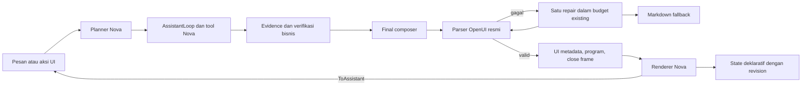

# Studio Intelligent UI

Studio dapat menjawab dengan Markdown dan antarmuka yang bisa dipakai langsung.
Planner memilih `text` untuk jawaban sederhana dan `interactive` ketika input,
filter, diagram, peta, atau simulasi membantu. Pilihan ini hanya mengubah
presentasi; izin agent dan daftar tool tetap ditentukan oleh jalur Nova yang ada.

Renderer memakai `@openuidev/react-lang` dan `@openuidev/lang-core` **1.0.0**.
Katalog Nova berisi 56 komponen, 59 fungsi tambahan, fungsi bawaan SDK, dan
`Evidence(id)` untuk hasil terverifikasi. Komponen mencakup form, tabel, enam
jenis chart, SVG, matematika, flashcard, timer, media publik, dan HTML/canvas.
Program contoh tidak disalin: implementasi menggunakan komponen serta token Nova.
Repo referensi pada commit `d789417ddf87699681b49f2675f7bceba42fdd65` tidak
menyertakan LICENSE. Lisensi MIT dependency dalam bundle tersimpan di
[NOTICE.txt](../backend/app/modules/assistant/ui_runtime/NOTICE.txt).

## Jalur turn



Direct Studio dan final root Smart menggunakan final composer milik
`AssistantLoop`. Specialist tetap mengirim evidence. Prompt katalog dimasukkan
hanya ketika planner memilih UI dan budget konteks mencukupi. Composer tidak
menjalankan tool. Angka dalam Markdown diperiksa terpisah dari program berpagar
`openui`; program baru diterbitkan setelah validasi. Repair UI dibatasi satu kali.
Jawaban interaktif wajib memiliki fallback Markdown yang tidak kosong.

Tabel, chart, dan KPI bisnis mengambil data melalui `Evidence` dengan identitas
hasil tool yang tepat. Filter, sort, pivot, dan agregasi lokal hanya mencakup
baris hasil tersebut; preview dibatasi 200 baris dan 50 kolom. State tidak boleh
menambah atau mengganti baris bisnis. Input dan perhitungan simulasi ditandai
sebagai asumsi. Teks yang memuat angka, termasuk cabang tersembunyi, ikut melewati
verifikasi angka existing.

Fungsi pengolahan data menerima nilai desimal yang diserialisasikan sebagai
string oleh jalur hasil Nova. Perhitungan lokal menolak integer yang melewati
presisi aman JavaScript, nilai non-finite, dan underflow; minta agent menghitung
nilai tersebut melalui jalur data Nova.

Ordered content menggunakan `ui` untuk metadata, `ui_delta` untuk potongan
program yang sudah valid, lalu `content_block_done`. Identitas blok, sequence,
journal, dan replay menggunakan kontrak streaming existing. Renderer menjalankan
program hanya setelah close frame. Cancel, role change, dan perpindahan chat
membersihkan runtime lokal. Observability membuka preview tanpa aksi atau script.
Riwayat tanpa blok UI tetap menggunakan renderer tabel/chart/Markdown existing.

## State dan aksi

Program, versi katalog, bindings, provenance, dan fallback tersimpan dalam trace
pesan. State mutable berada di tabel flat
`NOVA_SYSTEM.CONFIG_ASSISTANT_UI_STATE`, dimiliki `AssistantRepository`.
Bootstrap, owning schema initializer, dan
[migrasi additive](../backend/migrations/20261013_studio_intelligent_ui.sql)
membuat tabel untuk instalasi baru maupun existing. Feedback tidak menulis row
state ini; menghapus thread juga menghapus state miliknya.

Endpoint berada di bawah `/api/v1/agents`:

```text
GET /{agent_id}/threads/{thread_id}/messages/{message_id}/ui-state/{content_id}
PUT /{agent_id}/threads/{thread_id}/messages/{message_id}/ui-state/{content_id}
```

PUT membawa `revision`, `program_sha256`, dan `state`. Server memeriksa pemilik
thread/pesan, principal, satu active role, security-context version, katalog,
identitas blok, hash program, deklarasi, tipe, dan batas state. Session id tidak
menjadi kunci state sehingga perangkat lain dengan konteks keamanan yang sama
dapat memuatnya. Redis metadata lock menserialisasikan penulisan; revision lama
menghasilkan HTTP 409. Renderer menawarkan **Reload saved state**, tanpa menimpa
perubahan perangkat lain secara diam-diam.

Autosave menunggu 400 ms. Mengirim aksi atau memilih chat/agent/view menunggu
flush. Status loading, saving, saved, retry, dan konflik terlihat dalam blok.
State maksimal 16 KiB, 64 variabel, kedalaman enam, daftar 100 item, dan string
4.000 karakter. Server menolak field hasil query, evidence, kredensial, dan
prototype. State tidak menyimpan hasil query atau objek runtime. Timer menyimpan
sisa detik; berjalan/pause, kamera peta, dan runtime canvas hanya berlaku lokal.

`@ToAssistant` mengirim turn baru melalui send existing dengan `ui_action`
opsional: `message_id`, `content_id`, `program_sha256`, `action_id`,
`operation_id`, dan state form. Server hanya menerima aksi assistant yang ada
pada blok asal; state tetap input pengguna yang tidak tepercaya. Operation id
mencegah pengiriman ulang aksi yang sama. Tool registry, pemeriksaan akses, dan
consent Nova tetap menentukan pembacaan atau mutasi. UI tidak memiliki endpoint
SQL atau jalur mutasi langsung. Audit mencatat identitas aksi/refusal tanpa isi form.
Gabungan pesan dan input form dibatasi 32.000 karakter; server menolak input
yang melebihi batas sebelum menerima operation id, tanpa memotong nilai form.

Shared conversations menghapus program, bindings, dan state UI pemilik dari
projection. Markdown sebelum aksi form tetap dapat dibaca. Mulai pesan yang
membawa input form privat, projection menyembunyikan teks dan trace lanjutan
agar state tidak bocor lewat salinan teks atau rencana query. Hasil semantic yang
aman tetap di-refresh menggunakan akses penerima melalui jalur existing.

## Runtime dan build

Backend web dan worker membutuhkan **Node 22** selain Python. Dockerfile
menyalin binary Node 22.22.3. Bundle validator tidak membutuhkan `node_modules`
di backend. Dari `frontend/`, dengan Node/pnpm versi CI:

```bash
pnpm install --frozen-lockfile
pnpm ui:bundle
pnpm ui:check
```

`ui:bundle` menghasilkan `validator.cjs`, `catalog.json`, dan NOTICE dari
katalog, fungsi, validator, dan kebijakan HTML yang dipakai frontend. `ui:check`
memeriksa drift bundle, schema, prompt, digest, dan lisensi; CI menjalankannya.
Ubah versi katalog ketika kontrak program berubah pada release berikutnya.
Blok dengan versi yang tidak dikenal menampilkan Markdown fallback.

Helper menerima JSON melalui stdin, menggunakan parser resmi, dan tidak
menjalankan script HTML, tool, atau request jaringan. Batasnya: program 64.000
byte, input 512.000 byte, output 128.000 byte, heap Node 64 MiB, empat proses
bersamaan, dan waktu keseluruhan lima detik. Proses dihentikan saat timeout atau
cancel. Telemetry helper dinonaktifkan; renderer tidak mempublikasikan state ke
SDK observability global.

`STUDIO_INTELLIGENT_UI_ENABLED=true` mengaktifkan fitur. Set `false` pada web
serta worker untuk menonaktifkannya; jawaban dan riwayat memakai Markdown.
Runtime hilang, katalog tidak cocok, budget konteks sempit, atau program gagal
validasi juga memakai jalur fallback. Tidak ada provider atau penyimpanan
credential tambahan.

## Media publik dan HTML

Adapter FastAPI menerima parameter yang sama persis dengan deklarasi statis
program asal. Evidence bisnis, state form, serta turn dengan input form atau
attachment tidak boleh menjadi sumber media, link, atau HTML. Host adapter
hanya `commons.wikimedia.org` dan `router.project-osrm.org`, HTTPS tanpa
redirect, maksimal delapan detik keseluruhan dan 256.000 byte JSON. Cache publik
berada di Redis dengan TTL satu jam.

Markdown Studio, termasuk fallback saat program gagal atau fitur dinonaktifkan,
menampilkan alt/label sebagai teks tanpa memuat gambar atau membuka link keluar.
Media/link publik memakai komponen katalog yang sudah divalidasi; code action
existing tetap mengikuti konteks eksekusi Nova.

Browser menampilkan gambar dari `upload.wikimedia.org` atau thumbnail resmi
`thumb.wikimedia.org`, beserta tautan sumber Wikimedia untuk atribusi/lisensi.
Host thumbnail mengikuti [perubahan domain Wikimedia](https://www.mediawiki.org/wiki/Snippets/Direct_imagelinks_to_Commons).
MapLibre memuat style, tile, sprite, dan font
publik OpenFreeMap dari `tiles.openfreemap.org`. Rute memakai OSRM dengan batas
25 tempat dan 5.000 koordinat. Browser hanya mengirim permintaan basemap/media
publik; Nova tidak mengirim hasil bisnis atau isi form ke layanan tersebut.
YouTube berupa tautan eksplisit. Jika layanan gagal, deskripsi atau daftar
lokasi tetap tersedia. Deployment perlu mengizinkan egress publik tersebut jika
media ingin digunakan.

Build memakai source modular MapLibre dari dependency terkunci agar chunk bisa
dipecah. Transform khusus menghapus deklarasi field TypeScript tanpa initializer;
field typed-array MapLibre harus mempertahankan nilai yang dibuat constructor
induk. Urutan eksekusi modul dijaga melalui `strictExecutionOrder`. Entry worker
dan stylesheet tetap memakai distribusi paket yang sama. Acceptance produksi
menguji peta dan marker sesudah pemecahan bundle. Distribusi frontend menyertakan
notice BSD MapLibre pada `public/licenses/maplibre-gl.txt`.

`HtmlView` memakai iframe sandbox dengan origin opaque, script inline saja, CSP
`default-src 'none'`, `connect-src 'none'`, `frame-src 'none'`, dan
`form-action 'none'`. Validator Acorn menolak akses parent, jaringan, storage,
constructor/prototype, navigasi, introspeksi Object, serta nama properti dinamis.
Kebijakan juga menolak atribut jaringan/event inline dan animasi SVG yang dapat
mengubah target link. Script tidak berjalan pada preview read-only atau blok
belum selesai. HTML menerima token CSS Nova; canvas harus memakai warna dari
token agar tetap terlihat pada kedua tema. Runtime canvas tidak di-autosave.

## Pemeriksaan

Frontend lint menolak warning (`--max-warnings 0`); output coverage yang dihasilkan
bukan source lint. Pytest memperlakukan warning sebagai error. TestClient memakai
`httpx2` pada dependency group test, sesuai versi Starlette yang terkunci;
StatsForecast memakai rilis yang memperbaiki escape sequence pada docstring.
SciPy minimal 1.17.1 menghindari kegagalan loader extension PROPACK lama yang
ditemukan pada runtime macOS; lockfile yang sama diperiksa pada Linux dan macOS.

Dari `frontend/`:

```bash
pnpm exec playwright install --with-deps chromium
pnpm lint
pnpm build
pnpm test:coverage
pnpm ui:check
pnpm ui:verify
```

`ui:verify` membangun fixture production lalu menjalankan click-through Chromium
pada 1440, 768, dan 320 px, light/dark, serta reflow 200%. Pemeriksaan mencakup
renderer, welcome screen, dan transcript Studio asli. Reflow halaman Studio
menggunakan lebar CSS separuh viewport dan DPR 2; pemeriksaan keyboard ponsel
mengurangi tinggi viewport saat field mendapat fokus. API state/media
fixture dibatasi pada data uji. Peta menggunakan tile OpenFreeMap sungguhan.
Report mencakup kalkulator, slider/checklist, form required, filter chart,
flashcard, countdown/reset timer, canvas dan isolasi parent, autosave, keyboard,
kontras teks/kontrol, serta overflow. Screenshot dan JSON tersimpan di
`/tmp/nova-intelligent-ui-browser-qa`, atau lokasi `NOVA_UI_QA_OUTPUT`.
Fixture ini bukan bukti API atau policy engine; tes backend dan seeded engine
menguji batas tersebut.

Dari `backend/`, gunakan setup stack dan perintah CI existing:

```bash
uv run pytest tests/unit --cov=app --cov-branch --cov-report=term-missing
uv run pytest tests/eval
uv run python -m tests.eval.report
uv run pytest tests/benchmark/test_assistant_loop.py tests/benchmark/test_assistant_engine.py tests/benchmark/test_intelligent_ui.py -s
uv run pytest tests/integration -m engine -v -rs
```

[Tes persistence engine](../backend/tests/integration/test_intelligent_ui_persistence.py)
menguji migrasi idempotent, cross-device revision, penolakan lintas pemilik/role,
feedback, operation dedup, dan journal replay pada StarRocks/Redis.
[Trajectory UI](../backend/tests/eval/test_intelligent_ui_trajectory.py)
menguji direct/Smart root, specialist/text, dan repair/fallback. Jalankan juga
acceptance patched-FE Ranger untuk caller, role, filter, mask, proxy, dan tool
agent; stack stock tidak menggantikannya. Hasil delivery dicatat di
[laporan acceptance](reports/studio-intelligent-ui-20261013.md).
Perbaikan warning dan regresi berikutnya dicatat di
[laporan 14 Oktober](reports/studio-intelligent-ui-warning-cleanup-20261014.md).
